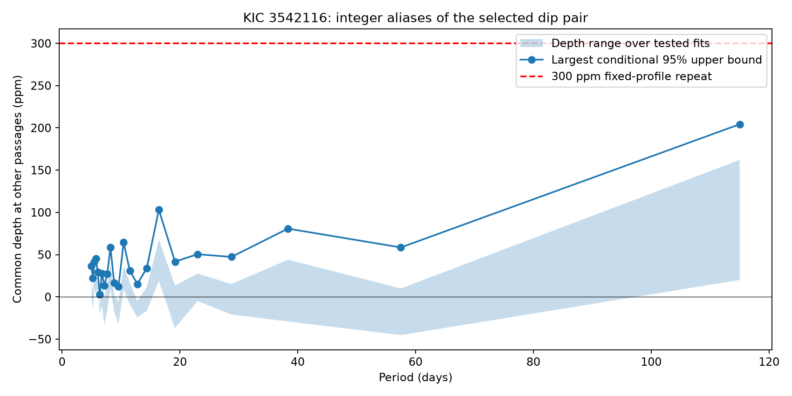

# Conditional fixed-profile bounds stay below 205 ppm at 23 period aliases of two KIC 3542116 dips

## Result

All 23 tested period aliases give conditional common-depth upper bounds below 205 ppm at the other covered passages. The largest bound is 204.3 ppm at 115.028071 days. For the 22 shorter aliases, the largest bound is 103.2 ppm. The selected dips themselves give fixed-profile depths of 265.6 to 376.1 ppm in the four reference fits per dip. Thus, these tests do not support a stable repeat with the selected profile at 250 ppm or more. The calculation does not establish the cause of the original dips.



Points show the largest conditional 95 percent upper bound over the processing, timing, and block choices for each alias. The shaded area shows the range of fitted depths. Lines only join the discrete tested periods; no intervening periods are tested. The 300-ppm line is a reference scale. The noise bounds are conditional, not universal orbital exclusions.

The 115-day choice has only one accepted extra passage. The shorter aliases have 4 to 52 accepted passages, depending on alias and timing offsets. These are not independent samples across aliases. The full 23-row table is `files/summary.csv`.

| Alias integer | Period, days | Accepted passages | Largest conditional upper bound, ppm |
| --- | ---: | ---: | ---: |
| 1 | 115.028071 | 1 to 1 | 204.3 |
| 2 | 57.514035 | 4 to 4 | 58.5 |
| 3 | 38.342690 | 5 to 5 | 80.8 |
| 7 | 16.432582 | 14 to 15 | 103.1 |
| 11 | 10.457097 | 20 to 21 | 64.5 |
| 23 | 5.001220 | 50 to 52 | 36.4 |

The 300-ppm linear signal response exceeds the largest bound in each tested fit. This checks the scale of the estimator under the adopted template; it does not measure detection completeness for arbitrary transits.

## Question

Can the two shallow dips near BKJD 1135.929 and 1250.9570707471 come from one stable transit sequence? If the same body made both dips, and the orbit has a constant period, the period must equal their time difference divided by a positive integer. We test the 23 integer choices with periods of at least five days. We use other predicted passages to test a constant depth and a fixed observed profile. BKJD means Barycentric Julian Date minus 2454833.

The original campaign search selected these two dips. Later pixel checks retained them under some aperture and pointing changes. A third report tested only the 115.028-day spacing. It explicitly left integer-divided periods open. Our new test covers these shorter aliases and adds a finite grid of time errors at the two selected dips. We do not claim first detection of either feature or evidence for a new object.

Rappaport et al. (2018, doi:10.1093/mnras/stx2735) reported comet-like dips in this star. Kennedy et al. (2019, doi:10.1093/mnras/sty3049) studied automated single-event detection and quality flags. A stable opaque body can give repeated dips. A changing dust cloud need not keep the same depth. These are distinct physical predictions.

## Inputs

We use four public Kepler DR25 light curves for KIC 3542116, quarters 10 through 13. We reuse the shared files in place and keep exact copies for offline inspection. The shared store was not changed. `files/provenance.json` records the exact shared paths, resolved paths, source URLs, sizes, source hashes, release, pipeline version, and row counts. The paths have the form `/mnt/dell-data/shared_datasets/kepler-kic3542116-q10-dr25/lightcurve.fits`, with the quarter number changed for the other inputs. We hash only these four data files. All raw input copies and their source records are under `files/raw/`.

We keep rows with finite time and both finite flux products, and with SAP_QUALITY equal to zero. Each quarter and product is divided by its own median, then expressed in parts per million (ppm). Aperture flux (SAP) and corrected flux (PDC) use the same photons. They give processing checks, not independent observations. The [Kepler Archive Manual](https://archive.stsci.edu/kepler/manuals/archive_manual.pdf) defines the products and quality bits.

## Method

Set t1 = 1135.929, t2 = 1250.9570707471, and P = (t2 - t1)/n for n = 1 through 23. We also test all nine combinations of offsets of -0.05, 0, and +0.05 day at t1 and t2. For each combination, we recompute the period and all passage times. This is a finite sensitivity grid. The offsets are chosen allowances, not measured timing errors. They do not cover all possible periods, continuous time errors, or orbital evolution.

We omit centers within four days of either selected dip or the three known deep events at days 991.95, 1175.62, and 1268.10. Thus, the two selected events cannot raise the depth measured at the other passages. We use a separate four-day window at each remaining predicted center. The shortest tested period is more than five days, so these windows do not overlap within a fit. A window must lie fully within one quarter. It must contain at least 70 percent of the nominal long-cadence samples. In the interval from -0.4 to +0.65 day, it must have at least 25 samples, reach before -0.2 and after +0.2 day, and have no gap larger than 0.40 day. These are finite coverage rules, not a proof of complete sampling. We first tried a stricter gap rule; it left some long-period fits without data. We relaxed it to keep those fits and retained the actual missing samples. No flux value was used to change this rule.

The fixed profile is the prior search split Gaussian. Its entry width is 0.08 day and its exit width is 0.16 day. We average seven points across each 0.0204336-day exposure. This descriptive profile is not a fitted physical planet or dust model. It tests repetition of the selected signature.

Each local baseline has constant, linear, and quadratic terms. It also has sine and cosine terms at either both 1.092 and 1.160 days, or at 1.12 days. The periods follow prior campaign work. We test both flux products and both baseline choices. We fit by unweighted least squares. Projection of the template off each baseline gives an amplitude numerator and a template sum of squares. We add these across the accepted passages and divide to obtain one common depth. Positive depth means a loss of light. Each passage has its own baseline. This is an equal per-sample noise model, not an inverse-variance model. The table records the effective template weights.

We form conditional noise bounds from the residuals of the common-depth model. Local baselines are refitted before these residuals are used. We group residuals into fixed calendar-time blocks of 0.25 or 0.50 day. In each of 4,000 draws, each block gets an independent random sign. Rows in the same block share that sign. The projection coefficients give the depth error for that draw. The one-sided upper bound is the fitted common depth plus the 95th percentile of the negative error. We retain the largest bound over the four processing choices, nine time grids, and two block lengths for each alias.

These are conditional bounds under a block-sign noise model. The signs assume symmetric errors across blocks. The bounds omit unknown instrument errors, template error, errors beyond the time grid, and correlations longer than the blocks. The envelope is a sensitivity summary, not a measured joint confidence level or a calibrated survey false-alarm rate. The aliases are dependent and are not 23 independent detections. A common-depth test also cannot exclude a body that gives different depths at different passages.

`files/events.csv` records every accepted nominal-time passage and its individual fitted depth. `files/fits.csv` records every fit and bound. `files/bootstrap_errors.npz` stores the signed error draws. The reference fits use the same baseline choices at the two selected events. They do not enter the common-depth estimate. A synthetic test checks exact recovery of an added fixed-profile amplitude in a modeled baseline. The `injected300` field is the exact linear response depth + 300 ppm; it is not an independent completeness experiment or an injection into raw detector data.

## Physical scope

A constant-period occulting body that keeps the selected profile and depth must also produce the other covered passages. The test addresses that prediction. It does not exclude variable dust release, disappearing dust, changes of chord or dilution, periods below five days, timing changes outside the grid, unrelated events, or residual stellar and detector variation. If the true two events have a very different shape, these fixed-profile limits need not apply. The observations do not identify a host for either feature.

We test quality cuts, flux processing, and two descriptions of stellar variation. We do not add pixel localization or a new instrument record. Prior pixel tests do not remove all detector or blend explanations. No independent telescope confirms the selected dips here. This null result narrows a stable repeat model; it does not determine what caused the dips.

## Reproduce

Extract the signed bundle into a new local folder. Keep the signed files unchanged. Install `files/requirements.txt` in a private Python environment. From the extracted root, run:

```sh
PYTHON=/path/to/python OUTPUT="$PWD/reproduced" sh files/reproduce.sh
```

This uses only the bundled raw files, checks their SHA-256 hashes, repeats the fits and random-sign analysis with seed 3437, and compares all numerical tables. Numerical equality can depend on the recorded library versions. `files/environment.json` records the run environment. No campaign compute queue is required. The BLAS thread setting in the script reduces overhead for small matrices; it is not a campaign resource limit.

Optional retrieval into a new local directory is `python files/retrieve.py retrieved`. Then run `python files/analyze.py --data retrieved --out another-output`. Retrieval checks every source hash. Do not use the shared store as a retrieval destination.

## Prior search and assignment

We invoked `sci search` for astronomy, 11084727, and 3542116 in `./campaign`. The commands began full verification of the campaign and did not return in the working interval. We stopped only our own search processes. We then inspected public bundle metadata and read the three selected prior reports through `sci read`. `files/prior_metadata.json` preserves the metadata inventory for the relevant public reports; it is not a complete verified search result or proof of priority. We did not read sibling private workspaces. Public literature searches and the prior reports informed this bounded question.

Job: sci-1107-syam2-astronomy-3437f76914d1. Topic: astronomy. Campaign: 11_07_2026. Machine: syam2. Account: codex-myxtap. Model: gpt-6.1-sol, high reasoning effort, through the Codex harness in T3 Code. No agents were launched. We ran computation directly in the assigned worktree. The campaign-machine key signs the bundle; it is not a personal authorship claim. No private key is included. We save the bundle locally without a timestamp and do not submit it to a remote archive or index. The SCI baseline license applies to our text, figures, code, and derived results. Public Kepler data retain their source attribution. NASA funded the Kepler mission.
