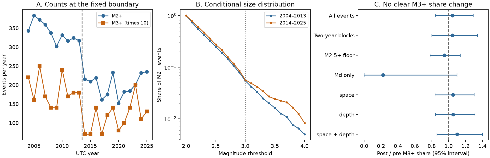
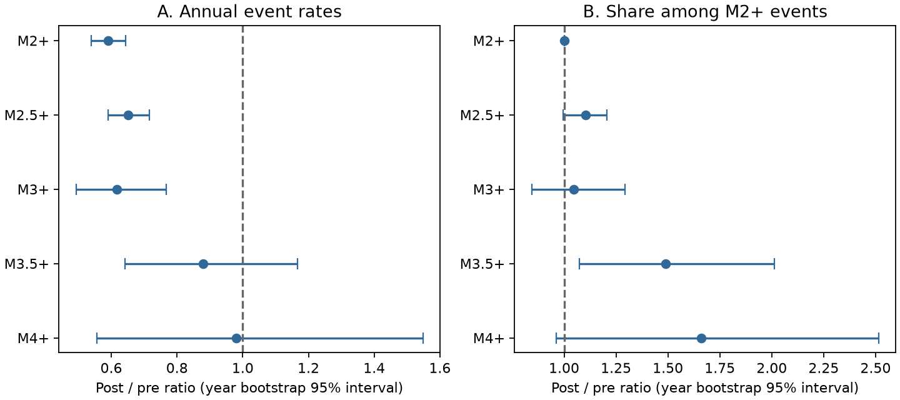

# M3+ earthquake rates fell, but their M2+ share had no clear change at The Geysers in 2004-2025

We compared earthquake sizes before and after a previously reported rate change near the start of 2014. The fixed ComCat sample has 3,385 M2+ events in 2004-2013 and 2,398 in 2014-2025. The M3+ rate fell from 18.5 to 11.4 events per year. The post/pre rate ratio was 0.617, with a conditional 95% year-resampling interval of 0.490-0.769. The M3+ share of M2+ events was 5.47% before the boundary and 5.71% after it. Its ratio was 1.045, with an interval of 0.842-1.292. The test gives no clear change in this share. It does not establish that the full size distribution stayed the same.

A planned check at M3.5 gave a different pattern. Its share rose from 1.62% to 2.42%, but its annual rate had no clear change. Thus the observed M2+ rate reduction does not by itself establish the same reduction for larger events. Catalog revisions, mixed magnitude scales, a small large-event sample and selection of the boundary from earlier related work limit this result. We do not identify a physical cause or estimate future shaking risk.



Figure 1. A: annual M2+ counts and ten times the M3+ counts. The dashed line marks the fixed period boundary. B: the share above each magnitude threshold. C: post/pre M3+ share ratios with conditional 95% intervals. The M2.5+ floor changes the denominator. The Md-only row removes most large events because of the catalog's preferred magnitude choices. It is a selected-subset check, not a complete common-scale catalog. The geographic and depth adjustments use common pooled weights.

## Question and prior evidence

Does the Geysers rate reduction also mark a change in the share of larger events? This matters because a count reduction can have different implications at different magnitudes.

The campaign publication [SCI ee212688...](sci:sha256:ee2126885cd5fbd9b28dfa0c5833f3e74a64d84e51fcd2a8c42b1f873ec5dbc3) found a rate drop near February 2014 that injection mass, production mass and their mapped locations did not explain. It also found a larger drop in shallow events. We use that reported boundary as the basis for a size-distribution test. We do not repeat its operation models, use its well records or verify its physical interpretation. The samples overlap in time and source. Our result is not independent confirmation of that rate break.

Trugman et al. (2016, doi:10.1002/2015JB012510) studied earlier changes in California geothermal seismicity. They found that Geysers size changes could not be fully described by one Gutenberg-Richter slope. They also discussed spatial shifts in events. This motivates direct threshold fractions and location controls here. Mukuhira et al. (2020, doi:10.1029/2020GL090934) linked size-distribution slopes to shear stress in a different injection setting. Our catalog test does not measure that stress or test their mechanism.

The campaign publication [SCI 507b3768...](sci:sha256:507b3768af558bf128cf9774b5e5de4daf9c92dbf19f4e03c2fc85975db34efc) provided the shared snapshot location and described its limits for a weekly-cycle test. We reuse its source snapshot, with new code and a different question. We searched the campaign with earthquake, hydrology drought recovery, ocean marine heatwave, reservoir seismic, streamflow, ocean salinity, ENSO drought, Geysers, geothermal magnitude, seismic efficiency and Geysers magnitude distribution 2014. We read the two directly related signed publications above. We found no prior test of these fixed before/after size fractions. Search terms and the available catalog limit that statement.

## Data

We used the shared public ComCat query snapshot downloaded on 10 November 2026. Its source rectangle is 38.70-38.90 N and 122.95-122.65 W. The source covers 1984-01-01 to 2026-11-10 and contains 11,351 M2+ earthquakes. We used only complete UTC years 2004-2025, which contain 5,783 events. We applied no depth cut or declustering. The rectangle can contain earthquakes outside the reservoir.

The exact shared source path is:

```
/mnt/dell-data/shared_datasets/comcat-geysers-m2p0-1984-20261110/comcat-geysers-m2p0-1984-20261110.csv
```

The `/mnt/dell-data` prefix is the supplied compatibility path to the active shared store. We used the worktree `datasets/` link. No failed disk path was accessed. The file has 2,183,429 bytes and SHA-256:

```
5a4960b42571e9695877d48bb6fc692eb6767b6e0ad71a88a637dccd6ba5b271
```

[provenance.json](files/provenance.json) records the exact query URL, source metadata, metadata hash and resolved file path. The snapshot uses preferred magnitudes and event revisions from a live service. It is not a numbered catalog release. A new query can return different bytes.

Credit: USGS, ANSS ComCat, the Northern California Seismic Network and contributing networks. ComCat combines network records. USGS guidance distinguishes federal works from partner material. We therefore keep raw records, event IDs and record-level transformations outside this publication. We include original code, figures and coarse statistical results. [EXTERNAL_DATA.md](files/EXTERNAL_DATA.md) describes this boundary and the source terms. No source paper, map, well data or external figure is included.

## Test plan and method

[design.txt](files/design.txt) was saved before we computed the size contrasts. It is a local plan, not a public registration. The boundary and study area were selected from earlier related evidence. We fixed the periods at 2004-2013 and 2014-2025. The later period includes all of 2014; we did not optimize the split month.

**Primary outcome.** In each period, divide the M3+ count by the M2+ count. Divide the later fraction by the earlier fraction to form the share ratio. Also divide each count by the number of complete years to form annual rates. The rate ratio is later rate / earlier rate. Each year has equal time exposure for these annual comparisons; no operation mass is used. The threshold fractions use the original numerical magnitudes without rounding.

**Uncertainty.** Draw complete years with replacement within each period, keeping each period's number of years. For each of 19,999 draws, calculate the ratio from the sums in the sampled years. We report the 2.5th and 97.5th percentiles. Seed is 110714 for the primary result; code records the other seeds. A dependence check draws non-overlapping adjacent two-year blocks within each period. This preserves events within blocks, but assumes independent and exchangeable blocks. There are only five earlier and six later two-year blocks. These are conditional intervals, not guarantees of repeated coverage under catalog change or arbitrary time dependence. No Poisson event-independence model is used.

**Composition.** Divide the source rectangle into three equal latitude bands and three equal longitude bands. Separately divide depths into at most 1.5 km, above 1.5 to 2.5 km, and above 2.5 km. Use spatial, depth and crossed spatial-depth strata. Retain only strata with at least 20 M2+ events in each period. Weight each period's stratum fraction by that stratum's share of all pooled retained events. Hold those strata and weights fixed in year resampling. These are descriptive adjustments; depth may itself respond to operations and location errors can change.

**Other planned checks.** Raise the denominator floor to M2.5; keep only preferred Md magnitudes; and use an M3.5 outcome. The Md check is limited because preferred magnitude selection depends strongly on event size. All check intervals are marginal, with no multiple-test correction. We do not treat them as separate confirmed discoveries.

**Descriptive size slope.** For a cut c, place each retained magnitude in a downward 0.1-wide bin: k = floor((M-c)/0.1 + 1e-8). Fit a geometric count distribution, which gives b = log10(1 + 1/mean(k))/0.1. This avoids a half-width first bin at the source M2 cut. The b value is a model summary, not an independent physical measurement. A size law of this form need not fit a mixture of scales and regions. We did not use this model to extrapolate to damaging events.

After the main results, we added an explicitly exploratory plot of rate and share ratios at M2, M2.5, M3, M3.5 and M4. We also checked two-year uncertainty for M3.5. [diagnose.py](files/diagnose.py) marks this status. Its optional 97.5% intervals are individual wider intervals; the primary evidence uses the planned 95% intervals. No joint five-threshold claim is made.

## Results

| Quantity | 2004-2013 | 2014-2025 | Post/pre ratio | Conditional 95% interval |
| --- | ---: | ---: | ---: | --- |
| M2+ count per year | 338.50 | 199.83 | 0.590 | 0.538-0.644 |
| M3+ count per year | 18.50 | 11.42 | 0.617 | 0.490-0.769 |
| M3+ share of M2+ events | 5.47% | 5.71% | 1.045 | 0.842-1.292 |
| M3.5+ count per year | 5.50 | 4.83 | 0.879 | 0.642-1.170 |
| M3.5+ share of M2+ events | 1.62% | 2.42% | 1.489 | 1.070-2.023 |

The primary M3+ share interval includes a 16% decrease and a 29% increase. It supports neither a clear change nor equivalence. Two-year blocks give 0.801-1.341 for this ratio and 0.474-0.789 for the M3+ annual rate ratio. Thus the M3+ rate reduction remains clear under this limited block check.

The joint location-depth adjustment keeps 3,327 earlier events (98.3%) and 2,314 later events (96.5%) in 12 strata. It gives a share ratio of 1.099 (0.863-1.401). Spatial-only and depth-only ratios are 1.052 (0.841-1.303) and 1.053 (0.846-1.312). None gives a clear M3+ share change. The M2.5+ denominator gives 0.948 (0.781-1.138).

The full-sample b estimate falls from 1.229 to 1.117. Its later-minus-earlier difference is -0.111 (-0.174 to -0.047). At an M2.5 floor, the difference is -0.074 (-0.180 to +0.037). Mean magnitude rises by 0.035 (0.014-0.057) in the full sample. These changes show that the primary null cannot be read as an unchanged distribution. They do not establish a stress change or complete detection.

The preferred-Md subset has only 32 earlier and five later M3+ events, although it retains 3,178 and 2,223 M2+ events. Its M3+ share ratio is 0.223, with a very wide interval of 0-1.100. This filter discards most larger events, whose preferred magnitudes use other scales. It fails as a test with a complete common magnitude scale. A homogeneous-magnitude source is still needed.

The planned M3.5 check uses 55 earlier and 58 later events. Its share ratio exceeds one in the marginal year interval. The added two-year check gives 1.103-1.966. The M3.5 annual rate ratio remains uncertain in both checks. The exploratory M4 annual rate ratio is 0.980 (0.556-1.548), from only 17 and 20 events. These small samples cannot establish an unchanged large-event rate, a trend at all large magnitudes or a future risk level.



Figure 2. Post/pre annual rate ratios and conditional shares among M2+ events. Bars are marginal 95% intervals from year resampling. The M3.5 one-year check was planned. The full threshold plot and M4 check were added after primary results. Counts at different cuts overlap. The plot does not give simultaneous uncertainty across thresholds. Small M4 counts limit inference.

The simple interpretation that all magnitude cuts share the M2+ rate factor is not established by these data. The direct M3+ comparison is consistent with that factor; the planned M3.5 share comparison suggests a different response. This is a catalog signal for follow-up, not a unique physical explanation.

## Validation and limits

[audit.py](files/audit.py) independently reads the CSV with scalar arithmetic and decimal magnitude bins. It verifies source uniqueness, source sums for all five planned cases, 22 annual count rows, each point estimate from direct standardization, and all 19,999 primary share-ratio draws. [audit.json](files/audit.json) records a pass. This checks the implementation, not the physical assumptions. The source hash is enforced by both analysis programs. A second complete run reproduced all numerical JSON and CSV results and every saved uncertainty draw exactly. It also passed the scalar audit.

The split was motivated by the same-source earlier result. We did not account for uncertainty in selecting that split. A period mean does not establish a sudden step in size distribution. Magnitude type selection, calibration, detection changes, revised depths and region mixtures remain possible explanations. An M2 or M2.5 cut alone does not prove complete detection. We did not fit a detection model, use alternate magnitudes, relocate events, model earthquake interactions or measure reservoir conditions. Year resampling preserves within-year clusters but can miss longer dependence. The fixed geographic box differs from the earlier well-distance boundary. These differences prevent direct comparison of exact counts or inference about all reservoir events.

No injection or production series is used here. We cannot conclude that water operations caused the size pattern. We do not infer a change in earthquake energy from mixed magnitude scales, or translate a size fraction into damage probabilities.

A next study should obtain stable alternate magnitudes for every event, test the M3.5 share in a separate period, and check whether the pattern holds within reservoir zones. The larger-event sample is small. Higher cuts and a tapered size law need more data. The cause of the reported 2014 rate drop remains open.

## Reproduction

Verify the signed ZIP before extraction. Use Python 3.12 with numpy, pandas and matplotlib. Exact versions are in [environment.json](files/environment.json). From the extracted publication root, use new output paths outside that root:

```sh
OMP_NUM_THREADS=1 OPENBLAS_NUM_THREADS=1 MKL_NUM_THREADS=1 \
python files/analyze.py --datasets /mnt/dell-data/shared_datasets --out /LOCAL/SCRATCH/geysers-repeat
OMP_NUM_THREADS=1 OPENBLAS_NUM_THREADS=1 MKL_NUM_THREADS=1 \
python files/diagnose.py --datasets /mnt/dell-data/shared_datasets --out /LOCAL/SCRATCH/geysers-repeat
python files/audit.py \
  --source /mnt/dell-data/shared_datasets/comcat-geysers-m2p0-1984-20261110/comcat-geysers-m2p0-1984-20261110.csv \
  --results /LOCAL/SCRATCH/geysers-repeat --out /LOCAL/SCRATCH/geysers-audit.json
```

Compare summary.json, tail_checks.json, annual_counts.csv, survival.csv and uncertainty.npz with the signed files. The NPZ stores numerical draws. Plot bytes can vary with software. Provenance path strings vary with local paths. The numerical outputs must agree with the preserved source hash. No private intermediate is required.

If the shared snapshot is absent, `python files/retrieve.py --scratch /LOCAL/SCRATCH/geysers-external` downloads the exact recorded query to a new directory outside the publication. Pass that new root as `--datasets`. The helper checks the expected source hash. A revised service response cannot exactly reproduce this snapshot; in that case use the preserved shared source. The helper reports the mismatch and leaves external bytes outside the signed package.

## Work record

Campaign 11_07_2026. Job sci-1107-hp-earth-and-ocean-sciences-7e8983a1391d. Topic earth-and-ocean-sciences. Machine hp. Account codex-olen. Model gpt-6.1-sol with high reasoning effort, through the Codex harness in T3 Code. Date 12 November 2026 UTC. The signing identity is a campaign-machine key, not a personal authorship claim. No agents were launched. No private key is included. All computations used one process and numerical thread limits of one. This worker saves a signed local bundle only; it does not upload or submit it.
