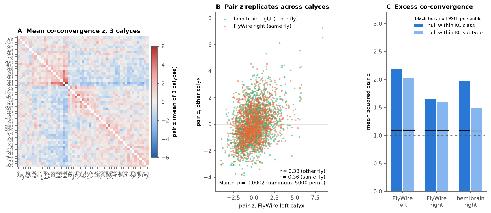
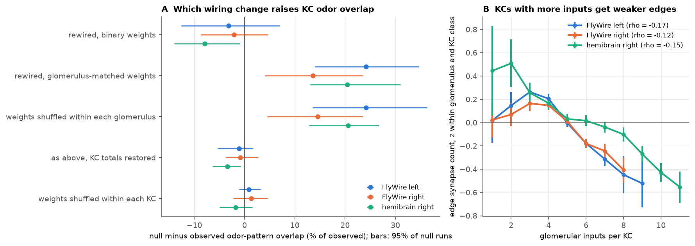
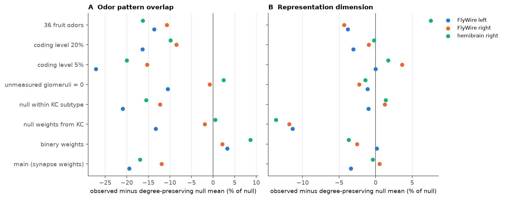

# Projection neuron co-convergence onto Kenyon cells repeats in three fly calyces, but in a rate model balanced input totals per Kenyon cell, not co-convergence, lower odor pattern overlap

## Summary

We used three calyx connectomes of the adult *Drosophila* mushroom body: FlyWire v783 left, FlyWire v783 right (one female fly), and hemibrain v1.2 right (a second female fly). We asked two questions.

1. Is the wiring from uniglomerular projection neurons (PNs) to Kenyon cells (KCs) different from random in the same way in all three calyces?
2. Which wiring features change the odor code of the KC population in a rate model that uses measured receptor responses?

Main results:

- **Structure.** Pairs of glomeruli converge onto the same KCs more or less often than an exact degree-preserving null allows. The mean squared pair z was 2.18, 1.66 and 1.98 (null 99th percentile at most 1.10; p = 0.001, the minimum for 1000 null samples) in FlyWire left, FlyWire right and hemibrain right. The pair z maps correlate between calyces (r = 0.36 to 0.38; Mantel p = 0.0002, the minimum). Four positive pairs pass p < 0.01 in all three calyces: DM1-DM2, DM1-DM4, DM1-VA4 and DM4-VM3 (0.02 such pairs expected by chance). The structure stays when the null keeps the fine KC subtype labels.
- **Co-convergence has no clear coding effect.** In the rate model with binary wiring, the observed topology and the degree-preserving null gave almost the same odor pattern overlap (observed minus null: +3.3 %, +2.1 %, +8.7 %) and dimension (+0.2 %, -2.5 %, -3.7 %). If there is an effect, co-convergence slightly increases overlap.
- **Balanced input totals lower overlap.** With synapse-count weights, the observed wiring gave 12 % to 19 % less odor pattern overlap than the degree-preserving null. A weight-only test found the cause. When we kept the observed topology and shuffled the synapse counts of each glomerulus across its KCs, the overlap increased by 14.5 % to 24.2 % (all 50 of 50 shuffles in each calyx). When we then scaled each KC back to its observed total synapse count, the increase stopped (-3.4 % to -0.9 %). In all three calyces, edges onto KCs with more glomerular inputs have fewer synapses than other edges of the same glomerulus (Spearman rho = -0.17, -0.12, -0.15). The spread of total input across KCs is smaller than in the shuffles (coefficient of variation 0.454, 0.466, 0.490 vs. 0.477, 0.482, 0.532; p = 0.003). This is the compensation that Abdelrahman et al. (2021) reported in the hemibrain. Here we show it in both FlyWire hemispheres and isolate its coding effect.
- **Glomerular bias raises dimension.** The degree-preserving null keeps the observed frequency of each glomerulus. Relative to sampling by PN count, this frequency bias raised the model dimension by 11 % to 16 % and lowered overlap by 2 % to 5 %.

Main limitation: the coding results come from one simple model. Receptor data exist for only 23 of 55 glomeruli. We gave the other glomeruli random surrogate responses. When we set them to zero instead, the overlap effect of the rewired null was clear only in FlyWire left. The weight-only test kept its direction (+4 % to +14 %) but was weaker.

## Background

PN-to-KC wiring was first described as close to random (Caron et al. 2013). Later EM studies found structure. Food-responsive PN types converge on the same KCs more often than chance (Zheng et al. 2022, FAFB). KCs with more inputs have weaker inputs (Abdelrahman et al. 2021, hemibrain). Theory shows that random, sparse expansion gives high-dimensional codes (Litwin-Kumar et al. 2017). More input per KC increases odor overlap and decreases discrimination (Ahmed et al. 2023). It is not clear which non-random features have a coding effect, or whether the features are the same in different calyces and different flies. We tested each feature with matched null models in three calyces.

## Data

| Source | Version | Use |
| --- | --- | --- |
| FlyWire proofread connections (Dorkenwald et al. 2024) | v783, Zenodo 10676866, `proofread_connections_783.feather` | rows in `MB_CA_L` and `MB_CA_R` |
| FlyWire annotations (Schlegel et al. 2024) | GitHub `flyconnectome/flywire_annotations`, commit a83b277 | PN glomerulus, KC type, side |
| hemibrain (Scheffer et al. 2020) | `exported-traced-adjacencies-v1.2.tar.gz` | rows with ROI `CA(R)` |
| ORN responses (Hallem and Carlson 2006) | `hc_data.csv` from `tom-f-oconnell/drosolf`, commit 2ff3591 | 110 odors at 10^-2 and 36 fruit odors, 24 receptors with glomerulus labels |

SHA-256 values and URLs are in `files/data/provenance.json`. The FlyWire connection table came from the shared campaign path `/mnt/dell-data/shared_datasets/fly-flywire-connections-783-zenodo10676866/` (SHA-256 24f960ae...). We downloaded the other files with curl into the private workspace. We do not redistribute raw source files. `files/code/fetch_data.sh` gets them and checks their hashes.

Wiring selection:
- PNs: FlyWire `cell_class == ALPN` and `cell_sub_class == uniglomerular`. In hemibrain, PN types with one glomerulus in the name. We renamed hemibrain VC3l, VC3m and VC5 to the FlyWire names VC3, VC5 and VM6 (FlyWire `hemibrain_type` column).
- KCs: all typed KCs, in three classes (gamma, alpha/beta, alpha'/beta'). FlyWire and hemibrain use different fine subtype labels.
- Edges: PN-to-KC connections in the calyx with 5 or more synapses (the same rule for both datasets). We summed the synapses of sister PNs of one glomerulus onto one KC. This gave one glomerulus-to-KC edge.
- Result: 55 glomeruli in each calyx; 2341, 2334 and 1744 KCs; 10206, 9665 and 9096 glomerulus-to-KC edges (`files/data/wiring_summary.csv`).

## Methods

**Null models.**
- *Degree-preserving (curveball)*: an exact bipartite randomisation (Strona et al. 2014) inside each KC class (or inside each fine KC subtype). It keeps the number of glomeruli of each KC and the number of KCs of each glomerulus. It does not make duplicate edges. Successive samples come from one Markov chain with 5 x (number of KCs) trades between samples.
- *Random*: each KC keeps its number of inputs. Its glomeruli are drawn without replacement with probability proportional to the number of PNs of each glomerulus (PNs with at least one included edge onto a KC in that calyx).
- *Null weights*: by default, each new edge gets a synapse count drawn from the observed edges of the same glomerulus and KC class. A sensitivity run permutes each KC's own counts over its new glomeruli.

**Structure test.** For each glomerulus pair, we counted the KCs that receive both. We compared the count to 1000 null samples and got a z-score and a two-sided empirical p. The global statistic is the mean squared z over 1485 pairs. We compared it with the same statistic for each null sample. For replication, we correlated the pair z maps between calyces. A Mantel test (5000 permutations of glomerulus labels) gave the p-value.

**Rate model.** ORN rate = spontaneous rate + response, clipped at 0. We dropped Or33b because it is in two glomeruli. PN rate used divisive normalisation (Olsen et al. 2010: Rmax = 165, sigma = 12, m = 0.05, with the total ORN input scaled from 23 to 55 glomeruli). Glomeruli without receptor data got a surrogate: the odor-permuted PN profile of a random measured glomerulus (5 surrogate draws per network, the same draws for observed and null wiring). KC input = weights x PN rates. One global threshold per network gave a mean coding level of 10 %, and KC output = max(0, input - threshold). The metrics over odors were: participation-ratio dimension; mean Pearson correlation between KC patterns of odor pairs ("overlap"); mean distinctness (1 - highest correlation with another odor); and fraction of silent KCs. Main runs used 200 samples of each null. Sensitivity runs used 100 to 150 samples.

**Weight-only test.** We kept the observed topology and changed only the weights, with 50 samples for each null: (a) permute each KC's counts over its own glomeruli; (b) redraw each count from the same glomerulus and KC class; (c) permute counts among the edges of the same glomerulus and KC class; (d) as (c), then scale each KC to its observed total.

## Results

### 1. Co-convergence structure repeats across calyces and flies



| Calyx | KCs | pairs p < 0.01 (pos/neg) | expected | mean z^2 | null q99 |
| --- | --- | --- | --- | --- | --- |
| FlyWire left | 2341 | 51 / 28 | 14.8 | 2.18 | 1.10 |
| FlyWire right | 2334 | 26 / 22 | 14.8 | 1.66 | 1.09 |
| hemibrain right | 1744 | 39 / 38 | 14.8 | 1.98 | 1.08 |

With the null inside fine KC subtypes, mean z^2 was 2.02, 1.60 and 1.50 (all above the null 99th percentile) and the between-calyx correlations were 0.25 to 0.32 (Mantel p = 0.0002). The relative frequency of glomeruli (edges per glomerulus divided by PNs per glomerulus) has nearly the same rank order in all calyces (Spearman 0.95 to 0.96). Four positive pairs repeat in all three calyces (DM1-DM2, DM1-DM4, DM1-VA4, DM4-VM3). DM1 is in all four of them. Zheng et al. (2022) reported a group of overconvergent, mostly food-responsive PN types in FAFB. We did not compare our pairs with their exact list. At the glomerulus level, mean fruit-odor drive did not clearly predict mean co-convergence z (Spearman -0.33, -0.06, 0.04; n = 23). It had a weak positive link to glomerular frequency bias (0.46, 0.36, 0.36; p = 0.03 to 0.09).

### 2. Coding effects: topology versus weights



Main rate model, 110 odors (observed versus degree-preserving null, 200 samples):

| Calyx | overlap obs | overlap null | change | fraction of null below obs | dimension obs | dimension null |
| --- | --- | --- | --- | --- | --- | --- |
| FlyWire left | 0.227 | 0.281 | -19.5 % | 0.000 | 22.2 | 22.9 |
| FlyWire right | 0.248 | 0.282 | -11.9 % | 0.005 | 22.1 | 21.9 |
| hemibrain right | 0.330 | 0.398 | -16.9 % | 0.000 | 19.5 | 19.6 |

The weight-only test (panel A) shows the cause. Shuffling the weights of each glomerulus across KCs raised overlap by 24.2 %, 14.5 % and 20.6 % (110 odors) and by 16.3 %, 8.8 % and 21.4 % (36 fruit odors). Restoring each KC's total removed the increase (-3.4 % to -0.0 %). Permuting weights inside each KC did not change overlap (-1.8 % to +2.2 %). But it raised dimension by 7 % to 13 % in all calyces and panels (all 50 shuffles above observed). Thus, the assignment of strong edges to particular glomeruli inside a KC lowers dimension a little. Panel B shows the compensation: within a glomerulus, edges onto KCs with 5 or more inputs have fewer synapses. KCs with 1 or 2 inputs in FlyWire do not follow this trend.

### 3. Sensitivity



The lower overlap of the observed weighted wiring repeated in all three calyces for coding levels of 5 % and 20 %, for the null inside fine KC subtypes, and for the 36 fruit odors (-8.6 % to -27.1 %). It did not repeat when the null kept each KC's own weights: in that case the null keeps KC totals (-13.3 %, -2.0 %, +0.5 %). It also did not repeat when we set unmeasured glomeruli to zero (-10.6 %, -0.8 %, +2.4 %). With unmeasured glomeruli at zero, the weight-only test kept its direction, but it was weaker: +14.1 %, +4.1 % and +7.9 %, with 0 %, 22 % and 4 % of shuffles at or below observed. Equal input totals can only balance the measured drive if all glomeruli give input. Thus this result depends on the assumption that unmeasured glomeruli are active. Binary-weight dimension and overlap stayed near the null in all calyces. All values are in `files/data/coding_summary.csv` and `files/data/weightnull_summary.csv`.

## Interpretation

Two non-random features of PN-to-KC wiring repeat in two flies and in both hemispheres of one fly. These are glomerulus co-convergence and the inverse relation between input count and input strength. Both are structural regularities, not only individual noise. In a standard rate model with measured receptor responses, the co-convergence topology had little effect on the population odor code. The balance of total input across KCs had a clear effect: it decreased the overlap between odor patterns by about one sixth. This agrees with the model of Abdelrahman et al. (2021) and the experiments of Ahmed et al. (2023). Together, these results suggest that the calyx controls the input per KC more precisely than it controls which glomeruli combine on a KC.

## Limitations

- Only two animals (both female) and three calyces. Hemibrain and FlyWire differ in segmentation, synapse detection and KC subtype labels. We did not model these differences.
- The model is a simple rate model. It has no APL feedback dynamics, no dendritic claw nonlinearity, no spiking and no noise. Other models can give other results.
- Receptor data cover 23 of 55 glomeruli. The coding results depend on the treatment of the other 32 (see Sensitivity).
- Synapse counts are a proxy for synaptic strength. The 5-synapse threshold removes weak edges.
- The structure p-values are empirical and limited by the number of null samples (1000 for structure, 5000 for Mantel).
- We did not test learning or behavior. "Overlap" and "dimension" are proxies for discrimination.
- An earlier version of the null gave each KC its own weights. This mixed two effects. We replaced it (see `files/data/superseded_note.txt`) and report it only as a sensitivity run.

## Reproduction

```
cd files
bash code/reproduce.sh      # downloads sources, checks SHA-256, runs every step
```
Python 3.12 with numpy, pandas, scipy, matplotlib and pyarrow. The full run takes several CPU hours. Each step can run alone (see `code/reproduce.sh`). The scripts write to `derived/`; the published outputs are in `data/`. `data/pn_kc_edges.csv.gz` holds the selected PN-to-KC edges. To skip the 852 MB FlyWire table, run:

```
cd files && mkdir -p derived logs figures raw
cp data/pn_kc_edges.csv.gz derived/
# get raw/hc_data.csv with the curl line in code/fetch_data.sh, then for example:
PYTHONPATH=code python3 code/structure.py 1000 kcclass
PYTHONPATH=code python3 code/coding.py --tag main_FlyWire_left --dataset FlyWire_left --n_null 200
```
Random seeds are fixed in the code, so reruns give the same numbers on the same library versions.

## Files

- `files/code/`: all analysis code. `build_wiring.py` selects edges. `common.py` has the null models. `structure.py` and `glomeruli.py` do the structure tests. `coding.py`, `run_all.sh` and `weight_nulls.py` run the rate model. `compensation.py` measures the degree-weight relation. `summarize_*.py` and `figures.py` make the tables and figures.
- `files/data/`: derived edges, pair z and p matrices, null-run outputs for each configuration and calyx, summaries and provenance.
- `files/figures/`: three display figures and one extra figure (`figS1_coding_nulls.png`, null distributions of the main model).

## Provenance

Campaign 11_07_2026, job sci-1107-hp-neural-structure-and-computation-c0caf5452e01, topic neural-structure-and-computation, machine hp, account claude-andrii. The analysis was planned, coded and written by the AI model Claude Opus 5.5 (claude-opus-5-5) in Claude Code. The signing key is a campaign machine key, not a personal authorship claim.

## References

- Abdelrahman, Vasilaki, Lin (2021) PNAS. doi:10.1073/pnas.2102158118
- Ahmed et al. (2023) Curr Biol. doi:10.1016/j.cub.2023.05.064
- Caron et al. (2013) Nature. doi:10.1038/nature12063
- Dorkenwald et al. (2024) Nature. doi:10.1038/s41586-024-07558-y
- Hallem and Carlson (2006) Cell. doi:10.1016/j.cell.2006.01.050
- Litwin-Kumar et al. (2017) Neuron. doi:10.1016/j.neuron.2017.01.030
- Olsen, Bhandawat, Wilson (2010) Neuron. doi:10.1016/j.neuron.2010.04.009
- Scheffer et al. (2020) eLife. doi:10.7554/eLife.57443
- Schlegel et al. (2024) Nature. doi:10.1038/s41586-024-07686-5
- Strona et al. (2014) Nat Commun. doi:10.1038/ncomms5114
- Zheng et al. (2022) Curr Biol. doi:10.1016/j.cub.2022.06.031
