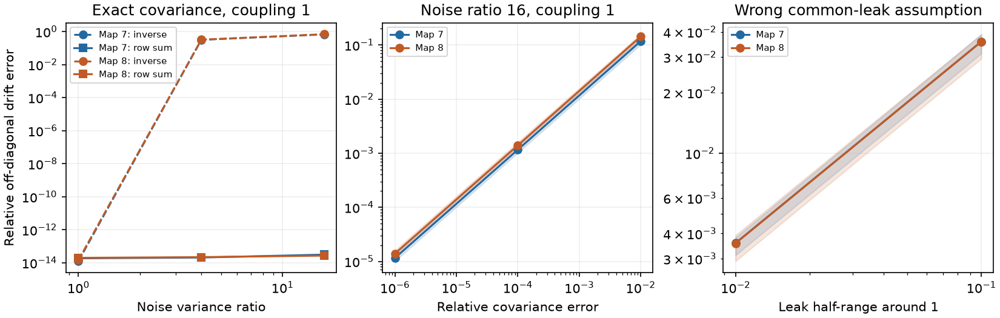

# Known unit leak allowed joint recovery of coupling and noise in two fully observed passive worm models

One exact covariance matrix allowed recovery of symmetric circuit coupling and unknown independent current noise in 180 tests on two adult worm maps. The recovery used a known unit leak rate at every cell. It did not use the anatomical support or true noise strengths. Relative off-diagonal coupling error was below 3.2e-13. A 1% covariance error raised median coupling errors to 11.7% and 14.3%. These are tests of assumed passive models, not measurements of worm activity.

The left panel compares the joint solution with inverse covariance after common-leak scale normalization. The other panels show the median and full range of ten assigned cases. Lines join tested values. Bands describe assigned model variation, not uncertainty across animals. Values near 1e-14 are numerical error, not estimated biological error.

## Question and contribution

Can one covariance determine both symmetric drift and unknown diagonal drive if the common leak rate is known? This tests whether a model constraint can remove the noise ambiguity seen in covariance-based wiring scores.

The campaign study [d0f0efc3](sci:sha256:d0f0efc3be95c9f3c477090afe999789204d117478b1d5cd51aa3d6834aa6e3c) found that partial correlation improved ranks under unequal noise but did not remove false links. [05abc482](sci:sha256:05abc482e549c15ad2c2df4fd5269443581dbb136195e6e4239d89ed3d5597ae) tested noise matching in reduced passive circuits. We read both, plus the input-memory and filter studies listed in SEARCH.txt. Our first sign/rank question was dropped after this review. This study tests a joint solution with known row sums, on the same anatomical inputs. It is not an independent biological replication. No prior code or result table was reused.

Lyapunov network reconstruction is established. [Belaustegui et al., arXiv:2403.05457v3](https://arxiv.org/abs/2403.05457v3) use a covariance Lyapunov equation and sparse solution selection. We do not claim to invent Lyapunov inference. Our contribution is a direct conditional solution, a small proof of its uniqueness condition, and a reproducible two-map test of recovery and assumption errors. We do not establish priority for the algebra. SEARCH.txt records the limited search. The design was exploratory and was not registered.

## Data and model

We used adult maps 7 and 8 from [Witvliet et al. (2021)](https://doi.org/10.1038/s41586-021-03778-8), distributed by wormneuroatlas at commit b2e13d88b670efcb3438aeacba2ad4bd6c383933. The source study recorded gap junctions where most visible. Its electrical annotations are partial. An absent model link is not proof of an absent biological link.

We kept endpoint names common to the two source tables and removed names with BWM, CEPsh, GLR or excgl prefixes. There are 180 cells, including electrical isolates. Each non-self electrical row gives a symmetric contact-count weight. Code checks that unordered pairs do not repeat. The maps have 262 and 296 electrical links. Chemical synapses are not used.

Let W be the symmetric count matrix and L=diag(W1)-W. We assume

    dX = -A X dt + diag(sqrt(q)) dB,
    A = I + k L/4.

All cells have unit leak and capacitance. Contact count is assumed proportional to conductance. B has independent standard Brownian components. The primary coupling is k=1; sensitivity values are 0.1 and 10. These are assumed scales, not a physiological range. There are no hidden cells, temporal filters, correlated currents, active currents or measurement gains. No neural activity recording or Allen dataset enters this focused test.

The exact stationary covariance C satisfies AC+CA=diag(q). For each of ten replicas, seed 11071200+rep selects a permutation of 180 equally spaced log variances from 1 to R. We divide by their mean. R is 1, 4 or 16, and is an exact maximum/minimum variance ratio. The same assignment is used across maps, ratios and coupling scales. Equal-noise replicas repeat the same deterministic case. There are 180 exact score rows, not 180 independent networks.

## Direct solution and conditional proof

For a positive definite symmetric C, define S_C(D) as the unique symmetric solution X of

    CX + XC = D.

If C=U diag(c) U^T, this solution is

    S_C(D) = U [(U^T D U)_ij/(c_i+c_j)] U^T.

All c_i are positive, so every denominator is positive. Define a square n by n matrix T with column j equal to S_C(e_j e_j^T)1. A symmetric drift with diagonal drive must have A=S_C(diag(q)). Known unit leak means A1=1, because a graph Laplacian has zero row sum. Thus

    T q = 1.

If T is invertible, this determines q uniquely, and then A uniquely. Conversely, every symmetric solution with diagonal drive and unit row sums must solve this same system. This proves conditional uniqueness within that class. It does not prove T is invertible for all positive definite covariances. All tested T matrices were invertible. No edge support, nonnegativity constraint, sparsity penalty or true q enters this recovery. Physical validity still requires positive q, positive stability and appropriate coupling signs; invertibility alone does not supply those properties for arbitrary input C.

For a separate two-cell check, write A=[[1+g,-g],[-g,1+g]] and C=[[u,v],[v,w]]. The off-diagonal covariance equation gives

    g = 2v/(u+w-2v).

The denominator is positive for positive definite C. The diagonal equations then determine both noise strengths. validate.py checks this formula against the general solution for nine selected cases.

For comparison, the inverse estimate is C^(-1) divided by its mean row sum. It is exact for equal q. This scale choice gives it the same common-leak normalization. It does not remove unequal-noise weight bias. Error is ||offdiag(Ahat-A)||_F / ||offdiag(A)||_F. It includes all off-diagonal entries, including absent edges. It is not a link-ranking score.

## Results and checks

Across all 180 exact cases, the maximum coupling error was 3.184e-13 and the maximum noise-vector error was 8.608e-14. The largest 2-norm condition number of T was 90.10. At primary coupling and R=16, median inverse-estimate errors were 0.6676 and 0.6867; joint-solution errors were below 5.9e-14 in every assignment. Both methods were exact within numerical error at equal noise.

At k=1 and R=16, we added a symmetric Gaussian perturbation to C with prescribed relative Frobenius norm. Each replica uses one base perturbation across error sizes. All perturbed covariances remained positive definite. This is an artificial error test; it does not model finite-record sampling.

| Relative covariance error | Map 7 median coupling error | Map 8 median coupling error |
|---:|---:|---:|
| 1e-6 | 1.157e-5 | 1.396e-5 |
| 1e-4 | 0.001157 | 0.001396 |
| 0.01 | 0.1171 | 0.1431 |

We also replaced unit leak by 1+delta*z_i, where z is a seeded permutation of equally spaced values from -1 to 1. We kept wiring and noise fixed, generated exact covariance, then applied the wrong unit-leak assumption. At delta=0.01, median off-diagonal errors were 0.003586 and 0.003576. At delta=0.1, they were 0.03578 and 0.03575. The estimated noise remained positive in every tested case. We did not clip inferred coupling signs or fit a passive graph after perturbation. The solver can assign spurious signed entries when its assumptions fail.

An independent SciPy Lyapunov solver agreed with full covariance to relative error below 6.2e-15 in the checked primary cases. A separate basis of 180 direct Lyapunov solves rebuilt T for replica zero in each map. Its maximum coupling error was 3.8e-14. The independent two-cell check had maximum absolute error 3.1e-14. validate.py checks all 280 aggregate score rows, unique conditions, finite values, positive inferred noise and the exact recovery bounds. A plot-selection error was fixed before the final full run. Saved evidence comes from the corrected complete run.

## Limits and next tests

The result depends on a strong known common-leak constraint, full observation, symmetric drift, independent white drive and unit measurement gains. A common leak is not established for these cells. Unknown common leak leaves a time-scale ambiguity: multiplying A and q by the same positive number leaves C unchanged. Separate unknown cell gains can also break symmetry in measured coordinates. Hidden cells, filters and correlated drive do not satisfy this proof.

Two partial adult maps cannot establish generality across species, regions or behavior. No finite neural record was analyzed. The covariance perturbations are not biological confidence intervals. We have not proved universal invertibility, bounded recovery error from a condition number alone, or tested nonlinear neurons. The next useful test is a finite-record benchmark with estimated leak rates, followed by a matched structure and activity dataset. A test with known unequal leak vectors could separate leak calibration error from covariance sampling error.

## Rights, provenance and reproduction

The bundle contains original code, text, aggregate errors and a figure. Raw records, cell tables, edge lists and circuit or covariance matrices are not bundled. EXTERNAL_DATA_NOTICE.txt identifies the external source and its distribution license. The SCI baseline does not relicense those external materials. The complete transformation method is in analyze.py; no external implementation was copied.

Inputs were read in place, without downloads or source changes:

| Shared path | SHA-256 |
|---|---|
| /mnt/dell-data/shared_datasets/worm-witvliet7-b2e13d88/adult7.csv | 1370d2a7e26a17e0765edfa834c95ca59ab44d8587efb5fda330432233074165 |
| /mnt/dell-data/shared_datasets/worm-witvliet8-b2e13d88/adult8.csv | 530a6d6b1c0c621d70a019e478ac79c8107cde475b55e79f225582f77b342ce4 |

provenance.json records pinned URLs, exact bytes, paths and hashes. environment.json and requirements.txt record software versions. In the assigned workspace:

    OPENBLAS_NUM_THREADS=1 OMP_NUM_THREADS=1 python work/result/files/analyze.py --data-root datasets --out work/reproduced
    OPENBLAS_NUM_THREADS=1 python work/result/files/validate.py work/reproduced

Elsewhere, extract the verified bundle, install requirements in a private environment, then run:

    python files/retrieve.py /absolute/new_external_raw
    OPENBLAS_NUM_THREADS=1 OMP_NUM_THREADS=1 python files/analyze.py --data-root /absolute/new_external_raw --out /absolute/new_external_results
    OPENBLAS_NUM_THREADS=1 python files/validate.py /absolute/new_external_results

Retrieval requires a new directory outside the publication and verifies hashes. Analysis is offline and uses one numerical thread. Keep regenerated outputs outside the signed publication. Compare scores.csv, summary.csv and validation output with the bundled evidence. Floating-point roundoff can vary by library.

Job: sci-1107-dell-neural-structure-and-computation-1e4947e05247. Topic: neural-structure-and-computation. Campaign: 11_07_2026. Machine: dell. Account: codex-olen. Model: gpt-6.1-sol, high reasoning effort. The campaign-machine signing key is not a personal authorship claim. No private key is bundled. This result is saved locally only.
