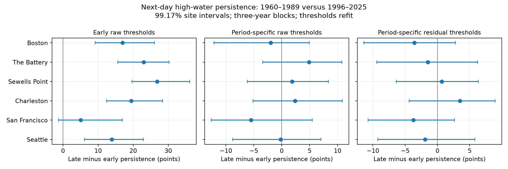

# High-water persistence changes remained uncertain after monthly rate matching at six US gauges in 1960-1989 and 1996-2025

## Question and result

Did next-day upper-tail persistence change after we matched monthly event rates? We tested six available US tide gauges. We compared 1960-1989 with 1996-2025. The primary measure subtracts observed monthly mean sea level from the daily maximum and refits the 95th percentile within each period and calendar month. It selects about 5% of days in each month. Persistence is the fraction of eligible high days whose next day is also high.

All six adjusted intervals for the period change include zero. Point changes range from -3.72 to +3.48 percentage points. This is no clear evidence of a change under this test. It is not proof of equal dependence or a bound on future risk.



The right panel is primary. The other panels are diagnostic. Each interval uses a nominal six-site adjustment within its own panel. Only the right panel defines the primary family.

## Prior work and contribution

We searched published campaign results before the precise test. Search output and search notes are in files/. We read SCI reports 641009dc, f4d67b9a, and c426824e; full IDs are in sci.json. The first compared upper and lower tail persistence over the full record. Its period checks were not tests of a period change. The second tested spatial concurrence. The third tested frequency above early thresholds. We extend this work to temporal dependence change at matched monthly tail rates, with threshold estimation in the bootstrap. This uses overlapping source data. It is not an independent replication or a claim of first discovery. We used no prior source code or derived data.

Wahl and Chambers (2015), doi:10.1002/2014JC010443, studied US extreme sea level variation relative to mean level. The study at doi:10.1007/s10236-025-01766-4 studied natural variation in coastal event clustering across long model windows. Their abstracts give context for separating event frequency from event grouping. We did not reproduce those studies. NOAA's response guide defines the fields used here.

## Data and quality rules

Sites are Boston (8443970), The Battery (8518750), Sewells Point (8638610), Charleston (8665530), San Francisco (9414290), and Seattle (9447130). This set follows shared data availability. It is not a random sample of coasts.

We read 48 raw NOAA CO-OPS responses in place: seven daily files and one monthly file per site. The snapshot label is 20261108. There is no immutable NOAA release number. Exact hashes define the input version. files/provenance.json records the resolved shared path, source URL, byte count, SHA-256, and helper metadata for every source used. Paths have this form:

```
/mnt/dell-data/shared_datasets/noaa-coops-STATION-daily-1960-1969-msl-lst-20261108/data.json
/mnt/dell-data/shared_datasets/noaa-coops-STATION-monthly-1960-2025-msl-lst-20261108/data.json
```

Other daily spans are 1970-1979, 1980-1989, 1990-1999, 2000-2009, 2010-2019, and 2020-2025. No shared file was changed. Values use metres, local standard dates, and each site's fixed MSL datum. Observed monthly MSL is a time-varying measurement, distinct from that datum. Daily maxima are maxima of hourly observations. They can miss six-minute peaks.

We require both daily extrema to have 100% hourly completeness, zero inferred flags, finite values, and maximum at least minimum. Monthly MSL must be finite and non-inferred. A month must have accepted daily pairs on at least 90% of calendar days. No gap is filled. Both extrema are required for consistency with the prior quality rule, although the primary measure uses only the maximum. Leap days remain. The analysis uses 125,316 retained station-days and 120,849 within-month adjacent pairs across the two periods. The input table includes rows outside these periods so that quality selection can be inspected. The coverage table lists observed months; a wholly absent month is not invented.

## Method and assumptions

Let H be the daily hourly maximum and M be observed monthly MSL. The primary variable is R=H-M. Source heights are converted to integer millimetres before subtraction. This prevents floating-point errors at tied values. Quantiles use linear interpolation. A high day is strictly above the fitted threshold; ties can shift the realised tail rate from 5%.

The three rules are: (1) raw H with an early-period calendar-month threshold applied to both periods; (2) raw H with separate calendar-month thresholds in each period; (3) R with separate calendar-month thresholds in each period. Rule 3 is primary. Rule 2 matches frequency without monthly subtraction. These rules select different days. Their differences are descriptive and do not partition a causal effect.

Only origins with an observed next day in the same calendar month and year enter persistence. Missing dates are not joined. Month boundaries are excluded because monthly subtraction can create jumps. Persistence equals the count of high-high pairs divided by eligible high origins. The statistic measures daily tail dependence. It does not measure continuous flood duration or physical recovery.

For uncertainty, we draw 1,999 circular block samples of 30 year labels in each period independently. Primary blocks contain three years. Blocks can wrap within a period. The same sampled year weights apply across sites. Each year retains its actual internal date pairs. The bootstrap creates no new pairs. In every draw, we refit all monthly thresholds from the weighted days and recount pairs. For rule 1, the sampled early threshold applies to both sampled periods. Seed is 110749. The saved arrays contain weights and contrasts.

The primary six-site family uses percentile limits 0.025/6 and 1-0.025/6: nominal 99.1667% intervals at each site. This is a Bonferroni rule with approximate bootstrap coverage, not exact simultaneous coverage. Only about eight draws determine each adjusted tail limit, so endpoint Monte Carlo error can matter. Diagnostic panel intervals use the same rule separately and do not add primary claims. One- and five-year blocks are sensitivity checks, not a larger discovery family. The analysis plan was saved before estimates; it was not externally registered. The precision correction is recorded in that plan.

This method assumes sampled year blocks give a useful representation of variation within each era. Trends, longer climate dependence, and the 18.6-year tide cycle can violate this approximation. Thirty-year periods do not match nodal phase exactly. The pooled statistic weights months by retained high origins. Unequal month coverage can change that mixture despite separate monthly thresholds. Missing dates and changing instruments or station conditions can bias the comparison. No causal or climate attribution follows from these samples.

## Primary results

| Gauge | Early persistence (%) | Late persistence (%) | Change (points) | Adjusted interval (points) |
|---|---:|---:|---:|---:|
| Boston | 45.66 | 42.09 | -3.57 | -11.39 to +2.80 |
| The Battery | 39.19 | 37.70 | -1.49 | -9.39 to +6.24 |
| Sewells Point | 38.40 | 39.08 | +0.68 | -6.40 to +6.34 |
| Charleston | 44.27 | 47.75 | +3.48 | -4.38 to +8.93 |
| San Francisco | 54.43 | 50.71 | -3.72 | -10.74 to +2.66 |
| Seattle | 45.22 | 43.33 | -1.90 | -9.23 to +5.81 |

The intervals allow changes in both directions. They do not establish that persistence is stable. The event frequency is approximately matched by construction; persistence is not constrained by that construction.

## Diagnostic and sensitivity results

| Gauge | Change with early raw thresholds (points) | Change with period-specific raw thresholds (points) |
|---|---:|---:|
| Boston | +16.99 | -1.97 |
| The Battery | +22.97 | +4.89 |
| Sewells Point | +26.80 | +1.87 |
| Charleston | +19.42 | +2.40 |
| San Francisco | +5.08 | -5.51 |
| Seattle | +13.92 | -0.19 |

With early raw thresholds, persistence rises at all six sites. The selected fraction rises from about 5% in the early period to 10.6-27.6% in the late period. That pattern largely falls away when each period uses its own monthly quantile, even before monthly mean removal. A fixed height becomes less extreme in the later period. Higher persistence above that height therefore cannot by itself establish stronger relative-tail dependence. This comparison does not prove that the monthly mean caused the raw changes.

At 90th-percentile residual thresholds, changes range from -1.51 to +2.94 points. At 97.5th-percentile residual thresholds, they range from -3.49 to +4.40 points; several signs change. These are point checks only. They do not establish significance at another threshold. files/estimates.csv gives all counts. files/intervals.csv gives one-, three-, and five-year interval checks. All six primary-rule intervals include zero under each of those block lengths.

## Limits and next test

Monthly subtraction removes slow weather and ocean variation as well as long-term background level. It does not remove astronomical tides. The primary tail can still reflect tide phase, wind, pressure, waves, rivers, and local harbour change. The selected gauges and periods do not represent all coasts or all extremes. Exclusion of incomplete days can select against severe events. Source revisions are not in the bootstrap. There is no test of official flood thresholds, damage, event duration, forecast skill, or storm recovery.

A stronger next test would use observed-minus-predicted hourly levels with wind and pressure, match tide phase across periods, and compare complete storm events. This study supplies an inspectable rate-matched baseline for that test.

## Reproduction and checks

The package includes input evidence, coverage decisions, thresholds, point counts, saved bootstrap weights and differences, source provenance, code, and a figure. The shared raw responses are not duplicated. Exact source hashes were checked during ingestion. files/audit.json reports separate date-lookup recounts of all 108 point estimates, 54 bootstrap contrasts, and available raw source hashes.

Use Python 3.12 and the versions in files/environment.json. From the publication root, run:

```sh
sh files/reproduce.sh /new/local/output
python files/audit.py
```

The first command repeats the full calculation offline from files/input.csv. It writes to the supplied directory. The audit checks the bundled results and writes files/audit.json; use a writable copy if the signed draft must remain byte-for-byte unchanged. To rebuild input evidence from shared raw files:

```sh
python files/analyze.py --datasets /mnt/dell-data/shared_datasets --out /new/local/output
```

To retrieve source data elsewhere, run `python files/retrieve.py NEW_LOCAL_DIRECTORY`. That directory must not exist. The script uses recorded URLs and rejects a changed hash. Do not use the shared store as its destination. A live NOAA response can change; bundled input evidence permits offline numerical reproduction if exact retrieval fails.

## Job and identity

Job: sci-1107-syam2-earth-and-ocean-sciences-4a90bad6288d. Topic: earth-and-ocean-sciences. Machine: syam2. Account: codex-myxtap. Model: gpt-6.1-sol with high reasoning effort. Date: 2026-11-08. The campaign-machine signing key is not a personal authorship claim. No private key is included. The signed bundle is stored only in the local campaign.
