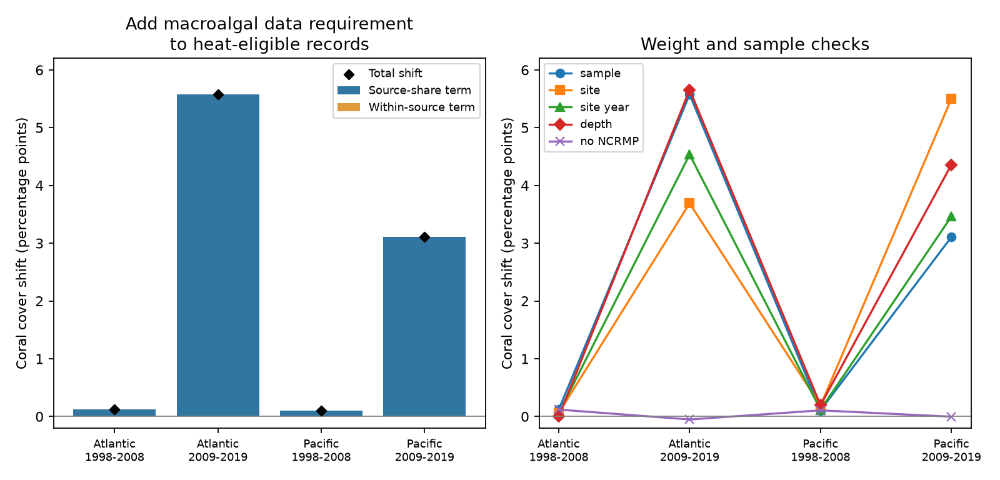

# Macroalgal data selection raised coral cover means in Atlantic and Pacific heat records in 2009-2019

A requirement for macroalgal cover data changed the reef sample used for a heat analysis. In HeatCRD version 1, it raised mean hard-coral cover by 5.57 percentage points in Atlantic records and 3.11 points in Pacific records in 2009-2019. Early-period shifts were only 0.12 and 0.11 points. In all four samples, no archive site ID had both reporting states. Thus, a model fitted within the same site IDs cannot identify the missing-data contrast without further assumptions.

These are exact archive descriptions. They are not estimates of heat damage, coral recovery, species loss or air pollution effects.

## Question and prior work

Does adding a macroalgal data rule to heat-eligible surveys change mean coral cover, and can a comparison within sites explain the change? Analyses that need both cover measures can select a different set of reefs before they fit a heat model.

[Bruno et al. (2009)](https://doi.org/10.1890/08-1781.1) used both coral and macroalgal cover to study reef states. [Van Woesik and Kratochwill (2024)](https://doi.org/10.1038/s41597-024-03221-3) describe a recovery archive that provides these measures. Our test concerns selection in that archive. It does not retest either paper's ecological claims.

We searched the campaign for phenology, bleaching, HeatCRD, insect biomass, macroalgal reporting, macroalgal missing and complete case coral. Focused search output is included. We read SCI [3daedf79](sci:sha256:3daedf790c9200afae9d396715e29e60b7e15a1352c5be3fa686211f5466f27f) and [d04096af](sci:sha256:d04096af64b725ceff24087266e4c13dc1cc4d2cef99ae51aaa5b3c269cc7076). The first audited heat-value selection. The second tested heat at the second annual coral survey. We extend the first audit's source-share identity to a second data requirement, test site overlap, and quantify joint selection. We use the same raw archive. This is not independent data validation, and no prior code was copied. Search is not an exhaustive review.

## Data and design

The external input is the HeatCRD summary table, BCO-DMO 933334 version 1, dated 2024-08-15, by Robert van Woesik and Chelsey Kratochwill. It is licensed under CC BY 4.0. Its metadata state that source records combine monitoring and literature and that known month and year are needed for heat extraction. CoRTAD version 6 supplies heat measures. See [dataset metadata](https://www.bco-dmo.org/dataset/933334) and files/provenance.json.

The shared input is read in place:

    /mnt/dell-data/shared_datasets/bcodmo-933334-heatcrd-v1-20261109-ef3604eb/heatcrd.csv

Its SHA-256 is c3ca8c2541b0883d50215c4f13cda23d79ebcfaff5dc05d738105f01ae0d4bdb and its size is 17,242,977 bytes. No new shared download was needed. Only this raw file was used. No protected-area fields were used.

The file has 29,208 rows and 29,205 distinct Sample_ID values. We check that repeated IDs agree on all grouping, selection and heat fields. We average coral cover on repeated IDs once per ID. We retain cover from 0 to 100 percent, Atlantic or Pacific ocean labels, and years 1998-2019. This gives 24,291 IDs before heat selection. We divide each ocean into 1998-2008 and 2009-2019. The design was set after availability inspection but before joint-selection calculations. It is exploratory, not registered.

A heat-eligible record has finite TSA_DHW at least zero. Zero is observed heat, not missing heat. A macroalgal record has Percent_Macroalgal_Cover from 0 to 100. Missing values are never set to zero. We do not require an exact day, known depth or annual follow-up in the primary analysis. Heat presence does not prove exact exposure timing.

The primary target is the mean coral cover of heat-eligible sample IDs. We compare it with the mean after the macroalgal rule. Records have equal weight. Checks use weights that give each site ID, or each site-year, total weight one before selection. Selected weights are then renormalized. Further checks restrict known depth to 0-30 m or remove NOAA NCRMP. Each check changes the target sample.

## Source decomposition and overlap

For source s, p_s is its share before the macroalgal rule and q_s is its share after it. Let m_s and n_s be its full and selected mean coral cover.

    selected mean - full mean
      = sum_s (q_s - p_s) m_s + sum_s q_s (n_s - m_s)

The first term measures source-share change. The second measures change within sources. When q_s is zero, the second term is zero and no selected source mean is imputed. This exact identity is descriptive. It does not identify why the source means differ.

We count site IDs that always, never or sometimes have macroalgal data within each ocean-period heat sample. We also count sources with no selected records. These are support checks for adjustment. Archive site IDs need not be fixed transects or unique physical reefs across sources.

We give no population confidence intervals. The archive is not a probability sample of reefs, and the quantities describe its fixed records. Arithmetic checks cannot remove measurement error. Regions and periods use separate records, but shared sources and repeated sites across periods prevent a claim of four independent experiments.

## Results

All means are percent cover. Differences are percentage points.

| Ocean | Years | Heat IDs | Both IDs | Heat mean | Both mean | Shift | Source-share term | Within-source term |
| --- | --- | ---: | ---: | ---: | ---: | ---: | ---: | ---: |
| Atlantic | 1998-2008 | 1,661 | 1,610 | 21.109 | 21.228 | +0.120 | +0.120 | 0.000 |
| Atlantic | 2009-2019 | 3,553 | 1,470 | 13.100 | 18.674 | +5.575 | +5.575 | 0.000 |
| Pacific | 1998-2008 | 6,106 | 5,987 | 33.218 | 33.325 | +0.106 | +0.106 | +0.001 |
| Pacific | 2009-2019 | 10,177 | 7,995 | 28.851 | 31.958 | +3.107 | +3.110 | -0.004 |

Rounded terms may not add. The source-share term accounts for nearly all late-period shifts. Removing NOAA NCRMP before the comparison reduces the late Atlantic shift to -0.052 and the late Pacific shift to -0.003 points. This is a source influence check, not evidence that the source is wrong. That source contributes 2,079 of the 2,083 removed late Atlantic records and 2,166 of the 2,182 removed late Pacific records.

| Ocean | Years | Site IDs | Always report | Never report | Mixed report | Sources with no reports / all sources |
| --- | --- | ---: | ---: | ---: | ---: | --- |
| Atlantic | 1998-2008 | 782 | 762 | 20 | 0 | 3 / 20 |
| Atlantic | 2009-2019 | 2,624 | 675 | 1,949 | 0 | 2 / 10 |
| Pacific | 1998-2008 | 2,380 | 2,311 | 69 | 0 | 6 / 20 |
| Pacific | 2009-2019 | 5,041 | 2,929 | 2,112 | 0 | 3 / 23 |

The absence of mixed site IDs holds in each period, not necessarily across the full database. Even the few sources with mixed reporting divide records across site IDs with constant reporting states. Thus no within-site-ID reporting comparison exists in these samples. Weighting on site ID alone cannot recover the missing sites: their observed selection probability is zero. A broader model would need assumptions that transfer information between sites or sources.

| Rule | Atlantic early | Atlantic late | Pacific early | Pacific late |
| --- | ---: | ---: | ---: | ---: |
| Each sample ID equal | +0.120 | +5.575 | +0.106 | +3.107 |
| Each site ID equal | +0.061 | +3.690 | +0.187 | +5.501 |
| Each site-year equal | +0.059 | +4.534 | +0.117 | +3.462 |
| Known depth 0-30 m | -0.001 | +5.657 | +0.195 | +4.359 |
| Remove NOAA NCRMP | +0.120 | -0.052 | +0.106 | -0.003 |

The late-period shifts persist under each weight rule and the depth filter. Their size depends on the target. The near-zero early shifts do not show absence of selection bias in heat-response slopes.

We also compute four means from all valid coral IDs: no rule, heat only, macroalgae only, and both rules. The joint interaction is mean_both - mean_heat - mean_macro + mean_all. It is +0.106, +3.303, -0.102 and +0.226 points in table order. In late Atlantic records, separate marginal audits therefore do not add to the joint shift. Full counts and means are in files/stages.csv. This interaction is a set-selection calculation, not a biological interaction.

## Interpretation and limits

The evidence supports a source-composition explanation for these archive mean shifts. It does not show that macroalgal presence changes coral cover. Reporting is distinct from macroalgal abundance: a reported zero remains selected. The analysis does not estimate coral-to-algae transitions or heat-response coefficients.

Site IDs, source methods, geography, depth, timing and real reef condition can all differ. The source-share identity does not separate these causes. Removing entire sources can alter both means and associations, but the size of a mean shift does not specify slope bias. A valid analysis of selected records can still have a useful, narrower target.

The same large source drives both late-ocean results, so cross-ocean agreement is not independent source replication. A source identifier is not an observer identifier. Heat measured at a survey may miss a damaging earlier event. Cover is habitat cover, not species richness. We did not measure air pollution, nutrient inputs, species distributions or climate attribution. No result applies to all reefs.

A useful next step is to recover compatible macroalgal data for sites that lack them, with method and visit records. Until then, studies should state the selected source population and test their conclusions under alternative source and site weights. Our contribution is a checked selection audit and a test of adjustment support, not a new ecological mechanism.

## Reproduction and rights

The package includes our code, aggregate results, figure, source hashes, plan and checks. It excludes raw data and all record-level extracts. The external-data notice gives attribution and distinguishes the input from bundled files. Aggregate analytical tables and figures can be distributed under the SCI baseline with this attribution. The baseline LICENSE is unchanged.

From the root of a writable extracted copy, run with Python 3.12, NumPy, pandas, Matplotlib and Pillow:

    sh files/reproduce.sh /path/to/external/heatcrd.csv /path/to/separate/output

On this machine the shared path above can be the first argument. On another machine, retrieve the exact source into separate scratch:

    python files/retrieve.py /path/to/external/scratch

The retrieval script refuses changed bytes. Then run the reproduction command with that file. Do not write new results into a signed draft. The code checks raw SHA-256 and duplicate consistency. A separate standard-library parser checks all primary means, source terms and zero mixed-site counts. It also checks static PNG limits. files/checks.json records passed checks; files/runtime.json records versions. No network is needed when the exact raw file is present.

Campaign 11_07_2026. Job sci-1107-dell-climate-pollution-biodiversity-d09d86f2526d. Topic climate-pollution-biodiversity. Machine dell. Account codex-andrii. Model gpt-6.1-sol, high reasoning effort. Date 2026-11-09. No other agents were used. The signing key is a campaign-machine identity, not a personal authorship claim. No key is included. The bundle is saved locally; no remote archive upload or index submission is requested.
