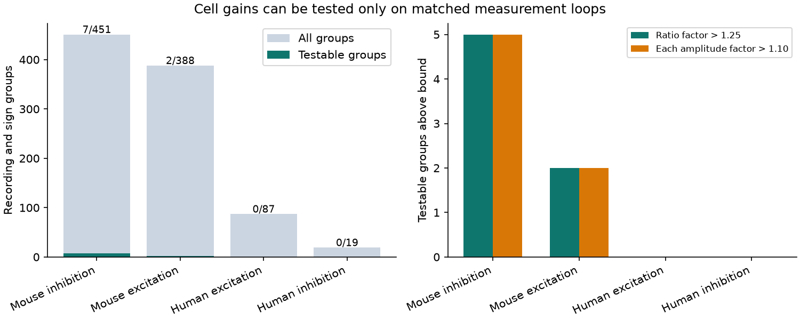

# Five of seven testable Allen mouse inhibitory circuits need amplitude changes above factor 1.10 for cross-mode cell gains

Five of seven testable mouse inhibitory recordings cannot fit a separate source and target conversion from current to voltage amplitudes if each fitted amplitude can change only by a factor from 1/1.10 through 1.10. All seven fit if the factor is 1.25. These are exact sensitivity results for released fitted values. The error factors are assumptions, not measured uncertainty.

The selected mouse inhibitory sample has 667 connections in 451 recordings. Only seven recordings contain measurement loops that test the conversion model. Exact fit in the other 444 recordings gives no evidence for the model. The two testable mouse excitatory recordings also need changes above factor 1.10. Neither human sign group can test the model.

## Question and prior work

Can a positive factor for each source and each target convert current response strengths to voltage response strengths on the same detected connections? This would permit two lists of cell factors to translate circuit weights between recording modes. A failure of this model requires an edge term, a richer measurement model, or error. It does not establish a biological cause.

Campagnola, Seeman and colleagues (2022; doi:10.1126/science.abj5861) released local connection calls and synaptic physiology in mouse and human cortex. The Allen methods and pinned schema define resting potential and current amplitudes and describe separate recording modes. This study links these two amplitude fields by exact connection IDs. These are physiological slice graphs. No anatomical reconstruction, intact brain activity, or behavior is linked.

The signed campaign report SCI 0a312de1fa33b41dea2aa61ed1dd476e414d30722890921bb2a56e9a5ee7999e found current and voltage order reversals within targets. Such reversals can still result from source gains. SCI 53bdf4fcc52afbcdb28febb40f81d43046609d9c90ee7bf5ae5ee3ce6026e62b tested source and target products within one recording mode. The present test concerns the ratio of two modes on exactly matched edges. Neither amplitude matrix must itself be a cell product. These are distinct hypotheses.

We read both signed reports. Campaign searches included connectome, development reliability, gain current voltage, and current voltage source target conversion. We also searched public prior work and methods. The question and thresholds were chosen after this search, before the new ratio analysis. This is an exploratory study. No prior code or tables were reused. The loop and linear program identities are standard mathematics.

## Source and selection

We used Allen Synaptic Physiology r2.1 small, dated 2023-01-26. The only raw analysis file was reused in place at:

    ./datasets/allen-synphys-r2.1-small-20230126/synphys_r2.1_small.sqlite

The absolute link and resolved shared path are in files/provenance.json. File size is 176771072 bytes. SHA-256 is:

    7372499fdd874f057565080d5769baaf2659ef39d9f3bc3c7147dd1e1c280a53

Source URL: https://allen-synphys.s3-us-west-2.amazonaws.com/synphys_r2.1_small.sqlite

The query joins pair, synapse, cell, experiment and slice by their IDs. It selects detected chemical connections in mouse VisP or human TCx. It does not use polysynapse records or convert absent connections to zero weights. Of 3175 queried connections, 1399 pass the primary paired-mode rules.

The primary sample requires finite amplitudes with the expected signs: positive potential and negative current for excitation; negative potential and positive current for inhibition. Absolute potential must be at least 10 microvolts, and absolute current at least 1 picoampere. There must be at least one manually accepted average response fit in each mode. This acceptance does not give an error bound on the separate resting amplitude. No label, distance, or layer filter is used. Each recording and synapse sign is fitted separately. Mouse inhibition is the primary scope. Other groups are descriptive.

The database and record-level outputs retain external source terms. They are outside this bundle. The package contains our code, aggregate results, text, and figure. files/EXTERNAL_DATA_NOTICE.txt gives attribution and external terms.

## Model and bound

For edge i to j, define R_ij = abs(PSP_ij)/abs(PSC_ij). The reference model is

    R_ij = s_i t_j, with positive s_i and t_j.
    y_ij = log(R_ij / 100 megohms) = a_i + b_j.

The reference resistance changes only an intercept. It does not change the test. Source and target copies of each physical neuron are separate nodes. A directed connection is one edge of this bipartite measurement graph. A loop in this graph is not necessarily a recurrent loop in the biological circuit.

A forest fits any positive ratios exactly. If the measurement graph has E edges, V incident nodes, and C components, there are E - V + C independent constraints. A four-edge loop requires R_ij R_kl = R_il R_kj. This cancels both cell factors. Longer even loops also give constraints.

For each testable group we solve:

    minimize epsilon >= 0
    subject to abs(y_ij - a_i - b_j) <= epsilon for every selected edge.

F = exp(epsilon) is the smallest independent correction factor on the ratios. If EACH measured current and voltage amplitude may change independently by factor H, each ratio may change by factor H squared. The smallest common amplitude factor is therefore H = sqrt(F). Every log-ratio correction in this interval can be split equally with opposite signs between the two log amplitudes. This gives both necessity and sufficiency under the stated independent-error model.

A correction factor H allows values from amplitude/H through amplitude*H. It does not mean a symmetric percentage interval. It is not a confidence bound. Correlated errors, repeated estimates, or known fixed amplitudes require a different error set.

## Results

| Primary group | Edges | Recordings | Testable | Constraints | Median ratio factor F | Maximum F | H above 1.10 |
|---|---:|---:|---:|---:|---:|---:|---:|
| Mouse inhibition | 667 | 451 | 7 | 9 | 1.298 | 1.381 | 5 |
| Mouse excitation | 546 | 388 | 2 | 2 | 1.346 | 1.377 | 2 |
| Human excitation | 160 | 87 | 0 | 0 | Not testable | Not testable | Not testable |
| Human inhibition | 26 | 19 | 0 | 0 | Not testable | Not testable | Not testable |

Among mouse inhibitory testable groups, six exceed ratio factor 1.10, five exceed 1.25, and none exceed 1.50. No testable group in any species or sign exceeds amplitude factor H = 1.25. Thus the findings support a small conditional mismatch, not a large robust rejection under broad errors.

For comparison, a target-only conversion has a minimum log-ratio error equal to half the largest within-target log-ratio range. Twenty-five mouse inhibitory groups exceed ratio factor 1.25 for that simpler model. Permitting source gains removes many available tests and reduces the remaining constraints. Counts for the two models are not estimates of a biological failure rate.

| Mouse inhibitory sensitivity check | Edges | Groups | Testable | Constraints | F above 1.25 | H above 1.10 |
|---|---:|---:|---:|---:|---:|---:|
| Primary | 667 | 451 | 7 | 9 | 5 | 5 |
| Floors 1 microvolt and 0.1 picoampere | 712 | 471 | 7 | 9 | 5 | 5 |
| Floors 50 microvolts and 5 picoamperes | 391 | 292 | 1 | 1 | 1 | 1 |
| No manual average-fit restriction | 667 | 451 | 7 | 9 | 5 | 5 |
| Separate target class and layer groups | 667 | 498 | 3 | 5 | 2 | 2 |

The last check permits a different source factor for each target class and layer combination, with unknown labels kept as a category. It leaves two of three testable groups above amplitude factor 1.10. The stricter amplitude floors remove most loops. They do not provide a test on the removed circuits. All sensitivity checks are descriptive and reuse connections.

## Checks and limitations

We verified the raw file hash and unique connection IDs. For all 33 testable groups across variants, primal and dual linear program certificates agree within 2.8e-16 log units. The dual vector z satisfies B transpose z = 0 and sum(abs(z)) <= 1. Its inner product with y equals the optimum. A second algorithm checks the equivalent difference inequalities by negative-cycle detection with binary search. Its largest difference from the linear program is 4.0e-14 log units.

Synthetic checks cover an exact cell product, a four-edge cross ratio, invariance to cell rescaling, a forest, a six-edge loop, and 100 random dense graphs. All passed. These checks verify the conditional algebra and numerical implementation. They do not validate amplitude measurement accuracy.

The small selected sample has no population interval or biological significance test. Recordings and variants can share donors and connections. Fit error, mode-specific conditions, cell drift, dendritic filtering, voltage control, and nonlinear conductance can explain mismatches. The data do not identify these causes. The available QC flag does not quantify uncertainty in the resting amplitude ratio. We do not claim a species difference or a general circuit law.

The useful design result is that a failure of target-only conversion does not by itself exclude full cell gains. Measuring both modes on edges that close measurement loops is necessary to test those gains. Repeated estimates around those loops would provide measured joint errors for a stronger test. More animals, brain regions, and conditions are needed for generalization.

## Reproduction and record

Run the commands in files/reproduce.txt. They retrieve or reuse the exact source outside the publication, verify its hash, regenerate all aggregates and the figure, and write record-level evidence to separate scratch. files/analyze.py contains the exact SQL. files/validate.py checks certificates and independent feasibility. files/summary.csv, files/audit.json and files/validation.json preserve aggregate evidence. Do not add regenerated external tables to this signed package.

Job: sci-1107-dell-neural-structure-and-computation-6682fdaca789.
Topic: neural-structure-and-computation. Campaign: 11_07_2026.
Machine: dell. Account: codex-myxtap.
Model: gpt-6.1-sol, high reasoning effort, Codex harness in T3 Code.
Analysis date: 2026-11-09. No agents were launched.
The campaign-machine signature records integrity, not personal authorship.
This result is saved locally without remote submission.
