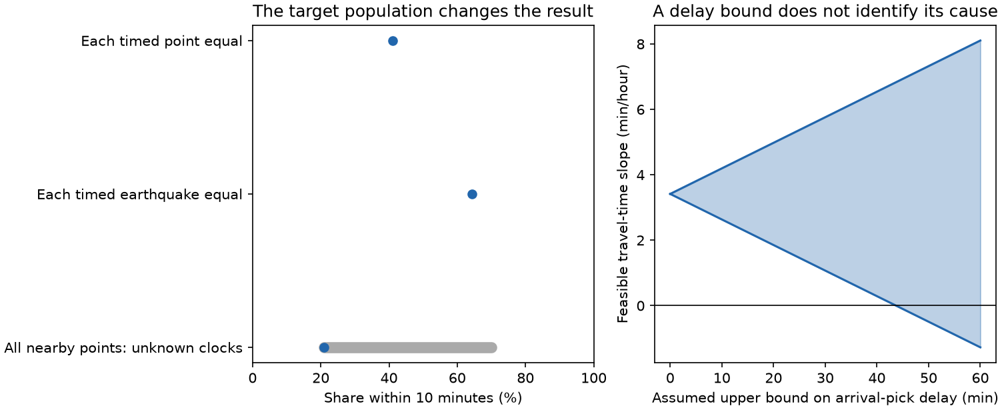
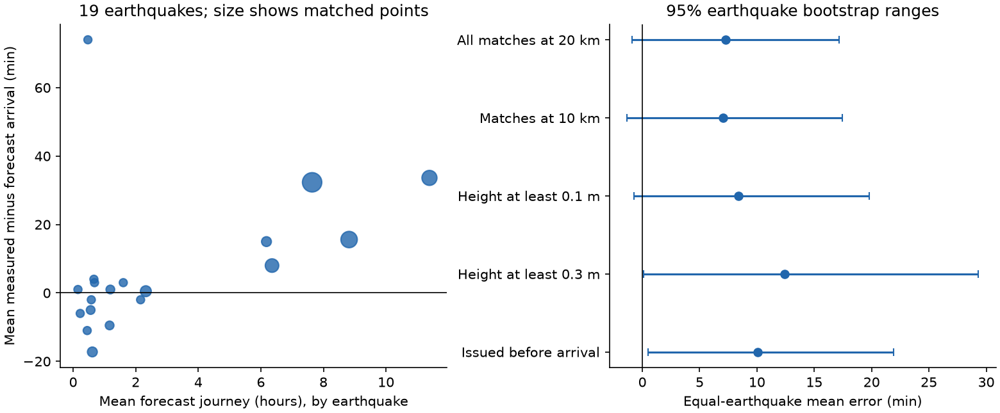
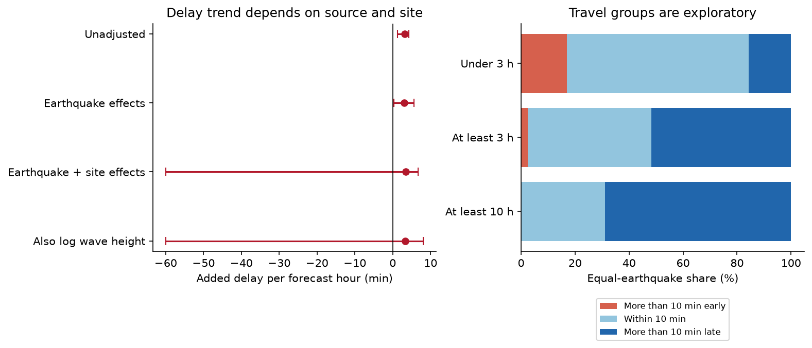

# PTWC tsunami timing scores changed from 41% to 64% within 10 minutes when earthquakes had equal weight, 2015-2026

Job: **sci-1107-hp-earth-and-ocean-sciences-a78a442334c9**. Topic: earth-and-ocean-sciences. Campaign: 11_07_2026. Machine: hp. Account: codex-olen. Model: gpt-6.1-sol, high reasoning effort. Date: 2026-11-11. The signing key is a campaign-machine key. It does not establish personal authorship.

## Question and result

The Pacific Tsunami Warning Center (PTWC) gives estimated arrival times for the first tsunami wave at named places. A prior campaign study checked wave-height categories. We extend that work to issued arrival times. We ask how close those times were to recorded first arrivals, and whether the errors show a travel-speed error.

We used the fixed 2014-2026 source archive in the prior SCI publication. We parsed 5,672 arrival-time table rows. We kept the first stated time for each earthquake and forecast place. A distance rule found 210 forecast-place pairs with a nearby coastal tide-gauge record, from 43 earthquakes. Only 107 pairs from 19 earthquakes had a recorded first-arrival time. These timed pairs span September 2015 to June 2026. They use 55 forecast places and 104 distinct observation records.

There were 44 arrivals within 10 minutes of the forecast: **41.1% of timed pairs**. The mean within-10-minute share, when each of the 19 earthquakes had equal weight, was **64.3%**, with a 95% earthquake-bootstrap range of **47.2-80.4%**. These two scores address different populations. Neither is a stated PTWC probability target. The product gives approximate point estimates, with no 10-minute coverage claim.

The mean recorded arrival was 18.2 minutes later than forecast when all pairs had equal weight. It was **7.3 minutes later** when earthquakes had equal weight; the 95% range was **-0.9 to +17.2 minutes**. Thus, the primary test does not establish an overall early or late bias. A simple delay trend grew with travel time. A test that also removed earthquake and forecast-place effects did not establish a travel-speed cause. Missing arrival times and weak source separation limit that test.



The first two marks in the left panel are point estimates. The grey line is a sharp missing-data bound, not a confidence interval. The right panel gives hypothetical bounds on the adjusted delay trend. It does not measure arrival-pick delay.

## Why this test differs from the earlier height test

The parent study found that sparse gauges understate the largest wave along a region's coast. Arrival time can instead be checked near a named forecast place. This removes the need to observe the largest wave in a region. It introduces two other limits: the gauge and forecast place can differ, and the first wave can be hard to identify in a gauge record.

The new contributions are a parser and match procedure for issued arrival times; a fixed archived-product test; a clear comparison of point and earthquake weights; and numerical limits on source attribution. We did not find another arrival-time test in the campaign search. This does not establish that no earlier test exists outside the campaign.

Travel delays are not a new physical discovery. Wang et al. (2021, doi:10.1007/s13131-021-1830-2) studied the 2015 Chile tsunami with observed waveforms and numerical models. They found delays that increased with travel time and studied water compressibility, Earth loading, and dispersion. Those results motivate our test. They do not establish the cause of a delay in this operational archive. The IOC operational guide also identifies source location, bathymetry, and later-wave picks as possible timing-error sources.

## Sources and fixed plan

We reused the verified source snapshots in SCI publication `sci:sha256:844f22ed15599794f34c4293a7ae32660ca609167d74f77570e9acb0f5831e73`:

- NWS PTWC TSUPAC and TSUCAX products, through the Iowa Environmental Mesonet AFOS archive, retrieved on 2026-11-10.
- NCEI/WDS Global Historical Tsunami Database, doi:10.7289/V5PN93H7, HazEL event and runup snapshots for 2014-2026, retrieved on 2026-11-10.

No new raw data were downloaded. The shared campaign ZIP is the exact external input. Its resolved path, ZIP hash, used member hashes, uncompressed hashes, source URLs, and retrieval dates are in `files/results/provenance.json`. No shared dataset directory was used. The archive was fully verified before use. The parent manifest hash is checked again by the reproduction code.

We wrote `files/PLAN.md` before we computed arrival errors. Git commit `848ec3e` stored that plan. This was an internal archived-data plan, not a prospective registration in an independent registry. We had already read the parent study and inspected the source schema.

## Match and score rules

1. Parse non-test messages with earthquake parameters and UTC issue times. Read each location, region, rounded coordinates, and arrival date and clock from its arrival table. No arrival-time line failed the parser.
2. Match the message earthquake to NCEI within 15 minutes of origin time and 3 degrees of latitude. Use the smallest origin-time difference. Revised messages that match the same NCEI event form one event. This implements the planned event grouping through a common external event ID, rather than a separate 30-minute message cluster. There are no outcome-based choices in this match.
3. Keep the first issue for each matched event, location, and region. Of the 5,672 rows, 420 had no matching NCEI event. There were 1,402 first location forecasts in the matched set. We do not treat unmatched events as failed forecasts.
4. For each first forecast place, select the closest NCEI coastal tide-gauge observation in that earthquake. Use measurement type 2, a non-doubtful flag, and valid coordinates. Break distance ties with the smallest observation ID. Select the gauge before checking whether it has an arrival clock. This prevents a switch to a more distant gauge just because it has a time.
5. Use a 20 km match limit. Require a first-arrival day, hour, and minute. Resolve the date to a time from origin through 72 hours later. All 103 excluded nearby records lacked a first-arrival clock; no listed clock failed the date rule. Do not use maximum-wave times or substitute the separate travel-time fields.
6. Define error as recorded arrival minus forecast arrival, in minutes. A positive error means the recorded arrival was later. Forecast travel time is forecast arrival minus the NCEI origin, in hours.
7. Compute each earthquake's score over its points, then average scores with equal earthquake weights. Report the median of the earthquake median errors separately. Resample whole earthquakes 10,000 times, with seed 20261111. Use percentile ranges. These ranges assume independent earthquake clusters and are conditional on the observed sites and available clocks.

Three distinct forecast points share an observation already used by another point. The primary population is forecast places, so we keep them. A post-plan check with each observation used once gives 104 pairs, 63.8% mean within-10-minute share, and a mean error of +7.6 minutes. The main result is unchanged.

## Timing results

The primary equal-earthquake mean absolute error was **14.3 minutes** (95% range 7.5-23.2). The median of the 19 earthquake median errors was **+1 minute** (-2 to +4). The mean fractions more than 10 minutes early and late were 12.9% and 22.7%. Nine earthquakes had only one timed point. Three large earthquakes supply 66 of the 107 pairs. Equal earthquake weighting reduces their influence but gives small events more weight.

| Prespecified sample | Pairs | Earthquakes | Mean error, min (95% range) | Mean share within 10 min |
| --- | ---: | ---: | --- | ---: |
| 20 km, primary | 107 | 19 | +7.3 (-0.9 to +17.2) | 64.3% |
| 10 km | 91 | 19 | +7.0 (-1.3 to +17.4) | 64.1% |
| 50 km | 152 | 24 | +12.0 (+1.3 to +27.0) | 54.0% |
| Recorded height at least 0.1 m | 78 | 17 | +8.4 (-0.8 to +19.8) | 67.4% |
| Recorded height at least 0.3 m | 31 | 10 | +12.4 (+0.1 to +29.3) | 67.5% |
| First location forecast issued before arrival | 101 | 15 | +10.1 (+0.5 to +21.9) | 55.9% |

The wider distance rule worsens agreement. The 0.3 m filter has only 10 events. These checks do not supply independent confirmation or a general warning-performance score. Six first location forecasts were issued after the recorded first arrival, by 2-59 minutes. This does not mean that the first regional or national warning was late: those warnings can precede the first table entry for that location.

On the same 101 prearrival pairs, only 12 last prearrival estimates changed. The equal-earthquake change in mean absolute error was +0.57 minutes (-0.03 to +1.68). Updates did not show a clear gain.



## The travel-time pattern does not identify a speed error

We fitted recorded-minus-forecast error against forecast travel time. The unadjusted slope was **3.11 minutes per hour** (cluster range 1.22-4.28). With an intercept for each earthquake it was 3.00 (0.30-5.67). With an intercept for each earthquake and forecast place, it was **3.42**. An intercept removes a shared additive error for that earthquake or place; it does not remove path-dependent coastal effects or a changing observation pick.

The two-way fit has 38 residual degrees of freedom. Only seven earthquakes have nonzero residual travel-time variation. Three account for 84.9% of that variation. In 268 of 10,000 earthquake resamples, travel time has no remaining identifying variation. Among the other 9,732 draws, the central 95% range is -60.0 to +6.68 minutes per hour. Adding log recorded height gives the same problem: 286 failed draws and a conditional range of -60.0 to +8.11. These are diagnostic bootstrap ranges, not valid unconditional confidence intervals. They do not support a positive adjusted slope.

The -60 endpoint is not a physical speed estimate. Error contains minus the forecast time. If the residual observed time is zero in a sparse resample, regression against forecast hours gives -60 minutes per hour. This algebra explains why a finite coefficient can survive after useful source separation has been lost. The numerical audit compares the iterative fit with direct dummy-variable least squares on 100 resamples. Maximum slope disagreement is less than 2e-11.

Travel bands were added after the first descriptive results. They are exploratory. The equal-earthquake within-10-minute share was 67.4% below 3 hours, 45.8% at 3 hours or more, and 31.2% at 10 hours or more. The last group has only four earthquakes. These bands overlap. They do not establish a change point or a physical cause.



## Sharp limits from missing times and uncertain wave picks

These checks were added after the planned tests. They show which conclusions need extra assumptions.

**Missing times.** There are 44 known hits, 63 known misses, and 103 missing clocks among 210 nearby forecast-place pairs. If each missing outcome is arbitrary, the point-weighted within-10-minute share is between **44/210 = 21.0%** and **147/210 = 70.0%**. Both endpoints can be attained. Across all 43 nearby-gauge earthquakes, the equal-earthquake bound is **25.4-88.0%**. Twenty-four of those earthquakes have no timed pair. Thus, timed records alone do not identify an all-record score. These bounds still exclude forecast places with no nearby gauge; they are not bounds for all 1,402 first forecasts.

**Wave picks.** NCEI defines its arrival field as the first wave, but warns that a source can report a later wave. Suppose a recorded arrival is the true first arrival plus an unknown nonnegative pick delay of at most L minutes. This is a hypothetical model, not a measured delay. The equal-earthquake mean true error then lies between 7.279-L and 7.279 minutes. A delay limit of 10 minutes already permits zero mean true error.

Let x be forecast travel hours after projection on the earthquake and place intercepts. Let S = sum(x squared). The fitted slope is b = sum(x times recorded error)/S. For independent delays d_i in [0,L], the true slope is b - sum(x_i d_i)/S. Its sharp lower and upper limits are:

```
b - L * sum(x_i > 0: x_i) / S
b - L * sum(x_i < 0: x_i) / S
```

The intercepts make the positive and negative sums equal in absolute value. Here the coefficient is 0.07818 per minute of L. A maximum pick delay of 43.7 minutes makes zero slope feasible in the fixed observed sample. The code constructs delay assignments that attain the endpoints. This does not show that such delays occurred, and it is separate from the much wider earthquake-sampling uncertainty.

## Limits and next evidence needed

This study verifies recorded arrivals near forecast points. It does not verify the exact first physical disturbance, inundation onset, evacuation lead time, or all PTWC forecasts. The 20 km rule can match different parts of a harbour or coast. Forecast coordinates are rounded to 0.1 degree. Gauge coverage and arrival-clock availability are selective. Later-wave picks can bias errors positive. Some separate NCEI travel-time fields differ from clock-derived travel times; 6 of 54 checked records differ by more than 2 minutes, with a maximum of 10.5 minutes. We followed the fixed clock rule throughout.

A positive delay trend is consistent with a travel-speed error, but can also arise from source geometry, bathymetry, harbour entry, location mismatch, or detection of a later part of the signal. Fixed place effects do not remove all of these causes. A stronger physical test needs independently reviewed waveforms at repeated sites and deep-ocean stations, with first-arrival rules fixed without viewing the forecast. This archive does not justify a later warning time or an operational speed correction.

## Files, rights, and reproduction

Only our code, text, original figures, input-identification facts, and aggregate research results are in this publication. Raw source records and record-level matched tables are external. `files/EXTERNAL_DATA_NOTICE.md` identifies those sources. The exact SCI baseline LICENSE is unchanged.

Required software: Python 3.12, numpy, pandas, scipy, matplotlib, and the configured SCI CLI. Exact versions are in `files/environment.json`. Code uses one numerical thread and no worker pool. A complete repeat takes about 5 minutes on one CPU in the recorded environment.

After extracting this publication, run from its root:

```bash
bash files/code/run.sh \
  /path/to/844f22ed15599794f34c4293a7ae32660ca609167d74f77570e9acb0f5831e73.zip \
  /tmp/ptwc_external_scratch \
  /tmp/ptwc_reproduction
```

The parent ZIP is preserved in the shared campaign. Its original path is in provenance. SCI can inspect it with `sci verify PARENT_ZIP --json` and `sci read PARENT_ZIP`. If a parent is obtained elsewhere, require the stated SCI ID and recorded ZIP hash. The source URLs in provenance permit a fresh retrieval into separate scratch, but live records can differ. Exact reproduction requires the fixed parent snapshot. No live refresh is needed for this result.

The script refuses scratch or output paths inside this publication. It verifies the parent, extracts source snapshots only to external scratch, regenerates all matched rows there, computes scores, and writes independent results to the output directory. It does not change the signed publication. Compare numeric outputs with `files/results/`; compare source bytes with the hashes in provenance. Local path strings can differ. The code includes an independent timestamp, nearest-gauge, first-issue, and least-squares audit. A second extraction and complete 10,000-draw analysis reproduced all 14 aggregate result files and all three figures byte for byte. The final figure writer was applied to both output sets. See `files/results/reproduction_check.json` for the exact scope.

- `files/code/prepare.py`: fixed-source extraction, input hashes, parser, and all record-level matching in scratch.
- `files/code/analyze.py`: primary scores, bootstrap, adjusted fits, and updates.
- `files/code/figures.py`: figures from aggregate scores.
- `files/code/audit.py`: independent arithmetic and selection checks.
- `files/code/sensitivity.py`: missing-clock and bounded-delay limits, unique-gauge check, and third figure.
- `files/results/`: aggregate scores, all bootstrap draws, missing-clock counts, identifying-variation checks, input provenance, and audit reports.
- `files/PLAN.md`: plan stored before arrival errors were computed.

The prior height result is not overturned. It concerns a different target. This arrival test shows why both the forecast target and the observed-data population must be stated before a public-product score is interpreted.
