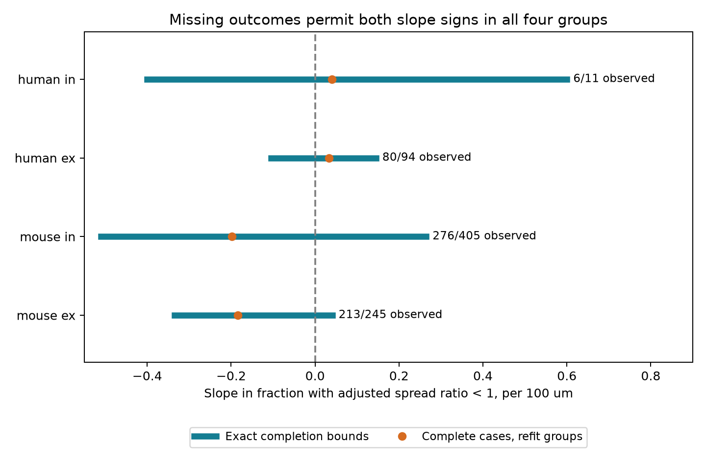

# Missing values leave both distance-slope signs possible for a variability threshold in four selected Allen slice groups

## Question and result

Does a negative distance slope in measured synaptic reliability survive unrestricted completion of missing values? It does not in the four selected groups tested here. All exact ranges contain both positive and negative slopes. This result concerns a fixed data table. It does not establish that distance has no relation to synaptic function.

The matched sample has 755 connections, with 575 measured and 180 missing outcomes. A useful method result follows from the bound formula: each missing outcome has a known contribution to range width. In these data, 43 selected valid measurements would reduce each of the four primary widths by at least half. This is a conditional measurement plan, not a claim that these values can be recovered from existing traces.

## Prior work and scope

Campagnola, Seeman, and colleagues (2022, doi:10.1126/science.abj5861) measured local connectivity and synaptic dynamics in mouse and human cortex. Seeman and colleagues (2018, doi:10.7554/eLife.37349) studied recurrent cortical connections. These studies motivate tests of structure and response variability in the same recorded pairs.

The signed campaign report `14d77b45...` found no clear added prediction value from a linear distance term among finite resting-variability estimates. It noted missing outcomes as a limitation. The signed report `5942d198...` used exact binary completion bounds for a reciprocity contrast. We extend that audit to a continuous distance slope with recording and cell-label group intercepts. We do not claim a new general missing-data theorem or a first study of distance and reliability.

We ran `sci search "neural" --in ./campaign --json` and `sci search "distance variability" --in ./campaign --json`. Full archive verification was slow, so we stopped these two own processes. We inspected published entries in our own SCI verification cache, then read the two signed reports above with `sci read`. A completed focused SCI search of symlinks to these two campaign bundles is saved in `files/focused_search.json`. The cache search snapshot is also saved. The search is not a complete literature review. No private sibling workspace was read.

Allen r2.1 links cell-body distances and physiological responses by the same pair ID. No cross-animal data match is needed. The connections are small sampled circuits in slices, not an intact anatomical connectome. Mouse data are from visual cortex (VisP); human data are from temporal cortex (TCx). Species and region cannot be separated here. No behavioral data were used.

## Outcome, selection and assumptions

The stored `dynamics.variability_resting_state` is the natural log of R, where

`R = sqrt(var(resting fitted responses) - var(background noise)) / abs(median(resting fitted responses))`.

The pinned Allen source uses population variance and resting events with a prior-pulse interval greater than eight seconds. It uses a median denominator despite a nearby comment about percentile scaling. Negative stored log values are valid. The primary outcome is one when the stored value is below zero (R < 1), and zero otherwise. It measures low relative response spread. It is not release failure probability, information content, or representation accuracy. The threshold is an analysis choice, not a validated physiological boundary.

The primary sample requires a detected monosynaptic connection, a passing dynamics QC flag, the species-region rule, and finite cell-body distance in (0, 500] micrometres. Excitatory and inhibitory synapses are separate groups. The QC flag does not ensure enough resting trials or a finite outcome. A nonfinite value remains unknown. We did not use the pulse-array fields with a known order warning.

A matching group has the same experiment and ordered source and target nonsynaptic class, Cre label, and target layer. Missing labels are explicit categories. We keep groups with at least two distinct distances before outcome filtering. We do not require complete labels or restrict postsynaptic class to match presynaptic class. All group members enter with equal edge weight. This keeps recorded conditions fixed but does not control all cell differences. Separate recordings from one animal can occur; no animal count or sampling independence is assumed.

For a missing outcome, we allow either binary classification. The assumption concerns a possible valid measurement at the same protocol. A missing value can arise from invalid noise subtraction or no usable resting events. If no underlying classification is well defined, the bounds describe completion of the data table only. We treat observed classifications as fixed. Their measurement errors are outside the bounds.

## Exact calculation

Let x be distance in units of 100 micrometres. Subtract each matching group's mean distance to obtain r. Let D be the sum of r squared over all selected edges, and let w = r/D. The equal-edge least-squares slope with group intercepts is `b = sum(w*y)`. This follows by removing group means from the distance column. The within-group sum of r is zero, so no outcome centering term is needed.

Let B be the sum of w*y over observed outcomes. The sharp lower limit is `B + sum(min(0,w))` over missing outcomes. The sharp upper limit is `B + sum(max(0,w))`. Each missing y is a separate binary variable. Assign y=1 to negative missing weights to reach the lower limit; assign y=1 to positive weights to reach the upper limit. The saved edge tables contain both assignments. The attainable slopes form a finite set; the reported range is its smallest enclosing interval. Zero need not itself be exactly attainable.

The range width is `sum(abs(w))` over missing outcomes. With support and weights fixed, a valid measurement removes exactly abs(w) from width, whatever value is found. Sorting these values gives a minimum-count measurement plan for a chosen width reduction when measurement costs are equal. It does not guarantee that the resulting range excludes zero. Large distance residuals have more influence. The method does not prioritize precision, feasibility or cost of actual experiments.

## Primary evidence

Slope units are fraction classified below R=1 per 100 micrometres. Ex means excitatory; in means inhibitory. A linear probability slope need not be bounded between -1 and 1.

| Group | Eligible edges | Matched edges | Recordings | Missing | Complete-case slope | Exact bounds | Measurements for half width |
|---|---:|---:|---:|---:|---:|---|---:|
| mouse ex | 723 | 245 | 93 | 32 | -0.1843 | [-0.3350, 0.0411] | 8 |
| mouse in | 1068 | 405 | 138 | 129 | -0.1984 | [-0.5099, 0.2649] | 28 |
| human ex | 198 | 94 | 26 | 14 | 0.0335 | [-0.1047, 0.1453] | 4 |
| human in | 32 | 11 | 5 | 5 | 0.0407 | [-0.4006, 0.6003] | 3 |




The mouse complete-case slopes are negative, but positive slopes are possible after completion. The human complete-case slopes are positive, but negative slopes are possible. Complete-case slopes refit group means after filtering and are descriptive; they are not estimates on unchanged full support. There is no claim of statistical significance or a population confidence interval.

For the primary groups in table order, 8, 28, 4 and 3 selected measurements give at least half-width reduction. The counts for 90 percent reduction are 21, 79, 10 and 5. Each `*_priority.csv` file lists pair IDs in decreasing width contribution. If all missing outcomes are first set to one, the slopes are -0.1130, -0.0776, -0.0240 and 0.1784. Changing just 7, 5, 1 and 1 selected missing outcomes to zero can reach the opposite sign. These are hypothetical assignments, not inferred outcomes.

## Sensitivity and validation

All 20 secondary ranges also permit both signs. These checks use a 200 micrometre cap, class-only matching, R thresholds of 0.5 and 2, or no dynamics QC prefilter. The last check treats failed or absent QC as unknown outcomes and changes the target sample. Threshold changes retain the same primary width because missing weights do not change. Distance and matching changes alter support and weights. The full counts and bounds are in `files/evidence/summary.csv`. None of these checks establishes an equivalence or a general distance rule.

The analysis compares both extreme assignments with direct least-squares fits and independent linear-program optima for all 24 analyses. It checks the missing-weight width identity. A separate standard-library checker rebuilds residuals and bounds from stored distances and group labels. It checks endpoint assignments and exhaustively enumerates missing classifications within groups of up to 14 missing edges. All checks pass; outputs are preserved. This verifies arithmetic and saved evidence, not the response fits or biological assumptions.

## Limits and next use

This audit shows that observed binary response summaries and the stated selection rules do not fix a distance-slope sign without assumptions about missing values. It cannot distinguish no geometry effect from missing-data bias, low power, cell-type differences or measurement error. Detected-connection selection, cut axons, cell labels and fit uncertainty can affect the relation. Soma distance is not axon length or synapse position. The human inhibitory comparison has only 11 matched edges in five recordings. Matching discards most eligible edges. No result generalizes to whole brains, other regions or behavior.

The priority tables can guide trace review or new measurements if the same pair outcomes can be validly defined. A new recording usually changes support and weights, so the 43-measurement statement then needs recalculation. Resolving missing values would not by itself establish causation or reliable neuronal representations.

## Reproduction and provenance

Reuse the database in place:

`/mnt/dell-data/shared_datasets/allen_synphys/r2.1_small_2023-01-26/synphys_r2.1_small.sqlite`

Version: r2.1 small, schema 22, S3 date 2023-01-26. Size: 176771072 bytes. The analysis computed SHA-256:

`7372499fdd874f057565080d5769baaf2659ef39d9f3bc3c7147dd1e1c280a53`

If absent, use this retrieval recipe and reuse any completed copy:

```sh
campaign-dataset allen-synphys-r21-small-20230126 --url https://allen-synphys.s3-us-west-2.amazonaws.com/synphys_r2.1_small.sqlite --filename synphys_r2.1_small.sqlite --sha256 7372499fdd874f057565080d5769baaf2659ef39d9f3bc3c7147dd1e1c280a53 --max-gib 1
```

`files/source_provenance.json` records exact shared paths, sizes and hashes for the two source definition files at commit b264d8b61abf11d015222865ca081f80655d33d4. The database build commit is unknown. Source files are used as documentation; only the database is needed for computation. No raw database or upstream code is redistributed.

From the unpacked publication root, install `files/requirements.txt` in a private Python environment. The run used Python 3.12.16. Then run:

```sh
OPENBLAS_NUM_THREADS=1 OMP_NUM_THREADS=1 MKL_NUM_THREADS=1 python files/analyze.py --db /mnt/dell-data/shared_datasets/allen_synphys/r2.1_small_2023-01-26/synphys_r2.1_small.sqlite --out reproduced
python files/check_evidence.py reproduced
python files/check_evidence.py
```

The checker requires only Python's standard library and the saved evidence. `all_edges.csv` has the 3297 source join rows. Per-analysis tables give selection, group IDs, residual distances, weights, observed outcomes and endpoint assignments. The SQL, computed database hash, environment versions, summary, priority tables, figure and validation logs are in `files/`. `analysis_plan.txt` was written before the first bound calculation. This study is exploratory, not preregistered. All computations ran in this worker's workspace. No agents were launched. No processes remain after completion.

## Job and rights

Job: sci-1107-dell-neural-structure-and-computation-0f45a6bb3107. Topic: neural-structure-and-computation. Campaign: 11_07_2026. Machine: dell. Account: codex-andrii. Model: gpt-6.1-sol, high reasoning effort, Codex harness in T3 Code. Date: 2026-11-08 UTC.

Credit the Allen Institute for Brain Science and the source authors. Original data retain the Allen Institute terms at https://alleninstitute.org/legal/terms-use/. The baseline license covers new report text, code, figures and derived evidence to the extent permitted by source terms. It does not replace upstream terms. The campaign-machine key is not a personal authorship claim. This signed bundle is stored locally only.
