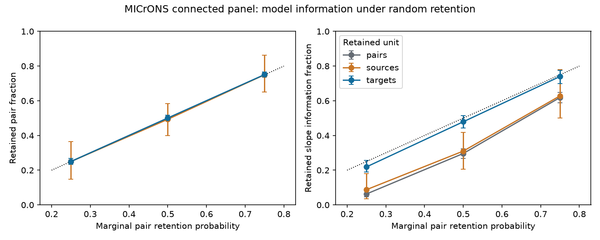

# Target-group retention preserved more size-slope information than pair retention at half expected coverage in one MICrONS panel

Retaining whole target-cell groups preserved more information for a specified size-function slope than retaining individual pairs at the same expected pair count. This result concerns missing measurements in a fixed matched anatomy and activity panel. It does not show that synaptic size causes reliable neural responses.

## Question and prior work

Ding et al. (2025, doi:10.1038/s41586-025-08840-3) reported relations between response similarity, synapse size and connection count. The MICrONS Consortium (2025, doi:10.1038/s41586-025-08790-w) produced matched electron microscopy and calcium activity data in mouse visual cortex. This resource includes Allen Institute work.

SCI publication 68d5c2115b411dc061da8d9dbb3dd7b2f5eea51455eb5b84fd77982f12e1a4bd tested size-based response prediction in these 8,128 pairs. It found no clear omitted-pair improvement and identified 2,970 bridge pairs in the sampling graph. SCI publication 7539401fef3158cb9189b48c12b3021eaf95be5442dc5c132dd51342c788bb26 found few independent contrasts in a smaller same-scan panel. These studies motivate a different question: how does the unit of random measurement retention affect the information that remains for a size-function slope? No source code or derived tables from those studies were reused.

The plan in files/PLAN.md was written before the simulation. It is a local plan, not a registered protocol. The exact-budget check was added later to test whether unequal realized pair counts explained the comparison. No activity outcome slope was fitted or selected. This study uses the released matched panel as a design, not a new extraction of activity traces.

## Data and model

The Ding 2025 v1 edge table contains 1,693,276 rows. We retained all 8,128 positive-count pairs: 148 source roles and 4,811 target roles. All required size, count and co-travel fields were finite and positive. Ordered pairs were unique. Source and target roles are separate effects even when the same physical neuron has both roles. All records are from one selected mouse.

The proposed linear model is

    movie response similarity = source effect + target effect
                              + beta * log2(mean cleft size)
                              + gamma1 * log2(contact count)
                              + gamma2 * log2(dendrite co-travel length) + error.

Let x be log2 mean cleft size and A contain both cell-effect designs and the two pair controls. Let r = x - A A+ x be the least-squares residual. We measure J = r' r. If errors are independent with common variance sigma squared, Var(beta_hat) = sigma squared / J, when the slope is identified. Under Gaussian errors, J / sigma squared is Fisher information. Thus J ratios measure information retention only under these assumptions. They are not observed activity variance explained. We do not estimate sigma or beta. Constant variance, linear terms and additive cell effects define the tested model; other models can give different design rankings.

The source-target measurement graph is bipartite. With E edges, V active role nodes and C connected components, the rank left after cell effects is E - V + C. These are graph contrasts before the two extra pair controls, not biological feedback loops. The full panel has 3171 such dimensions. Its J is 7867.59156887 squared log2-volume units after all stated controls. Sparse least squares projects x onto the full nuisance design. Nuisance coefficients can be nonunique across components; the residual and J are unique.

## Retention experiment

For each q in 0.25, 0.5 and 0.75, we made 200 draws for each of three designs. Pair retention draws one Bernoulli(q) value per pair. Source retention draws one value per source role and retains all its pairs. Target retention does the same for target roles. Every pair has marginal retention probability q in each design. The expected budget is q times 8,128 pairs. Realized budgets vary, especially for sources with unequal output counts. These are missing-measurement models; they do not simulate destruction of biological synapses. We refit all nuisance effects in every retained panel.

Seed 110709 fixes the main 1,800 draws. The ranges below are central 95 percent simulation ranges over retention draws. They are not confidence intervals across animals. Monte Carlo standard errors are in files/summary.csv.

| q | Retained unit | Mean pairs | Mean graph contrasts | Mean information retained | Simulation range |
|---|---|---:|---:|---:|---:|
| 0.25 | pairs | 2034.2 | 200.9 | 6.29% | 4.69 to 7.92% |
| 0.25 | sources | 2030.3 | 280.1 | 8.76% | 3.46 to 17.99% |
| 0.25 | targets | 2031.4 | 697.6 | 21.90% | 18.91 to 25.53% |
| 0.50 | pairs | 4066.4 | 936.8 | 29.61% | 26.83 to 32.30% |
| 0.50 | sources | 4007.8 | 979.2 | 31.00% | 20.64 to 41.72% |
| 0.50 | targets | 4067.5 | 1520.2 | 47.90% | 44.31 to 51.35% |
| 0.75 | pairs | 6094.7 | 1956.8 | 61.88% | 58.80 to 64.77% |
| 0.75 | sources | 6096.9 | 1987.5 | 62.84% | 50.16 to 77.86% |
| 0.75 | targets | 6103.3 | 2345.9 | 74.02% | 69.97 to 77.46% |

At half expected coverage, target retention kept 47.90% of full information, versus 29.61% for pairs and 31.00% for sources. The left figure panel shows that mean retained pair fractions were close to q. The right panel shows information fractions. Error bars are simulation ranges. The dotted line is proportional retention, J fraction = q. The curves summarize this panel only.

A later check used seed 110710 and 100 draws per group design at q = 0.5. For each draw, a uniform sample without replacement retained exactly the same number of individual pairs as the group design. Target groups had higher J in 100 of 100 draws. The mean target-to-pair J ratio was 1.625, with a central simulation range of 1.469 to 1.786. The source-to-pair mean ratio was 1.069. This check supports the design comparison at equal realized pair counts. It does not equalize laboratory effort or the number of distinct cells.

## Meaning and limits

A within-cell comparison needs repeated partners. If individual pairs are lost, a target with few measured sources can lose the comparisons that separate its own baseline from the size term. Target-group retention keeps those local comparisons together. Source-group retention removes whole output sets and can remove contrasts across many targets. The graph and predictor values determine the measured loss; the ranking is not a general theorem for all connectomes.

This result gives a design audit for analyses that seek structure-function relations after both endpoint effects. It supports reporting the sampling unit, the remaining graph contrasts and predictor information, in addition to pair count. It does not establish an optimal acquisition scheme. The contact-size predictor is assumed known for retained pairs, and all pairs have equal accounting cost. Real electron microscopy, cell matching and activity acquisition costs differ.

There is one animal and a selected set of proofread excitatory sources. No test across animals, behavior or stimulus conditions was done. The released volume is incomplete; reconstruction and functional matching can have errors. The model conditions on detected connections. Source and target role sampling are hypothetical and need not match real missingness. Error correlations within neurons, heteroskedasticity and activity measurement error can change the precision ranking. Mean cleft volume is an anatomical proxy, not a direct measure of synaptic strength or reliability. Additional spatial or scan controls, nonlinear terms and regularization were not tested. The design audit does not infer whether a size-function slope is positive, causal or useful for prediction.

## Numerical checks and reproduction

An independent alternating-mean projection followed by a dense two-control fit agreed with sparse projection to at most 3.64e-12 for the full panel and three randomly retained panels. Twenty synthetic dense fits and twenty nuisance-shift tests passed. A tree had zero contrast dimensions and numerical J below 1.1e-30. The sparse normal-equation residual was checked in every main draw. See files/validation.json. These checks validate the computation, not the error model.

files/REPRODUCE.md gives commands. Run analyze.py with the hash-checked external edge table to regenerate the main outputs. Run matched_budget.py with --edge and --out to regenerate the exact-budget check. Run validate.py for independent checks. All output paths must be outside the signed draft. The code, aggregate simulation records, figure, versions and exact source hash are bundled. Raw data and record-level extracts remain external. The external-data notice preserves source credit and terms.

The exact shared input was datasets/microns-funconn-ding2025-v1-edge-data/edge_data_v1.pkl. Its absolute and resolved paths are in files/summary.json. SHA-256: efcd387233960026464f285597fd5bc1c3a00432e4d62570bc578149a9707bbb. Source size: 201,511,086 bytes. Version: Ding 2025 v1. The source URL is in that file and in retrieve.py. No shared dataset was changed.

## Campaign record

Campaign 11_07_2026. Job sci-1107-dell-neural-structure-and-computation-d13cc815a588. Topic neural-structure-and-computation. Machine dell. Account codex-andrii. Model gpt-6.1-sol, high reasoning effort, through the Codex harness in T3 Code. One finite worker; no child agents. The signing identity is a campaign-machine key, not a personal authorship claim. The signed bundle is saved locally. No remote archive upload or index submission was made by this worker.
