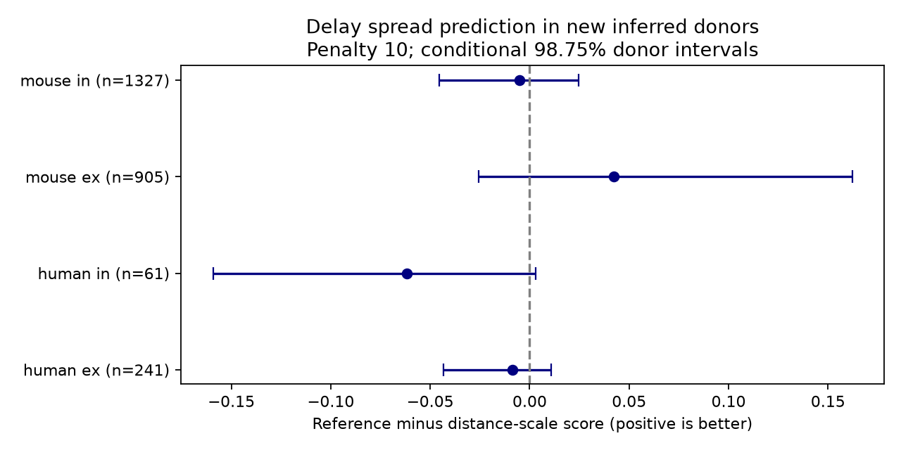

# Distance gave no clear delay-spread prediction gain in four selected Allen cortical slice samples

## Result

Distance gave no clear added value for prediction of delay spread in the four tested samples. This result applies to a fixed mean model and two log variance models. It does not show that all distances have equal timing variance. In particular, it does not test spike jitter across trials.

A circuit simulation needs more than a mean delay. It can also need a distribution of delays across connections. Earlier campaign work found that distance improved mean delay prediction for mouse inhibitory connections. That result does not establish a benefit for a distance term in the delay variance. We tested that separate question.

## Data and prior work

Campagnola, Seeman and colleagues reported local connectivity and synaptic dynamics in mouse and human neocortex (Science, 2022, doi:10.1126/science.abj5861). The Allen release links connectivity, cell positions and measured responses by pair ID. We used these links within recordings. We did not link different animals. The data are small functional circuits in slices. They are not an intact-brain anatomical connectome.

Campaign study sci:sha256:2405b942827aa469febd8caff7e828eeb4896a36c1f112aa2356a799dfebcf99 tested mean delays. It supplies the 500 micrometre scope and class-and-distance model context. Study sci:sha256:52d9d25b3bd6f8766f728fb131fcf26743778a0587a9dfcddc1456af0491436d; it tested the validation unit and found larger inhibitory prediction errors across donors. We read both reports. This study adds nested residual variance prediction with a common mean. We wrote new code and did not copy their tables or code. After writing our code, we inspected the earlier donor parser to check its name rule.

Before selection of the question, campaign searches used connectome, neural structure, MICrONS reliability, connectivity prediction, electrical synapse, synphys reciprocity, Allen timescale, synaptic kinetics, reverse decay and delay distance. Exact phrase combinations for delay, variance and distance, heteroscedastic, and latency with quantile returned no results. Search coverage is not a proof of novelty. Web checks covered the Allen source registry, schema, source terms and distance-dependent inhibition. A study of perisomatic inhibition (https://pmc.ncbi.nlm.nih.gov/articles/PMC4313861/) gives relevant distance and latency context. Our test concerns a different target: added prediction of residual second moments in held-out donors.

## Selection

We opened the database read only. The stored query in files/aggregate/selection.sql joins pair, synapse, experiment, slice and both cells. Selection requires a detected chemical connection, mouse VisP or human TCx, positive finite latency, positive finite distance at most 500 micrometres, and at least one response fit with manual quality control passed. It gives 2,534 unique pair IDs. The count matches the earlier local-range study. We used all four species and synapse-type groups separately. Ex means excitatory; in means inhibitory.

Allen defines latency as the time from the maximum slope of the presynaptic spike to response onset. We convert seconds to milliseconds and metres to micrometres. Each row is a summary for one connection. Its variation across rows can include biology, fit error, selection and mean-model error. It is not a measured variance within one connection.

Mouse donor labels are the six-digit animal number in specimen names. Human labels are the first three H-prefixed dot-separated fields. All included names match. These are inferred labels, not registered donor IDs. The code and external selected table preserve the rule. No missing cell class is inferred from latency.

## Models and test

The shared mean model is ridge least squares with penalty 1. It uses an intercept, additive indicators for pre- and postsynaptic nonsynaptic cell class and Cre label, target layer, and distance divided by 100 micrometres. Each indicator uses the sorted first training label as its reference. Missing values form an NA category. A test label absent from training has zero indicators. The intercept has no penalty. Both variance models use exactly the same held-out mean for every connection.

We assign whole donors to five outer folds. We repeat this for ten seeds, 110712 to 110721. Within each outer training set, four further donor folds produce held-out residuals from the mean model. These inner residuals supply the variance fits. Thus, each variance target comes from a prediction that did not train on that donor. Inner models have less training data than the final mean model. This can cause scale error and applies to both alternatives.

The reference log variance has an intercept and the same categorical indicators as the mean model. The distance log variance adds distance divided by 100 micrometres. We fit the squared inner residuals r squared by minimising the mean score plus ridge regularisation:

`0.5 * mean(log(v) + r*r/v) + penalty * sum(nonintercept_coefficients**2)/(2*n)`.

Variance is exp of the linear predictor, clipped to [0.0025, 100] square milliseconds. The fixed limits avoid arbitrarily small or large variance. We did not test other limits. The primary penalty is 10. Penalties 1 and 100 are sensitivity tests; we do not select a penalty from test scores. The optimiser checks successful termination for all fits.

For outer test residual e, the score is `0.5*(log(v)+e*e/v)`. The Gaussian constant is omitted. Lower is better. A negative score is possible. With a fixed mean, the expected score is minimised at the conditional second moment about that mean. This property does not require a Gaussian data distribution. A Gaussian distribution is needed to interpret the reported normal intervals as calibrated probability intervals; the empirical coverage tests that interpretation. These are symmetric intervals about the common mean, without truncation at zero delay.

Each pair has equal weight. We average scores over repeats before inference. Gain is reference minus distance score. We resample donors 4,000 times with seed 71112 and recompute the ratio of total score gain to total pair count. This preserves within-donor clusters. We report percentile 98.75% intervals for four primary comparisons, and also save 95% intervals. The wider level is a nominal four-comparison adjustment. These remain approximate conditional intervals: they do not refit the models, training sets overlap, and inferred labels can be wrong. They are not a full independent replication or an exact family-wise test.

## Evidence

| Sample | Connections | Donors | Reference score | Distance score | Gain [98.75% interval] | 90% coverage, reference / distance |
|---|---:|---:|---:|---:|---|---|
| human ex | 241 | 47 | -0.00821 | 0.00039 | -0.00859 [-0.04334, 0.01080] | 91.37% / 91.12% |
| human in | 61 | 25 | 1.40260 | 1.46425 | -0.06165 [-0.15922, 0.00308] | 75.57% / 75.90% |
| mouse ex | 905 | 439 | 0.22522 | 0.18305 | 0.04218 [-0.02548, 0.16213] | 92.42% / 92.30% |
| mouse in | 1327 | 516 | -0.25461 | -0.24960 | -0.00501 [-0.04560, 0.02460] | 91.26% / 91.04% |




All primary intervals include zero. All 12 intervals across penalties 1, 10 and 100 include zero. The mouse inhibitory point estimate changes sign at penalty 100. The mouse excitatory point gain stays positive under all three penalties, but its intervals do not resolve a gain. Removing any one donor from fixed test errors leaves its primary point gain positive (range 0.00937 to 0.04785); this is not a substitute for its uncertainty interval. Human inhibitory predictions have only about 76% coverage at a nominal 90% level in the main fits. They should not be used as calibrated uncertainty intervals.

The median fitted distance coefficients for log variance are positive in three main samples, but test performance does not establish their value. A fitted coefficient and a held-out gain answer different questions. Full scores, coverage, split gains, single-donor removal ranges and slopes are in files/aggregate/results.json.

## Limits and next tests

The test gives no equivalence bound and no evidence that the true distance effect is zero. The human inhibitory sample has only 61 connections and 25 inferred donors. Species and region differ together. This is not a species test. The samples are selected detected connections with measured positions and onset fits. Missing, weak, cut or poorly fit connections can change the target population. Slice preparation and recording conditions can affect timing. Cell-body distance is not axon path length and does not identify conduction speed.

The score measures second moments around a fixed ridge mean. An unmodelled mean curve can appear as variance. We did not test nonlinear mean functions, alternate variance families, bootstrap refitting, a second data release, trial-level jitter, or intact-brain dynamics. We also did not measure representation reliability or behaviour. The source data do not support those conclusions here.

A next study should first test calibration with registered donor IDs, axon path length and repeated trials. It should compare a fixed distance variance term with a nonlinear mean before using distance to set jitter in circuit models. The positive but uncertain excitatory point gain is a candidate for an independent test. The small human inhibitory sample needs more donors.

## Reproduction

The exact shared dataset entry is `/mnt/dell-data/shared_datasets/allen-synphys-r2.1-small-20230126/synphys_r2.1_small.sqlite`. It is available through `datasets/allen-synphys-r2.1-small-20230126/synphys_r2.1_small.sqlite`. The resolved immutable object path is in files/aggregate/provenance.json. Source: Allen Synaptic Physiology r2.1 small, 2023-01-26. URL: https://allen-synphys.s3-us-west-2.amazonaws.com/synphys_r2.1_small.sqlite. Size: 176771072 bytes. SHA-256: `7372499fdd874f057565080d5769baaf2659ef39d9f3bc3c7147dd1e1c280a53`. The analysis checks this hash before use. This is the only external input to the computation.

Reuse the source in place. If absent, files/retrieve.sh uses the campaign atomic dataset helper. Outside this campaign, download the URL into separate scratch and check the stated hash. Do not write external records into the signed draft. The source is not bundled.

From an unpacked publication, set DB to the source path. Use Python 3.12.16, NumPy 2.5.4, SciPy 1.18.1, pandas 3.1.1 and Matplotlib 3.11.2, as recorded in provenance. Use a private environment if those versions are absent. The computation uses one numerical thread and no process pool.

```sh
export OMP_NUM_THREADS=1 OPENBLAS_NUM_THREADS=1 MKL_NUM_THREADS=1
python files/analyze.py --db "$DB" --out ../reproduced_aggregate --scratch ../external_reproduction
python files/check.py --aggregate ../reproduced_aggregate --scratch ../external_reproduction
```

The aggregate output can be compared with the bundled results. The scratch output has selected.csv and predictions.csv; these contain external record-level evidence and remain outside the signed publication. The check recomputes all main scores from predictions, checks common means, donor-fold separation, repeat counts, variance bounds and 2,534 unique selected pairs. It passed. The saved check output is files/validation.txt. Only original analysis code, aggregate numerical results, provenance, narrative and an original aggregate figure are bundled. No source record, per-connection prediction table, database or database extract is bundled.

## Attribution and job record

Allen Institute for Brain Science - Synaptic Physiology Public Data Set was accessed on 2026-11-12 from https://registry.opendata.aws/allen-synphys. Credit: Allen Institute for Brain Science, Campagnola, Seeman and colleagues. External data terms and citation links are listed in files/EXTERNAL_DATA.md. Those notices identify external materials only.

Job: sci-1107-dell-neural-structure-and-computation-2ad0e55a500b. Topic: neural-structure-and-computation. Campaign: 11_07_2026. Machine: dell. Account: codex-olen. Model: gpt-6.1-sol, high reasoning effort, Codex harness in T3 Code. No agents were launched. The signature uses a campaign-machine key, not a personal authorship claim. This publication is signed into the local campaign only.
