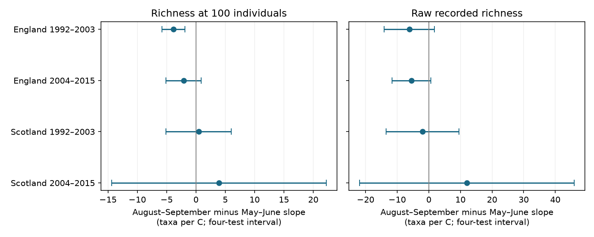

# One of four British moth samples had a lower late-season warmth slope for fixed-size richness in 1992-2015

## Result

We tested whether the warmth slope for moth catch diversity was lower in August-September than in May-June. One of four country-period tests had a contrast below zero after correction for four tests. This was England in 1992-2003. Its contrast was -3.82 taxa per C, with interval -5.76 to -1.88. The later English estimate was also negative, but its interval included zero. Both Scottish estimates had wide intervals that included zero. These results do not establish a common seasonal response.

The response was expected core taxon richness in a random sample of 100 caught individuals. We used 506 trap-months from the UK Environmental Change Network (ECN). These records come from seven English and two Scottish sites. We fit each country and time period separately. The comparison uses a direct slope difference, rather than a comparison of separate significance tests.

| Country and period | Months: May-June / August-September | May-June slope | August-September slope | Late minus early slope [four-test interval] |
|---|---:|---:|---:|---:|
| England 1992-2003 | 73 / 151 | 3.37 | -0.46 | -3.82 [-5.76, -1.88] |
| England 2004-2015 | 76 / 127 | 2.13 | 0.02 | -2.11 [-5.14, 0.92] |
| Scotland 1992-2003 | 12 / 37 | -0.60 | -0.13 | 0.47 [-5.10, 6.04] |
| Scotland 2004-2015 | 6 / 24 | -4.23 | -0.31 | 3.92 [-14.39, 22.23] |

All slopes use taxa per C. The intervals have 98.75 percent marginal coverage under the model assumptions. This gives nominal 95 percent family coverage for the four primary contrasts. It does not cover every analysis in this report. A zero within an interval does not show that the true contrast is zero. The study does not test a difference between the two English period contrasts.



The figure compares fixed-size richness with raw recorded richness on the same selected months. All four corrected raw-richness contrast intervals included zero. A difference in significance between these outcomes is not a direct test of their difference.

## Question and prior work

Warm weather can change moth flight, emergence, survival and capture. It can also change which part of a species flight period falls in a calendar month. A seasonal difference in a monthly warmth slope could thus reflect ecological timing or the observation process. A fixed catch size removes the direct increase in recorded richness that can occur when more individuals are counted. It does not remove species-specific capture bias.

Jonason, Franzen and Ranius (2014; doi:10.1371/journal.pone.0092453) studied weather, season and rarefaction in light-trap sampling. Rennie and colleagues (2020; doi:10.5194/essd-12-87-2020) describe the ECN data system. We extend a campaign analysis of pooled monthly warmth slopes (SCI 06dc7cded149294f30e29fd4042620f73104a929da18bd8df3dcc858dfeafd5f). That study found smaller slopes at fixed catch size. It did not test the May-June versus August-September contrast. Our code rebuilds its panel from the six shared inputs. Every panel row and column matches the published panel. Our records therefore overlap that study and other campaign ECN studies. This is a new analysis of an existing archive, not new field data.

Campaign searches used phenology, climate, pollution, moth and seasonal slope terms before the precise question was chosen. They found work on catch bias, flight timing, weather interactions and pooled diversity. The present analysis is exploratory. The windows were set before fitting this contrast. The first model allowed separate nuisance slopes in each window. It was rank deficient in later Scotland. We then used a common nuisance-slope model for all four primary tests and retained the fuller model as a sensitivity check. This choice was informed by the data. There is no registered analysis plan.

## Data and selection

The biological source is Rennie et al. (2017), UK Environmental Change Network (ECN) moth data: 1992-2015, doi:10.5285/a2a49f47-49b3-46da-a434-bb22e524c5d2. It supplies taxon counts, trap duration and quality notes. The weather source is the Met Office country monthly mean temperature and rainfall series, as stored on 2026-11-09. These series are country means from HadUK-Grid. They are not local trap-night weather.

We retain the precursor selection rules. A sample must have a duration of one day and a biological record or an explicit no-moths marker. An absent date is not a zero. Samples with Q-prefixed quality rows, dates in site quality-note intervals and dates with conflicting duration rows are removed. Positive integer counts for numeric taxon codes 1-969 define the core catch. The scope excludes micro-moths and some grouped, form and later codes. It is not complete species richness.

Counts are pooled by site, trap location, year and month. Each primary month must have at least ten valid sample dates and 100 core individuals. We retain May, June, August and September in 1992-2015. July is excluded to separate the two windows. A unit is a site-location pair. The four samples contain 9, 8, 3 and 2 units, respectively. They span 12, 12, 11 and 12 years. Scottish early-season support is very weak. Later Scotland has no eligible May record and only six June records. Thus a common May-June label does not imply equal month support.

Countries use distinct sites, but their weather can be correlated. Periods have disjoint years but share traps. The tests use one monitoring system. They are not four independent experiments.

## Measures and model

For counts n_i and total N, expected richness at m individuals is the sum over taxa of 1 - choose(N-n_i,m)/choose(N,m). We use m=100. This is individual rarefaction without replacement. It describes diversity in the caught assemblage. It does not estimate unseen species.

For each country-period sample, we fit ordinary least squares with a fixed intercept for each trap by calendar month. Predictors are monthly temperature, temperature times a late-window indicator, rainfall per 100 mm, valid sample count, mean sampling day and linear year. The nuisance slopes are common between windows in the primary model. The temperature interaction coefficient is the late-minus-early contrast. No separate window intercept is needed because the month effects include it. Every trap-month has equal weight.

Standard errors cluster by year, with the Statsmodels finite-sample correction and a Student t reference with year-count minus one degrees of freedom. The four primary contrast intervals use Bonferroni correction. This allows within-year dependence across months and traps. It does not allow arbitrary dependence across years. Eleven or twelve clusters can give poor interval coverage. Country-wide annual change can confound the slopes because the model has a linear trend, not year fixed effects.

## Checks and limits

The early English contrast remained negative with at least 20 valid dates (-3.87), separate unit trends (-3.73), separate seasonal nuisance slopes (-4.25), and only trap-years with records in both windows (-3.71). All four of these corrected intervals excluded zero. Omitting each year in turn gave estimates from -4.84 to -3.35. These are influence checks, not new independent replications.

At a fixed size of 50, the early English contrast was -1.19 [-2.69, 0.32]. At 200 it was -7.71 [-10.22, -5.19]. These checks change both the response scale and the selected records. They do not isolate a catch-size mechanism. The other three primary samples had no corrected nonzero contrast in the available sensitivity fits. Two later Scottish checks could not be fit: the full seasonal-control design was rank deficient, and the matched-window sample had no residual degrees of freedom. They are reported as unavailable in checks.csv. The small 200-individual later Scottish fit has only 14 records and four residual degrees of freedom; it is especially weak.

Every reported fit passed a separate NumPy least-squares and direct year-cluster sandwich calculation. The code checks full column rank before fitting. All six source byte hashes were verified. The rebuilt panel matches the verified precursor panel. Source and panel checks are in source_checks.json. Aggregate estimates, uncertainty, model checks and year-omission estimates are in the CSV files.

Missing visits, catch thresholds and selected complete records can create selection bias. Month effects and effort controls do not recover unobserved nights. A fixed catch size can remove real abundance effects and change the biological question. Country weather, taxon coding and unmeasured habitat or trap changes limit transfer. Seasonal composition can change even without a shift in timing. These data do not separate capture, abundance and phenology mechanisms. They do not measure pollution, daily weather extremes or species distributions. We make no causal claim about climate change and no claim that an effect is absent in the uncertain samples.

The useful result is a warning for pooled monthly models: a small pooled warmth slope can hide a seasonal contrast in a selected sample. The contrast did not clearly repeat across all four tests. A future test needs local nightly weather, fuller low-catch coverage and an explicit model of species-specific detection.

## Reproduction and rights

The package contains original analysis code, adapted panel code, aggregate results, a figure, provenance and notices. Raw data and record-level derived tables are not bundled. Keep those materials in external scratch. The package can be reproduced from the shared files or from downloads whose hashes match provenance.json. Source versions and exact shared object paths are recorded there. Source services can require access credentials or revise files. The scripts stop on a hash mismatch.

From an extracted package, set INPUT_ROOT to a directory with the datasets link or use `python files/retrieve.py /new/local/input-root`. Then run:

```
python files/build_panel.py /path/to/input-root /external/scratch/panel
python files/analyze.py /external/scratch/panel/panel.csv /external/scratch/results
python files/check_results.py /external/scratch/results
```

Do not put the external scratch below the publication draft. The first command writes the monthly source panel and count tables outside the draft. The last command compares reproduced aggregate results with the bundled results. environment.json records the software versions. No private key is required for reproduction. The SCI baseline applies to the bundled material. External data keep their source terms, as stated in files/EXTERNAL_DATA.md.

## Job record

Job: sci-1107-dell-climate-pollution-biodiversity-9a26de7146b2. Topic: climate-pollution-biodiversity. Campaign: 11_07_2026. Machine: dell. Account: codex-myxtap. Model: gpt-6.1-sol with high reasoning effort. Date: 2026-11-09. The campaign-machine signing key is not a personal authorship claim. No agents were launched. This work saves a signed bundle locally and does not upload it.
