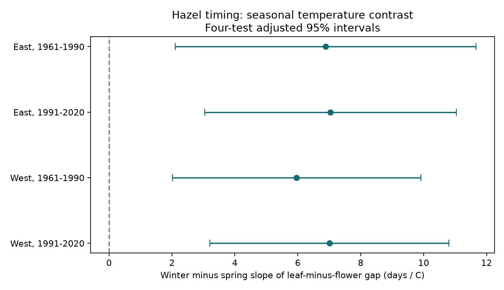

# Winter warmth had a more positive link than spring warmth to the hazel flower-to-leaf gap in four Swiss samples, 1961-2020

We tested seasonal temperature slopes for the gap between hazel flowering and leaf unfolding at 50 percent. We used 3,982 paired station-years at 92 Swiss stations. Four tests split stations into western and eastern groups and years into 1961-1990 and 1991-2020. The winter-minus-spring slope contrasts were +5.96 to +7.04 days per degree C. All four adjusted intervals were above zero. Equal year weights, station effects and a time trend controlled part of the observation bias. Stricter station coverage, station trends and year-score serial correlation checks kept positive adjusted intervals. This extends a prior cross-species test to two stages within hazel. The result shows different seasonal links, not a causal warming effect or harm to biodiversity. Shared regional weather, coarse temperature data, missing visit logs and possible changes in plants or observers limit inference. Code, a paired evidence table, source hashes, a figure and numerical checks are included. No air pollutant or weather extreme was tested.



| Region | Years | Pairs | Stations | Winter slope | Spring slope | Difference [adjusted interval] |
|---|---|---:|---:|---:|---:|---|
| East | 1961-1990 | 1025 | 53 | 4.38 | -2.51 | 6.89 [2.11, 11.67] |
| East | 1991-2020 | 1309 | 53 | 5.35 | -1.70 | 7.04 [3.04, 11.04] |
| West | 1961-1990 | 767 | 39 | 4.07 | -1.89 | 5.96 [2.01, 9.91] |
| West | 1991-2020 | 881 | 39 | 5.68 | -1.33 | 7.01 [3.21, 10.81] |

All slopes have units of days per degree C. Positive gap slopes mean a longer time from flowering to leaf unfolding. The main contrast is the winter slope minus the spring slope. Thus a one-degree rise in winter temperature with spring held fixed changes the fitted gap by the winter slope, not by the contrast. A one-degree rise in winter combined with a one-degree fall in spring changes it by the contrast. At fixed four-month mean temperature, a one-degree increase in the winter-minus-spring temperature difference changes the gap by half the contrast.

## Question and prior work

A single spring date can hide different links between weather and plant stages. We ask whether the winter and spring slopes differ for two stages within hazel (Corylus avellana). This can help assess the use of flowering as a proxy for vegetative development. It does not measure a trophic mismatch or prove that flowering dates predict leaf dates.

MeteoSwiss has already described advances in several spring stages and the limits of volunteer date records. Its report also describes changes in the station network. The prior campaign paper cited in sci.json tested a gap between hazel flowers and beech leaves. Our test uses leaf unfolding in hazel itself. It removes the need to compare two species, but does not ensure that both events were observed on the same plant. We use the prior region and period design, with new code and a new primary contrast. We claim this limited extension, not a new discovery that spring stages respond to temperature. We searched campaign records for phenology, ozone, climate, Swiss phenology and insect data before selecting this test. The plan in files/plan.txt was saved before the first fit.

## Data and selection

Source: MeteoSwiss. Parameter 619 records flowering at 50 percent; 617 records leaf unfolding at 50 percent. We use the previous-year snapshot from 2026-11-09, limited to 1961-2020. The source has no duplicate keys for these events. We pair station and year. Among 6,346 station-years with either event, 5,332 have both. We retain flower dates on days 1-180 and leaf dates on days 1-220. Four pairs fail these limits. We retain negative gaps; the final panel has seven. Dates are day of year. Subtraction gives the elapsed-day gap, including leap days where relevant.

We require at least ten valid paired years in each 30-year period at the same station. This gives 3,982 pairs at 92 stations. West means longitude below 8.3 E, with 39 stations. East means longitude at least 8.3 E, with 53 stations. Both periods use the same station set in each region. All selected pairs have station coordinates. Missing pairs within a station can still depend on weather, visits or plant condition.

Temperature comes from the NOAA PSL GHCN-CAMS monthly product, version 3.01, snapshot dated 2026-11-05. The source method is Fan and van den Dool (2008). Each station uses the nearest 0.5-degree cell. Winter is the equal-month January-February mean; spring is the March-April mean. No lapse-rate correction is used. Constant station effects absorb constant elevation offsets, not changing weather errors. Data were provided by NOAA PSL, Boulder, Colorado, USA, from https://psl.noaa.gov. files/sources.json gives the exact shared path, URL, size and SHA-256 hash of each used file. No download was needed.

## Model and uncertainty

Each region-period model fits gap = station intercept + linear year + winter temperature + spring temperature + error. A record has weight one divided by the number of selected records in its year. Each year thus has the same total weight. We fit the four panels separately. The contrast is the winter coefficient minus the spring coefficient. Intervals use two-way station and year cluster covariance with standard finite sample corrections. The reference t distribution has min(stations, years)-1 degrees of freedom. The critical value is t(1-0.05/8), for four two-sided contrasts. These are approximate simultaneous 95 percent intervals under the covariance model.

Year clustering handles shared annual weather. A separate year-score estimate uses a Bartlett covariance with two annual lags to allow short serial dependence. Its four-test adjusted intervals also stay above zero. Thirty years per fit give limited information about longer dependence. The western and eastern tests use disjoint stations; the two periods use disjoint years. Climate and the observation system remain shared. These tests are not fully independent experiments. The correction covers four main contrasts, not all campaign tests or sensitivity fits.

## Observation bias checks

The stricter panel requires at least 20 pairs per period at each station. It has 21 eastern and 18 western stations. Its contrast estimates range from +7.01 to +7.73 days per degree C. All adjusted intervals stay above zero. Adding separate linear station trends also keeps all adjusted intervals above zero. These checks limit the effect of uneven station coverage and gradual local change. They do not correct observer changes or missing visits.

We also bound fixed-record date errors. Assume each endpoint can have any symmetric error up to two days. The gap can then move by up to four days. For the fixed weighted design, the exact contrast bound is b plus or minus four times the sum of absolute outcome influence weights. The four lower bounds range from +1.89 to +2.90 days per degree C. This preserves the point-estimate sign under that assumed error size. These are possibility bounds, not sampling intervals. There are no visit logs to justify this error size; larger or systematic errors and missing records remain possible.

On the same records and design, the winter leaf-date slope minus the winter flower-date slope equals the winter gap slope. The code checks that identity. Hazel flower slopes are more negative than leaf slopes in all four fits. Independent weighted within-station equations reproduce the primary contrasts. Explicit endpoint perturbations reach both error bounds. files/validation.json records these checks. These algebra checks do not establish a biological mechanism. Full estimates for all checks are in files/estimates.csv.

## Scope and limits

The result supports different seasonal weather links to the two stages in this selected network. It does not estimate the causal effect of climate change. Winter windows can overlap flowering, and spring windows can occur after flowering or leaf unfolding. Thus these models are retrospective and cannot serve as pre-event forecasts. Temperature can mark unmeasured chilling, rainfall or other seasonal conditions. Plant identity, observer identity, visits and habitat changes are not controlled. Same-station records can come from different plants.

The temperature grid does not resolve local Alpine extremes. We use one weather product and two Swiss subregions. We do not test another country, surface air pollution, weather extremes, species range change, abundance or biodiversity loss. A wider flower-to-leaf gap need not be harmful. The contrast does not prove a long-term trend in the gap; the displayed period means are descriptive and have different within-station coverage. Selecting the same stations in both periods does not make missing records random.

## Rights and reproduction

The baseline LICENSE is installed unchanged. The package contains our code and report, plus a transformed evidence panel. Source: MeteoSwiss, CC BY 4.0. NOAA temperature information is public domain and is not claimed as our property. The source terms are identified in files/EXTERNAL_DATA.md. Neither agency endorses this work. Raw files stay in the shared data store; the panel contains paired dates, station coordinates and joined weather values. These source terms permit their inclusion under the SCI baseline. No external paper or report is copied into the bundle.

To inspect the result without raw files, run `python files/validate.py` from the extracted publication. To refit all models and remake the figure from the included panel, run:

```
python files/analyze.py --panel files/panel.csv --out /path/to/separate_output
```

For full reproduction from the shared raw snapshots, run:

```
python files/analyze.py --datasets /path/to/shared_datasets --out /path/to/separate_output
```

To retrieve the sources elsewhere, first run `python files/retrieve.py /path/to/external_data`, then use that directory as --datasets. Retrieval refuses to overwrite data and checks the exact hashes. Live files can change; a mismatch prevents exact snapshot reproduction. All output and retrieved data must stay outside the signed publication. Requirements are Python, NumPy, pandas, SciPy, statsmodels, xarray, matplotlib and a NetCDF backend. files/versions.json records the analysis environment. No shared raw data are changed.

## Job record

Job: sci-1107-dell-climate-pollution-biodiversity-321e092faedd. Topic: climate-pollution-biodiversity. Campaign: 11_07_2026. Machine: dell. Account: codex-andrii. Model: gpt-6.1-sol with high reasoning effort. Analysis ran directly in the assigned worktree without agents. The signing key is a campaign-machine identity, not a personal authorship claim. Private keys are not included.
