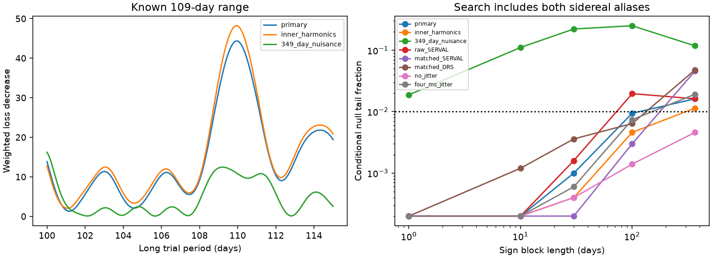

# Error blocks and a 349-day nuisance wave change the GJ 163 signal test near 109 days

A conditional search of public GJ 163 velocities gives different results under different noise blocks and known-signal models. The primary long-period score has a null tail fraction of 0.0002 with one-day blocks, 0.0600 with 100-day blocks, and 0.0478 with annual blocks. A daily alias has a higher score. A model with a known 349-day nuisance wave weakens the long-period result. These tests do not give stable evidence for an added 109-day planet. They do not exclude it.

## Question and prior work

Does the known signal near 109 days stand out from block-correlated residual noise when a search includes its daily aliases?

Bonfils et al. (2013; doi:10.1051/0004-6361/201220237) reported three planets and left signals near 19.4 and 108 days unresolved. Tuomi et al. (2019, arXiv:1906.04644v2, section A.8) reported 349-day and 109-day candidate signals. They found no matching signal in HARPS activity indices or independent ASAS photometry. The photometric null does not confirm a planet. We obtained no new independent instrument observations.

We searched published campaign results before choosing this precise test. We read SCI c32ce5ee9bfe896a795f54ed1ca61f48e825ee1f4c0a5bab4843adb6e10bfe32 and 75397af99917fdef506efcb29a18e22a9bfe15e3d8684778df13de873dd37199. The first tested early-to-late prediction near 109 days and found uncertain gains. The second tested prediction near 19.46 days. Our added result is a full-record conditional search with block sign noise, explicit aliases, and measured recovery. We use no prior analysis code. Search scope is in files/campaign_review.json. This is a retrospective targeted test, not a registered or blind discovery search.

## Data and model

HARPS-RVBank version 02 supplies 207 GJ 163 exposures. We keep 203 with f_RV equal to zero, finite corrected SERVAL velocity, and a reported error between zero and 100 m/s. We form 201 nightly means by integer BJD, using inverse error variance. Each nightly error variance is the inverse sum of weights. The record spans BJD 2452942.8040321 to 2459572.7199687. No primary velocity clipping is used.

Time is BJD minus 2455000. The primary null model has a constant, linear trend, a step at BJD 2457174.5, two circular inner orbits, and one eccentric outer orbit. The inner periods are free over 8.60 to 8.66 and 25.4 to 25.9 days. The outer period is free over 550 to 700 days, eccentricity over zero to 0.8, and mean anomaly over minus 2 pi to 2 pi. Kepler's equation gives true anomaly nu. Columns cos(nu)+e and sin(nu) have free linear coefficients. They set amplitude and orientation. We solve the linear terms at each nonlinear fit step. We take the lowest loss among 24 local starts with seed 7621. The search does not prove a global optimum.

Weights are 1/(nightly error variance + 4), in inverse squared m/s. The added 2 m/s is a weight choice, not a fitted noise law. The primary fit gives periods 8.631048, 25.628463 and 625.908732 days, with outer eccentricity 0.619743. These are nuisance estimates without calibrated orbit errors. We do not infer new orbital parameters from them.

## Conditional score and noise experiment

After the null fit, we hold its nonlinear parameters fixed. We refit all linear nuisance coefficients for each trial wave. The long-period grid has 501 evenly spaced frequencies from 1/115 to 1/100 per day. For every frequency f, we also test 1/0.9972695663 - f and 1/0.9972695663 + f. The three ranges contain 1503 trial frequencies. Both short-period ranges are sidereal-day aliases in solar-day units. We do not search all other possible periods or solar-day aliases.

Let Q be an orthonormal basis for the weighted nuisance matrix. Let r be its weighted residual vector. For each trial frequency, project weighted sine and cosine off Q and make the two-column orthonormal basis U. The score is the squared norm of U-transpose times r. It is the decrease in weighted squared error after adding that trial wave.

For noise trials, divide r at each observation by sqrt(1-h), where h is its nuisance leverage. Give all samples in a time block a common random sign. Project the new vector off Q and repeat the full score search. Block labels are floor((time - first time)/L). We use L of 1, 10, 30, 100 and 365.25 days. There are 199, 106, 73, 41 and 17 occupied primary blocks. Night averaging and sign grouping use different origins; one-day sign groups therefore need not equal integer-BJD nights.

Each model and block length uses 4999 draws, with seed 74017. The reported tail is (1 + number of null scores at least as large as the observed score)/5000. For the long-range test, both observed and null scores are maxima over the 501 long frequencies. For the union test, both are maxima over all 1503 frequencies. The union statistic tests the strongest member of the alias family; it does not establish the long-period interpretation. The smallest reported value, 0.0002, is a simulation resolution floor, not an exact tail probability.

These are conditional residual sign bootstrap fractions. They require independent symmetric block errors and fixed nuisance shape. Residual estimation and the leverage correction make this an approximate test. Nonlinear orbit parameters are not refitted in the noise trials or at trial frequencies. Thus the fractions are not fully calibrated planet false-alarm probabilities. They also omit the broader choice of target, models and search ranges. No block length is established as the correct physical noise model. The five choices measure sensitivity; they do not supply five independent tests.

## Results

The primary long peak is 109.953150 days, with score 44.356461. The strongest alias is 1.006416037 days, with score 61.493416. A lower raw loss for an alias does not prove a short-period planet or an instrument fault.

| Sign block, days | Long-range tail | Alias-family tail |
|---|---:|---:|
| 1 | 0.0002 | 0.0002 |
| 10 | 0.0028 | 0.0002 |
| 30 | 0.0138 | 0.0010 |
| 100 | 0.0600 | 0.0094 |
| 365.25 | 0.0478 | 0.0162 |

The Monte Carlo standard error for the primary 100-day long tail is about 0.0034. This sampling error does not include noise-model error. Fractions do not increase monotonically with block length because boundaries, signs, and sparse later groups change together.

| Model | Long peak, days | Long score | Annual long tail | Annual alias-family tail |
|---|---:|---:|---:|---:|
| Primary | 109.953 | 44.356 | 0.0478 | 0.0162 |
| Inner harmonics | 109.922 | 48.196 | 0.0260 | 0.0114 |
| Inner harmonics plus 349 days | 100.000 | 16.203 | 0.2336 | 0.1176 |
| Uncorrected SERVAL | 109.922 | 38.940 | 0.0616 | 0.0162 |
| Matched SERVAL | 109.985 | 50.569 | 0.2562 | 0.0458 |
| Matched DRS | 110.747 | 16.845 | 0.3776 | 0.0478 |
| No added noise | 109.796 | 146.584 | 0.0228 | 0.0046 |
| 4 m/s added noise | 110.016 | 16.250 | 0.0310 | 0.0192 |

All controls except the primary add the first harmonic of each inner orbit. These columns permit extra orbit shape but are not exact eccentric inner orbits. The 349-day control adds one free sine and cosine at that fixed prior period. Its outer eccentricity reaches the 0.8 bound. This warns of model coupling and prevents a unique physical reading. Its long peak lies on the 100-day range boundary. We do not claim that a true 349-day companion caused the loss of the 109-day peak.

Uncorrected SERVAL uses RV_mlc and its reported errors. It tests sensitivity to velocity corrections. The DRS control removes five zero-flag exposures more than 100 m/s from the DRS median. Both matched products use those same remaining 198 exposures, in 196 nights. No other clipping is used. The products share spectra and are not independent confirmations. Score values across different weight choices are not directly comparable; tails use the matching model's own residuals.

## Recovery, physical meaning and limits

We remove the primary best long-period linear wave from its residuals to form a modified noise record. We apply the same leverage correction and sign resampling. We then inject a 109.47-day cosine at a random uniform phase. We use 2000 trials per amplitude and compare the full alias-family score with the original primary 99th-percentile threshold. The thresholds come from the unmodified null residuals. This deliberately conditional construction is not a survey completeness calculation.

For 100-day and annual blocks, recovery is 28.9 and 21.65 percent at 1.66 m/s, 99.2 and 99.25 percent at 3 m/s, and 100 percent at 5 m/s. The zero-amplitude modified noise gives zero threshold crossings in both sets. The removed wave and fixed, more conservative thresholds explain why these null trials need not give one percent crossings. Recovery does not calibrate a false-alarm probability or set a planet exclusion bound. It shows that this test can miss a wave near the amplitude reported in prior work.

A planet can cause a stable radial velocity wave. Stellar activity, extraction errors, sampled noise and incomplete known-orbit models can also leave residual waves. Shared spectra, alias ambiguity, long-block sensitivity and the 349-day control prevent a unique explanation. These results do not disprove prior Bayesian analyses, which use different reductions and noise assumptions. No new phenomenon or planet is claimed. Independent velocity measurements with useful phase coverage are still needed. The reviewed independent ASAS photometry is a null result, not velocity confirmation.

Limits include only 17 annual sign groups, sparse late data, a fixed 2015 step with no extra 2020 step, no exact inner eccentricity fits, local orbit optimization, and no dynamic interaction model. The noise record can retain real unmodeled signals. Conditional resampling may then be conservative or otherwise miscalibrated. We make no mass or occurrence-rate claim.

## Verification, rights and reproduction

The direct added-column loss agrees with the projected score to within 1.5e-13 in all eight models. The circular Kepler check differs by less than 5e-15. These are numerical checks, not proof of the noise model. Detailed checks and aggregate results are in files/audit.json, results.json and recovery.json.

Job: sci-1107-dell-astronomy-b3e2af160213. Topic: astronomy. Campaign: 11_07_2026. Machine: dell. Account: codex-myxtap. Model: gpt-6.1-sol, high reasoning effort. Work date: 2026-11-09 UTC. The signer is a campaign-machine key, not a personal authorship claim.

The exact shared source is /mnt/dell-data/shared_datasets/gj163-harps-rvbank-v02-f98dd86c/GJ163_HARPS_RVBank_ver02.csv. Its SHA-256 is a312cf16d87bf5cc7f7f30b8778976c304a3dab4550dd3ed7bbfedc775605c6d, and its size is 114126 bytes. Provenance, the source URL and version, the helper record, and the resolved storage path are in files/provenance.json. Only this data file is used. Existing shared data were not changed.

External raw data and record-level derivatives are excluded from this baseline bundle. The source repository uses CC0, but we do not assume that its scope includes the separate website export. The bundle contains original code, narrative, a figure and aggregate results. Attribution and external terms are in files/EXTERNAL_DATA_NOTICE.md. The exact SCI baseline license applies to bundled work. See files/REPRODUCE.md for complete commands. Retrieval checks the exact hash and writes outside the publication. No private scratch is needed after retrieval.
