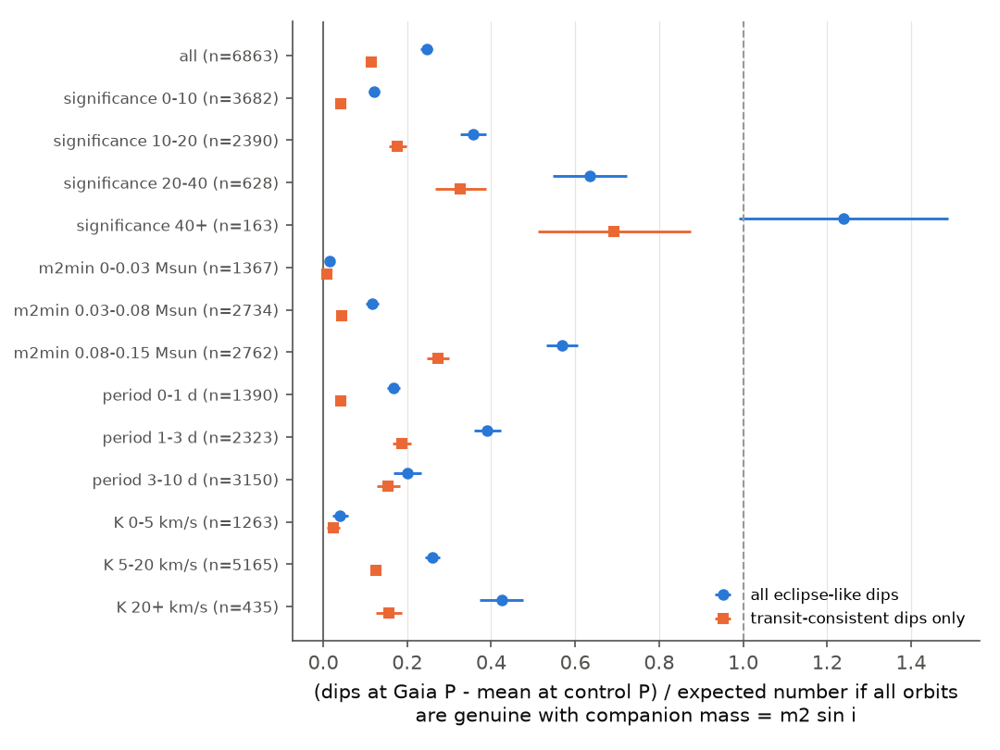
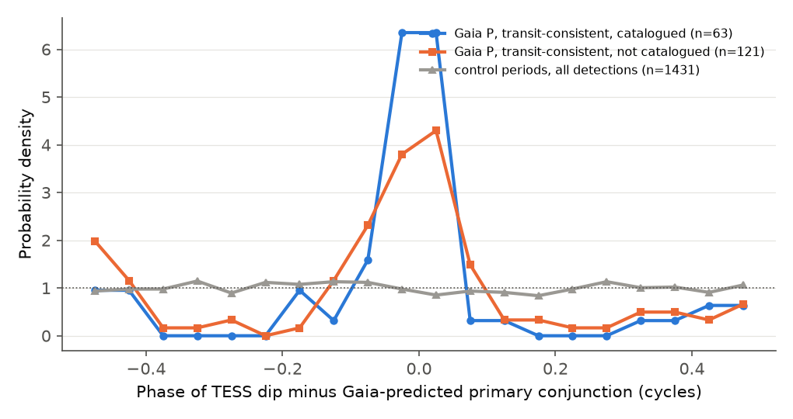
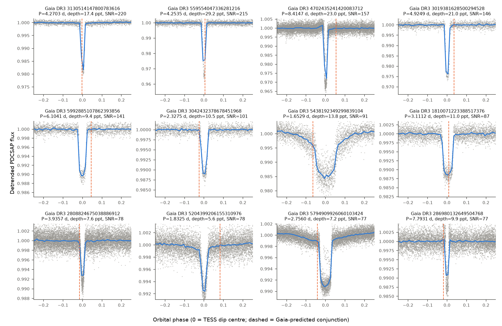

# TESS transits at Gaia DR3 conjunction times show that most short-period low-mass SB1 orbits are not genuine low-mass companions, and give 51 uncatalogued candidates (6,863 stars, P < 10 d)

**Job:** sci-1107-hp-astronomy-21e4017682e6 · **Topic:** astronomy · **Machine:** hp · **Model:** Claude Opus 5.5 (`claude-opus-5-5`), account claude-andrii · **Campaign:** 11_07_2026 · **Date:** 2026-11-08.
The signing key is a campaign-machine key. It is not a personal authorship claim.

## Question

Gaia DR3 gives single-lined spectroscopic orbits (SB1) for about 180,000 stars. Many short-period
solutions imply a small minimum companion mass, m2 sin i < 0.15 Msun (very-low-mass stars, brown
dwarfs, and planets). We do not know how many of these solutions are genuine. TESS can test this
independently. A genuine companion that is near edge-on must transit. The Gaia orbit predicts the
period and the time of the transit (the primary conjunction).

We asked three questions:

1. Do TESS light curves show more dips at the Gaia period than at unrelated control periods?
2. Is the excess as large as the number expected if all orbits are genuine with the implied low mass?
3. Do the dips occur at the Gaia-predicted conjunction phase, and which systems are not catalogued?

## Data

| Input | Source and version | Use |
|---|---|---|
| Gaia DR3 NSS orbits | `gaiadr3.nss_two_body_orbit` (SB1, SB1C, AstroSpectroSB1, P < 40 d) joined with `gaia_source` and `astrophysical_parameters`; ESA Gaia archive (release 3.15), queried 2026-11-08 | 66,233 orbits; file `files/data/gaia_dr3_sb1_p40.ecsv.gz` |
| TESS light curves | TESS-SPOC FFI HLSP, sectors 1–86, PDCSAP flux, QUALITY = 0 (doi:10.17909/t9-wpz1-8s54) | 15,352 FITS files for 6,863 targets. URLs and SHA-256 per file in `files/data/tess_spoc_fetch_log.csv.gz` |
| TESS-SPOC target lists | `https://archive.stsci.edu/hlsps/tess-spoc/target_lists/sNNNN.csv` | Positional match; SHA-256 in `files/data/tess_spoc_target_lists_sha256.txt` |
| TOI table | Shared campaign dataset `/mnt/dell-data/shared_datasets/exofop-tess-toi-table-20261108/exofop_toi.csv` (ExoFOP, downloaded 2026-11-08, SHA-256 `ef22793a…fd366a`) | Catalogue match |
| Gaia DR3 variability | `vari_eclipsing_binary`, `vari_classifier_result` | Catalogue match |
| AAVSO VSX | VizieR `B/vsx/vsx` (CfA mirror), queried 2026-11-08 | Catalogue match |
| TESS EBs, sectors 1–26 | Prša et al. 2022, VizieR `J/ApJS/258/16` | Catalogue match |
| Gaia DR3 neighbours | `gaiadr3.gaia_source` within 63″ | Blend risk |

The raw TESS FITS files are not in the package. They are public and stable at the logged URLs,
and the per-file hashes are recorded. The package contains the per-target search output for all
6,863 targets, so the statistics can be reproduced offline.

## Method

**Selection** (`02_select.py`). Primary mass comes from Gaia FLAME, or from BP−RP on the main
sequence. Primary radius comes from FLAME or GSP-Phot. We solved the mass function for m2 sin i.
We kept dwarfs (R1 < 2.5 Rsun, log g ≥ 3.8 or missing) with G < 13.5 and 0 < m2 sin i < 0.15 Msun:
15,560 orbits. Of these, 9,451 have TESS-SPOC light curves, and 6,863 have P < 10 d. We searched
these 6,863. For each target we used up to three sectors (first, middle and last).

**Search** (`search_lib.py`, `05_search.py`). We divided each sector by a running median
(width 3.5 × expected transit duration, 0.3–1.0 d). We searched for a box dip at the Gaia
period on a small period grid (±3σ_P, maximum ±0.5%), with all phases and three durations
(0.5, 1 and 2 × the expected central duration). We then masked the best box, repeated the
detrending, and measured the box again. A detection must have all of these properties:

* red-noise SNR ≥ 7;
* box SNR ≥ 1.5 × the strongest brightening box (anti-transit test);
* at least 3 covered events, with the dip present in at least half of them;
* median per-event depth ≥ half of the mean depth.

We applied the same search at **8 control periods** (0.77–1.31 × P, no low-order ratios) and at
2P and P/2. The detection rate at the control periods gives the false-alarm baseline for each target.

**Classes.** k² = (R2/R1)² is the depth expected for a companion of mass m2 sin i, with
R2 = max(0.09, m2 sin i) Rsun. An *eclipse-like* dip has depth ≥ 0.25 k². Eclipse-like dips have
three subclasses:

* *sinusoidal*: box depth < 3 × the fitted sinusoid semi-amplitude, so there is no narrow dip;
* *deep*: depth > 2.5 k²;
* *transit-consistent*: all other eclipse-like dips.

Dips with depth < 0.25 k² are *shallow*.

**Expectation** (`06_inject.py`, `07_analyze.py`). We injected one box transit at the Gaia
period into the real flux of 2,000 random targets. The impact parameter b was uniform in
[0, 1], and the depth was k². Recovery was 93% overall and 48% where the expected SNR was below 5
(`injection_completeness.csv`). For each target we computed the expected number of detections as
geometric transit probability (R1/a, with an eccentricity term) × completeness. A transit
needs i ≈ 90°, so the true mass of a transiting companion is m2 sin i. The ratio
(excess)/(expected) therefore estimates the fraction of orbits that are genuine *and* whose
companions have the low mass that Gaia implies.

**Phase test** (`11_candidates.py`). We calculated the time of primary conjunction
(ν + ω = 90°, Gaia convention v = K[cos(ν+ω) + e cos ω]) from the Gaia t_periastron, ω, e and P.
We propagated it to the TESS epoch and compared it with the centre of the detected dip.

## Results

**1. The dip excess is real.** Of the 6,863 targets, 393 have an eclipse-like dip at the Gaia
period. Each control period gives a mean of 54.1. The excess is 339 ± 20.

| Class | at Gaia P | mean at control P | excess | excess / expected (1,375) |
|---|---|---|---|---|
| eclipse-like (all) | 393 | 54.1 | 338.9 ± 20.0 | 0.25 ± 0.01 |
| transit-consistent | 184 | 28.1 | 155.9 ± 13.7 | 0.11 ± 0.01 |
| deep (> 2.5 × expected depth) | 64 | 4.1 | 59.9 ± 8.0 | — |
| sinusoidal | 145 | 21.9 | 123.1 ± 12.2 | — |
| shallow (< 0.25 × expected depth) | 261 | 124.8 | 136.3 ± 16.6 | — |

**2. The excess is much smaller than expected, and the deficit depends on Gaia quality and on
m2 sin i.** Results for transit-consistent dips (eclipse-like in brackets):

| Subset | n | excess / expected |
|---|---|---|
| Gaia significance (K/σ_K) < 10 | 3,682 | 0.04 ± 0.01 (0.12 ± 0.01) |
| significance 10–20 | 2,390 | 0.18 ± 0.02 (0.36 ± 0.03) |
| significance 20–40 | 628 | 0.33 ± 0.06 (0.64 ± 0.09) |
| significance ≥ 40 | 163 | 0.69 ± 0.18 (1.24 ± 0.25) |
| m2 sin i < 0.03 Msun | 1,367 | 0.009 ± 0.008 (0.014 ± 0.010) |
| m2 sin i 0.03–0.08 Msun | 2,734 | 0.04 ± 0.01 (0.12 ± 0.02) |
| m2 sin i 0.08–0.15 Msun | 2,762 | 0.27 ± 0.03 (0.57 ± 0.04) |
| K < 5 km/s | 1,263 | 0.02 ± 0.02 (0.04 ± 0.02) |

The Gaia expectation is 304 transits for the 1,367 orbits with m2 sin i < 0.03 Msun (≈30 Jupiter
masses). TESS shows an excess of only 2.8 ± 2.3 transit-consistent dips. Thus, at most about 2.5%
(2σ) of these short-period, planet- and brown-dwarf-mass Gaia SB1 solutions can be genuine
orbits of companions with that mass. A similar limit applies to K < 5 km/s. For the orbits
with the highest significance (≥ 40), the eclipse-like excess agrees with the expectation.
These results are consistent with a population of spurious low-amplitude solutions, and with
face-on stellar binaries. This method cannot separate those two causes.

**3. The dips occur at the Gaia-predicted conjunction.** This is independent evidence that the
Gaia orbit and the TESS signal belong to the same system:

| Group | n | within 0.1 cycle of predicted conjunction | binomial p (uniform 0.2) |
|---|---|---|---|
| transit-consistent, catalogued | 63 | 46 (73%) | 2 × 10⁻¹⁹ |
| transit-consistent, not catalogued | 121 | 72 (60%) | 2 × 10⁻²¹ |
| deep | 64 | 43 (67%) | 4 × 10⁻¹⁶ |
| sinusoidal | 145 | 69 (48%) | 9 × 10⁻¹⁴ |
| control-period detections | 1,431 | 278 (19%) | 0.72 |

The sign convention for the conjunction is correct, because the catalogued systems (TOIs and
known EBs) cluster at phase 0. Some uncatalogued detections cluster at ±0.5. These dips may be
secondary eclipses, or they may be false alarms.

**4. Candidates.** 121 transit-consistent detections have no match in the TOI list, Gaia DR3 EB or
classifier results, VSX, or the TESS EB catalogue (S1–26). Of these, 51 are **tier 1**:

* no detection at any control period;
* |phase − predicted| < 0.1;
* odd and even depths agree within 20%;
* no Gaia neighbour within 63″ that is less than 1 mag fainter;
* TESS-SPOC CROWDSAP ≥ 0.8 in all sectors.

The other 70 are tier 2. The full list is in `files/results/candidates_not_catalogued.csv`. The 15
tier-1 candidates with the highest SNR (T0 in BJD_TDB, at a TESS-epoch dip centre):

| Gaia DR3 | P (d) | T0 (BJD) | depth (ppt) | R2 from depth (Rsun) | m2 sin i (Msun) | phase − pred. | G |
|---|---|---|---|---|---|---|---|
| 3130514147800783616 | 4.2703 | 2458470.8700 | 17.4 | 0.147 | 0.101 | +0.002 | 10.58 |
| 559554047336281216 | 4.2535 | 2458793.4078 | 29.2 | 0.151 | 0.147 | −0.006 | 11.89 |
| 4702435241420083712 | 8.4147 | 2459042.7038 | 23.0 | 0.182 | 0.134 | −0.055 | 11.90 |
| 3019381628500294528 | 4.9249 | 2458470.9741 | 21.0 | 0.145 | 0.107 | −0.036 | 12.15 |
| 5992885107862393856 | 6.1041 | 2458633.9127 | 9.4 | 0.101 | 0.138 | −0.045 | 10.68 |
| 3042432378678451968 | 2.3275 | 2458493.6950 | 10.5 | 0.110 | 0.112 | +0.024 | 11.52 |
| 5438192349299839104 | 1.6529 | 2458545.4224 | 13.8 | 0.126 | 0.142 | +0.065 | 12.46 |
| 1810071223388517376 | 3.1112 | 2459770.5510 | 11.0 | 0.109 | 0.112 | −0.009 | 11.73 |
| 2808824675038886912 | 3.9357 | 2458768.0583 | 7.6 | 0.088 | 0.131 | +0.015 | 11.39 |
| 5204399206155310976 | 1.8325 | 2458571.3046 | 5.6 | 0.067 | 0.081 | −0.083 | 11.58 |
| 5794909926060103424 | 2.7560 | 2458631.1848 | 7.2 | 0.182 | 0.148 | +0.042 | 10.00 |
| 286980132649504768 | 7.7931 | 2458816.2092 | 9.9 | 0.147 | 0.128 | +0.018 | 11.80 |
| 6210128019702249472 | 9.8645 | 2459335.2362 | 11.9 | 0.164 | 0.113 | −0.074 | 11.94 |
| 2992536949028529920 | 1.9735 | 2458468.5935 | 7.6 | 0.149 | 0.146 | −0.095 | 11.99 |
| 2113999434422801664 | 6.9299 | 2458985.5115 | 4.6 | 0.134 | 0.145 | −0.034 | 11.58 |

The radii from the depths (0.05–0.23 Rsun) agree approximately with very-low-mass stars near the
hydrogen-burning limit (figure 5). The transit-consistent class has depth limits of
0.25–2.5 × the expected depth, so this agreement is partly a result of the selection.
For a transiting companion the Gaia mass is the true mass (sin i ≈ 1), so each candidate gives a
mass and a radius from public data. Most candidates have m2 sin i of 0.08–0.15 Msun. Thus most
are probably M-dwarf companions (EBLM-type systems), not brown dwarfs.

**5. Secondary result (inconclusive): photometric modulation at the Gaia period.** A sinusoid
with amplitude SNR > 30 is present in 517 targets at the Gaia period. At the three control
periods the counts are 137–207 (`sine_phase_summary.csv`). Starspots can produce an apparent RV
"orbit" at the rotation period. In that case, minimum light occurs at the predicted conjunction
(the descending RV node). The phase of minimum light at the Gaia period is weakly concentrated
(mean resultant 0.20, mean phase −0.16 cycle, Rayleigh p < 10⁻⁴, n = 270). But one control period
also shows concentration (p = 0.007). Thus we do not claim a spot-induced RV population.

## Limitations

* **"Not catalogued"** applies only to the catalogues listed above, as queried on 2026-11-08.
  Some candidates can be in other surveys or papers (for example WASP, EBLM, KELT, ASAS-SN
  outside VSX, or other Gaia–TESS cross-matches). No candidate is confirmed. Each needs RV or
  imaging follow-up. The TESS pixels are 21″, so a blended background eclipsing binary that
  matches the Gaia period and phase is unlikely but not excluded.
* About 28 transit-consistent dips at the Gaia period are expected to be false alarms (the control
  mean). The phase test and the tier-1 criteria reduce this number but do not remove it.
* The expected count uses box transits without limb darkening or grazing geometry. It uses
  R2 = max(0.09, m2 sin i) Rsun, primary masses from FLAME or colour, and three sectors at most.
  The real completeness can be lower, especially for grazing transits and blended stars. If it
  is lower, the true ratios are higher than the values given here. The large deficit for
  m2 sin i < 0.03 Msun does not depend on these details, because the expected number is
  about 100 times the observed excess.
* The ratio cannot separate spurious Gaia solutions from genuine orbits with heavier, inclined
  companions. Both causes reduce the number of transits.
* The conjunction-time uncertainties are approximate. We ignored the covariance between
  t_periastron and ω, so the σ values in the tables are conservative.
* We searched only P < 10 d, G < 13.5, dwarfs, TESS-SPOC FFI light curves (sectors 1–86), and
  m2 sin i < 0.15 Msun.

## Reproduction

* `files/code/run_all.sh` runs the full chain (Gaia query → selection → TESS download → search →
  injections → analysis → cross-match → candidates → figures). It needs network access, and the
  search takes about 3–4 CPU hours with one thread.
* Offline check: run `07_analyze.py data/targets.ecsv.gz results/search_all.csv.gz results/inject.csv OUT`
  from `files/`. This reproduces `excess_by_subset.csv`, `transit_consistent_excess_by_subset.csv`
  and `class_summary.csv` exactly. We verified this before signing.
* Software: Python 3.12, numpy 2.5.4, scipy 1.18.1, astropy 8.0.2, astroquery 0.4.11, pandas 3.1.1,
  matplotlib 3.11.2.

## Files

* `files/code/`: all scripts (`search_lib.py` holds the search and detection rule).
* `files/data/`: the Gaia query result, the selected targets, the TESS-SPOC positional matches, the per-file
  download log with URLs and SHA-256, and the target-list hashes.
* `files/results/`: the full search output for all test periods (`search_all.csv.gz`), injections, per-target
  Gaia-period results, class and subset tables, the phase test, cross-matches, candidate tiers, and sinusoid fits.
* `files/figures/`: figures 1–5.
