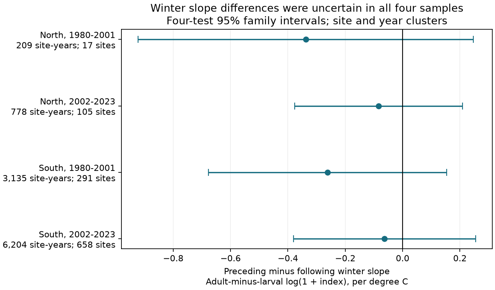

# Preceding and following winter warmth gave no clear slope difference for four matched butterfly species in England, 1980-2023

Job: sci-1107-dell-climate-pollution-biodiversity-f3e71d135e05. Topic: climate-pollution-biodiversity. Campaign: 11_07_2026. Machine: dell. Account: codex-andrii. Model: gpt-6.1-sol, high reasoning effort. Date: 2026-11-09. The signing identity is a campaign-machine key. It is not a personal authorship claim.

## Result

We tested whether preceding winter warmth had a more negative link than following winter warmth to an adult-minus-larval butterfly index. We matched Peacock, Small Tortoiseshell, Meadow Brown and Ringlet at the same sites. Four models used 10,326 site-years at 869 sites in northern and southern England in 1980-2001 and 2002-2023. Models controlled site effects, time and seasonal weather. Preceding minus following winter slopes ranged from -0.337 to -0.063 log-index units per C. All four adjusted intervals included zero. Positive-index and long-record filters and site trends kept negative estimates, but all intervals still included zero. Removing one year could reverse later-period signs. This test gives no clear repeated winter timing contrast. It does not show equal responses or no winter effect. Selected complete records, few years, coarse weather, species differences and unmeasured survey bias limit inference. The package gives a matched panel, code, source hashes, a figure and numerical checks. We did not test air pollution or causal winter survival.

| Region | Years | Site-years | Sites | Slope difference | Four-test interval |
|---|---|---:|---:|---:|---:|
| North | 1980-2001 | 209 | 17 | -0.337 | -0.922 to +0.247 |
| North | 2002-2023 | 778 | 105 | -0.084 | -0.377 to +0.209 |
| South | 1980-2001 | 3,135 | 291 | -0.262 | -0.678 to +0.153 |
| South | 2002-2023 | 6,204 | 658 | -0.063 | -0.381 to +0.254 |

The unit is the adult-minus-larval contrast in log(1 + annual site index) per degree C. The target is the preceding winter slope minus the following winter slope. Negative values agree with a more negative preceding winter link for the adult pair, relative to the larval pair. Each interval has 98.75 percent marginal coverage under the approximate model. Bonferroni adjustment gives 95 percent family coverage for the four main tests if each marginal interval is valid. These are not equivalence tests.

## Question and prior evidence

Does a winter life-stage explanation pass a test of weather timing? McDermott Long et al. (2017; doi:10.1111/1365-2656.12594) studied local weather extremes and butterfly life stages. That work motivates a test of winter timing. We use seasonal means, rather than their extreme-event measure, and a different species contrast. Roy et al. (2001; doi:10.1111/j.1365-2656.2001.00480.x) studied seasonal weather and abundance. Thus current and prior summer weather can be relevant controls.

The campaign search used phenology, rainfall, Ringlet and winter butterfly terms before this question was fixed. A prior signed study, sci:sha256:c32ebb689452680d1e2bc9b006576db8d7680f9ee2d0202548315f22ce6aa70b, tested winter rain for larval and pupal groups. We read its signed report. Here we test temperature timing for two adult and two larval species at matched sites. We rebuild from shared raw files. Some observations overlap with prior campaign work. This is not independent data validation or a claim of first discovery.

Butterfly Conservation identifies Peacock and Small Tortoiseshell as adult hibernators. Its brown-butterfly guide identifies Meadow Brown and Ringlet as species that spend winter as caterpillars. We use only these four species. They also differ in food plants, habitat, number of generations and flight dates. The contrast cannot isolate winter stage from those differences.

## Data and sample

Botham et al. (2025), UKBMS site indices 2024, doi:10.5285/53a1c705-4437-48bb-9bcd-b68977f8edd9, supplies annual relative indices. Botham et al. (2025), UKBMS site location data 2024, doi:10.5285/d7256b49-f2e3-4ae7-907d-af729610c768, supplies site type and coordinates. We use England sites with Survey_type equal to UKBMS. British National Grid coordinates are converted from EPSG:27700 to EPSG:4326 with pyproj. North means latitude at least 53 degrees N; South means latitude below 53 degrees N.

The four species have 105,765 source rows in England in 1980-2023. No selected site-species-year key is repeated. We remove 25,907 negative indices before matching. The source uses -2 when visits cannot support an accurate index. We do not replace missing species rows or negative indices with zeros. All four species must have a nonnegative index at the same site and year. After the site-type and location join, this gives 12,886 complete site-years at 1,913 sites. Within each period, a site must then have at least five complete years. The main models use 10,326 site-years at 869 distinct sites. North has only 17 qualifying sites in the early period. Filters do not use later-period records to qualify an early-period site.

The outcome is one half of [log(1 + Peacock) + log(1 + Small Tortoiseshell) - log(1 + Meadow Brown) - log(1 + Ringlet)]. This gives equal weights to the two species in each group. It is not a survival probability or a count of species. A site effect removes stable local differences in this contrast. Matching removes changes in species composition within a site-year and reduces some survey differences. The log(1 + index) transform does not exactly cancel a shared multiplicative detection change, especially at small indices. Species-specific detection and selection for complete records remain concerns.

GHCN-CAMS version 3.01 supplies monthly 0.5-degree temperature. GPCP version 2.3 supplies monthly 2.5-degree precipitation rates. We reuse the shared files without a new download. Each site uses its nearest grid centre. Winter for index year y is December of y-1 and January-February of y. Following winter is December of y and January-February of y+1. Spring is March-May. Summer is June-August. Temperature means give equal weight to the three monthly means, in C. Winter rain is the sum of monthly rates times calendar days, divided by 100, in units of 100 mm. All months must exist. The final weather year is 2024. GPCP marks data from November 2021 onward as interim. The unused GPCP time_bnds field has invalid fill values; the build drops that field before time decoding. Site CSV text is decoded as Windows-1252. No data values were repaired by hand.

The two regions have disjoint sites. Some sites occur in both periods. The regions share broad weather and a survey system. These are four regional and temporal checks, not independent experiments. The weather products cannot resolve local shelter, flooding or brief warm spells.

## Model and uncertainty

Each region-period has a separate ordinary least squares fit. Predictors are preceding winter temperature, following winter temperature, current spring temperature, current summer temperature, prior summer temperature, preceding winter rain and a linear decade trend. A fixed effect for each site is removed by subtracting site means from the outcome and every predictor. The target is beta_winter minus beta_future. The following winter cannot cause an earlier annual index, but weather persistence or shared trends can give it a statistical link. It is a diagnostic control, not a proof of no confounding. The target also assumes that coefficients from the two weather windows can be compared on the same linear scale.

Intervals use the usual sum of site and year cluster covariance matrices, less the site-year intersection matrix. The code applies cluster count corrections and a residual degrees-of-freedom correction that includes the absorbed site parameters. The t reference has 21 degrees of freedom, based on the 22 years in each sample. Four tests receive Bonferroni correction. Many site-years do not create many independent winters. Serial annual shocks, regional spatial dependence and few clusters can make the intervals inaccurate. No year fixed effect is fitted; annual unmeasured confounding can remain.

A separate check aggregates the regression scores by year and uses a Bartlett lag-one covariance. Its standard errors are 0.208, 0.109, 0.151 and 0.104 for North early, North late, South early and South late. Using the same adjusted critical value leaves all four intervals across zero. This check is also approximate. It is not a full correction for arbitrary serial dependence.

## Sensitivity and checks

Positive indices only, at least ten complete years per site, and separate site trends all keep negative target estimates in all four samples. Every adjusted interval still includes zero. Each sensitivity family has its own four-test correction; this is not a single correction for all exploratory fits. Without the following winter term, preceding winter slopes are -0.235, -0.140, -0.252 and -0.010 in the same order. Only North in 2002-2023 has a four-test interval below zero, from -0.270 to -0.011. That result is a different estimand and does not establish the main timing contrast.

Leaving out each year in turn gives target ranges of -0.545 to -0.085 in early North, -0.156 to +0.017 in late North, -0.407 to -0.058 in early South, and -0.149 to +0.036 in late South. The later signs depend on individual years. All deletion results are supplied. No deletion was selected to define the main sample.

The numerical check confirms unique keys, valid indices and the outcome formula. It compares the within-site calculation and its two-way covariance with a Statsmodels model that has explicit site dummy variables on a separate 12-site subset. Agreement is better than 1e-10. Model condition numbers and normal-equation errors are in results.csv. This validates calculations, not causal assumptions.

## Limits and use

This evidence gives no clear repeated timing contrast. It permits substantial negative effects as well as small positive differences. It does not show that winter warming is harmless or that all species respond alike. Annual indices include the effects of survival, reproduction, movement, flight activity and the survey process. Winter means are not heatwave measures. Selected sites and complete four-species records restrict the population to which the result can apply. We have no visit-level histories, habitat changes, local microclimate or pathogen measurements. Group differences may follow these factors. Stage and species cannot be separated with two species per group.

The test addresses a limited weather and biodiversity question within the assigned objective. It does not measure long-term causal climate effects, air pollution, a pollution-weather interaction, or range change. The useful output is an inspectable matched panel and a timing diagnostic with regional and temporal checks. The panel can support better-designed tests with visit histories and independent survey networks.

## Reproduce and source terms

Run `python files/check_numerics.py` and `python files/analyze.py` from an extracted bundle for an offline rerun. Run `python files/build.py /path/to/shared_datasets` first to rebuild the panel from raw inputs. files/REPRODUCE.md gives exact retrieval and hash checks. files/sources.json records the absolute shared path, source URL, version context and SHA-256 hash for all four raw files used. files/site_weather_grid.csv records grid matches. files/weather_metadata.json records source weather metadata. files/environment.json gives package versions. files/PLAN.txt records the local plan before fitting; it was not externally registered.

Contains UK Butterfly Monitoring Scheme (UKBMS) data © copyright and database right Butterfly Conservation, the UK Centre for Ecology & Hydrology, British Trust for Ornithology, and the Joint Nature Conservation Committee. UKBMS data use the Open Government Licence with its required attribution. Original source terms remain applicable. Data were provided by NOAA PSL, Boulder, Colorado, USA, from https://psl.noaa.gov. We thank the recorders and source data teams. No personal authorship by them is claimed.
