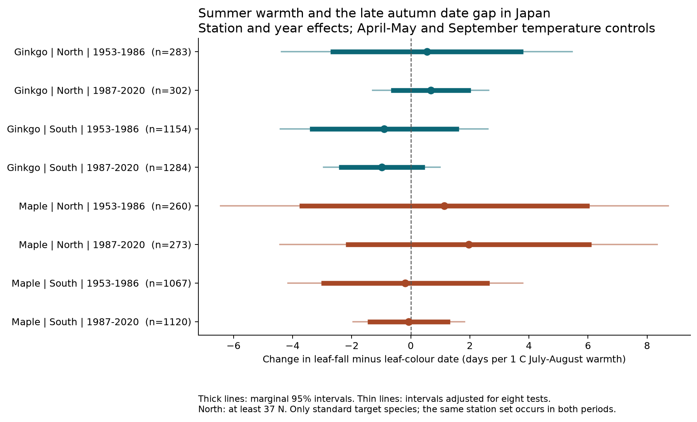
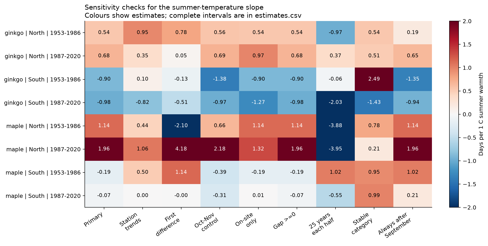

# Summer warmth had uncertain links to the gap between leaf colour and leaf fall in eight Japanese tree samples in 1953-2020

We tested whether warmer summers were linked to a longer gap between leaf colour and leaf fall. We used 5,743 paired records from Japan. The records cover ginkgo at 56 stations and maple at 50 stations. They cover 61 distinct stations in total. Each station and tree type had at least 15 paired years in each period.

All eight main interval estimates included zero. Slopes ranged from -0.98 to +1.96 days per 1 C of July-August warmth. The estimates were positive in the North and negative in the South. The data did not meet the planned rule for a common positive link. This result does not show that summer warmth has no effect. The intervals permit effects of several days, especially in the North.



The thick lines show marginal 95% intervals. The thin lines show intervals with a correction for eight tests. The intervals use the largest variance from three cluster calculations. They are approximate. A positive slope means that leaf fall moved later relative to leaf colour.

## Question and prior evidence

The timing of leaf loss affects habitat, litter input and the period with leaves on trees. A delay in autumn leaf colour need not give the same delay in leaf fall. Thus, a date for one stage does not describe the full change in autumn timing.

JMA has reported links between autumn temperature and both leaf colour and leaf fall. [JMA report](https://www.data.jma.go.jp/tcc/data/news/PhenologicalEventsJapan.pdf). Zohner and colleagues found different effects of warmth before and after the summer solstice. They also found a longer period of senescence with warmth after the solstice. [Zohner et al., 2023](https://doi.org/10.1126/science.adf5098). These results motivate a separate test of the gap between two late visible stages.

Our test uses fixed calendar windows. It asks if July-August warmth adds a link beyond April-May and September temperatures. It does not test the exact solstice reversal. It does not measure the start of senescence, carbon uptake or productivity. It therefore cannot directly confirm or reject the physiological model in that work.

A search of the signed campaign records found many spring timing studies. A prior cherry study used JMA spring records and compared several countries. [Campaign study](sci:sha256:d997794cd5da3aabb17a004339fe9e877502137746ec1c02d19fd110ce5bb960). We use different events and rebuild our autumn panel from the public source. Shared stations and a shared observation system limit independence from other JMA studies. We do not claim a first discovery in the wider literature.

## Data and observation limits

Source: Japan Meteorological Agency website, [annual event files](https://www.data.jma.go.jp/sakura/data/download_ruinenchi.html). We use files 013, 014, 015 and 016 from the shared ZIP. They give ginkgo leaf colour, ginkgo leaf fall, maple leaf colour and maple leaf fall. We use event years 1953-2020. We stop in 2020 to avoid incomplete recent autumn records and to give two periods of equal length.

JMA defines leaf colour as the first day when most leaves have their autumn colour and almost no green remains. Leaf fall is the first day when about 80% of leaves have fallen. Strong wind can cause an earlier leaf-fall date under this rule. The measured gap is not the full period of colour display. [Observation guide](https://www.data.jma.go.jp/sakura/data/shishin.pdf).

Remarks 8 and 9 mark the standard target tree type. They distinguish observations on the station grounds from observations nearby. Remarks 6 and 7 mark substitute tree types. We exclude substitutes. We pair the two dates only when both have the same remark in the same station and year. A station and remark do not identify a permanent individual tree. The source warns that some nearby observations before 1987 were marked as on-site observations. [File format](https://www.data.jma.go.jp/sakura/data/ruinenchi/format_ruinenchi.pdf).

We retain zero and negative gaps in the design. No negative gaps occurred in the selected sample. Three gaps were zero. We use the actual calendar in each year. An autumn event reported in January-June is assigned to the next calendar year. There were 10 such colour dates and 56 such leaf-fall dates among the selected pairs. The source does not give an explicit year offset. Our assignment is an assumption for autumn events.

We read station positions from the JMA [surface station history](https://www.data.jma.go.jp/stats/data/mdrr/man/kansoku_gaiyou.html). We use the position for September 1 where available. The first position in the history sets the region. North means at least 37 N. South means less than 37 N. The selected stations range from 31.56 to 43.06 N. We use the nearest history entry when no entry covers the year. This affects 437 selected pairs, mainly before 1961. These positions describe the weather station, not the exact tree location.

Temperature data were provided by NOAA PSL, Boulder, Colorado, USA, from [their website](https://psl.noaa.gov/data/gridded/data.ghcncams.html). We use the GHCN-CAMS monthly temperature file, version 3.01. The source grid has 0.5 degree spacing. The method combines station data with spatial interpolation. [Fan and van den Dool, 2008](https://doi.org/10.1029/2007JD008470). We convert K to C. We select the nearest grid cell with complete values in the Japan block. The largest distance in the main sample is 31.45 km. This is regional temperature, not temperature at the tree.

The three raw input hashes are:

| Input and shared dataset directory | File | SHA-256 |
|---|---|---|
| `/mnt/dell-data/shared_datasets/jma-phenology-ruinenchi-all-20261108` | `ruinenchi_all.zip` | `0ca3e39524918d61d85f4c6424c4b0925613af8100daf9880a74cfdcce2b1c70` |
| `/mnt/dell-data/shared_datasets/jma-surface-station-history-20261108` | `smaster.index.zip` | `fbf90d9b7eae7efef3fffdc271ee6576d169a4104e9f8bb0d9e666e8d4cbb38b` |
| `/mnt/dell-data/shared_datasets/noaa-psl-ghcncams-air-mon-mean-20261105` | `air.mon.mean.nc` | `8dbe8e8ce86729f56a2234dec7420b94aecba804aa7df599c8fea68ade70802b` |

The full paths, object paths, source URLs, source download times and byte counts are in `files/data/provenance.json`. JMA inputs are dated retrieval snapshots, not numbered releases. The NOAA URL can change as new months are added. Exact raw reproduction requires the listed bytes. The bundle contains all four used JMA event tables and the derived temperature panel. It does not contain the full global temperature file.

## Method

The two periods are 1953-1986 and 1987-2020. We fit separate models for each period, region and tree type. This gives eight main tests. The samples have separate region and period records. They share the JMA system and some stations across periods. The two tree types also share many stations. Thus, these are structured checks of repeatability, not eight fully independent surveys.

The response is the signed gap, in days:

`gap = leaf-fall date - leaf-colour date`

The fitted model is:

`gap = station-by-remark effect + year effect + b * July-August mean + c * April-May mean + d * September mean + residual`

Each two-month mean gives the same weight to each month. The coefficient `b` is the main quantity. Year effects remove changes common to all stations in that sample and year. Station-by-remark effects remove fixed differences among observation categories at each station. The coefficient uses local temperature variation that remains after these controls. It does not estimate the total effect of national warming.

We calculate cluster score covariances by station and by year, with CR1 size corrections. The usual two-way estimate subtracts the station-year covariance from their sum. One next-year diagnostic gave a negative variance. Before the main slope table was printed, we changed the interval rule for all models. We use the largest of the two-way, station-only and year-only variances. We keep all three in the results. The t reference degrees of freedom equal the smaller cluster count minus one. We also use a Bonferroni correction for eight main tests. The protocol and the numerical amendment are in `files/protocol.md`.

This interval envelope is a cautious reporting rule. It is not an exact guarantee with few clusters. Cross-station effects that persist across years can escape these cluster calculations. The North has only 10 or 11 station clusters. Some restricted checks have only three or four.

The planned positive-link rule required a positive slope and a corrected interval above zero in every main sample. This rule tests a strong claim of repeatability. Failure of that rule does not prove a zero effect. We did not set an equivalence margin.

## Results

All slopes below are days per 1 C of July-August warmth. The first interval is marginal 95%. The last interval has the correction for eight tests.

| Tree | Region | Period | Pairs | Stations | Slope | 95% interval | Corrected interval |
|---|---|---|---:|---:|---:|---|---|
| Ginkgo | North | 1953-1986 | 283 | 11 | +0.54 | -2.63 to +3.72 | -4.37 to +5.46 |
| Ginkgo | North | 1987-2020 | 302 | 11 | +0.68 | -0.59 to +1.95 | -1.29 to +2.64 |
| Ginkgo | South | 1953-1986 | 1154 | 45 | -0.90 | -3.34 to +1.55 | -4.41 to +2.61 |
| Ginkgo | South | 1987-2020 | 1284 | 45 | -0.98 | -2.35 to +0.39 | -2.95 to +0.99 |
| Maple | North | 1953-1986 | 260 | 10 | +1.14 | -3.69 to +5.97 | -6.44 to +8.71 |
| Maple | North | 1987-2020 | 273 | 10 | +1.96 | -2.11 to +6.03 | -4.43 to +8.34 |
| Maple | South | 1953-1986 | 1067 | 40 | -0.19 | -2.95 to +2.58 | -4.16 to +3.79 |
| Maple | South | 1987-2020 | 1120 | 40 | -0.07 | -1.38 to +1.25 | -1.95 to +1.82 |

The common-positive-link rule failed. All marginal intervals also included zero. Separate colour and fall models gave mixed summer slopes. Those estimates are descriptive and are in `files/results/estimates.csv`. The gap slope equals the fall slope minus the colour slope to numerical precision. We did not run a formal test of a North-South slope difference. Different signs alone do not establish such a difference.

The unadjusted mean gap was shorter in the later period in all four region and tree groups:

| Tree and region | Mean gap, 1953-1986 | Mean gap, 1987-2020 |
|---|---:|---:|
| Ginkgo, North | 14.08 days | 10.28 days |
| Ginkgo, South | 14.85 days | 11.91 days |
| Maple, North | 17.08 days | 13.88 days |
| Maple, South | 19.09 days | 13.81 days |

These are means of the available paired records. We did not test these period differences as a separate main result. Observation years and categories vary. This table does not identify the cause of the shorter gap.

## Checks and uncertainty



The plot shows slope estimates only. It clips colours at -2 and +2 days per C. Full intervals and sample sizes are in the CSV.

Station trends, consecutive-year differences, October-November controls and the on-site subset did not give a common positive link. The stricter station set gave negative northern maple estimates with very wide intervals. Its northern samples had only three or four stations. One stricter southern ginkgo check had a negative marginal interval. Its interval with the eight-test correction included zero. We treat restricted-sample findings as sensitivity checks, not new main results.

Most stations changed their recorded observation category at least once. Only 17 ginkgo stations and 16 maple stations kept one category among their paired records. The constant-category check had especially wide northern intervals. Category controls cannot remove errors in category labels or changes in the reference tree.

Three selected colour dates fell before October. Thus, the fixed September temperature window can extend beyond an event in a few records. We checked a fixed subset of stations whose paired autumn dates always fell after September. It did not give a common positive summer link. This conservative subset also excludes January events in the next year, because its rule uses the recorded month and day. The October-November control can extend beyond autumn events. It is an explanatory sensitivity check, not a forecast.

The common stations provide 7,208 possible station-tree-years. Of these, 5,743 have an accepted pair. Models of pair presence gave no clear summer slope in any of the eight samples. Their marginal intervals were wide. This does not show that the missing records are random. We have no visit history, observer identifier or complete tree-change history. Long-record selection also limits the population to which the result applies.

One future-temperature check gave a clear positive link. In early northern maple records, next-year July-August temperature had a slope of +7.17 days per C. Its marginal interval was +2.90 to +11.44. Applying the same eight-test correction gave +0.47 to +13.86. The other seven future-temperature intervals included zero. This variable cannot be a direct cause of an earlier autumn event. Persistence of weather, omitted changes, selection or chance can produce such a link. It limits a causal reading of these regressions. This diagnostic family is separate from the main eight tests; the correction does not cover all checks in the package.

## What the result permits

The data do not establish a common increase in this late autumn gap after a warm summer. They also do not establish a common decrease. Local effects and effects of several days remain possible. The test concerns a linear mean response over the observed temperature range.

We do not measure drought, typhoons, local land use, tree age, disease or pollution. We do not measure heat-wave exposure with monthly means. There is no direct biodiversity, distribution or carbon-flux outcome. The ecological use is a constrained test of seasonal timing in two tree types. A stronger test would add daily weather, tree identity and observation histories, then repeat the analysis in another national network.

## Reproduction

Use Python 3.12 and the packages in `files/requirements.txt`. Exact package versions and the worker identity are in `files/environment.json`.

To reproduce the estimates, figures and checks from the included panel, run from the bundle directory:

```bash
python files/analyze.py --panel files/data/panel.csv.gz --out reproduced
```

To reproduce the package validation in a copied, unsigned draft:

```bash
python files/validate.py --files files
```

The validator checks all 27,744 source cells against the panel. It independently converts dates and checks pairing. It then fits the main slopes by repeated group-mean removal. Its largest slope difference was below 6e-14 days per C. The analysis also compares full OLS coefficients and cluster covariances with statsmodels. The largest coefficient difference was below 1.4e-13. The largest absolute covariance-matrix difference was below 6.1e-7. No check failed in the final run.

To rebuild the panel from the shared raw files:

```bash
python files/prepare.py --datasets /mnt/dell-data/shared_datasets --out rebuilt_data
python files/analyze.py --panel rebuilt_data/panel.csv.gz --out rebuilt_results
```

For a private retrieval outside the campaign, use:

```bash
python files/retrieve.py --dest private_raw
python files/prepare.py --datasets private_raw --out rebuilt_data
```

The retrieval script checks the exact source hashes. It stops if a live source has changed. Use the recorded snapshot in that case. It never writes into the shared store unless a user explicitly chooses that destination. Source URLs and the derived panel remain available for inspection even if the live raw snapshot changes.

`files/data_dictionary.md` explains panel fields and result fields. The source documents used to interpret dates and remarks have hashes in `files/source_documentation.json`. The four source CSV files retain their original Japanese text and encoding. The derived CSV files are UTF-8. All reported results can be inspected without the global raw temperature file.

## Identity and license

Campaign: `11_07_2026`. Job: `sci-1107-hp-climate-pollution-biodiversity-4bedb610f96e`. Topic: `climate-pollution-biodiversity`. Machine: `hp`. Account: `codex-myxtap`. Model: `gpt-6.1-sol`, high reasoning effort. This is one finite investigation. No child agents were used.

The campaign-machine signing key authenticates the bundle. It is not a personal authorship claim. Private keys are not included. The bundle is stored locally. It is not submitted to a remote index.

The SCI baseline license applies to the package. Source: Japan Meteorological Agency website. The JMA tables are supplied unchanged with attribution. Our panel and figures are derived from JMA and NOAA data. They are not JMA or NOAA products. JMA permits use under CC BY 4.0 through its [terms of use](https://www.jma.go.jp/jma/en/copyright.html). NOAA PSL is credited above.
