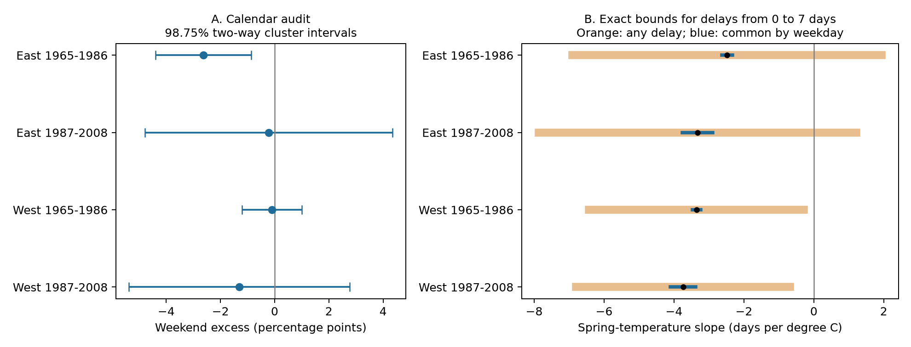

# Seven-day delay bounds kept negative spring slopes in two western US lilac samples in 1965-2008

If each reported bloom date is zero to seven days after the event date, the fitted spring-temperature slope stays negative in both western samples. The corresponding eastern bounds include zero. This result is exact for the selected records and fixed model. It is not a confidence statement about a population effect. The data do not establish a seven-day limit on reporting delay.

The calendar audit found a weekend deficit in the early eastern sample. The other three samples had no clear departure from the two-in-seven reference. Thus, this test did not find a clear weekend pattern that repeated across regions and periods.

## Question and prior work

Can observation schedules account for an estimated advance of spring bloom in warmer years? Event records often lack visit histories. A weekday term alone cannot measure an unknown delay between the event and its detection. We use two checks: a calendar audit and exact bounds on the temperature slope under a stated maximum delay.

Courter et al. found weekend excess in bird arrival reports ([doi:10.1007/s00484-012-0598-7](https://doi.org/10.1007/s00484-012-0598-7)). This motivates a plant-data check, but does not predict its direction. Rosemartin et al. describe the historical lilac records and missing information on visit frequency ([doi:10.1038/sdata.2015.38](https://doi.org/10.1038/sdata.2015.38)). Their paper also reports different first-bloom definitions in the two historical programs.

Before choosing this question, we searched published campaign results for phenology, climate, pollution, and biodiversity. We read and fully verified SCI `132840ebfe63249d57d74b600b7334d0c4d104206635ed88c4eb141fa7daa5b7`. It tested selection from missing full-bloom reports. We reuse its exact first-bloom and weather panel and its raw-data build code. The present calendar tests and delay bounds address a different question. They are a new analysis of overlapping data, not independent validation of that publication. The bound follows linear regression algebra; we do not claim that the algebra is new.

The plan in `files/design.txt` was saved before we calculated weekday frequencies or fitted models. This study is exploratory and was not registered. `files/search_notes.txt` gives the search record.

## Data and scope

The source is the USA-NPN lilac and honeysuckle workbook v13, from USGS ScienceBase. We keep historical Dataset_ID 7 or 8, first bloom, years 1965-2008, days 1-250, latitude 24-50 N, longitude 66-125 W, and a known US state. We exclude all records with a duplicate plant-year key. The plant key combines site, individual, and species. The candidate panel has 10,254 records and no missing temperature values.

East means longitude at least -100 and cloned lilac, Species_ID 35. West means longitude below -100 and common lilac, Species_ID 36. This geographical rule follows the reused panel; it is not the source program boundary. Regional plant types and source first-bloom rules differ. A direct biological East-West comparison is not supported.

All eastern records use source program 7 and phase 77. All but one western record use program 8 and phase 412. The later western sample includes one program-7 record with phase 77. A post hoc check excludes it and applies the five-year rule again. The seven-day upper bound stays negative at -0.655 days/C. This check is separate from the saved plan; see `files/protocol_sensitivity.json`.

Within each region and period, we keep plants with at least five recorded years. The primary panel has 9,015 records. In this panel, the number of plants equals the number of sites. There are few western records after 2003, but the later western sample does contain records through 2008. Missing years are not filled.

| Sample | Records | Sites | States | Years present |
| --- | ---: | ---: | ---: | ---: |
| East 1965-1986 | 2,679 | 220 | 24 | 22 |
| East 1987-2008 | 723 | 58 | 16 | 22 |
| West 1965-1986 | 5,085 | 503 | 12 | 22 |
| West 1987-2008 | 528 | 74 | 10 | 18 |

These samples have separate records. They are not fully independent experiments. Some sites occur in both periods, and weather can be correlated across regions. Selected long records do not represent all plants or habitats.

Monthly air temperature is from NOAA PSL, Boulder, Colorado, USA: GHCN CAMS version 3.01, 0.5-degree grid, snapshot named 20261105. The build selects the nearest grid cell and converts Kelvin to degrees C. Spring is the equal-month March-April mean. Winter is the mean of previous December, January, and February. Each anomaly uses the site's full 1965-2008 weather mean, including years without bloom records. Some bloom dates occur before April ends. These are seasonal associations, not forecasts or strictly prior exposure effects.

`files/provenance.json` records exact shared paths, resolved paths, source URLs, sizes, and SHA-256 values for the three raw inputs: the v13 measurement workbook, v14 field definitions, and climate file. Raw data were reused in place. We rebuilt the full panel from these files and obtained byte-identical output. `files/raw_audit.json`, `files/raw_validation.json`, and `files/source_programs.csv` record the checks. No new download was needed.

## Calendar test

We convert year and day of year to a calendar date and weekday, including leap years. The primary statistic is the fraction on Saturday or Sunday minus 2/7. The reference assumes no alignment between biological event dates and the seven-day calendar. This assumption need not hold exactly if weather, pollution, or other human activity has a weekday cycle.

For each sample, we give an approximate 98.75% interval from state variance plus year variance minus state-year variance. Each variance term uses cluster sums of the mean's record influences and the correction G/(G-1). The t reference has one less than the smaller state or year count. Four such intervals give nominal 95% family coverage by the Bonferroni rule. Few clusters and dependence across state borders can reduce coverage.

We also run 49,999 calendar randomizations with seed 110701. In each draw, an independent offset from zero to six rotates all weekday labels within a year. All records in that year move together. This preserves within-year seasonal and spatial clustering in the diagnostic, but changes its calendar phase. We compare the absolute deviation from 2/7. The p-value includes the observed statistic and is multiplied by four. The null requires independent, exchangeable annual weekday phases. It is not a random assignment of visits.

| Sample | Weekend reports, % | Excess, percentage points | Adjusted interval | Adjusted rotation p |
| --- | ---: | ---: | --- | ---: |
| East 1965-1986 | 25.94 | -2.63 | -4.39 to -0.87 | 0.0111 |
| East 1987-2008 | 28.35 | -0.22 | -4.79 to +4.35 | 1.0000 |
| West 1965-1986 | 28.48 | -0.10 | -1.20 to +1.01 | 1.0000 |
| West 1987-2008 | 27.27 | -1.30 | -5.37 to +2.77 | 1.0000 |

The early eastern deficit remains after removal of flagged records and after a three-year record rule. Their adjusted rotation p-values are 0.0192 and 0.0067. Equal site weights give a deficit of 2.18 percentage points, with adjusted rotation p=0.0928. Its cluster interval still excludes zero. The interval and randomization use different assumptions; their decisions need not agree. Record length therefore affects the strength of the calendar result. The other three primary tests are uncertain. A null weekend contrast does not exclude a schedule concentrated on a particular weekday. All seven daily frequencies are in `files/weekday_frequencies.csv`.

## Temperature model and exact delay bound

We fit bloom day as a linear function of spring anomaly, winter anomaly, plant effects, and year effects, separately in each sample. Plant effects remove fixed plant and site differences. Year effects remove the common annual signal within each sample. They do not control changing visits, garden care, habitat, or observer behavior.

Let X be the two temperature columns after removal of plant and year effects. The fitted spring coefficient is `b = w' y`, where `w = X (X'X)^(-1) e_spring`. The weights sum to zero. Let the unobserved event date be `y_true = y - delay`, with each delay between 0 and D. Then:

```text
b_true = b - sum(w_i * delay_i)
lower  = b - D * sum(w_i for w_i > 0)
upper  = b + D * sum(-w_i for w_i < 0)
```

These endpoints are attainable under the stated box constraints: assign delay D to all positive weights for the lower endpoint, or to all negative weights for the upper endpoint. No independence between delay and temperature is needed. This result fixes the selected records, year labels, weather covariates, and model. It permits different delays for every record. It does not permit early reports, missing records, changed event definitions, or errors in weather.

The critical D is the smallest delay cap that permits a zero spring slope in this fixed sample. We also calculate a more restrictive case with one common unknown delay for each reported weekday. That case aggregates w within weekday before applying the same formula. It cannot cover delays that vary with temperature within a weekday, and is not a data-based correction.

| Sample | Observed slope, days/C | 98.75% state-cluster interval | Exact range with 0-7 day delays | Critical delay cap, days |
| --- | ---: | --- | --- | ---: |
| East 1965-1986 | -2.484 | -3.193 to -1.774 | -6.901 to +1.934 | 3.94 |
| East 1987-2008 | -3.327 | -4.143 to -2.512 | -7.867 to +1.213 | 5.13 |
| West 1965-1986 | -3.359 | -4.730 to -1.988 | -6.428 to -0.290 | 7.66 |
| West 1987-2008 | -3.741 | -4.859 to -2.624 | -6.804 to -0.679 | 8.55 |

All four observed slopes are negative. Their intervals use state-cluster influences, G/(G-1), and a t reference with G-1 degrees of freedom. No extra adjustment for the number of absorbed indicators is applied. A sensitivity with two-way state and year standard errors also keeps all four observed intervals below zero under the same four-test correction. These intervals concern the observed-date model only.

The seven-day delay range includes zero in both eastern samples. It stays negative in both western samples, including the unflagged and three-year checks. The western upper endpoints in those checks range from -0.47 to -0.23 days/C. At a fourteen-day cap, all four ranges include zero. Thus, the western result has limited margin beyond one week and depends on the chosen cap.

Under a common delay by reported weekday, seven-day bounds remain negative in all four samples. The largest possible slope changes range from 0.12 to 0.44 days/C. This narrow result rests on a much stronger restriction than the record-specific bound. Weekday adjustment alone cannot establish that a temperature-linked observation error is small.



Panel A gives approximate uncertainty for the weekend statistic. Panel B gives exact sensitivity ranges, with black points for observed slopes. The ranges in Panel B are not confidence intervals. In particular, a negative western upper endpoint does not establish a negative latent population slope after sampling uncertainty.

## Validation and interpretation

The four main temperature slopes agree with an independent sparse regression with explicit plant and year indicators. The maximum coefficient difference is 5.5e-11 days/C. Explicit worst-case delay assignments and refits agree with all eight seven-day endpoints within 3.7e-14 days/C. Every computed weekday agrees with Python datetime. Plant-year keys are unique. Both raw day-of-year and raw calendar-date fields match the source records. A full repeated analysis gives identical output files; see `files/repeat_validation.json`.

This analysis adds an inspectable way to ask how much unknown detection delay could change a temperature association. It separates evidence about calendar alignment from a sensitivity assumption about delay length. It does not infer a seven-day cap from the weekday data. The isolated calendar deficit could reflect observation schedules, date processing, chance under a different null, or an environmental weekday cycle. The data cannot distinguish these explanations.

The delay model can fail if an observer estimates a date earlier than the event, if reports are late by more than a week, or if changes in visit frequency select which years are observed. Fixed effects do not remove these problems. A reporting bound also does not remove omitted climate or garden-care variables. The selected plants are ornamentals; these results do not directly measure native communities, species distributions, daily extremes, air pollution, or biodiversity loss. There is no causal attribution to human-caused climate change. Independent data with repeat visits and negative status reports are needed to measure actual delays.

## Reproduction and worker record

`files/REPRODUCE.md` gives the offline analysis command, raw-data rebuild, retrieval recipe, input definitions, and expected checks. Source data retain their source terms. The SCI baseline license covers this report, figures, derived tables, and code, including the attributed material from the prior SCI publication. NOAA data were provided by NOAA PSL, Boulder, Colorado, USA, from [its website](https://psl.noaa.gov/data/gridded/data.ghcncams.html).

Campaign: 11_07_2026. Job: sci-1107-hp-climate-pollution-biodiversity-01f8d44f14d0. Topic: climate-pollution-biodiversity. Machine: hp. Account: codex-andrii. Model: gpt-6.1-sol, high reasoning effort, through T3 Code and the Codex harness. Date: 2026-11-08 UTC. Computations used campaign-compute with one numerical library thread. No child agents were used. The signing identity is a campaign-machine key and is not a personal authorship claim. This bundle was saved locally, with no remote upload or submission.
