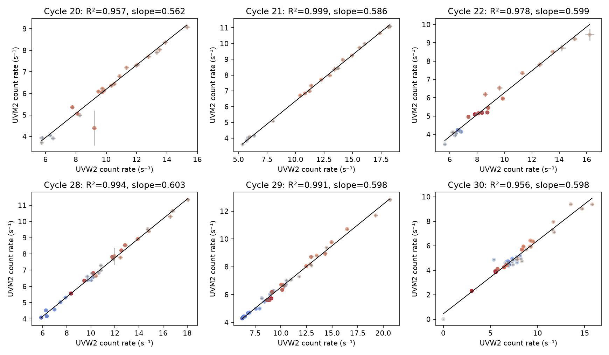
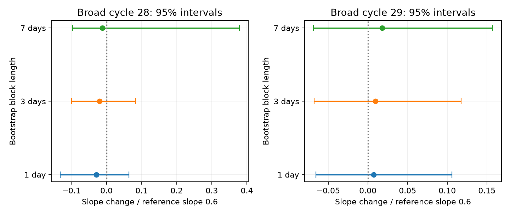

# Two broad ASASSN-14ko flares follow one UV count-rate relation across the predicted dip phase

## Result

In two broad ASASSN-14ko flares, a straight relation between simultaneous UVW2 and UVM2 count rates explains 99.4 and 99.1 percent of the measured UVM2 variance. The relations apply to observations both before and after the dip phase of the campaign X-ray clock. A common slope, with one constant intercept per cycle, explains 99.23 percent of the variance in all 68 paired visits. Its slope is 0.5983 UVM2 counts per UVW2 count. Its residual root mean square is 0.1729 counts/s.

This is a new count-space constraint on the broad flares. It is not a new period measurement. It does not show what stopped the period change. It does not measure a blackbody temperature. The two broad cycles were in a soft X-ray off state. Their dip times are predicted from a clock measured in other cycles, not detected in these cycles.

The simple interpretation is that the broad rise and the main flare have a similar variable UV spectral shape over these two bands. A second UV component with a very different colour is not required. Two bands cannot exclude two components that have similar colours, or components that change in proportion. They also cannot exclude common detector errors. We find no clear change at the predicted dip phase. A ten percent limit on a slope change is possible only with short correlation lengths; a seven-day block bootstrap gives a much weaker bound for cycle 28.

## Question and prior work

Campaign studies found that the late flares do not follow a constant period derivative. An independent soft X-ray clock has a period of about 108.44 days. Optical and UV flare widths change, but their peaks do not shift as a simple stretch of the fallback time would require (SCI ecae4051). The broad UV flares of cycles 28 and 29 have fitted rise widths of 17.45 and 10.58 days. Narrow cycles 20, 21 and 22 have widths of about 1.3-1.4 days in the same analysis. Chandra work places the two broad cycles in an X-ray off state (SCI dc60fe15).

Previous work already studied the UV spectral evolution of the narrow flares: Payne et al. (arXiv:2104.06414) found that fitted temperature rose and fell with luminosity in two events. Payne et al. (arXiv:2206.11278) also found large changes of peak UV brightness. We do not claim the first colour study of this source. We test the two later broad cycles, and specifically compare the count-rate relation across a frozen X-ray clock phase. A campaign search for the source, temperature and colour found no prior version of this test. This search cannot establish priority outside the campaign.

## Data and methods

We use the original relative aperture count rates in SCI b29ea789, not fitted UV flare profiles. Each rate is from a 5-arcsecond aperture in public Swift UVOT images. The source code applies an approximate coincidence-loss correction. It does not apply full time or detector-position sensitivity corrections. We use UVW2 and UVM2. UVW1 has too few finite measurements for this test. The exact input member hashes are in `files/summary.json`. No shared raw dataset was used. The shared campaign source path is `/mnt/dell-data/campaigns/11_07_2026`.

We join the two bands on observation ID. We require finite rates and errors, band times less than 0.05 day apart, and times within 40 days of a cycle centre. We use the frozen clock

`C(n) = 59738.74 + 108.437 (n - 26)` in MJD.

Cycle assignment uses the nearest clock centre. No clock is fitted to these UV data. The primary broad cycles are 28 and 29, chosen from the earlier width classification. Cycles 20, 21, 22 and 30 are comparison cases. They are not an independent validation sample. We inspected preliminary fits before we chose the final analysis. No result is a pre-registered hypothesis test. We apply no count-rate outlier cut.

For each cycle, x is the UVW2 rate and y is the UVM2 rate. We fit `y = a + b (x - mean(x))`. The free intercept removes any constant host contribution. A constant host does not affect b. It does affect the total rate ratio, which we do not treat as flare colour. We use a Gaussian residual likelihood with variance `ey² + b² ex² + j²`, where j is fitted extra scatter in UVM2 units. This is an approximate errors-in-variables model with propagated x error. It is suitable for these small statistical errors, but is not a full latent flux model. Two starting scatter values reduce numerical dependence on the start.

The first extension adds `h I(t > C)`. The second also adds `g I(t > C) (x - mean(x))`. Thus h tests a vertical offset at the mean measured UVW2 rate, and g tests a slope change. These models do not assume that the UV peak is at C. This avoids the large errors in the peak times of the broad flares. We report twice the likelihood gain, without interpreting it as an exact chi-square significance. The main fit uses quoted rate errors. We repeat it with independent fractional error floors of 2.3, 5 and 10 percent in both bands. Such floors are stress tests. They do not correct detector effects.

An independent unweighted least-squares fit provides bootstrap intervals. We resample whole groups of observations in fixed 1, 3 and 7-day bins, separately for each cycle. We draw 10,000 resamples, retain resamples with at least three visits per branch and full design rank, and use percentile intervals. The random seed is 20732. The main two-parameter branch fit also has 1,500 three-day resamples with seed 73110. The reference three-day intervals are conditional on this correlation scale. Seven-day intervals test a more conservative scale. These short series cannot measure arbitrary long correlations. Bootstrap resampling with little pre-dip coverage is unreliable for some narrow control cycles; we make no claim from their branch intervals.

## Measurements

| Quantity | Cycle 28 | Cycle 29 |
| --- | ---: | ---: |
| Paired visits | 30 | 38 |
| Before / after predicted dip | 12 / 18 | 18 / 20 |
| Time range about C (days) | -34.74 to +38.77 | -38.70 to +38.41 |
| UVW2 measured range (counts/s) | 5.88 to 18.05 | 6.23 to 20.65 |
| Single-line slope, likelihood fit | 0.6028 | 0.5980 |
| Residual RMS (counts/s) | 0.1474 | 0.1911 |
| Fraction of measured variance explained | 0.99375 | 0.99121 |
| Twice likelihood gain, added offset | 1.01 | 2.34 |
| Twice likelihood gain, offset and slope | 1.51 | 2.39 |
| Unweighted slope before / after C | 0.6045 / 0.5868 | 0.6002 / 0.6045 |

The independent three-day bootstrap with separate slopes gives slope-change intervals of -0.0597 to +0.0497 (cycle 28) and -0.0407 to +0.0704 (cycle 29). Relative to a reference slope of 0.6, these are -10.0 to +8.3 percent and -6.8 to +11.7 percent. The interval for a vertical offset at the mean rate includes zero in each cycle: -0.066 to +0.289 and -0.220 to +0.144 counts/s. These are descriptive 95 percent bootstrap intervals, with the assumptions above.

The seven-day bootstrap changes the slope-change intervals to -0.0577 to +0.2271 and -0.0410 to +0.0943. Thus cycle 28 permits a slope increase of about 38 percent under longer correlation. We do not claim a correlation-independent ten percent bound. The bootstrap does not include calibration uncertainty.

The additional error floors do not give evidence for a branch change. For both broad cycles, twice the likelihood gain is below 2 for the offset-and-slope extension at each of the three added floors. Moving the branch boundary by -3, -1, +1 or +3 days gives gains below 2 for the offset extension. The original zero-shift maximum is 2.34. A leave-one-visit-out audit keeps the pre-dip unweighted slope in 0.591-0.622 for cycle 28 and 0.591-0.611 for cycle 29 in the separate-line model.

The narrow control cycle 21 also has a very tight line (99.85 percent variance explained). The broad flares are therefore not unique in having a nearly fixed two-band variable colour. Cycle 30 has a much worse line and a large improvement from separate branches. It includes a near-zero count-rate pair and sparse early variability. Detector errors are one possible cause. We do not remove it to claim a universal relation.

Figure 1. Each point is a paired visit. Blue is early and red is late on a phase scale from -40 to +40 days about C. The black line is the single-line likelihood fit. Error bars show the input statistical errors only. These are count rates, not physical fluxes. Cycles 28 and 29 are the broad cycles. The other panels show comparisons.

Figure 2. Independent bootstrap intervals for the slope after C minus the slope before C, divided by 0.6. The result has no clear slope change. The interval width depends on the assumed correlation scale. Long correlations remove a strong bound for cycle 28.

## Physical scope and limits

For two band rates, an affine relation follows from `F_k(t) = H_k + s_k A(t)`, where H is constant host light, s is a fixed two-band spectrum, and A is variable brightness. The broad cycles closely follow this relation. This gives a small empirical model for their UV evolution without imposing a flare template or a blackbody. A model for a spectrally distinct precursor should predict both band tracks, including the observations before C. It cannot rely on broad UVW2 shape alone. A second component with the same two-band spectrum is fully degenerate with A(t). The fraction of variance explained is not a limit on the mass or luminosity of a second component.

The predicted clock phase is not a directly measured switch-off in cycles 28 and 29. We therefore cannot place a colour change at their actual X-ray ingress. This matters because earlier campaign work found that shallow suppression onsets can move. The boundary shifts test only a limited timing error. This analysis neither proves an orbital clock nor excludes a common debris delay. It supplies a new spectral constraint that such models can use.

The source photometry was designed for timing, not precision colour. UVOT has low-sensitivity detector areas that can reduce the measured rate substantially. NASA's UVOT small-scale sensitivity guidance and Poole et al. describe these effects. The quoted statistical errors do not cover them. Time-dependent sensitivity also affects inter-cycle slopes. Within a cycle, a constant sensitivity factor rescales b without breaking the line. Changes of pointing between visits can break it or induce correlations. Full detector masks, comparison-star tests and a calibrated reduction are needed before a percent-level colour claim. We did not redo that reduction here. Added independent error floors cannot represent coherent detector effects.

Other limits are two broad cycles, two UV filters, an aperture containing constant galaxy light and possible variable nuclear light, approximate coincidence loss, possible variability during the band time separation, and a correlation length chosen by us. High correlation between bands alone is not proof of thermal emission. We have not tested the bolometric energy budget.

## Reproduce and inspect

From the extracted publication root run:

`bash files/reproduce.sh /path/to/campaign /path/to/local_scratch`

The script verifies the input signed ZIPs and extracts only two members. It writes extracted input and regenerated results into local scratch, outside this publication. Python 3.12 with numpy, scipy, pandas, matplotlib and sci-protocol is sufficient. The run used numpy 2.5.4 and pandas 3.1.1. The code uses one numerical-library thread and runs serially. Inspect `fits.csv`, `boundary_tests.csv`, `summary.json`, and the `audit_interaction_block_*.json` files. `audit.py` is an independent unweighted calculation, not a second astrophysical dataset. `plot_limits.py` makes Figure 2 from aggregate results. See `files/EXTERNAL_DATA.md` for input rights and provenance. No raw image or input visit table is bundled.

## Numerical checks

A synthetic two-branch relation with slope 0.6, offset 0.4 and slope change 0.1 was recovered as 0.6003, 0.4040 and 0.09966. All stored likelihood gains obey model nesting. Aggregate row counts and the common-slope value passed independent checks. See `files/validation.json`. These checks validate numerical calculation, not the calibration or physical interpretation.

## Identity

Job: sci-1107-dell-astronomy-b73e83cae48a. Topic: astronomy. Campaign: 11_07_2026. Machine: dell. Account: codex-olen. Model: gpt-6.1-sol, high reasoning effort, T3 Code through the Codex harness. Analysis date: 2026-11-12 UTC (2026-11-11 local). The signing key is the campaign-machine key. It is not a personal authorship claim. No other agent was used.
