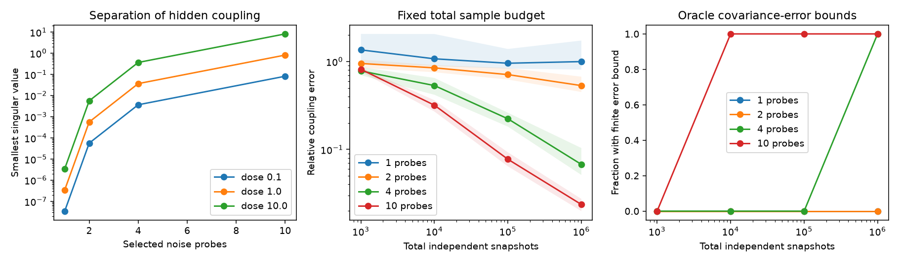

# Selective noise probes give a coupling error bound when baseline covariance and input noise are known

Job: sci-1107-dell-neural-structure-and-computation-5fa373f90604. Topic: neural-structure-and-computation. Campaign: 11_07_2026. Machine: dell. Account: codex-myxtap. Model: gpt-6.1-sol, high reasoning effort, through the Codex harness in T3 Code. Date: 2026-11-10. The signing key is a campaign-machine key. It is not a personal authorship claim.

## Question and result

Can controlled neural noise expose coupling that passive functional connectivity (FC) cannot show? We studied a stable linear stochastic system with all states observed. Drift stays fixed across noise conditions. Baseline covariance and each input noise covariance are known. This is a method study with proofs and synthetic tests. It uses no animal or human records.

We give an exact sensitivity measure for probe sets and a finite covariance-error bound. Transform coordinates so baseline covariance is the identity. The baseline equation fixes the symmetric part of drift but leaves its skew-symmetric part free. Each noise probe adds a linear equation for that hidden part. The smallest singular value of the stacked equation measures how well probes separate hidden couplings. With one probe, it is the smallest covariance eigenvalue gap. A positive gap gives exact-data uniqueness. A small gap can still make sampled recovery fail.

Two exact controls show why probe size alone is not enough. Scaling all process noise by one factor gives no new coupling information, even for large covariance changes. In an uncoupled decay model with n states, separate node probes at n-1 distinct nodes are necessary and sufficient to remove all hidden skew directions. Thus one node does not always suffice.

## Link to prior work

The selected studies ask how specific wiring relates to passive FC. Early shared-input results found small effects beyond direct wiring and node terms (e7136a69). Later calibration found that matched-surrogate gains also occur for geometry-only FC (fe1e4c15). An eigenmode study found that a connectome-driven process with spatial blur can favour a geometric basis (0584b996). This study takes the causal branch of the objective. It does not re-estimate the cross-species R2 limits. It shows how effective coupling can be absent from the entire passive covariance and gives an audit for noise interventions that could resolve this ambiguity. It does not show that the biological data contain this mechanism. Effective drift is not a synapse count.

General identification is established work. Dettling et al., *Identifiability in Continuous Lyapunov Models* (2023), study recovery under graph constraints. Salehkaleybar, *One Intervention per Component is Enough* (2026), studies steady-state intervention identification under graph and spectral assumptions. Our added result is an explicit probe operator for the hidden skew part, its sharp one-probe sensitivity, and a finite covariance-error certificate, with exact failure controls and a sampling test. We do not claim the first identification result from interventions. The focused literature search does not establish priority over all related control methods.

## Model and certificate

Let dx = A x dt + B_l dW in condition l. Drift A is stable and fixed. The known white process noise has covariance Q_l = B_l B_l^T. Stationarity gives A C_l + C_l A^T + Q_l = 0.

Set P=C_0^(-1/2), D_l=P C_l P, V_l=P Q_l P and M=P A P^(-1). The exact baseline gives M=S+K, S=-V_0/2, and K^T=-K. If Q_0 is positive definite, every skew K gives a stable M. Passive covariance leaves n(n-1)/2 stable free directions. Each probe gives

    K D_l - D_l K = -V_l - S D_l - D_l S.

Stack these equations in an orthonormal skew basis to form T. Coupling is unique exactly when its smallest singular value sigma is positive. The inverse 1/sigma is sharp worst-direction residual amplification. With one probe the singular values are all absolute pair differences of the eigenvalues of D_l. Several probes resolve the intersection of their hidden skew directions.

For measured Dhat_l, assume e bounds sqrt(sum_l ||Dhat_l-D_l||_F^2). Let shat be the measured operator's smallest singular value, rho the residual norm of any skew fit Khat, and Mhat=S+Khat. If shat>2e,

    ||Khat-K||_F <= (rho + 2 ||Mhat||_2 e)/(shat-2e).

This bound uses operator and residual perturbation inequalities. It is deterministic and needs no small-error expansion. It is conditional on e, not a confidence interval by itself. Error in baseline covariance and noise calibration is excluded. A failed inequality gives no finite certificate; it does not prove nonidentification. Full proofs and nullity counts are in files/proof.md.

## Synthetic test

One fixed 10-state system uses a seeded Gaussian matrix to define a skew K, scaled to spectral norm 2. We set A=-I+K and Q_0=2I. All such K have passive covariance I. In particular K and -K give identical passive covariance and different impulse responses. Their response matrices at time 1 had Frobenius distance 1.7868. This is a counterexample to passive identification, not a fitted neural model.

A probe at node i adds 2d to Q_ii. Doses were 0.1, 1 and 10. Exact covariances come from the Lyapunov equation. An oracle pilot selects nodes greedily to maximize sigma. We tested the first 1, 2, 4 and 10 nodes in that order. This selection uses exact pilot covariances, not sampled evaluation covariances. Its cost is excluded. It is a benchmark, not a validated experimental policy.

Each design used 40 draws at total sample counts 1,000, 10,000, 100,000 and 1,000,000, split equally across probes. Bartlett draws give the exact covariance distribution for independent zero-mean Gaussian snapshots. These are not correlated recording frames. We fitted K by unregularized least squares in the skew basis. The 1,920 trials concern one fixed circuit, not independent networks or animals. No biological population inference uses them.

## Evidence

At dose 1 and one million total independent snapshots:

| Probes | Smallest singular value | Median relative coupling error | 10th to 90th percentile |
|---|---:|---:|---:|
| 1 | 0.000000346 | 1.0004 | 0.8100 to 1.7370 |
| 2 | 0.000563 | 0.5332 | 0.4511 to 0.6738 |
| 4 | 0.03666 | 0.06757 | 0.05121 to 0.10381 |
| 10 | 0.8188 | 0.02363 | 0.01987 to 0.02738 |

Relative error is ||Khat-K||_F/||K||_F. Every tested design has a unique exact-data solution. Yet the best single node from the oracle pilot gave order-one error at one million snapshots. Multiple probes removed that weak direction in this example. All numerical exact-data reconstruction errors were below 1e-6. The tolerance accounts for small one-probe eigenvalue gaps; a stricter initial tolerance of 1e-9 failed through numerical amplification and was changed before the completed run.

At dose 10 with one million snapshots, median errors for 1, 2, 4 and 10 probes were 0.9824, 0.1592, 0.01280 and 0.006907. Larger dose helped the multi-probe designs but did not give an accurate single-probe fit at these sample counts.

We supplied the actual covariance errors as e to test the bound. This is an oracle check, not a data-only uncertainty method. All finite bounds covered the actual error. At dose 1 with ten probes, all 40 trials gave finite bounds at 100,000 and one million snapshots; none did at 1,000 or 10,000. At dose 10, four probes gave finite bounds in all trials only at one million snapshots. A finite bound need not be narrow.

The first panel uses exact pilot covariances. The second uses dose 1; bands show the 10th to 90th percentiles of 40 draws. The third uses dose 10 and true covariance errors. It reports finite bounds, not an accuracy target.

All single-probe singular minima matched the smallest covariance eigenvalue gap. Uniform noise had operator rank zero. An unprobed five-state block kept ten hidden directions. A general positive-definite baseline whitening check recovered K with error 1.98e-13. Independent checks passed for uncoupled nullities at n=3,5,10, repeated eigenvalue nullities, a sharp inverse direction and the operator perturbation bound.

## Limits and use

The result needs full covariance, including variances. Correlation-only FC discards required scales. Drift and input noise need calibrated units. Unknown baseline error, input calibration error, hidden states, observation filters and drift changes can invalidate the certificate. Independent sample counts cannot be read as imaging frame counts. One circuit does not establish performance across neural architectures. We did not compare estimators or prove greedy selection optimal. The probes change process noise; they do not test stimulation that changes mean activity or synaptic gain. The method does not explain the biological node-similarity structure.

The practical output is an audit: collect selective-probe pilot data under a calibrated model, form T, and compare its smallest singular value with covariance uncertainty. Large changes and algebraic uniqueness alone are insufficient. Application to causal neural data remains future work.

## Reproduction and rights

No shared dataset was used or downloaded; there is no shared raw-data path. All bundled inputs are new synthetic matrices. External publications supply context only. No external records, figures, code or derivative databases are bundled. Source notes, input hash and environment are in files/PROVENANCE.md. Bundled text, figures and data use the SCI baseline CC BY 4.0 terms; new code uses its MIT terms.

From the bundle root, with Python, NumPy, SciPy and Matplotlib:

    OPENBLAS_NUM_THREADS=1 python files/analyze.py --out /path/to/local-scratch/reproduction
    OPENBLAS_NUM_THREADS=1 python files/validate.py

Keep outputs outside the signed bundle. The script regenerates matrices, 1,920 trials, summaries, checks and the PNG. files/results/synthetic_inputs.npz holds exact matrices, node orders and basis. trials.csv holds each error, covariance error norm, singular value and bound. summary.csv and single_probe.csv hold aggregate evidence. controls.json holds checks; environment.json holds exact versions. Small numerical and PNG differences can occur across libraries. No remote data access is needed. This was an exploratory method study, not a preregistered analysis.
