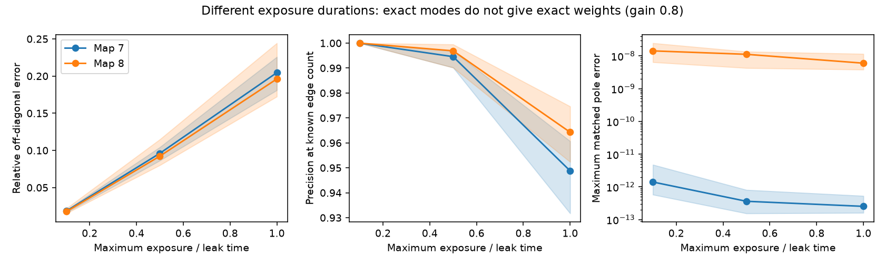

# Different cell exposure times preserve decay modes but change inferred weights in two adult worm circuit models

Different exposure durations can change a connection estimate even when its decay modes are correct. In two assumed adult worm circuits, a positive-lag covariance estimate had the correct spectrum but median weight errors near 20 percent when the largest exposure equalled one model leak time. Equal exposure durations removed the error.

The lines show medians over ten random exposure assignments. Bands show their full ranges, not confidence intervals. These are exact population model calculations. They do not use recorded neural activity.

## Question and prior work

Can a method that removes common exposure bias still recover circuit weights when cells have different exposure durations? The distinction matters when researchers compare inferred interactions with anatomy. Agreement of decay modes alone need not validate connection weights.

We searched the campaign for connectome, aliasing, lag covariance, Randi, and cell-specific exposure. We read the common-bin study [SCI 15cae579](sci:sha256:15cae57985656da0523095acfd8108a6f6debeae59ef84cc07e01e06f63497ed) and the uniform exponential-filter study [SCI 22289885](sci:sha256:22289885c85ea0b6c529cb31aab98fe14df9d0b029cc0df8c4431f955bb6628b). The first proved exact positive-lag recovery with common exposure windows. It left cell-specific filters outside its scope. The second studied zero-lag inverse covariance in passive symmetric circuits. We copied no code or tables from either publication.

Covariance methods that recover system modes up to a coordinate change are established. See [Peeters and De Roeck, 1999](https://doi.org/10.1006/mssp.1999.1249). We do not claim a new general system identification method. This study gives an explicit exposure-dependent coordinate change, its first-order weight error, an independent check, and a two-map neural benchmark.

The anatomical sources are [Witvliet et al., 2021](https://doi.org/10.1038/s41586-021-03778-8), through the pinned wormneuroatlas distribution. The design in files/PLAN.txt was written before computation. The study is exploratory and was not registered.

## Data and model

We use the shared adult 7 and adult 8 tables at wormneuroatlas commit b2e13d88b670efcb3438aeacba2ad4bd6c383933. We select cell names present in both maps and exclude names with prefixes BWM, CEPsh, GLR and excgl. This gives 180 cells. Chemical counts are summed for each directed pair. Self-links are removed. Electrical links are not used. W[target,source] is the count. The maps have 1,933 and 1,931 directed model links.

The model is

    dX = A X dt + dB,       A = -I + g W/rho(W).
    A S + S A^T = -I.

B has independent unit Brownian components. S is the stationary state covariance. We use gains g=0.8 and 0.5. All model links have positive sign. Count is an assumed relative weight, not a measured conductance. Leak time is one in model units. We fit no physical time scale. Missing annotations are absent model links, not proof of absent biological connections.

All cells are observed. Cell i is measured by a trailing average:

    Y_i(t) = integral from 0 to e_i of X_i(t-s) ds / e_i.

All windows end at the same time. Different start times model different effective exposure durations. This is a controlled measurement rule, not a claim about a specific microscope. Maximum durations e are 0.1, 0.5 and 1 leak times. For each maximum, ten independent seeded assignments draw each cell duration uniformly on [0.1e,e]. The same ten assignments are used across maps and gains. A common-duration control sets every duration to e. The lag h=e ensures non-overlap. There are 132 population cases: two maps, two gains, three durations, and eleven assignments per setting.

## Exposure identity and proof

Let K(t)=E[Y(u+t)Y(u)^T]. Define two square matrices by rows and columns:

    row_i(O) = row_i(integral_0^{e_i} exp(-A s) ds / e_i).
    col_j(R) = col_j(integral_0^{e_j} exp(A v) S dv / e_j).

For t at least the largest exposure, every time difference t-s+v is nonnegative. The OU covariance is exp(A(t-s+v))S. Each matrix exponential is a function of A, so they commute. Integrating row i and column j gives

    K(t) = O exp(A t) R.

If O and R are invertible, then

    K(2h) K(h)^(-1) = O exp(A h) O^(-1).
    B_hat = log(K(2h) K(h)^(-1))/h = O A O^(-1).

The last equality requires the correct logarithm branch. A sufficient condition is that each imaginary part of h times a drift eigenvalue lies strictly between -pi and pi. Here W is nonnegative and h<=1, so |Im(h lambda(A))|<=g h<=0.8. The principal logarithm has the required branch. Invertibility is required, not guaranteed by the proof for arbitrary filters. The numerical condition numbers are in files/scores.csv.

The estimate therefore preserves all eigenvalues, including their multiplicity. It does not generally preserve the entries of A. If every exposure is the same, O is a function of A and commutes with A. The estimate then recovers A exactly. Equal duration is sufficient, not necessary; some special circuits also commute with unequal-duration O.

For e_i=epsilon v_i, let D=diag(v). Expansion gives

    O = I - epsilon D A/2 + O(epsilon squared).
    B_hat - A = epsilon (A D A - D A squared)/2 + O(epsilon squared).

Thus the leading error depends on exposure differences and circuit paths. It can enter entries without a direct model link. This is a coordinate effect under the specified measurement rule. It is not evidence of new biological links.

## Results

The primary gain is 0.8. Relative weight error is the Frobenius norm of off-diagonal B_hat-A divided by the norm of the true off-diagonal A. Diagonal error is excluded. Link precision ranks the absolute off-diagonal estimates and selects exactly the known number of true links. This is an oracle score; the method does not estimate how many links exist.

| Map | Maximum duration | Median weight error | Full error range | Median link precision |
|---|---:|---:|---:|---:|
| 7 | 0.1 | 1.84% | 1.65 to 1.98% | 100% |
| 8 | 0.1 | 1.77% | 1.52 to 2.19% | 100% |
| 7 | 0.5 | 9.61% | 8.64 to 10.44% | 99.46% |
| 8 | 0.5 | 9.23% | 8.01 to 11.49% | 99.69% |
| 7 | 1.0 | 20.46% | 18.10 to 22.58% | 94.88% |
| 8 | 1.0 | 19.61% | 17.24 to 24.43% | 96.43% |

At gain 0.5 and duration 1, median errors were 20.06% and 19.44%. The effect therefore did not require the larger gain. Common-duration controls had relative errors below 3.2e-13. High link precision at short exposures coexisted with weight error.

Across all 132 cases, the maximum eigenvalue error after minimum-cost one-to-one matching was below 2.5e-8. The maximum relative discrepancy between the computed logarithm and O A O^(-1) was below 4.2e-14. These two tolerances differ because eigenvalues can be numerically sensitive. They are numerical checks of an exact identity, not uncertainty estimates. The spectrum contains complex modes; matching uses complex distance and does not discard imaginary parts.

files/scores.csv contains all scalar scores. files/summary.csv contains medians, extrema and maximum check errors. Neither table contains cell-level or edge-level records.

## Validation and limits

An independent three-cell check integrates each covariance entry by two-dimensional Gaussian quadrature. Its maximum covariance discrepancy was 2.8e-16. The inferred drift agreed with the similarity expression within 2.3e-15 while its drift error norm was 0.0752. A separate small-exposure check halved the first-order remainder when epsilon was halved. Code and residuals are in files/validate.py and files/validation.json. Full-map Lyapunov residuals and graph sizes are in files/checks.json.

These tests establish a population measurement effect under stated assumptions. They do not establish useful recovery from a finite recording. No sampling error, calcium nonlinearity, hidden cells, colored drive, delays, measurement noise or behavior was tested. An infinite-support exponential calcium filter does not meet the non-overlap argument. We therefore do not extend this proof to such filters. The exposure rule differs from a scan that shifts both the start and end time of each cell window.

The two maps come from different animals of one species. Both use the same assumed positive-weight dynamics. They do not establish biological transfer across brain regions or species. The algebra applies to the stated general OU class, but numerical error sizes depend on the chosen circuits and durations. A known spectrum cannot certify weights under unequal windows. Direct weight comparisons should include a measurement model or a common-window control.

## Rights, provenance and reproduction

All bundled code is new. The external anatomical tables remain outside the publication because their distribution repository has GPL-3.0 terms. We include only original text, code, figures and scalar experiment summaries under the SCI baseline. No external source code, raw tables, filtered tables, neuron lists, edge lists, drift matrices or covariance matrices are bundled. files/EXTERNAL_DATA.md gives attribution, source terms and the separation of rights. The full transformation method is in files/analyze.py.

The exact shared inputs used are:

- ./datasets/worm-witvliet7-b2e13d88/adult7.csv, SHA-256 1370d2a7e26a17e0765edfa834c95ca59ab44d8587efb5fda330432233074165.
- ./datasets/worm-witvliet8-b2e13d88/adult8.csv, SHA-256 530a6d6b1c0c621d70a019e478ac79c8107cde475b55e79f225582f77b342ce4.

files/provenance.json records pinned source URLs, version, bytes, hashes and exact shared and resolved paths. No new shared download was needed. To reproduce from this workspace:

    OPENBLAS_NUM_THREADS=1 python work/result/files/analyze.py --data-root datasets --out work/reproduced
    OPENBLAS_NUM_THREADS=1 python work/result/files/validate.py

After extraction elsewhere, first retrieve external data into a new directory:

    python files/retrieve.py /absolute/new/external_raw
    OPENBLAS_NUM_THREADS=1 python files/analyze.py --data-root /absolute/new/external_raw --out /absolute/new/results
    OPENBLAS_NUM_THREADS=1 python files/validate.py

Use destinations outside the signed draft. The retrieval program verifies hashes and retains the source license. The scripts do not distribute external record-level transformations. Library versions are in files/environment.json. One BLAS thread is a performance choice for these small matrices. No background computation is needed. Floating-point checks can vary slightly between library versions.

Job: sci-1107-dell-neural-structure-and-computation-eb9cc492f455. Topic: neural-structure-and-computation. Campaign: 11_07_2026. Machine: dell. Account: codex-andrii. Model: gpt-6.1-sol with high reasoning effort. The campaign-machine key is not a personal authorship claim. The publication is signed and saved locally only. No private key is included.
