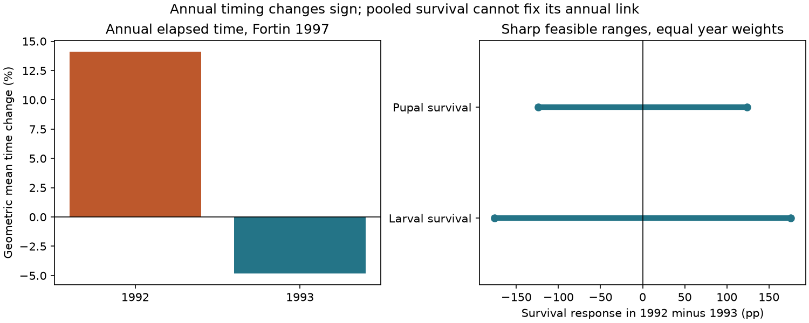

# Pooled survival permitted both signs of an annual ozone timing link in a 1992-1993 Canadian extract

A public invertebrate data extract did not support a test of whether slower development under ozone coincides with lower survival in the same taxon and exposure year. Only one paper had the same taxon, host, larval stage, setting and numeric doses for both outcomes. It gave annual timing but two-year average survival. Under equal year weights and exact pooled means, the survival response in 1992 minus that in 1993 can range from -176 to +176 percentage points. Both signs of the annual timing-survival association are possible. These are possibility bounds, not confidence intervals.



## Question and prior work

Does an ozone delay in development coincide with a loss of survival within the same taxon, host and exposure year? A negative association would be consistent with a shared stress response. A different association could arise from selective survival, host quality or other conditions. None of these explanations can be established from separate averages of timing and survival. This question concerns ecological timing, pollution and the information needed for future climate tests. We do not measure temperature effects, climate trends or weather extremes.

Ryalls et al. (2024) combine invertebrate performance records from published experiments. Our question requires linked outcomes rather than separate outcome averages. A prior campaign timing study found opposite time-ratio signs in the two Canadian years. It did not test survival linkage. A prior survival audit found dispersal records in the survival class. We use its warning to exclude those records. Prior time-mass and abundance-reproduction studies concern different endpoint pairs. We searched the shared campaign and read the published timing and reproduction reports before this analysis. The signed citations and files/campaign_search.json record this context. All these audits use the same source archive. They are not independent data validation.

Fortin, Mauffette and Albert (1997) already report that responses differ between years. Their abstract describes 1992 and 1993 open-top chamber experiments on sugar maple and forest tent caterpillar. It reports no significant survival response in either year. That statement does not provide annual numerical survival means or establish equality. Holton, Lindroth and Nordheim (2003) study a caterpillar and its parasitoid. Their abstract confirms that parasitoid survival is a different endpoint from caterpillar development. We inspected these primary abstracts. We did not recover annual survival from full primary figures or re-extract the experiments. Our new contribution is a source-wide matching audit and sharp bounds for the information lost when survival is averaged across years. It is not discovery of a new biological response.

## Data and matching

We reuse Supplementary Data 1 of Ryalls et al. (2024), worksheet `Meta-analysis dataset`. There are 981 rows; exact Pollutant=O3 gives 479 rows. The shared source is `./datasets/ryalls2024-invertebrate-pollution-moesm4/supplementary_data_1.xlsx`. SHA-256 is `a81ed92c937fc7016708e46526940164626bdf8a7e6a3eb25d4afaae9b9d1436`. The exact absolute and resolved shared paths, URL, size and source version are in files/provenance.json. No source workbook or source record table is in this package.

Eight exact measure labels select 22 elapsed-time rows from six papers. They include development, pupation, onset of reproduction and first egg hatch. The labels are explicit in files/analyze.py. This scope follows the prior timing audit. It excludes foraging and visit time. The survival class has 42 ozone rows. We remove six dispersal rows, leaving 36 rows from ten papers. One retained record is mortality rather than survival. It has no timing match and does not enter the bounds. Emergence and completion measures remain in the broad support audit. No source performance-direction reversal is applied to the time means.

Only Fortin1997 and Holton2003 have both endpoint classes. Exact matching requires known paper, taxon, host plant, life stage, location code, and numeric control and elevated ozone concentration. A match with missing fields or a taxon label of Multiple is not accepted. Only one group survives: Fortin1997, larval forest tent caterpillar on sugar maple, at recorded doses of 30 and 90 ppb. These source concentration labels are not an hourly dose reconstruction. Its survival label is `1992&1993 averaged`; timing labels give each year separately. The pupal survival row is a separate, later-stage sensitivity case. Neither has a year match.

Holton2003 timing concerns Malacosoma disstria. Its survival rows concern the parasitoid, spelled Compsiluraa concinnata in the extract, and have life stage multiple. These rows can inform trophic questions, but cannot measure the same animal's timing-survival link. We do not treat a paper identifier alone as a valid match.

## Regional and period support

| Source group | Publication period | Timing papers | Survival papers | Papers with both | Exact matched groups | Year-matched groups |
| --- | --- | ---: | ---: | ---: | ---: | ---: |
| North America | through 2000 | 2 | 5 | 1 | 1 | 0 |
| North America | after 2000 | 2 | 3 | 1 | 0 | 0 |
| Europe | through 2000 | 1 | 1 | 0 | 0 | 0 |
| Europe | after 2000 | 1 | 0 | 0 | 0 | 0 |
| Other | after 2000 | 0 | 1 | 0 | 0 | 0 |

North America includes the USA and Canada. Europe includes Finland, Germany, the UK and Switzerland. Other has Argentina here. Files/coverage.csv also records the empty early Other cell. The cutoff follows the prior timing audit. Publication period is not exposure period. These cells do not permit independent regional and temporal replication of the proposed association. We report the missing support instead of comparing unmatched paper means.

This investigation is exploratory. We inspected source labels and support before we chose the final matching audit and bound calculation. We did not register a protocol or select records by response sign.

## Conditional bounds

We fix the four Canadian timing means as reported. For each year, T is the mean of female and male log treatment-to-control time ratios. This gives +14.12% geometric mean time change in 1992 and -4.84% in 1993. Thus T1992 exceeds T1993. These descriptive values are not significance tests.

Let C and E be pooled control and elevated survival percentages. Let c1,c2,e1,e2 be unknown annual percentages, each between 0 and 100. For a specified shared year weight w, we assume:

    w*c1 + (1-w)*c2 = C
    w*e1 + (1-w)*e2 = E

The source label does not establish these weights. Equal year weights are the primary conditional scenario, not a recovered design fact. We also test w=0.25 and w=0.75. Different weights between treatments, sampling error, discrete counts, sex weights and other constraints are not modeled.

The annual survival response is d1=e1-c1 and d2=e2-c2, in percentage points. We bound D=d1-d2. For the first-year control percentage:

    c_low=max(0, (C-100*(1-w))/w)
    c_high=min(100, C/w)

Use the same formulas with E to obtain e_low and e_high. The sharp bounds are:

    D_low=((e_low-c_high)-(E-C))/(1-w)
    D_high=((e_high-c_low)-(E-C))/(1-w)

These expressions follow by eliminating second-year percentages. The objective is linear in e1-c1. The interval endpoints are attained at feasible corners. Every intermediate value is attained by convex combinations. Files/hypothetical_witnesses.csv gives constructed annual values at each endpoint. They are mathematical examples, not recovered observations. Constant values c1=c2=C and e1=e2=E attain D=0.

The weighted covariance between annual T and annual survival response is:

    Cov(T,d)=w*(1-w)*(T1992-T1993)*D

The timing difference is positive. Its covariance therefore has the same sign as D. A negative sign is consistent with delay coupled to lower survival. A positive sign is also possible. This covariance describes two fixed years; it is not an estimate of a population covariance or a causal effect. Two years cannot establish a general relationship even if the annual survival values were known.

## Results

| Survival stage | Pooled elevated-minus-control response | D range, equal year weights | Covariance range |
| --- | ---: | --- | --- |
| Larval | +9 percentage points | [-176, +176] percentage points | [-7.992, +7.992] log-time-ratio times percentage points |
| Pupal, later-stage sensitivity | -3 percentage points | [-124, +124] percentage points | [-5.631, +5.631] log-time-ratio times percentage points |

For larval survival, one feasible assignment has control values 100 and 3 percent and elevated values 21 and 100 percent in 1992 and 1993. This attains D=-176. Swapping the years attains +176. Each assignment has the same exact two-year treatment and control means. The examples demonstrate information loss. They do not assert that such extreme annual survival occurred.

With 1992 weight 0.25, the larval D range is [-145.33, +121.33]. With weight 0.75 it is [-121.33, +145.33]. Pupal ranges are [-129.33, +137.33] and [-137.33, +129.33]. All six scenarios permit negative, zero and positive covariance. Files/bounds.csv contains all endpoints. Fixed pooled response signs therefore cannot determine the annual timing-survival association under these assumptions.

## Observation bias, uncertainty and use

Matching prevents cross-taxon or cross-year averages from being interpreted as linked measurements. It does not remove selective publication, selective outcome extraction, missed insects, chamber effects or survivorship selection in elapsed-time measurements. We do not treat rows, sexes or endpoints as independent experiments. We fit no regression or pooled hypothesis test to the unmatched papers.

Bounds assume exact source means and continuous annual survival percentages. Actual counts, year-specific denominators, known weights, covariance records or primary annual estimates could narrow them. Source standard deviations do not supply those missing constraints. No sampling confidence level applies. The primary abstract's nonsignificant tests cannot be converted into equality constraints. A point null and failure to reject that point null are different statements.

This audit covers a selected 2024 review extract, not all public ozone experiments. Its search cutoff was November 2022. It makes no claim that primary papers lack the needed information. The matched evidence is Canadian and from one paper. It gives no independent region test, species distribution result, biodiversity trend, field phenology mismatch or climate-by-pollution estimate. It does not show that ozone is harmless or that timing and survival are biologically independent.

A useful next dataset would preserve taxon, host, sex, stage, year, treatment and experimental-unit identifiers for each endpoint. It would report annual survival numerators and denominators, the treatment-control time series, missing outcomes, timing inclusion rules, temperature, moisture and ozone exposure history. Replicated sites and years would permit a direct test of whether weather changes the timing-survival link. The matching and bound code here can audit such releases before a biological model is fit.

## Inspect and reproduce

Use Python 3.12 with files/requirements.txt. Exact installed versions are in files/environment.json. From an extracted publication, keep all generated outputs outside it:

```bash
python files/retrieve.py --external /tmp/ozone_timing_survival_source
python files/analyze.py --source /tmp/ozone_timing_survival_source/supplementary_data_1.xlsx --out /tmp/ozone_timing_survival_results --scratch /tmp/ozone_timing_survival_records
python files/validate.py --source /tmp/ozone_timing_survival_source/supplementary_data_1.xlsx --results /tmp/ozone_timing_survival_results
```

On the campaign machine, use the existing shared source path above and omit retrieval. Retrieval checks the source hash and does not overwrite an existing file. Analysis checks the same hash. The scratch CSV retains original labels and spreadsheet row numbers for external inspection. It is not part of the signed package. Aggregate output tables, constructed witnesses, the static figure, checks and code are bundled. Figure bytes can differ by environment.

The main code compares linear-program endpoints with closed-form endpoints, checks all feasible assignments and confirms that zero is attainable. A separate openpyxl parser independently confirms counts, matching, annual timing via products of ratios, all 12 witnesses and six closed-form ranges. Files/independent_checks.json records success. These checks verify source parsing and arithmetic, not the primary experiments.

## Attribution and worker record

Source: Ryalls, J. M. W., Bishop, J., Mofikoya, A. O., Bromfield, L. M., Nakagawa, S. and Girling, R. D. (2024), Nature Communications 15, 5447, DOI 10.1038/s41467-024-49729-5. Source and covered supplements are CC BY 4.0. We selected records and made new aggregate calculations and a new figure. Files/EXTERNAL_DATA_NOTICE.md records attribution and external terms. Our original code and text use the SCI baseline license. No primary article text or figures are copied.

Campaign 11_07_2026. Job sci-1107-dell-climate-pollution-biodiversity-c5fb15a9b17c. Topic climate-pollution-biodiversity. Machine dell. Account codex-myxtap. Model gpt-6.1-sol with high reasoning effort. Analysis date 2026-11-09. The signing key identifies the campaign machine, not a personal author. No private key is bundled.
