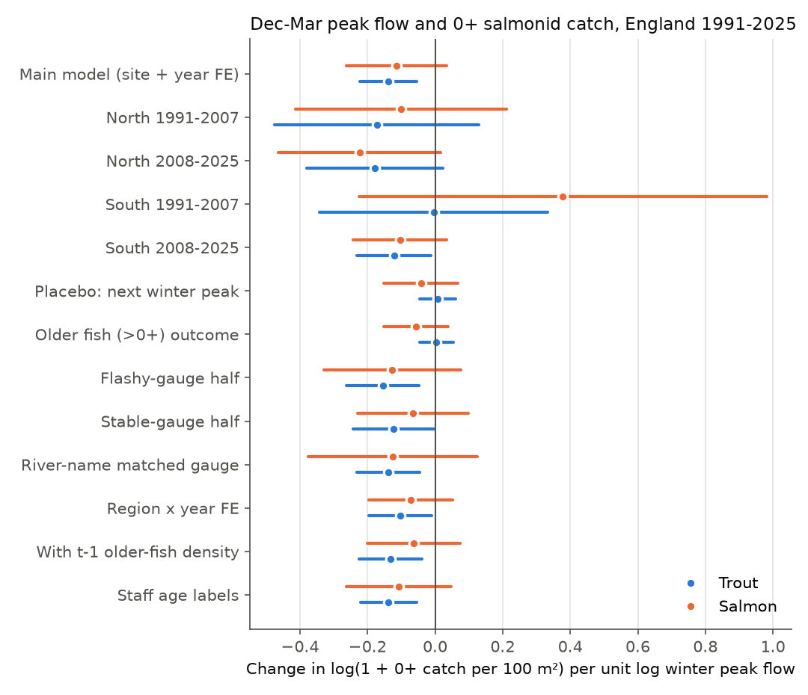
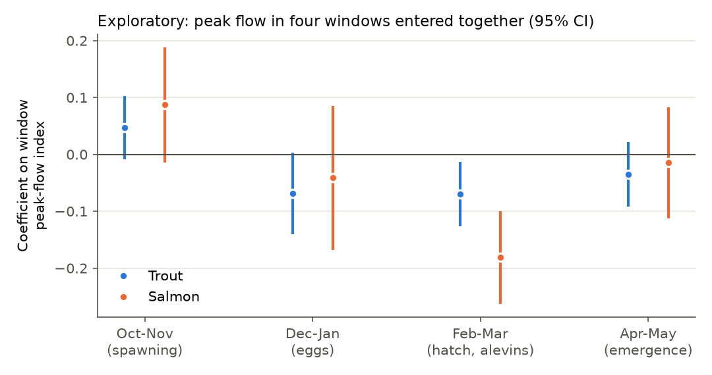
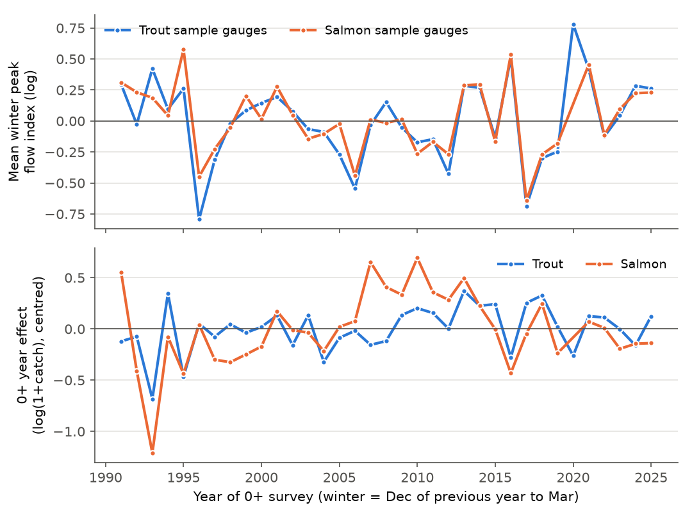

# High winter river flows decreased young-of-year brown trout catches at 579 English sites in 1991-2025; Atlantic salmon had the same sign, but the interval included zero

## Main result

We tested if high river flows in winter decrease the number of young-of-year (0+) salmonid fish in the next summer. Winter floods can move the gravel where the eggs and young fish stay. We used Environment Agency (EA) electric-fishing surveys and EA daily river flows for England.

- **Brown trout (planned primary test).** A higher December-March peak flow came before a lower 0+ catch. The slope was -0.139 log units of (1 + 0+ catch per 100 m²) per unit of log peak flow (95% CI -0.223 to -0.054; 6,154 site-years, 579 sites, 35 years). A winter peak at two times the site's usual peak gave a 9% lower value of (1 + catch). At the median catch this is about 13% fewer 0+ trout. The 5th-to-95th percentile range of winter peaks gave a difference of 19%.
- **The planned checks agreed.** The slope was negative in all four region-period sub-samples. The peak of the winter *after* the survey had no effect (+0.007, CI -0.046 to +0.060). Older trout (more than one summer old) had no effect (+0.004, CI -0.046 to +0.054). The slope stayed negative with region-by-year fixed effects, river-name-matched gauges, staff age labels, a spawner-density control, a winter air temperature control and each leave-one-region-out or leave-one-year-out fit.
- **Atlantic salmon (planned second test).** The slope had the same sign but was uncertain: -0.114 (95% CI -0.264 to +0.035; 3,317 site-years, 298 sites). Three of four sub-samples were negative.
- **Timing (exploratory, not in the plan).** When we put four two-month windows in one model, the February-March peak gave the largest negative slope. For salmon, this slope was -0.181 (CI -0.263 to -0.100). For trout, it was -0.070 (CI -0.127 to -0.014). This period is near hatching, when young fish stay in the gravel. The October-November peak (spawning) had positive estimates, but their intervals included zero.
- **Trend.** Winter peak flows at the sample gauges increased by 0.071 log units per decade, but the interval included zero (CI -0.028 to +0.170). With the trout slope, this trend gives about 3% fewer 0+ trout over 1991-2025. The observed 0+ year effects increased in the same period. Thus the flow change did not cause the main 0+ trend.



## Question and earlier work

Many studies of single rivers found that floods during egg incubation or fry emergence decrease salmonid year classes. Examples are French brown trout streams, where high flows during emergence decreased 0+ density [Cattanéo et al. 2002, doi:10.1139/f01-186], and a Spanish river drainage, where discharge controlled brown trout recruitment [Lobón-Cerviá 2004, doi:10.1139/f04-118]. Climate projections give more intense winter rain in Britain. A national, multi-region test with observation-bias controls was not in the campaign record.

We searched the campaign for river fish, trout, salmon, floods, flow, drought and recruitment before we selected the question. Three earlier campaign studies used the same EA fish export. They used fish of all ages and air temperature or rain, not river flow or 0+ fish:

- Community temperature indices of English river fish did not follow local warming [sci:sha256:d9f348606629e46cb57cf964e5333ee68a0009c68e613b84a7fc1a6748d42740].
- Rain deficits gave no clear change in the warmth slope of all-age trout catch [sci:sha256:cb613f6a3f424a2d71a02c2ca5295a9a758f71cd3ec874c532746ae3ce9f9f8e].
- Water-quality recovery moved fish communities toward cold-water species [sci:sha256:20db21aacbf6d41b59356ba72a26fa7ca4dbf1014d0f86d1492df65c6ae40fb2].

A study of English river invertebrates found that drought years caused a stall in autumn scores [sci:sha256:39dc74ed016f29d3108e6cea504c7348e263d746023325afcbc69a0f873244cb]. That study is about a different extreme and a different group.

**What is new here.** This study separates 0+ fish from older fish with the EA individual length file, which we added to the shared dataset store. It uses measured daily river flow from 776 matched EA gauges, not rain or air temperature. It applies planned placebo, life-stage, region and period checks.

## Data

| Source | Version and file | Use | Terms |
| --- | --- | --- | --- |
| EA National Fish Populations Database (NFPD), counts | `FW_Fish_Counts.zip`, shared snapshot 20 Oct 2026, SHA-256 `0eea3712...0f09` | Surveys, first-run counts, fished area | Open Government Licence v3.0 |
| NFPD individual lengths | `FW_Fish_Individual_Lengths.zip`, Last-Modified 10 Nov 2026, SHA-256 `4d4664da...b534` | 0+ or older for each measured fish | Open Government Licence v3.0 |
| EA Hydrology API | daily mean flow (`flow-m-86400-m3s-qualified`), 856 gauges, downloaded 12 Nov 2026 | Flow indices | Open Government Licence v3.0 |
| E-OBS v32.0e | `tg_ens_mean_0.25deg_reg_v32.0e.nc`, SHA-256 `b156cd2e...8f290` | Winter air temperature control only | ECA&D / C3S E-OBS terms |

The full paths, URLs, byte counts and hashes are in `files/results/provenance.json`. The hash of each flow download is in `files/results/ea_flow_downloads.csv`. We added the length file and the banded-measurement file to the shared store with the campaign dataset helper (`ea-nfpd-fw-fish-individual-lengths-20261110`, `ea-nfpd-fw-fish-banded-measurements-20261110`). We did not use the banded file in the final analysis.

## Method

The analysis plan was written before the first outcome model. It is in `files/ANALYSIS_PLAN.md`. Section "Deviations and disclosures" gives the changes.

**Survey sample.** We kept completed, non-selective electric-fishing surveys in England. The strategy was single catch or catch depletion over the full width. The survey month was July to October, the year was 1991-2025, and the fished area was more than zero. We kept one survey per site and year, the survey nearest to 1 September. Of 31,866 surveys that passed these filters, 31,201 site-years remained. Surveys with a trout or salmon catch but no measured fish of that species were removed (5,119 trout and 3,484 salmon site-years).

**0+ classification.** EA staff gave an age band to many salmonids. For each species, EA region and month, we found the length cut-off that gave the fewest disagreements with the staff labels (`files/results/cutoffs.csv`). The cut-offs were 71-121 mm for trout and 80-130 mm for salmon. The disagreement rate was 0-13%. We applied the cut-off to all measured fish. The 0+ share of the measured fish in run 1 multiplied the run 1 count. If a survey had no fish of the species, the 0+ catch was zero.

**Outcome.** The outcome is log(1 + 0+ first-run catch per 100 m² of fished area). First-run catch is an index. It is not a population estimate.

**Flow match.** For each site we used the nearest EA flow gauge with at least ten valid winters. The gauge had to be within 10 km. The median distance was 3.7 km. A window was valid if at least 85% of its daily values were present.

**Flow indices (index year t = year of the survey).**

- W, the main exposure: log of the maximum daily mean flow from 1 December (t-1) to 31 March (t), divided by the median of the same value at that gauge over 1991-2025. W = 0 is a usual winter. W = 0.69 is a peak two times the usual peak.
- S: the same index for April-May.
- LOW: the same type of index for the lowest 7-day mean flow in June-August.
- QS: log of the flow on the survey day divided by the gauge median flow. High flow on the survey day can decrease the capture efficiency.

We removed W values with an absolute value above 3 as probable gauge errors. A small offset (1% of the median flow) kept zero flows finite.

**Model.** We used ordinary least squares with site and year fixed effects. Controls were S, LOW, QS, survey day of year and its square, log fished area and method-by-strategy. Year fixed effects remove national changes in fish numbers, survey practice and weather. Thus W is tested only from differences between rivers in the same year. Standard errors used two-way clusters by site and year (Cameron-Gelbach-Miller). Intervals used Student t with the smaller cluster count minus one degree of freedom. A site had to have at least six site-years with complete data and at least three years with some 0+ fish of that species.

**Planned decision rules.** H1 (trout): the pooled slope is negative with a 95% CI that excludes zero, and the slope is negative in at least three of four sub-samples (North = North West and Yorkshire and North East, South = the other regions; 1991-2007 and 2008-2025). H2 (salmon): the same rule. H3: the next-winter placebo has an interval that includes zero. H4: the older-fish slope is smaller than the 0+ slope. H5: the slope is more negative at flashy gauges. H6: the W trend times the slope gives the flow part of the 0+ trend.

## Results

| Test (unit: log(1 + 0+ catch per 100 m²) per unit W) | Trout slope (95% CI) | Salmon slope (95% CI) |
| --- | --- | --- |
| Main model | **-0.139 (-0.223 to -0.054)** | -0.114 (-0.264 to +0.035) |
| North 1991-2007 | -0.173 (-0.475 to +0.130) | -0.101 (-0.413 to +0.212) |
| North 2008-2025 | -0.179 (-0.380 to +0.023) | -0.223 (-0.464 to +0.017) |
| South 1991-2007 | -0.004 (-0.343 to +0.334) | +0.378 (-0.226 to +0.981) |
| South 2008-2025 | -0.122 (-0.232 to -0.012) | -0.104 (-0.242 to +0.035) |
| Placebo: next-winter peak | +0.007 (-0.046 to +0.060) | -0.042 (-0.151 to +0.067) |
| Older fish (>0+) outcome | +0.004 (-0.046 to +0.054) | -0.057 (-0.152 to +0.038) |
| Flashy minus stable gauges (interaction) | +0.007 (-0.109 to +0.124) | +0.015 (-0.154 to +0.184) |
| Region x year fixed effects | -0.103 (-0.196 to -0.010) | -0.072 (-0.196 to +0.051) |
| River-name matched gauge (within 15 km) | -0.138 (-0.231 to -0.045) | -0.125 (-0.376 to +0.125) |
| Gauge within 5 km | -0.109 (-0.204 to -0.014) | -0.131 (-0.292 to +0.029) |
| With older-fish density at t-1 | -0.133 (-0.225 to -0.040) | -0.064 (-0.201 to +0.074) |
| With winter air temperature (E-OBS) | -0.141 (-0.228 to -0.055) | -0.117 (-0.254 to +0.020) |
| Staff age labels where present | -0.138 (-0.221 to -0.054) | -0.108 (-0.263 to +0.047) |
| Depletion surveys only, first run | -0.074 (-0.180 to +0.033) | -0.022 (-0.216 to +0.172) |
| Depletion surveys only, all runs | -0.086 (-0.197 to +0.025) | -0.030 (-0.249 to +0.190) |
| Presence of any 0+ (linear probability) | -0.013 (-0.038 to +0.011) | -0.019 (-0.074 to +0.037) |
| Winter mean flow index in place of W | -0.146 (-0.259 to -0.033) | -0.195 (-0.348 to -0.042) |
| Days above the gauge Q5 flow (per day) | -0.0051 (-0.0078 to -0.0024) | -0.0056 (-0.0098 to -0.0013) |

All rows and terms are in `files/results/models.csv`. Leave-one-year-out trout slopes were -0.152 to -0.120. Salmon slopes were -0.173 to -0.089 (`leave_year_out_*.csv`). Leave-one-region-out trout slopes were -0.156 to -0.105, and all intervals excluded zero.

**Decision against the plan.**

- H1 (trout): met. The pooled interval excluded zero, and all four sub-samples were negative. Only the South 2008-2025 interval excluded zero by itself. The South 1991-2007 estimate was near zero.
- H2 (salmon): not met. Three of four sub-samples were negative, but the pooled interval included zero.
- H3: met for both species.
- H4: met for trout. The older-fish slope was near zero. For salmon, the older-fish slope was about half of the 0+ slope, with a wide interval.
- H5: not supported. Flashy and stable gauges gave similar slopes.
- H6: the flow trend explains a small (about 3%) and uncertain decrease, against an observed increase of the 0+ year effects of about 0.07 log units per decade.


**Other observations, not planned as tests.**

- The peak of the previous winter (t-1) had a positive trout slope (+0.085, CI +0.014 to +0.156). One possible cause is less competition from a weak older year class. We did not test this.
- Peak flow decreased the 0+ catch but not the presence of 0+ fish. Thus the flow signal is in density, not in local loss of reproduction.
- The exploratory window model (`files/results/exploratory_windows.csv`, figure below) used 5,901 trout and 3,194 salmon site-years. The February-March salmon slope stays clear if a correction for four windows is applied (p = 0.0001). It is a new hypothesis for later tests, not a confirmed result.





## Interpretation

High winter flows have a measurable but moderate effect on 0+ trout catch in England. The effect is clear in the national panel, and it agrees with a physical cause in the egg and alevin stage: the effect is only on 0+ fish, the following winter has no effect, and the strongest exploratory window is the hatching period. Year-to-year flow differences explain only a small part of 0+ variation (the residual standard deviation of the outcome is about 1.2 log units). The change in winter peaks from 1991 to 2025 was small and uncertain at these gauges. Thus, to 2025, more intense winter floods were not a main cause of change in English 0+ trout numbers. If winter peaks increase more in the future, the slope gives a basis for an estimate. For example, a 30% higher typical peak (W = 0.26) gives about 3.6% fewer 0+ trout in (1 + catch) units.

## Limitations

- **Observation, not experiment.** Floods are not random. Year fixed effects and site fixed effects remove national and fixed site differences, but local weather, land use, stocking, barriers and habitat work can correlate with flow.
- **Gauge distance.** The nearest gauge can be on a larger or different river. The river-name and 5 km checks gave similar trout slopes. We did not use a river network to make sure that each gauge is upstream or downstream of its site.
- **Catch is not abundance.** First-run catch depends on capture efficiency, fish size, flow, crew and equipment. We controlled the survey-day flow, day of year, method and fished area, but not crew or conductivity. Depletion-only fits gave smaller slopes with intervals that included zero. This can be from the smaller sample (2,667 trout site-years) or from a capture-efficiency part in the main effect.
- **Age classification.** The length cut-offs disagree with staff labels for 0-13% of fish, mostly in autumn and in fast-growth southern rivers. Results with staff labels were almost the same.
- **Site selection.** Long repeat series and measured lengths select a small, non-random part of the archive (6,154 of about 26,000 trout site-years). Anglian and Midlands sites are few. The sample is mostly from upland and western rivers.
- **Brown and sea trout.** The EA name "brown / sea trout" includes both forms.
- **Peak index.** Daily mean flow underestimates short flood peaks in small, flashy streams. This can make the slope smaller (attenuation).
- **Salmon power.** The salmon sample is about half the trout sample. A null salmon result does not show that salmon are not affected.
- **Plan and data handling.** We fitted the code once on the first 14% of downloaded gauges to find errors before the full run. We did not change the plan after that test.
- **No air pollutant.** This study examined a weather extreme and a biological response. It did not test air pollution.

## Deviations and disclosures

- The plan said "nearest gauge within 10 km with at least 85% completeness in each window". We applied the 85% rule per window and required at least ten valid winters per gauge.
- The plan named these tests: the main model, the four sub-samples, the next-winter placebo, the older-fish outcome, the flashiness split, the trend calculation, staff age labels, river-name matched gauges and gauges within 5 km. All other rows in `models.csv` were added after the plan as robustness rows. Most were written before the full run, but after the code test on 14% of the gauges. The exploratory window model was added after the full results were seen. None of these rows changed the main model or the decision rules.
- The E-OBS v32.0e file ends on 30 June 2025. The Dec 2024-Mar 2025 winter is complete.

## What remains open

- A river-network match of gauges to sites (for example, with OS Open Rivers, which is in the shared store) and catchment-area weights.
- A depletion-based population estimate for 0+ fish, to separate abundance from capture efficiency.
- An independent test of the February-March window in other countries, for example with Welsh, Scottish or French juvenile salmonid surveys.
- Sub-daily peak flows (15-minute EA data) for small streams.
- A test of compensation: the positive effect of the previous winter's peak.

## Reproduce

Requirements: Python 3.12 with numpy, pandas, scipy, xarray, netCDF4, pyproj, pyarrow and matplotlib (versions in `files/results/provenance.json`). There is no special package for fixed effects. `files/code/fe.py` has the estimator. The full run takes about 1 hour with 2 CPUs, mostly for the flow download.

```sh
# 1. inputs (only if the shared store is not available), into a local folder outside this publication
bash files/code/fetch_inputs.sh /abs/inputs
# 2. full pipeline: writes record-level files to SCRATCH and aggregate tables and figures to OUT
bash files/code/run_all.sh /mnt/dell-data/shared_datasets /abs/scratch /abs/out
```

`run_all.sh` downloads the station list and about 860 daily flow series from the EA Hydrology API (about 60 MB compressed). The EA bulk fish exports and the EA flow series are mutable. Compare the hashes with `provenance.json` and `ea_flow_downloads.csv`. A different export can give slightly different numbers.

Files in this publication:

- `files/code/`: all code (00-05 pipeline steps, `fe.py`, download scripts).
- `files/results/models.csv`: all model rows. `exploratory_windows.csv`, `leave_year_out_*.csv`, `summary.json` (sample sizes and trend), `year_summary_*.csv` and `year_effects_*.csv` (national year values), `cutoffs.csv`, `fish_panel_flow.json` (sample flow).
- `files/figures/`: the four figures.
- `files/ANALYSIS_PLAN.md`, `files/EXTERNAL_DATA_NOTICE.md`.

No raw fish records, site coordinates, site-year tables or flow series are in this publication. They can be made again with the scripts.

## Attribution and job record

Contains Environment Agency information © Environment Agency and/or database right, used under the Open Government Licence v3.0. We acknowledge the E-OBS dataset from the EU-FP6 project UERRA and the Copernicus Climate Change Service, and the data providers in the ECA&D project. See `files/EXTERNAL_DATA_NOTICE.md`.

Job `sci-1107-hp-climate-pollution-biodiversity-be4b48e8793f`, topic climate-pollution-biodiversity, machine hp, campaign 11_07_2026. The analysis was done by an AI agent (Claude Opus 5.5, model ID claude-opus-5-5, in Claude Code) on 12 November 2026. The signing key is a campaign-machine key. It is not a personal authorship claim.
