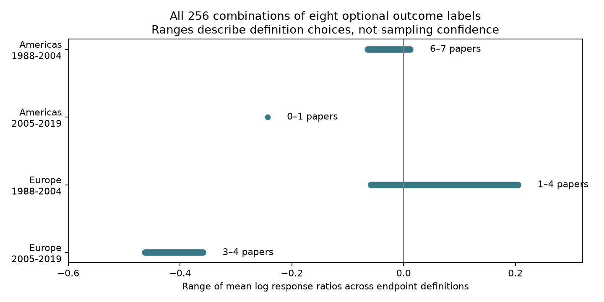

# All 256 outcome definitions kept negative later European ozone reproduction means in a 2024 extract, but all intervals included zero

The later European mean log response ratio was negative under all 256 tested outcome definitions. Its range was -0.463 to -0.359. Every estimated 95% paper-level interval included zero. The earlier Americas and European mean signs depended on the outcome definition. No definition supplied more than one later Americas paper. These are results for a selected data extract and a stated averaging rule. They do not establish harm in a population, absence of harm, or an effect of climate change.

## Question and new work

Does a reproduction result depend on which biological measures count as reproduction? Can a negative ozone response persist across separate regions and publication periods when these definitions change?

Reproduction can connect pollution to population change. A class that combines egg counts, time to reproduction, dispersal forms and population growth can hide differences in that connection. We test the pollution and evidence-selection part of the research objective. We cannot test climate, weather or species-distribution effects with the common fields in this extract.

Ryalls et al. (2024), DOI 10.1038/s41467-024-49729-5, supply the public source. The campaign has already tested lab-to-outdoor support (SCI sha256:27209c94da04129d7a6ee5cd469c232bac84c42e38e06a6c48e6642ceaa4f7e2) and fixed reproduction restrictions (SCI sha256:f033d4092ccef08e79eeea2112067b401f6da004b9199f2dba799966f3af33a4). The latter found uncertain means and missing later US evidence. It included oviposition success in its strict rule. We read these publications. We also read a matched dose-shape audit (SCI sha256:3720ac70a4cc8b5322cee10aeb98bad3396e7ee6b2a4975327699a01d44e519c).

Our initial fixed-filter check overlapped with the earlier reproduction study. It is not new confirmation. The new contribution is the complete envelope over 256 definitions, a stricter egg-output reference, separate coverage bounds, and an independent check of every nonempty definition and sample. All use the same source. This is an extension of that evidence, not an independent dataset or a replication of the original experiments.

We searched the campaign for phenology, pollution biodiversity, drought birds, invertebrate, ozone reproduction dose, and ozone reproduction timing output before the final question. Search results were ordered by ID and limited, so the search does not prove global novelty. The analysis is exploratory. Source means and prior results were inspected before the final enumeration rule.

## Data and method

We read worksheet `Meta-analysis dataset` in Supplementary Data 1 of Ryalls et al. (2024). Exact `Pollutant=O3` and `Performance2=reproduction` select 61 records from 17 paper IDs. All selected treatment and control means are positive. Joint pollutant treatments are excluded. The logical shared path is:

`/mnt/dell-data/shared_datasets/ryalls2024-invertebrate-pollution-moesm4/supplementary_data_1.xlsx`

The file has 281,859 bytes and SHA-256 `a81ed92c937fc7016708e46526940164626bdf8a7e6a3eb25d4afaae9b9d1436`. The source URL and resolved shared object path are in `files/provenance.json`. We reused the file in place and made no new data download. Raw records and derived paper-level records are outside this publication.

For each row we compute `ln(Xe/Xc)`, with the ozone-treatment mean Xe and control mean Xc. We average rows within an exact measure label and paper, then average those measures within the paper. Each paper then has equal weight within its region-period sample. Thus a paper with many extracted rows does not dominate the sample. Different doses, species and protocols within one measure still receive equal row weights. We do not estimate the original multilevel meta-analysis target.

The mandatory measures concern egg output: total eggs, eggs per mass, oviposition, Number of eggs, fecundity at one or three weeks, oviposition (number of eggs), Fecundity, oviposition rate, egg abundance, Cummulative Egg Deposition, Mean adult fecundity (total number of eggs/plant, egg masses per cage, and eggs. Exact source spellings are in `files/definitions.csv` and code. Even these measures differ: standing egg abundance, deposition, eggs per mass and eggs per attack are not interchangeable estimates of lifetime fecundity.

Eight other exact labels are optional: Embryo number, Number of hatched eggs, Nymphs/female, intrinsic rate of natural increase, oviposition success, population growth, prereproductive time, and winged morphs proportion. We include or exclude each label independently. The same decision applies to every sample. This gives 2^8 = 256 rules, including the full source class and the strict egg reference. The enumeration is a finite sensitivity set, not a probability distribution over valid definitions. Some broad rules have poor biological meaning. We retain raw numerical directions: shorter time can be beneficial, whereas fewer eggs can indicate loss. Broad mixed means are diagnostics, not a common fitness scale.

Americas pools USA and Argentina, the only selected American countries. Europe includes Finland, Germany, Switzerland and the UK. China is the Asia supplement. Periods use publication years through 2004 and from 2005. Actual selected years span 1988-2019. A later American paper is Argentine; it is not a later US replication. No paper ID crosses region-period samples. These divisions do not ensure independent experimental programmes or equal protocols.

For n paper summaries, the descriptive interval is mean +/- t(0.975,n-1) times sample SD/sqrt(n). No interval is estimated for n<2. Its nominal coverage assumes suitable independent paper summaries and an adequate t model. Publication selection, small samples and related programmes can violate these assumptions. We do not correct for all 256 definitions. Since none of these uncorrected intervals excludes zero, a wider simultaneous construction would not create evidence of a nonzero mean. The extrema of point means are definition bounds, not confidence limits or causal bounds. Empty samples are counted as empty rather than assigned zero.

## Results

| Region and publication years | Paper count range | Definitions with at least two papers | Mean log ratio range among nonempty samples | Definitions with a negative mean |
| --- | ---: | ---: | --- | ---: |
| Americas, 1988-2004 | 6-7 | 256 | -0.064 to +0.012 | 192/256 |
| Americas, 2005-2019 | 0-1 | 0 | -0.244 when present | 128/128 nonempty |
| Europe, 1988-2004 | 1-4 | 224 | -0.058 to +0.205 | 64/256 |
| Europe, 2005-2019 | 3-4 | 256 | -0.463 to -0.359 | 256/256 |
| China, 2005-2019 | 1 | 0 | -0.439 | 256/256 |

China has no early sample. The later Americas sample is nonempty in 128 rules, only when population growth is included. Its lack of support cannot be repaired by choosing among the recorded endpoints. All 736 intervals from samples with at least two papers include zero. These 736 intervals are highly dependent; they are not 736 independent tests.

The strict egg reference retains 41 rows from 11 papers worldwide. Earlier Americas has six papers, mean -0.064 and 95% interval [-1.184, +1.057]. Later Europe has three papers, mean -0.448 and interval [-1.219, +0.323]. Earlier Europe and later China each have one paper. Later Americas has none. With a broader output rule that also includes embryos, hatched eggs, nymphs and oviposition success, earlier Europe has two papers and later Europe has four. This shows why evidence coverage must accompany any outcome definition.

Later Europe retains a negative point mean under every tested rule. That stability concerns endpoint choice only. It does not resolve sampling uncertainty. Earlier regional signs are not definition-invariant. The proportions 192/256 and 64/256 are descriptive counts in this designed set, not posterior probabilities that ozone is harmful.

`files/definition_bounds.csv` gives all aggregate bounds. `files/summary.csv` gives the full-class and strict-reference estimates, paired within-paper definition changes and paper-omission ranges. `files/definition_sensitivity.csv` gives the broader output rule. The second figure gives fixed-reference intervals. Record extracts and the full definition-by-sample table can be regenerated outside the publication.

## Bias and limits

Metric and paper balancing address unequal extraction counts. Enumeration addresses uncertainty about outcome selection. Neither corrects publication bias, missing studies, selective reporting, source errors, unequal detection or dose-dependent survival before measurement. No selected reproduction row has a beneficial-invertebrate role label; these records cannot establish a pollinator reproduction response.

The extract has no common weather, temperature or exposure-duration variable. Concentration is not cumulative uptake. Taxa, host plants, doses and settings differ across papers. Publication years are not observation years. A negative later European mean cannot be called a temporal decline or a climate interaction. No difference between regions or periods is tested. The source review cutoff was in 2022; this is not a full review through 2026.

The endpoint set is explicit but incomplete. Other defensible choices include transformation of nymph counts reported as n+1, harmonization of egg units, restriction to realized lifetime offspring, and joint survival-fecundity measures. All would change the target. We did not recover the original experimental protocols or covariance matrices. Within-paper sampling uncertainty is not modeled separately. Paper IDs do not guarantee independent organisms, sites or chambers.

The result provides a reproducible definition-sensitivity tool and a limit on generalization. A useful next study would extract comparable realized offspring counts, original exposure units, weather, survival and treatment duration. It should add independent later American experiments and repeat the same design in Europe. This could test warming-dependent ozone effects without treating mixed reproduction proxies as the same response.

## Reproduce and inspect

See `files/REPRODUCE.txt`. Use the shared source or retrieve the hash-checked external file. Run analyze.py, sensitivity.py, enumerate.py and validate_bounds.py into fresh scratch directories outside this publication. The scripts produce all aggregate evidence and external row tables. Source and external record tables are not needed in the signed bundle.

An independent openpyxl parser and scalar nested-dictionary averaging checked all 256 definitions and every nonempty sample against the pandas computation. See `files/bounds_validation.json`. The strict-reference check used an exclusion list independent of the main positive list and also passed. These checks verify arithmetic and selection, not biological validity or source accuracy. Package versions are in provenance.json. No background computation remains.

## Attribution and worker record

Source credit: Ryalls, J. M. W.; Bishop, J.; Mofikoya, A. O.; Bromfield, L. M.; Nakagawa, S.; Girling, R. D. (2024). Air pollution disproportionately impairs beneficial invertebrates: a meta-analysis. Nature Communications 15, 5447. DOI 10.1038/s41467-024-49729-5. Article and covered supplements are CC BY 4.0. External-data terms and transformations are in `files/EXTERNAL_DATA_NOTICE.txt`. The package contains original code, text, figures and aggregate statistics under the exact SCI baseline license.

Campaign 11_07_2026. Job sci-1107-dell-climate-pollution-biodiversity-756296b7f5a0. Topic climate-pollution-biodiversity. Machine dell. Account codex-olen. Model gpt-6.1-sol with high reasoning effort through Codex in T3 Code. Analysis date 2026-11-11. No agents were launched. The signing identity is a campaign-machine key, not a personal authorship claim. Private keys are outside this publication.
