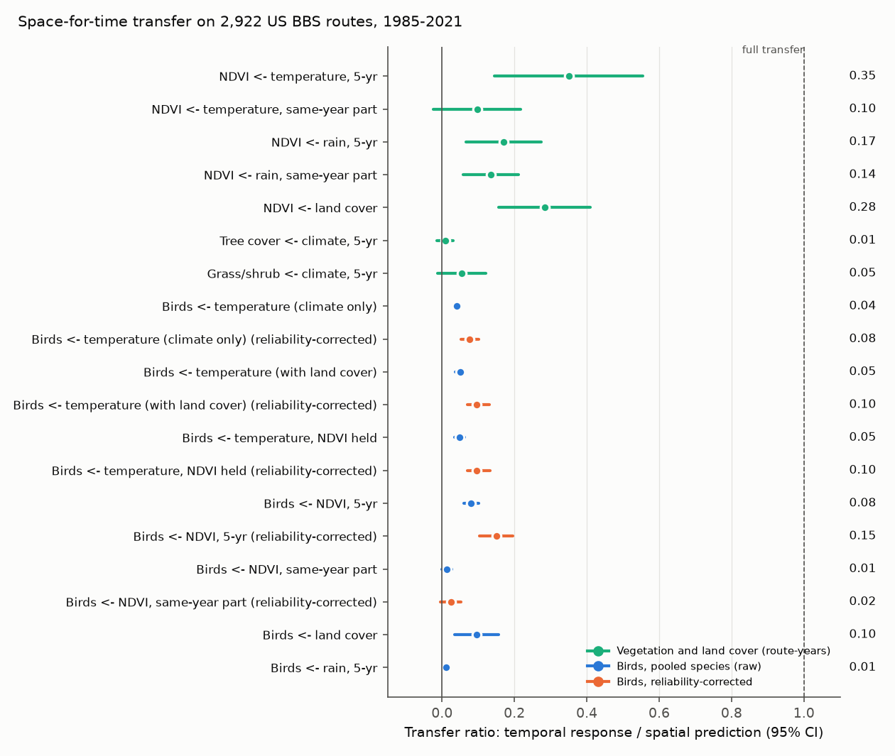
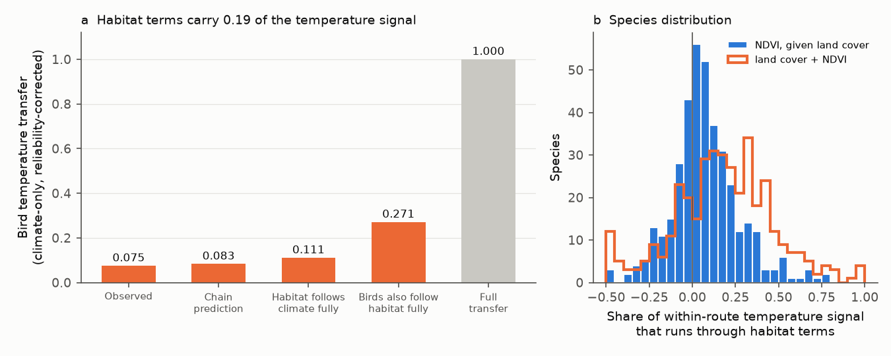
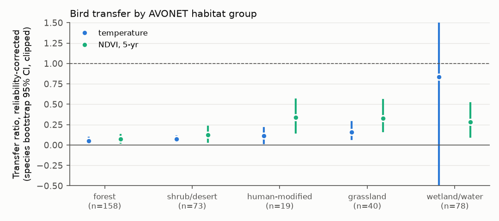

# Vegetation greenness did not carry the weak climate tracking of US breeding birds: birds followed 8-15% of their spatial greenness associations, greenness carried 9% of their temperature signal, and greenness followed 35% of its own spatial temperature prediction (BBS, PKU GIMMS NDVI, 1985-2021)

Job: sci-1107-dell-climate-pollution-biodiversity-e9ce3a4fcf05. Campaign 11_07_2026. Topic:
climate-pollution-biodiversity. Machine: dell. Model: Claude Opus 5.5 (claude-opus-5-5). The signing key
is a campaign-machine key. It is not a personal authorship claim.

## Summary

Earlier campaign work found that North American bird communities and species follow only a small part
of their spatial temperature associations in time (about 5-14%; sci:sha256:c0a3a9aa...,
sci:sha256:91f371b5..., sci:sha256:0037934e...). They also follow only 11-40% of their spatial
land-cover associations (sci:sha256:b624d6a0..., sci:sha256:096d8e50...). Which ecological process sets
this gap was open.

We tested one candidate process with satellite data from outside the Breeding Bird Survey (BBS):
**inheritance from vegetation**. In space, birds follow temperature partly because vegetation
(biome, productivity) follows temperature. If vegetation responds to warming slowly, and if birds follow
vegetation, then the bird gap is inherited from the vegetation gap. We measured all links of this chain on
the same 2,922 contiguous-US BBS routes, 1985-2021, with PKU GIMMS NDVI v1.2 (May-July greenness),
nClimGrid climate and LCMAP land cover.

Main results (95% intervals; "transfer" = temporal response divided by the spatial prediction,
1 = full space-for-time transfer):

1. **Vegetation itself transfers weakly.** Route greenness followed 0.35 (0.14-0.56, 4-degree block
   clustered; 0.26-0.44 year-block jackknife) of its spatial prediction from 5-year temperature, 0.10 from
   the same-year part of temperature, 0.17 from 5-year rain and 0.28 from land cover. Land-cover classes
   followed their spatial climate prediction at about 0 (tree cover 0.009, grass/shrub 0.05).
2. **Birds follow greenness weakly.** For 381 species, the transfer of the 5-year-mean greenness
   association was 0.081 (0.063-0.098; 0.15 after correction for errors in the spatial coefficients).
   The same-year part of greenness gave only 0.013 (0.024 corrected). This is as low as land-cover
   transfer (0.096 here; 0.19 corrected in b624).
3. **Greenness carries little of the bird temperature signal.** NDVI took 9% of the within-route
   temperature signal of the land-cover model (species median 6%). Land cover and NDVI together took
   19% of the climate-only signal.
4. **The chain does not explain the gap.** With the measured links, the chain predicts a corrected
   temperature transfer of 0.083; the observed value is 0.075. If vegetation and land cover followed
   climate fully, the bird temperature transfer would rise only to 0.11. Even if birds also followed
   habitat fully, it would be 0.27. The remaining 0.73 of the gap is in the direct (habitat-independent)
   temperature association, which birds followed at about 0.10.
5. **Transfer grows with the averaging window but stays small.** Temperature: 0.010 (same year), 0.050
   (5-year mean), 0.082 (10-year mean); greenness: 0.025, 0.080, 0.096 (corrected 10-year: 0.17 and
   0.18).
6. **Open-country birds follow greenness more.** Corrected greenness transfer was 0.33 (0.17-0.55) in
   40 grassland species and 0.34 in 19 human-modified-habitat species, against 0.07 (0.03-0.12) in 158
   forest species. The strongest single responses were from nomadic grassland birds (Dickcissel 1.57,
   Lark Bunting 0.63, Grasshopper Sparrow 0.59, raw).

Conclusion: weak space-for-time transfer is present at every link (vegetation to climate, birds to
vegetation, birds to land cover, birds to temperature). Vegetation lag is real but it is not the process
that holds bird communities back, because only a small part of the bird temperature association runs
through greenness and land cover. The gap is mostly in the direct temperature association and in the weak
response of birds to habitat change itself.

## 1. Question and plan

The plan (`files/PLAN.md`) was written before any NDVI or species model was fitted. It names three
quantities and a chain prediction:

* theta_veg_T: transfer of route NDVI to temperature (also rain and land cover);
* theta_N: transfer of the bird greenness association (5-year mean and same-year parts);
* m: the share of the bird temperature association that runs through greenness;
* chain: theta_T_total ~ (1 - m) theta_T_direct + m theta_veg_T theta_N.

The inheritance hypothesis predicts theta_N near 1, theta_T_direct near 1 and a chain prediction close to
the observed theta_T_total. The generic-limitation hypothesis predicts theta_N as low as the land-cover
transfer.

Added after the main fits (marked "added" below): a climate-only spatial model (to get the land-cover plus
NDVI share m_hab and the full chain), the transfer of land-cover classes to climate, 10-year and same-year
averaging windows, and the year-block jackknife of the chain.

## 2. Data

| Source | Version | Use |
| --- | --- | --- |
| North American Breeding Bird Survey | 2026 release (1966-2025), ScienceBase 6a0b0b0ab66b0188da36aedd | Standard runs (RunType 1), contiguous US, 1985-2021: 68,130 runs on 2,922 routes with complete NDVI and land cover |
| BBS route paths | National Atlas bbsrtsl020 (to 1998), Stanford EarthWorks vy474dv5024 | 9 points along each route path |
| PKU GIMMS NDVI v1.2 | AVHRR-MODIS consolidated, 1/12 degree, half-month, 1982-2022; Zenodo 8253971 (Li et al. 2023, ESSD) | Route May-July NDVI |
| nClimGrid monthly | NOAA NCEI, files of 2026-10-06 | Route May-July temperature and precipitation |
| LCMAP v1.3 route land cover | table of sci:sha256:b624d6a0... (USGS LCMAP CONUS v1.3, 400 m route buffers, 1985-2021) | Land-cover fractions (6 classes + tree) |
| AVONET | Tobias et al. 2022, eBird taxonomy sheet | Habitat and migration labels |

Exact shared-store paths, sizes, SHA-256 hashes (all verified equal to the recorded hashes) and source URLs
are in `files/provenance/inputs.json`. Licences and attributions: `files/NOTICE-external-data.md`.

**NDVI.** For each route and year, the mean of the six half-month composites from May 1 to July 31 at the
nearest pixel of each of the 9 path points, then the mean over points. Fill values and snow/ice QC codes
were removed. The split-path reliability of the route-year NDVI anomaly (odd vs even points,
Spearman-Brown) was 0.97 (5-year means 0.93), so NDVI sampling noise is small. Route mean May-July NDVI
rose by 0.002 per decade; route temperature rose by 0.22 C per decade (`files/figures/fig5_route_means.png`).

## 3. Methods

The BBS run, count, species, fold, domain and estimator code is the published pipeline of
sci:sha256:b624d6a0... (copied unchanged; it reproduced its 429 species, 69,243 runs and 2,986 routes).

**Bird species models (`05_species.py`).** For each species with 50 or more occupied routes, routes within
250 km of an occupied route form its domain. Two folds of 4-degree blocks give cross-fitting: the spatial
coefficients used for routes in one fold come from the other fold.

* Spatial model 0: Poisson model (L2 penalty 1e-4) of route totals (offset: number of runs) on a cubic
  spline of the 1985-2021 May-July temperature normal, a spline of the log precipitation normal and six
  land-cover fractions. Spatial model N: model 0 plus a spline of the route NDVI normal.
* For each run, the spatial coefficients give predicted log abundances: x_T from 5-year mean temperature
  (t-4..t), x_P from 5-year precipitation, x_LC from that year's land cover, x_N5 from 5-year mean NDVI and
  x_Nf = prediction from same-year NDVI minus x_N5.
* Temporal model: conditional Poisson regression of run counts on these terms with route x observer and
  year fixed effects; standard errors clustered by route. The coefficient of each term is its transfer
  ratio theta.
* m_w = 1 - cov(x_T^N, x_T^0) / var(x_T^0) over the within-group (route x observer) variation: the share
  of the temperature signal of model 0 that model N gives to NDVI.
* Reliability correction (as in b624): the two folds have independent coefficient errors; the covariance
  of the within-group predictions of the two folds divided by the variance of the cross-fitted prediction
  estimates the attenuation. Corrected theta = sum(w theta) / sum(w reliability), random-effects weights,
  species bootstrap interval.
* Pooling: DerSimonian-Laird random effects over 381 species with converged fits.
* Year-block jackknife: we refitted all species and the vegetation model 9 times, each time without one
  block of 4-5 survey years (1985-88, ..., 2017-21). All species share the same weather years, so this
  interval is the more honest one for pooled values; it was close to the meta-analytic interval.

**Vegetation model (`04_veg.py`).** Same routes and folds, all route-years 1985-2021. Cross-fitted OLS of the
route NDVI normal on the same climate splines and land-cover fractions; temporal OLS of route-year NDVI on
the 5-year temperature prediction, the same-year minus 5-year temperature prediction, the same two terms for
precipitation and the land-cover prediction, with route and year fixed effects. Standard errors clustered
by 4-degree block. `04b_lc_climate.py` (added) does the same for land-cover fractions and NDVI on climate
alone.

**Added chain model (`05b_chain.py`).** Spatial model C with climate only. theta_Tc is the transfer of its
temperature term. m_lc and m_hab are the shares of its within-group temperature signal that the land-cover
model and the land-cover plus NDVI model remove. Full chain (reliability-corrected):
theta_Tc ~ (1 - m_hab) theta_Td + m_N theta_veg_T theta_N5 + m_lc theta_LC_clim theta_birds_LC, with
m_N = m_hab - m_lc, theta_LC_clim = 0.055 (the larger class value, tree or grass/shrub) and
theta_birds_LC = 0.19 (corrected value of b624).

## 4. Results

### 4.1 Vegetation follows its own spatial climate prediction weakly

`files/results/veg_transfer.json`. Transfer of route May-July NDVI (2,922 routes, 108,114 route-years):

| Term | theta (block-clustered 95% CI) | Year-block jackknife 95% CI | 1985-2000 | 2001-2021 |
| --- | --- | --- | --- | --- |
| Temperature, 5-year | 0.35 (0.14-0.56) | 0.26-0.44 | 0.20 | 0.25 |
| Temperature, same-year part | 0.10 (-0.02-0.22) | 0.03-0.16 | 0.16 | 0.07 |
| Precipitation, 5-year | 0.17 (0.11-0.23) | 0.07-0.27 | 0.08 | 0.29 |
| Precipitation, same-year part | 0.14 (0.10-0.17) | 0.06-0.21 | 0.04 | 0.21 |
| Land cover | 0.28 (0.20-0.37) | 0.16-0.41 | 0.11 | 0.56 |

The era values are lower than the full-period value for temperature because the full period also uses the
change between eras. In a linear form, NDVI rose by 0.0036 per C across routes (with precipitation and land
cover held) but fell by 0.0043 per C (SE 0.0012) with 5-year temperature in time. Thus warm periods did not
make routes greener as warm places are greener. Land-cover classes followed their spatial climate prediction
at about 0: tree cover 0.009 (SE 0.012), grass/shrub 0.055 (0.034), cropland -0.004 (0.011). With climate
alone in the spatial model, NDVI transfer to temperature was 0.23 (SE 0.04).

### 4.2 Birds follow greenness weakly and same-year greenness almost not at all

`files/results/summary.json`, `files/results/species_theta.csv`. 381 species:

| Term | theta raw (jackknife 95% CI) | reliability-corrected (95% CI) |
| --- | --- | --- |
| Temperature, climate only (added) | 0.040 (0.030-0.050) | 0.075 (0.052-0.102) |
| Temperature, model with land cover | 0.050 (0.037-0.062) | 0.096 (0.074-0.119) |
| Temperature, NDVI held (model N) | 0.048 (0.034-0.062) | 0.096 (0.069-0.124) |
| NDVI, 5-year mean | 0.081 (0.063-0.098) | 0.15 (0.10-0.20) |
| NDVI, same-year part | 0.013 (-0.002-0.027) | 0.024 (-0.004-0.052) |
| NDVI, same-year only (one term) | 0.025 (0.017-0.032) | 0.047 (0.030-0.067) |
| Land cover | 0.096 (0.035-0.157) | |
| Precipitation, 5-year | 0.011 (0.007-0.015) | |

The temperature value of model 0 (0.050) repeats b624 (0.050) exactly. Within species, NDVI 5-year
transfer exceeded direct temperature transfer by 0.037 (0.009-0.065). With route effects only
(comparisons across observer changes), the corrected values were 0.14 for temperature and 0.10 for NDVI.
By era, the temperature transfer was 0.061 in 1985-2000 and 0.031 in 2001-2021; NDVI 0.082 and 0.071.
Median reliability of the predictions was 0.57-0.59.

### 4.3 The vegetation chain accounts for very little of the gap

* Share of the within-route temperature signal that runs through NDVI (given land cover): m = 0.089
  (jackknife 0.062-0.115; species median 0.059). Land cover: 0.105. Land cover plus NDVI: 0.19 (species
  median 0.18). In the spatial normals the NDVI share was similar (0.063).
* Chain with model 0 (pre-planned, corrected): predicted 0.092 (jackknife 0.067-0.118) vs observed 0.096.
  If NDVI followed temperature fully: 0.101 (0.075-0.127).
* Full chain with the climate-only model (added, corrected): predicted 0.083 vs observed 0.075. If
  vegetation and land cover followed climate fully: 0.111. If birds also followed habitat fully: 0.271.
  Direct part alone: 0.078.

Thus removing the whole vegetation and land-cover lag would close about 3% of the gap between the
observed transfer and full transfer ((0.111 - 0.083) / (1 - 0.083)). Even perfect habitat tracking by birds
would close only about 20%. Most of the gap is in the direct temperature association (81% of the
signal), which birds followed at about 0.10.

### 4.4 Time scale and habitat groups

Transfer rose with the averaging window of the driver (added; raw): temperature 0.010 (same year), 0.050
(5-year), 0.082 (0.062-0.103; 10-year; corrected 0.17); NDVI 0.025, 0.080 (same rows), 0.096
(0.065-0.127; 10-year; corrected 0.18). Slow responses exist, as for land cover in b624, but a 10-year
window still gives less than one fifth of the spatial prediction.

Exploratory habitat groups (AVONET habitat; corrected; species bootstrap 95% CI):

| Group | Species | Temperature | NDVI 5-year | m (NDVI) | m_hab |
| --- | --- | --- | --- | --- | --- |
| Forest and woodland | 158 | 0.05 (0.02-0.09) | 0.07 (0.03-0.12) | 0.10 | 0.23 |
| Shrubland and desert | 73 | 0.07 (0.04-0.11) | 0.12 (0.04-0.23) | 0.08 | 0.14 |
| Human-modified | 19 | 0.11 (0.02-0.21) | 0.34 (0.15-0.56) | 0.10 | 0.22 |
| Grassland | 40 | 0.16 (0.07-0.28) | 0.33 (0.17-0.55) | 0.15 | 0.17 |
| Wetland and water | 78 | not determined (-3.1-1.8) | 0.28 (0.10-0.51) | 0.04 | 0.16 |

Open-country birds followed greenness about four times more than forest birds. The species with the
largest precise greenness responses were Dickcissel (1.57, SE 0.16), Canvasback (0.86), Red-winged
Blackbird (0.86), Lark Bunting (0.63), Grasshopper Sparrow (0.59) and Savannah Sparrow (0.54). Several of
these are known to settle where rain makes good habitat in a given year. This agrees with the higher
temperature transfer of grassland birds in sci:sha256:91f371b5... and with the full water transfer of
wetland birds in sci:sha256:096d8e50.... For wetland birds the temperature reliability was too low to
correct.

## 5. Interpretation

1. **Vegetation inheritance is rejected as the main cause.** All three links of the chain were measured on
   the same routes. Vegetation lags climate (0.35 for 5-year temperature, about 0 for land-cover classes),
   but only about one fifth of the bird temperature signal runs through greenness and land cover. The
   chain prediction matches the observed transfer, and full vegetation tracking would raise the bird
   transfer only from about 0.08 to 0.11.
2. **Weak transfer is general, also for a direct resource variable.** Greenness varies strongly from year
   to year, is measured precisely and is a proxy for food and cover. Birds still followed its spatial
   association at only 0.08-0.15 (5-year) and almost not at all in the same year. Together with land cover
   (0.10-0.25) and temperature (0.05-0.14), this shows that the weak response is a property of how bird
   abundance responds to any local environmental change in BBS data, not of climate.
3. **Vegetation shows the same pattern.** Greenness followed only 0.17-0.35 of its spatial climate
   prediction. This agrees with the "vegetation constraint" result for grassland productivity, where the
   temporal sensitivity to rain is smaller than the spatial one (Lauenroth and Sala 1992; Sala et al.
   2012). Weak space-for-time transfer thus occurs at two trophic levels.
4. **What is left.** The direct temperature association is followed at about 0.10 and grows slowly with
   longer windows. Possible causes, not tested here: spatial associations that contain non-transferable
   parts (history, dispersal limits, other covarying gradients), site fidelity and density regulation,
   and responses slower than 10 years. Open-country species that settle each year by habitat conditions
   follow change more, so settlement behaviour is a good candidate for a next test.

## 6. Limitations

* Correlational design. Year effects remove national weather and NDVI sensor differences; regional
  satellite artefacts can remain. The AVHRR (to 2000) and MODIS-consolidated eras gave similar bird NDVI
  values (0.082, 0.071).
* May-July NDVI at 1/12 degree (~9 km) is a coarse proxy of habitat quality and food. It does not show
  forest age, insect abundance or vegetation structure below the canopy. Birds can follow a variable that
  NDVI does not measure.
* The mediation shares come from spatial models with splines and penalties; they assume that land cover
  and NDVI are on the causal path and are not only correlates. If NDVI is partly an effect of other causes,
  m is an upper value for the vegetation path.
* The full chain uses the larger land-cover-to-climate transfer (0.055) and the b624 bird land-cover value
  (0.19) as fixed constants; their uncertainty is not propagated. Changing them within their intervals does
  not change the conclusion, because the land-cover share is 0.105.
* The reliability correction assumes classical, independent errors in the two folds. Species-level
  reliabilities are noisy; we pooled them as ratios of weighted sums.
* Route land cover uses 1998 route paths and 400 m buffers. Observer hearing drift (sci:sha256:b113aa1b...)
  affects within-observer trends; the route x observer design removes level differences but not drift
  within a tenure. The 10-year windows have more weight on such slow changes.
* The added analyses (climate-only model, time scales, land-cover-to-climate transfer, full chain) were
  defined after the main results were known.

## 7. Files and reproduction

* `files/code/run_all.sh DATASETS LC_TABLE SCRATCH OUT` runs all steps (about 1.5 h with 2 processes on
  the loaded Dell host). LC_TABLE is `files/data/route_landcover_lcmap_1985_2021.csv.gz` of
  sci:sha256:b624d6a0...; extract it with `sci read <b624 zip> --file
  files/data/route_landcover_lcmap_1985_2021.csv.gz --output LC_TABLE`. The scripts write only to SCRATCH
  and OUT.
* Steps: `02_bbs_build.py`, `03_cti.py`, `pfe.py` (copied from b624); `04_lc_from_bundle.py`;
  `00_avonet.py`; `01_ndvi.py` (route NDVI); `04_veg.py`, `04b_lc_climate.py` (vegetation and land cover);
  `05_species.py` (primary bird models; JK_DROP=a-b for jackknife refits), `05b_chain.py` (added);
  `run_jk.sh`; `06_pool.py` (pooling, corrections, chain, jackknife); `07_figures.py`.
* Data in this bundle (derived, aggregated): `files/data/route_ndvi_mayjul_1982_2022.csv.gz` (route x year
  NDVI, odd/even path halves, valid point count; adapted from PKU GIMMS NDVI v1.2, CC BY 4.0) and
  `files/data/route_climate_mayjul.csv.gz` (route x year nClimGrid May-July temperature and precipitation,
  public domain source). No BBS count records are included.
* Results: `files/results/summary.json` (all pooled values, corrected values, chains, jackknife),
  `files/results/species_theta.csv` (381 species with names, AVONET habitat, all thetas, SEs,
  reliabilities and shares), `species_theta_raw.csv` and `species_chain_raw.csv` (unfiltered model
  output), `jackknife_species_theta.csv.gz`, `jackknife_veg_blocks.csv`, `veg_transfer.json`,
  `lc_climate_transfer.json`, `ndvi_tavg_annual_mean.csv`, run logs in `files/results/logs`.
* Software: `files/provenance/software_versions.txt` (Python 3.12, numpy, pandas, scipy, scikit-learn,
  rasterio, geopandas, matplotlib).

## References

Li, M. et al. (2023) Spatiotemporally consistent global dataset of the GIMMS NDVI (PKU GIMMS NDVI) from
1982 to 2022. Earth Syst. Sci. Data 15, 4181-4203. Lauenroth, W. K. and Sala, O. E. (1992) Long-term
forage production of North American shortgrass steppe. Ecol. Appl. 2, 397-403. Sala, O. E. et al. (2012)
Legacies of precipitation fluctuations on primary production: theory and data synthesis. Phil. Trans. R.
Soc. B 367, 3135-3144. Tobias, J. A. et al. (2022) AVONET. Ecology Letters 25, 581-597.
