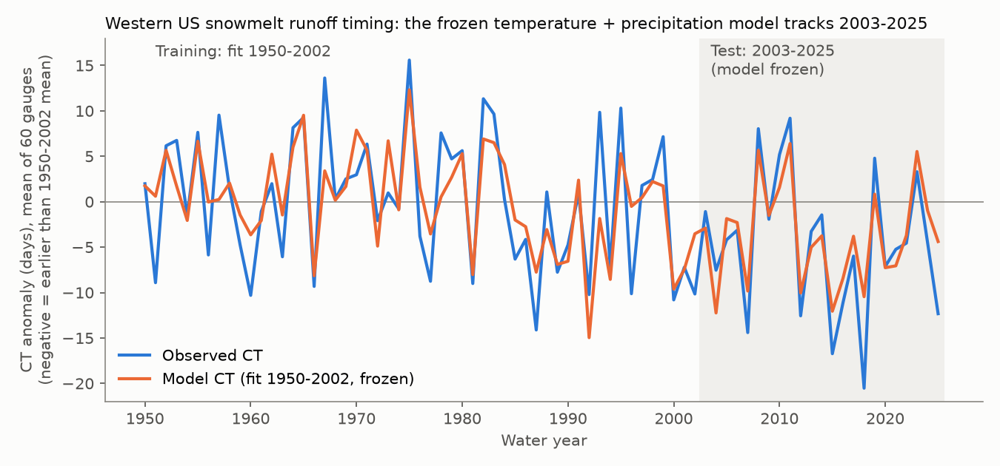
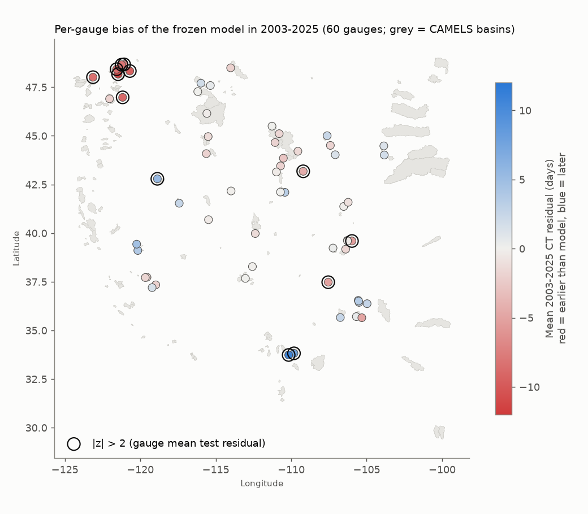
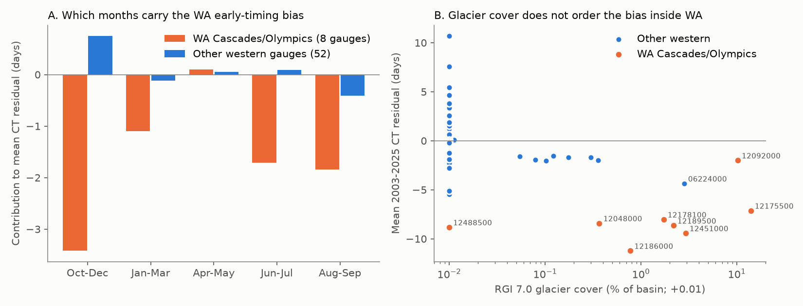

# A frozen 1950-2002 spring temperature and winter precipitation model predicted 2003-2025 snowmelt runoff timing at 60 western US reference gauges within 1 day; 8 Washington gauges ran 8 days early

## Summary

Stewart, Cayan and Dettinger (2005) reported that snowmelt runoff in western North America came earlier in 1948-2002. They related this change mainly to warmer spring temperatures. We did an out-of-sample test of this explanation with 23 new water years.

We used 60 snowmelt-dominated CAMELS-US reference gauges (minimal human effect) west of 103 W. For each gauge we calculated the center of timing (CT), which is the flow-weighted mean day of the water year. In each gauge we fitted CT to the basin-mean March-May temperature and the log of October-March precipitation (NOAA nClimGrid) for water years 1950-2002. Then we froze the models and predicted CT for 2003-2025 from the observed climate. We wrote the plan and the null criterion before we calculated any CT value (see "Pre-registered plan").

Main results:

1. **The frozen model had no clear bias in 2003-2025.** The pooled mean residual (observed minus predicted) was -0.85 days. The 95% interval was -2.36 to +0.64 days (bootstrap of test years) and -3.67 to +1.96 days (bootstrap of regions and years). This is inside the pre-registered null band of +-3 days.
2. **The model had skill.** It reduced the test mean squared error by 37% against the 1950-2002 climatology and by 31% against an extrapolated 1950-2002 linear trend.
3. **Spring warming explains most of the change.** Mean CT was 4.67 days earlier in 2003-2025 than in 1950-2002. Spring temperature rose by 0.76 C. The frozen temperature terms give -4.30 days, the precipitation terms give +0.45 days, and -0.82 days are not explained.
4. **The result is robust.** Five pre-registered variants (January-June or April-June temperature, no precipitation term, half-volume date Q50, quarter-volume date Q25) gave pooled residuals between -1.07 and +0.68 days. All intervals included zero.
5. **One exception (exploratory): Washington Cascade and Olympic gauges.** Eight gauges west of 120 W in Washington had CT 7.99 days earlier than predicted (95% year-bootstrap interval -12.2 to -4.0 days). Seven of the 8 had a gauge-level z below -2. The other 52 gauges had a mean residual of +0.25 days (-1.48 to +1.81). We found this pattern after we saw the results. Thus it needs an independent test.
6. **Glacier loss does not explain the Washington signal in a simple form.** RGI 7.0 glacier cover did not order the residual inside the Washington group (Spearman +0.52, p = 0.18, n = 8; the sign is opposite to the glacier-loss expectation). The glacier-free American River (12488500) was 8.8 days early, and the most glacier-covered Puyallup gauge (12092000, 10% glacier) was only 2.0 days early.
7. **Monthly flow shares show two parts of the Washington signal.** October-December flow excess gives -3.4 days of the -8.0 days. Smaller summer shares give -1.7 days (June-July) and -1.9 days (August-September). January-March gives -1.1 days. Washington October-November precipitation was 9% higher in 2003-2025. A model with separate October-November and December-March precipitation removes about one quarter of the Washington residual (-8.0 to -5.8 days). Winter (November-February) temperature does not remove it.
8. **Temperature sensitivity was possibly larger in 2003-2025 (uncertain).** A pooled within-gauge fit gave -5.07 days per C in 1950-2002 (95% interval -6.02 to -4.18) and -6.91 days per C in 2003-2025 (-8.47 to -5.26). The difference was -1.84 days per C (-3.52 to +0.03), so the data do not show a clear change.

**Figure 1.** Mean CT anomaly of the 60 gauges against their 1950-2002 means. Blue: observed. Orange: the per-gauge model fitted to 1950-2002. The model is frozen in the shaded test period, 2003-2025.

**Figure 2.** Mean 2003-2025 CT residual at each gauge. Red is earlier than the model. Black rings show gauges with |z| > 2, where z is the mean test residual divided by the training residual SD over the square root of the number of test years. The cluster of red rings in the north-west corner is the Washington Cascade and Olympic group.

**Figure 3.** A: Decomposition of the 2003-2025 minus 1950-2002 CT change into the frozen temperature part, the frozen precipitation part, and the unexplained part. B: Mean residual by USGS gauge-number region (first two digits) with 95% year-bootstrap intervals. 06 Missouri, 07 Arkansas-Red, 08 Rio Grande, 09 Colorado, 10 Great Basin, 11 California, 12 Pacific Northwest (Washington, Idaho, Montana), 13 Snake.

**Figure 4.** A: The contribution of each season's flow-share residual to the mean CT residual. Contribution = share residual times (mid-month day minus training mean CT). B: Mean CT residual against RGI 7.0 glacier cover.

## What is new

The campaign record had no earlier test of the western US snowmelt timing trend. Earlier campaign work on snow basins used 1981-2014 CAMELS data and annual runoff ratios (sci:sha256:880882ee...), not the timing of flow. Earlier campaign timing work used Canadian and Arctic rivers (for example sci:sha256:e1dd27fb...). This publication gives:

- the first frozen out-of-sample test of the temperature explanation of earlier western US snowmelt runoff, with 23 water years after the end of the Stewart et al. (2005) record;
- a quantitative split of the 1950-2002 to 2003-2025 CT change into temperature, precipitation and unexplained parts;
- a regional exception in the Washington Cascades and Olympics, a seasonal decomposition of this exception, and a test that removes the simple glacier-loss explanation.

## Data

| Data | Source and version | Licence | Use |
| --- | --- | --- | --- |
| Daily mean discharge, parameter 00060 | USGS NWIS Water Services, `https://waterservices.usgs.gov/nwis/dv/`, retrieved 2026-11-12 for WY1949-2025 | US Government work, public domain | CT, Q25, Q50, monthly shares |
| Gauge list, coordinates, snow fraction, basin polygons | CAMELS-US v1.2 (Newman et al. 2015; Addor et al. 2017), Zenodo record 15529996, doi:10.5065/D6MW2F4D | CC BY 4.0 | gauge selection, basin masks |
| Monthly mean temperature and precipitation, 5 km | NOAA NCEI nClimGrid monthly, files modified 2026-10-06 | US Government work, public domain | basin-mean T and P |
| Glacier outlines (attribute table: centroid, area) | RGI 7.0, RGI 2000-v7.0-G, via the OGGM mirror; RGI Consortium (2023), doi:10.5067/f6jmovy5navz | CC BY 4.0 | glacier cover per basin |

Shared dataset files used (paths in the campaign dataset store; hashes recorded by the campaign dataset helper):

| Shared path | Source URL | SHA-256 | Bytes |
| --- | --- | --- | --- |
| `datasets/camels-us-attr-topo-zenodo15529996/camels_topo.txt` | https://zenodo.org/api/records/15529996/files/camels_topo.txt/content | `b64ca9923bcaccf21dde33137903797919e8d6732edd7849f8534e0ddcbec8e8` | 38677 |
| `datasets/camels-us-attr-clim-zenodo15529996/camels_clim.txt` | https://zenodo.org/api/records/15529996/files/camels_clim.txt/content | `6a3a80256afbaea13f59f279c174d3c010156b826ffb53a4cfb5508814404f5f` | 100673 |
| `datasets/camels-us-basin-set-full-res-zenodo15529996/basin_set_full_res.zip` | https://zenodo.org/api/records/15529996/files/basin_set_full_res.zip/content | `768681294a0bef9be5a8a79e45d4c50bea9d2d25825b30c9e143b069bc02ee53` | 45179559 |
| `datasets/noaa-nclimgrid-monthly-tavg-20261006/nclimgrid_tavg.nc` | https://www.ncei.noaa.gov/data/nclimgrid-monthly/access/nclimgrid_tavg.nc | `b781f5ee586c1b9de5334a65453bb6e6888da43c959ba8d306f2d1e7f59d83c7` | 1525103736 |
| `datasets/noaa-nclimgrid-monthly-prcp-20261006/nclimgrid_prcp.nc` | https://www.ncei.noaa.gov/data/nclimgrid-monthly/access/nclimgrid_prcp.nc | `1d9f6cb28dd8ed203ed512ad9083f5a5252dedd85ac58cf155a33582b36459fb` | 1798084265 |
| `datasets/rgi2000-v7.0-g-global-attributes-oggm-mirror/RGI2000-v7.0-G-global-attributes.csv` | https://cluster.klima.uni-bremen.de/~oggm/rgi/RGI2000-v7.0-G-global-attributes.csv | `58846e0bee2e736db4e2070ff54a922dafb6043eca12df71d7467406355f1c7c` | 74734943 |

This job added the RGI file to the shared store. The SHA-256 of each NWIS RDB file that we downloaded is in `files/data/nwis_raw_sha256.txt`. NWIS values can be revised later, so a new download can differ a little. The derived per-gauge-year table `files/data/ct.csv` keeps the exact values that we used. See `files/NOTICE-external-data.md` for attribution.

## Methods

**Gauge selection (pre-registered).** We started with the 134 CAMELS-US gauges with longitude < -103 and CAMELS snow fraction >= 0.2. A water year (WY, 1 October to 30 September) was complete if it had 10 or fewer missing days. We filled the gaps by linear interpolation. We kept gauges with >= 40 complete WYs in 1950-2002 and >= 18 in 2003-2025, and with a median 1950-2002 CT between WY day 183 (1 April) and day 304 (31 July). 60 gauges passed (40-53 training years, mean 49.3; 1,360 test gauge-years).

**Timing metrics.** CT = sum(day x Q) / sum(Q) over the WY, with 1 October = day 1. Q25 and Q50 are the WY days when 25% and 50% of the annual volume had passed.

**Climate.** For each basin we averaged the nClimGrid cells whose centers are inside the CAMELS polygon. For basins with fewer than 4 such cells, we used all cells that touch the polygon. T = mean March-May temperature. P = sum of October-March precipitation. The model used ln P.

**Model.** In each gauge, ordinary least squares on WY1950-2002: CT = a + b T + c ln P. We froze a, b and c and predicted 2003-2025 from the observed T and P.

**Statistics.** The pooled residual is the mean over test years of the mean residual of all gauges in each year. Interval 1: 5,000 bootstrap samples of test years (all gauges together, which keeps the spatial correlation). Interval 2: we resampled the gauge-number regions and then the years. Benchmarks: the 1950-2002 mean CT of each gauge, and the 1950-2002 linear trend of each gauge extrapolated. Decomposition: per-gauge b x (change in mean T) and c x (change in mean ln P), averaged over gauges.

**Exploratory analyses (after the main result).** (a) Region-level residual intervals. (b) A model with November-February temperature added. (c) Glacier cover per basin: the sum of the RGI 7.0 glacier areas whose centroids are inside the basin, divided by the basin area. (d) Frozen 1950-2002 models of each calendar month's share of annual flow, and the conversion of their test residuals into CT days. (e) A model with October-November and December-March precipitation as separate terms plus October-November temperature. (f) A pooled within-gauge fit (gauge-by-period demeaning) with separate T and ln P slopes for each period, with a bootstrap of years in each period.

## Pre-registered plan

We wrote this plan in the progress log before we calculated any CT value:

- Candidates: CAMELS-US gauges with gauge_lon < -103 and frac_snow >= 0.2.
- Completeness and snowmelt rules as given above.
- Outcome CT; secondary outcomes Q25 and Q50.
- Predictors: basin-mean March-May T and ln October-March P from nClimGrid.
- Model per gauge, fitted on WY1950-2002, frozen for WY2003-2025.
- Primary statistic: pooled mean test residual with year and region-year bootstrap intervals; benchmarks: climatology and trend.
- Null: |pooled mean residual| < 3 days and test MSE < climatology MSE.
- Sensitivities: January-June T, April-June T, no-P model.

The primary result satisfies the null (no bias) and shows skill. The Washington analysis, the glacier test, the seasonal decomposition and the sensitivity-change test were not in the plan.

## Main numbers

| Quantity | Value |
| --- | --- |
| Gauges / test gauge-years | 60 / 1,360 |
| Pooled mean test residual (days) | -0.85 (year CI -2.36 to +0.64; region-year CI -3.67 to +1.96) |
| Test MSE: model / climatology / trend (days^2) | 166.6 / 262.7 / 240.6 |
| Skill vs climatology / vs trend | 0.37 / 0.31 |
| Median training R^2 | 0.44 |
| Mean CT change 1950-2002 to 2003-2025 (days) | -4.67 |
| Temperature part / precipitation part / unexplained (days) | -4.30 / +0.45 / -0.82 |
| Mean T change (C) | +0.76 |
| Gauges with z < -2 / z > 2 | 10 / 3 |
| Washington Cascade/Olympic group (8 gauges) residual (days) | -7.99 (CI -12.2 to -4.0) |
| Other 52 gauges residual (days) | +0.25 (CI -1.48 to +1.81) |
| Pooled T slope 1950-2002 / 2003-2025 (days per C) | -5.07 / -6.91; difference -1.84 (CI -3.52 to +0.03) |

| Variant | Pooled residual (days) | Year CI | Skill vs climatology |
| --- | --- | --- | --- |
| Primary (March-May T, CT) | -0.85 | -2.36 to +0.64 | 0.37 |
| January-June T | -0.80 | -2.51 to +0.82 | 0.35 |
| April-June T | -1.07 | -2.68 to +0.54 | 0.34 |
| No precipitation term | -0.23 | -2.09 to +1.47 | 0.25 |
| Q50 outcome | -0.73 | -2.46 to +0.94 | 0.36 |
| Q25 outcome | +0.68 | -1.41 to +2.63 | 0.32 |

## Interpretation

The temperature explanation of Stewart et al. (2005) passed a strong test. A simple model that used only 1950-2002 data gave the correct size of the further advance of snowmelt runoff in the next 23 years, when spring temperatures rose by about 0.8 C. The average extra advance was less than 1 day. Thus, at these reference gauges, we did not find an extra advance from other causes such as dust on snow, forest change or a non-linear snow response, apart from Washington.

In the Washington Cascades and Olympics, flow came about 8 days earlier than the model predicted. About 40% of this came from more flow in October-December, and part of that agrees with wetter autumns. The remainder came from smaller June-September flow shares. These maritime basins have warm snowpacks near 0 C, and the model fit there was weak (training R^2 0.10-0.32). Possible causes are more autumn rain and rain-on-snow, a non-linear loss of low-elevation snow, and lower late-summer baseflow. Glacier cover did not explain the size of the signal. We did not test these causes directly.

## Limitations

- **Sample.** CAMELS-US basins are small to medium reference basins. Only 60 met the long-record and snowmelt rules. Regions 07 and 08 have 2 and 6 gauges, so their intervals are wide. Oregon (region 14) has no gauge in the sample.
- **Climate data.** nClimGrid is interpolated from stations and is less accurate in high mountains. We used basin means, not snow-covered-area means. Elevation-dependent warming is not resolved.
- **Model.** The model is linear with two predictors. The median training R^2 was 0.44. It has no snowpack (SWE) term and no radiation or dust term.
- **Post hoc subgroup.** We found the Washington group after we saw the residual map. Its interval is conditional on this choice. An independent test (for example with Oregon, British Columbia or SNOTEL data) is necessary.
- **Glacier cover.** We used RGI 7.0 centroids (around year 2000), not outlines, and we did not use glacier change. Small glaciers near the basin edge can be wrongly assigned.
- **Data revisions.** Some 2024-2025 NWIS values are provisional or estimated (ice periods). We did not remove them.
- **Multiple tests.** We did not correct the exploratory tests for multiple comparisons.

## Open questions for the next study

1. Test the Washington early-timing signal with independent gauges (Oregon Cascades, southern British Columbia via HYDAT) and with SNOTEL SWE.
2. Add an April 1 SWE term or a rain-snow partition to the model, and test if the autumn and summer parts of the signal disappear.
3. Test elevation-band temperatures (for example PRISM or ERA5-Land) in place of basin means.
4. Repeat the sensitivity-change test with more years. The 2003-2025 slope was steeper, but the interval just included no change.

## Reproduction

All code is in `files/code/`. `files/code/run_all.sh <scratch_dir> <shared_datasets_dir>` downloads NWIS data into the scratch folder (about 130 MB, 134 sites), extracts the basin climate from nClimGrid, and repeats every analysis and figure. It never writes into this publication. The steps are:

1. `fetch_nwis.py`: download daily discharge (USGS, public domain).
2. `basin_climate.py`: basin-mean monthly nClimGrid T and P (writes `basin_climate.csv`; the bundled copy is `files/data/basin_climate.csv`).
3. `compute_ct.py`: CT, Q25, Q50 per gauge and WY (`files/data/ct.csv`).
4. `analyze.py`: primary and sensitivity tests (`files/results/main`, `files/results/sens_*`).
5. `explore_region.py`, `glacier_season.py`, `ct_decomp_autumn.py`, `sensitivity_change.py`: exploratory analyses (`files/results/explore`, `files/results/glacier`).
6. `make_figs.py`: figures.

To repeat the statistics without a download, run steps 4-6 on the bundled `files/data/ct.csv` and `files/data/basin_climate.csv`. Steps 5-6 also need the CAMELS polygons, and `glacier_season.py` also needs the NWIS files. Bootstrap seeds are fixed. Python 3.12 with numpy, pandas, geopandas, rasterio, netCDF4, scipy and matplotlib. The computation used 2 CPUs and took a few minutes. The NWIS download took about 15 minutes.

Result files: `summary.json` (pooled statistics), `per_gauge.csv` (coefficients, test-period slopes, mean residuals, z), `residuals.csv` (all gauge-years, observed, predicted, climatology, trend), `year_mean_resid.csv`. In `glacier/`: `per_gauge_glacier.csv`, `monthly_share_resid.csv`. In `explore/`: region intervals, winter-T model, season contributions, autumn-split model, sensitivity change.

## Provenance

- SCI campaign 11_07_2026, job sci-1107-dell-earth-and-ocean-sciences-6676c87ef3c9, topic earth-and-ocean-sciences, machine dell, account claude-myxtap.
- Analysis and text by the AI model Claude Opus 5.5 (claude-opus-5-5) working as an autonomous research agent, 2026-11-12. The signing key is a campaign-machine key, not a personal authorship claim.
- Data retrieved 2026-11-12 (NWIS) or taken from the campaign shared dataset store (hashes above).

## References

- Stewart, I. T., Cayan, D. R., Dettinger, M. D. (2005). Changes toward earlier streamflow timing across western North America. Journal of Climate 18, 1136-1155. doi:10.1175/JCLI3321.1
- Newman, A. J. et al. (2015). Development of a large-sample watershed-scale hydrometeorological data set for the contiguous USA. HESS 19, 209-223. doi:10.5194/hess-19-209-2015
- Addor, N. et al. (2017). The CAMELS data set: catchment attributes and meteorology for large-sample studies. HESS 21, 5293-5313. doi:10.5194/hess-21-5293-2017
- Vose, R. S. et al. (2014). Improved historical temperature and precipitation time series for U.S. climate divisions (nClimGrid). Journal of Applied Meteorology and Climatology 53, 1232-1251. doi:10.1175/JAMC-D-13-0248.1
- RGI Consortium (2023). Randolph Glacier Inventory 7.0. NSIDC. doi:10.5067/f6jmovy5navz
- Musselman, K. N. et al. (2017). Slower snowmelt in a warmer world. Nature Climate Change 7, 214-219. doi:10.1038/nclimate3225
