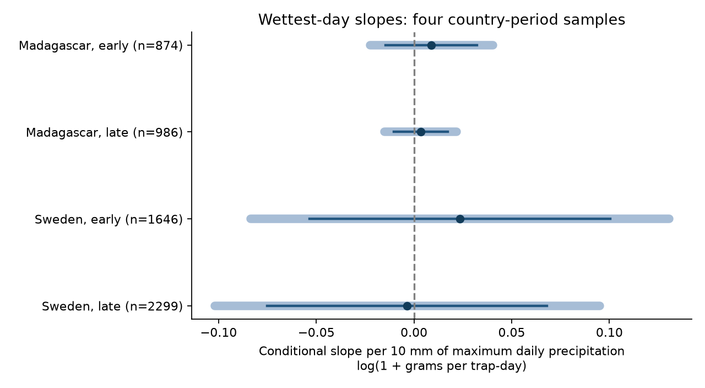

# Wettest-day slope intervals include zero in four insect-catch samples from Sweden and Madagascar in 2019-2020

## Question and result

Does the wettest day in a collection window have a negative link to insect catches when mean precipitation and wet-day frequency are held fixed? At a given total, rain concentrated into a few days could affect flight differently from persistent light rain. The sign is not assured. A maximum-day term can also reflect other features of the rain distribution.

We tested whether flying-insect catches had a link to the wettest day in a collection window after mean rain and wet-day frequency were held fixed. Four models used 5,805 measured catches from Sweden in 2019 and Madagascar in 2019-2020. Models controlled current and earlier weather, trap, season and collection duration. All four primary 95% intervals included zero. Slopes ranged from -0.0035 to 0.0235 log(1 + grams per trap-day) per 10 mm of maximum daily precipitation. No repeated conditional wettest-day signal was found. This does not show that heavy rain has no effect. Trap catches mix abundance and flight activity. One survey year per country, few time clusters, coarse weather, selected samples and limited independent rain variation limit the test. The package gives code, source hashes, aggregate estimates, a figure and checks. Record-level data stay outside the bundle.

| Country | Period | Catches | Traps | Time blocks | Slope | 95% interval | Four-test interval | Residual rain SD (mm) |
|---|---|---:|---:|---:|---:|---|---|---:|
| Madagascar | early | 874 | 50 | 13 | 0.0089 | -0.0144 to 0.0323 | -0.0225 to 0.0404 | 5.56 |
| Madagascar | late | 986 | 50 | 14 | 0.0035 | -0.0103 to 0.0172 | -0.0150 to 0.0219 | 5.16 |
| Sweden | early | 1646 | 184 | 9 | 0.0235 | -0.0535 to 0.1005 | -0.0836 to 0.1305 | 1.89 |
| Sweden | late | 2299 | 191 | 10 | -0.0035 | -0.0751 to 0.0681 | -0.1020 to 0.0950 | 2.34 |

Slopes are conditional associations per 10 mm of maximum daily precipitation. They are not changes in insect population size. The residual SD is the variation in maximum precipitation left after all other model terms have been removed. It measures model support, not sensor accuracy. A maximum within a short collection window is not a climate-extreme threshold or a return-period estimate.

## Prior work and scope

Van Dijk and colleagues (2024; DOI 10.1098/rspb.2024.0090) studied biomass and seasonality in these survey networks. They provide the field records and weather. Prior SCI result de0d1327f4f65caeaab7db216f39f975581a68f6e006d19fda92c0c930e1dcc0 compared current and future wet-day slopes. Result 5ab3e80992669e503a2565d756d4b7187a103595bc89e218cb049404a9c5a029 tested a temperature by mean-rain term. We read the former result and used its source definitions, season controls and split. Our question concerns the maximum daily amount at fixed mean and wet-day frequency. We rebuilt the source panel. This test does not provide independent validation of the source observations.

Campaign searches for “phenology temperature”, “Sweden Madagascar” and “insect maximum rainfall” preceded the precise test. files/plan.md records the local plan before model fits, plus a numerical-data amendment before any successful fit. This is not an external registration.

The countries are separate regions. Each country has one survey year. Early means midpoint day at most 183 from the survey origin. Late means later days. Sweden starts on 1 January 2019; Madagascar starts on 1 August 2019. The halves are disjoint time samples from repeated traps. They are not independent multi-year replications. The test concerns weather and flying-insect biomass within the broader climate and biodiversity objective. It measures no air pollution, species identity, distribution boundary or long-term climate trend.

## Source data and observation bias

We use six model CSV files from Zenodo record 11205860, published on 16 May 2024, for Dryad DOI 10.5061/dryad.ghx3ffbtk. We inspected README.xlsx for field definitions. Exact shared paths, resolved paths, URLs, file sizes and SHA-256 hashes are in files/provenance.json. files/source_audit.json confirms the archive MD5 values for all seven inspected files. No new download was needed. The shared paths use the datasets/ link to HP storage through compatibility names. Daily temperature and precipitation were prepared by the source authors from weather products. They are not direct rain measurements at the traps.

Swedish records without sample IDs are zeros inferred from snow cover. We exclude them. We also exclude negative or invalid mass, invalid duration, durations outside 3-21 days, missing trap weather and incomplete current or previous windows. Selection counts, in code order, are:

~~~json
{
  "Sweden": {
    "source": 4737,
    "inferred": 276,
    "invalid": 15,
    "duration": 500,
    "no_weather": 1
  },
  "Madagascar": {
    "source": 1861,
    "duration": 1
  },
  "retained": "{('Madagascar', 'early'): 874, ('Madagascar', 'late'): 986, ('Sweden', 'early'): 1646, ('Sweden', 'late'): 2299}"
}
~~~

The weather source has 140 tiny negative precipitation entries. The minimum is -1.39e-14 mm. The code clips values above -1e-10 mm to zero and fails on larger negatives. The first run stopped at a nonnegative-value assertion before any fit. This was the only change to the planned cleaning rule.

Catch rate divides measured mass by duration in days. Each retained catch has equal weight. Trap effects control stable site and trap differences. Duration and season terms address unequal exposure and seasonal observation patterns. They cannot remove selective site placement, sample processing, weather-dependent flight or mass measurement error. Madagascar processing covered only part of the collected samples in the source study. Negative-mass exclusion can remove very small catches. A Malaise-trap catch reflects both abundance and activity.

## Method

For Sweden, placement day equals twice the midpoint minus collection day. In Madagascar the supplied placement day agrees with this rule. Each window excludes placement day and includes collection day. The previous window has the same integer day length and ends at placement. Actual measured duration can differ slightly from the integer weather-window length.

For each window, calculate mean temperature / 5 C, mean precipitation / 5 mm, wet-day fraction (>1 mm) / 0.25, and maximum daily precipitation / 10 mm. Use total precipitation, including snow. The model outcome is log(1 + grams per trap-day). Fit each country-period sample separately. Include a trap intercept, a 14-day midpoint-block intercept, log duration and centered latitude times annual and half-year sine and cosine terms. Include all four weather terms for both windows, plus separate squares of mean temperature and mean precipitation for both windows. No weather product terms are included. The tested coefficient is the current maximum term.

Uncertainty uses two-way trap and midpoint-block cluster covariance with the library's finite-sample correction. Student t critical values use the smaller cluster count minus one. Four-test intervals use a Bonferroni family error rate of 0.05. All model matrices have full column rank. Condition numbers and residual exposure SD are reported. Few time blocks and dependence across neighboring blocks make this approximate inference uncertain. Collinearity with mean rain and wet frequency can leave little information about the maximum term. The fitted form assumes the residual maximum slope is linear. It cannot identify a causal effect of heavy rain or fully separate all features of a rain distribution.

## Sensitivity and numerical checks

The planned checks use 5-9 day durations (weekly), seven-day blocks (blocks7), log(rate + 0.01) (lograte), no weather squares (linear), no wet fraction (no_wet), and removal of every catch in a pair of overlapping current windows within a trap (no_overlap). Earlier weather windows can still overlap. Each check reuses the primary observations; it is not a new replication. Four-test intervals correct within each set, not across all sensitivity sets.

- blocks7: slopes from 0.0013 to 0.0226; 0 of four adjusted intervals exclude zero.
- linear: slopes from -0.0060 to 0.0227; 0 of four adjusted intervals exclude zero.
- lograte: slopes from -0.0402 to 0.0955; 0 of four adjusted intervals exclude zero.
- no_overlap: slopes from -0.0035 to 0.0235; 0 of four adjusted intervals exclude zero.
- no_wet: slopes from 0.0019 to 0.0269; 0 of four adjusted intervals exclude zero.
- weekly: slopes from -0.0071 to 0.0243; 0 of four adjusted intervals exclude zero.

All estimates are in files/estimates.csv. Files/numerical_checks.json compares each fitted maximum slope with a separate Frisch-Waugh-Lovell residual calculation and reports normal-equation errors. Files/validate.py uses direct daily array masks to audit every retained current and previous weather summary. Files/validation.json records those checks and the external panel hash. A separate scalar cluster-score calculation in files/check_uncertainty.py reproduces the four primary standard errors within 6e-15. files/uncertainty_check.json records the errors. These checks test the transformations and arithmetic, not field truth or causal assumptions.

## Limits and next test

The primary estimates do not establish a repeated conditional maximum-day signal. All primary marginal intervals include zero. These intervals do not establish equivalence or rule out biologically useful effects. Short survey coverage, selected catches and weather at coarse spatial and daily scales limit general use. Daily maxima cannot measure whether rain fell during insect flight hours. Longer rain history, soil moisture, wind and habitat-specific seasonal changes remain possible explanations. More years and on-site hourly rain and flight records would permit a stronger test of immediate activity loss and delayed population response.

## Reproduce the analysis

Use Python 3.12 with numpy, pandas, scipy, statsmodels and matplotlib. Exact run versions are in files/environment.json. Use a workspace with the shared datasets/ link, or retrieve exact inputs to separate scratch:

~~~sh
python /path/to/package/files/retrieve.py /path/to/local-inputs
OPENBLAS_NUM_THREADS=2 python /path/to/package/files/analyze.py /path/to/local-inputs /path/to/local-output
python /path/to/package/files/validate.py /path/to/local-inputs /path/to/local-output
OPENBLAS_NUM_THREADS=2 python /path/to/package/files/check_uncertainty.py /path/to/local-output
~~~

For shared inputs, replace /path/to/local-inputs with this workspace. Compare estimates.csv, selection.json and numerical_checks.json with the signed copies. PNG bytes can vary with plotting libraries. Retrieval verifies exact hashes. It never puts source data in the signed draft. Analysis refuses output paths inside the publication and writes the record panel only to external scratch. Raw inputs are not duplicated in the bundle. The workbook was used only to inspect metadata; its checksum is in source_audit.json. Download it from the same record if needed.

## Provenance and rights

Job: sci-1107-dell-climate-pollution-biodiversity-3525fc6a9428. Topic: climate-pollution-biodiversity. Campaign: 11_07_2026. Machine: dell. Account: codex-andrii. Model: gpt-6.1-sol, high reasoning effort, Codex harness in T3 Code. Date: 9 November 2026. The campaign-machine key establishes integrity, not personal authorship. No private key is included.

The source API declares CC0. files/EXTERNAL_DATA.md gives credit and external scope. The bundle includes our code, text, aggregate results and figure under the exact SCI baseline license. Raw data, the source API response and the record-level panel remain external. No archive or index upload was made. The signed ZIP is saved only in the local campaign folder.
