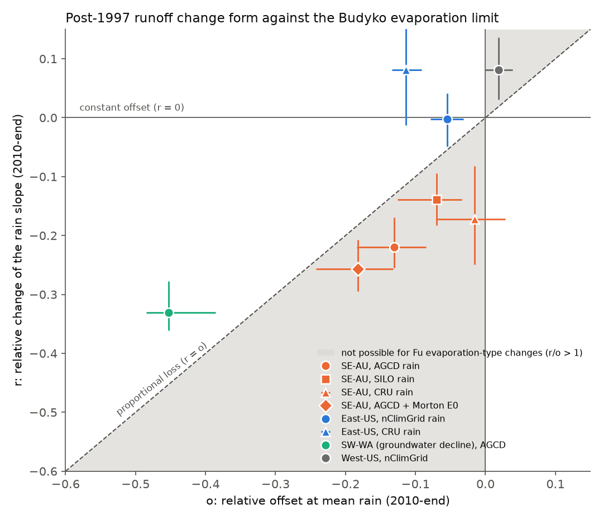
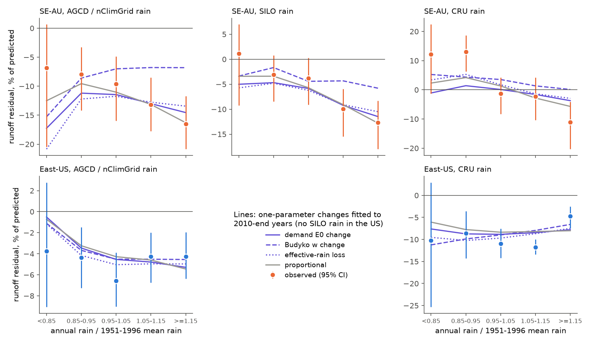
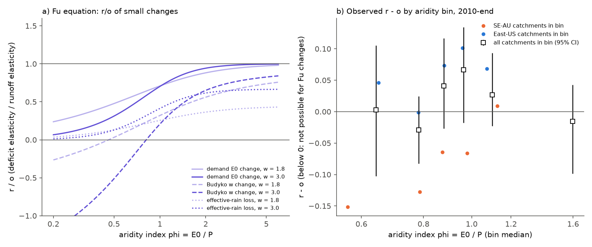

# A Budyko evaporation change agrees with the eastern US post-1997 runoff offset but cannot make the south-east Australian slope loss, also at equal aridity (CAMELS, 1951-2025)

Job `sci-1107-dell-earth-and-ocean-sciences-db41763d7d0a`, campaign 11_07_2026, topic
earth-and-ocean-sciences, machine dell, account claude-sci. Model: Claude Opus 5.5
(`claude-opus-5-5`) in Claude Code (T3 Code). The signing key is a campaign-machine key. It is
not a personal authorship claim.

## Summary

**Question.** Earlier campaign bundles found that runoff in south-east Australia (SE-AU) and in
the eastern US (East-US) fell below the 1951-1996 rainfall-runoff relation after 1997, by about
40 mm per year in both regions after 2009 (bundle 20955da2). The two changes have different forms
(bundle 871b2192). SE-AU lost 22-26% of the rain slope of runoff (the runoff response to one more
mm of rain). East-US had a constant offset and no slope change. We asked whether **one physical
change**, an increase of catchment evaporation, can make both forms. The different forms would
then come only from the different aridity of the two regions. This is the standard Budyko
explanation of runoff change. If it is false, the two shifts need different causes.

**Theory (written in the plan before the data analysis).** Let o be the relative change of
runoff at mean rain (offset) and r the relative change of the rain slope. Then r/o is the
elasticity of the deficit to rain divided by the elasticity of runoff to rain. r/o = 0 is a
constant offset, r/o = 1 is a proportional loss, and r/o > 1 means that the loss is a larger
fraction of runoff in wet years. For Fu's Budyko equation, we calculated r/o for small changes of
the evaporation parameter w, of evaporative demand E0 and of effective rain, for w from 1.3 to 6
and aridity phi = E0/P from 0.2 to 6. All three changes gave r/o of 1 or less everywhere (maximum
0.92 for w, 1.00 for E0 as phi becomes large, 0.83 for effective rain; Figure 3a). Thus a
Budyko-type evaporation change cannot remove a larger fraction of runoff in wet years than in dry
years. In the r-o plane, r < o (for o < 0) is not possible for these changes (Figure 1).

**Data and method.** 175 SE-AU, 260 East-US, 279 West-US, 25 south-west Western Australia
(SW-WA, a known groundwater-decline region) and 64 northern Australian catchments (CAMELS-AUS
v2.03, calendar years 1951-2021; CAMELS-US with USGS flow, water years 1951-2024). Rain: AGCD,
SILO and CRU TS 4.09 (Australia); nClimGrid and CRU TS 4.09 (US). E0: CRU TS 4.09 PET (both
continents) and Morton wet-environment ET (Australia). Per catchment, we fitted
Q = Fu(P, k E0; w) + c (P(t-1) - mean P) to 1951-1996 (median calibration R2 0.80 SE-AU, 0.75
East-US). For the test years (2010-end), we fitted one extra parameter for each candidate change:
w, E0, effective rain, offset, proportional loss, and a 'high-flow loss' that grows with flow
(r/o = 2). Intervals are 95% cluster-bootstrap intervals over 2 x 2 degree cells (2,000 draws).
The plan is in `files/ANALYSIS_PLAN.md`. Analyses marked "post hoc" were added after the first
results.

**Main results.**

1. **SE-AU: the observed form is outside the Budyko limit with all rain and E0 products
   (primary endpoint E1).** With AGCD rain, r = -0.220 (95% CI -0.255 to -0.169) and o = -0.130
   (-0.184 to -0.085). The best-fitting E0 change predicts r = -0.128 (-0.181 to -0.084); the
   effective-rain change -0.097; the w change -0.044. The observed slope loss is larger than all
   three predictions (observed minus predicted: -0.091 [-0.128, -0.045] for E0, -0.123
   [-0.156, -0.077] for effective rain, -0.176 [-0.209, -0.131] for w). The statistic r - o was
   below 0 with every product: AGCD -0.090 (-0.115 to -0.051), SILO -0.069 (-0.096 to -0.028),
   CRU -0.157 (-0.230 to -0.066), AGCD with Morton E0 -0.075 (-0.104 to -0.032) (Figure 1).
   With CRU rain the offset was near zero (o = -0.015), but the slope loss stayed (r = -0.172).
   The planned decision rule (observed r outside the interval of all three predictions in at
   least 2 of 3 rain products) is met in 3 of 3 products (the SILO margin is small: r = -0.139
   against an E0 interval of -0.136 to -0.044).
2. **SE-AU wet years carry the loss (Figure 2).** In 2010-2021, SE-AU runoff was 6.9% below the
   Fu relation in years with less than 85% of mean rain (CI -20.5 to +0.6) and 16.5% below it in
   years with 115% or more (-20.8 to -11.7). The fitted E0, w and effective-rain changes predict a
   deficit of 15-21% in the dry class and 7-15% in the wet class. With SILO rain, the observed
   dry-class value was +1.2% and the wet-class value -12.6%; with CRU rain, +12.2% and -11.1%.
3. **East-US agrees with an evaporation change.** r = -0.003 (-0.049 to +0.042), o = -0.055
   (-0.078 to -0.031). The observed r is within the intervals of the E0, w and effective-rain
   predictions (observed minus predicted for w: +0.012, -0.035 to +0.056). r - o = +0.052
   (+0.003 to +0.099), inside the allowed region. All one-parameter changes fitted East-US years
   almost equally well (summed squared error 70-73% of the no-change value).
4. **Aridity does not explain the difference (E3).** At equal aridity (phi 0.5-1.2; medians 0.94
   SE-AU, 0.85 East-US), SE-AU had r = -0.208 (-0.243 to -0.152; 92 catchments) and East-US
   r = -0.003 (-0.049 to +0.040; 259 catchments). The difference was -0.205 (-0.259 to -0.136);
   for r - o it was -0.124 (-0.179 to -0.038). Within SE-AU the slope loss was the same in humid
   (phi < 1: r = -0.205) and dry catchments (phi >= 1: r = -0.230), but the offset was not
   (-0.080 against -0.219). In humid SE-AU catchments r - o was -0.125 (-0.147 to -0.067); in dry
   ones -0.011 (-0.048 to +0.033). Thus SE-AU lost about one fifth of its rain slope at all
   aridity levels. The Budyko prediction for East-US-like aridity is a near-constant offset.
5. **Measured evaporative demand explains about one third of each mean deficit (E4).** CRU PET in
   2010-end was 6.1% (SE-AU) and 4.1% (East-US) above its 1951-1996 mean. When we used a constant
   E0 instead of the measured series, the mean deficit increased from -36.5 to -52.6 mm per year
   in SE-AU (30% explained by measured E0) and from -27.9 to -42.9 mm in East-US (35%). With
   Morton wet-environment ET, SE-AU E0 did not increase (ratio 0.998), and the SE-AU deficit was
   -17.4% of predicted flow. Thus the E0 contribution depends on the E0 product.
6. **Controls.** In a placebo test (fit 1951-1980, test 1981-1996), r - o was +0.024
   (-0.016 to +0.076) in SE-AU and +0.029 (-0.011 to +0.064) in East-US, inside the allowed
   region. In the dry 1997-2009 period, the SE-AU change was proportional (r = -0.115,
   o = -0.114, r - o = -0.001, -0.051 to +0.047). The beyond-Budyko form appeared in 2010-end.
   SW-WA, the groundwater-decline reference, was inside the allowed region (r = -0.331,
   o = -0.453, r - o = +0.122), and the E0 change predicted its slope (observed minus predicted
   +0.009, -0.041 to +0.059).
7. **Template comparison (E2).** In SE-AU the w change fitted worst of the six one-parameter
   changes (summed squared error 0.77 of the no-change value, against 0.44 proportional, 0.47 E0,
   0.47 high-flow loss, 0.48 effective rain and 0.56 offset). The high-flow loss template was
   the best fit in 41% of SE-AU catchments and the proportional template in 29%. The summed
   squared errors of the proportional, E0 and high-flow templates were close. Thus this endpoint
   rejects a w change and a pure offset in SE-AU, but it does not separate the other templates.

**Post hoc checks of other explanations of the SE-AU slope loss.** None of them removed it.

| Check | Statistic | Value [95% CI] |
| --- | --- | --- |
| Rain season. Cool-season (May-Oct) share of rain in wet years, 1951-1996 against 2010-2021 | change | -1.9 points [-3.4, +0.3] |
| Rain season. Linear model with separate May-Oct and Nov-Apr rain slopes | r with seasons / r without | -0.244 / -0.258 |
| Multi-year memory. Mean rain of years t-2 to t-5 added | r with memory / r without | -0.241 / -0.253 |
| Larger rain errors after 1997 (slope attenuation). Slope of Q on AGCD rain, instrumented by CRU rain | R = slope ratio - 1 | -0.277 [-0.328, -0.241] (OLS -0.213) |
| Same, instrumented by SILO rain | R | -0.212 [-0.254, -0.172] |
| AGCD-SILO annual disagreement (SD of log ratio) | 1951-1996 / 2010-2021 | 0.039 / 0.033 |

Errors that are independent between products do not bias an instrumented slope. The
instrumented slopes lost as much as or more than the ordinary slope, and AGCD-SILO disagreement
did not increase. Thus attenuation by larger rain errors does not explain the slope loss.

**Conclusion.** The two post-1997 shifts are not one evaporation change seen at two aridity
levels. The East-US offset agrees with an increase of evaporation, and the measured increase of
CRU PET explains about one third of it. The SE-AU change is a loss of about one fifth of the rain
slope at all aridity levels. Since 2010 its relative loss has been larger in wet years than in
dry years. No change of w, E0 or effective rain in Fu's equation can make this form. A season
shift, multi-year rain memory and larger rain-product errors also do not explain it. The SE-AU
change therefore needs a mechanism that removes a fraction of the extra runoff in wet years. One
example is a deeper groundwater table that now stores wet-year water that formerly reached
streams, or less saturated contributing area in wet years. Another is a loss of
flow-generating connectivity. We did not test these mechanisms. For water planning, an
evaporation-type adjustment (an offset or a Budyko parameter change) will overestimate SE-AU
flow in wet years.

## Figures

**Figure 1.** Relative slope change r against relative offset o for 2010 to the end of the record
(95% cluster-bootstrap intervals). Grey: region not reachable by any small change of w, E0 or
effective rain in Fu's equation (r/o > 1). Dashed: proportional loss. SE-AU points are in the
grey region with all rain and E0 products. East-US, West-US and SW-WA are not.

**Figure 2.** Runoff residual relative to the Fu calibration prediction, by annual rain class,
2010 to the end of the record. Points: observed (95% CI). Lines: residuals predicted by the
one-parameter changes fitted to the same years. The lines include composition effects, because
different catchments fall in different classes.

**Figure 3.** a) r/o of small changes in Fu's equation against aridity, for w = 1.8 and 3.0. All
curves are at or below 1. b) Observed r - o in six equal-count aridity bins of the pooled SE-AU and
East-US catchments (squares, 95% CI) and per group within each bin (dots). SE-AU catchments are
below zero at aridity values where East-US catchments are above zero.

## Tables

**Table 1. Slope change r and offset o, 2010 to end of record (Fu calibration).** Predicted r
values are from the fitted one-parameter changes. Full values and intervals are in
`files/results/endpoints.csv`.

| Group | Rain / E0 | n | r observed | o observed | r - o | r pred. E0 | r pred. eff. rain | r pred. w | Linear-model r (bundle 871b2192 form) |
| --- | --- | ---: | --- | --- | --- | ---: | ---: | ---: | ---: |
| SE-AU | AGCD / CRU | 175 | -0.220 [-0.255, -0.169] | -0.130 [-0.184, -0.085] | -0.090 [-0.115, -0.051] | -0.128 | -0.097 | -0.044 | -0.258 |
| SE-AU | SILO / CRU | 175 | -0.139 [-0.183, -0.094] | -0.070 [-0.126, -0.034] | -0.069 [-0.096, -0.028] | -0.081 | -0.063 | -0.029 | -0.221 |
| SE-AU | CRU / CRU | 175 | -0.172 [-0.249, -0.082] | -0.015 [-0.071, +0.028] | -0.157 [-0.230, -0.066] | -0.021 | -0.016 | -0.010 | -0.264 |
| SE-AU | AGCD / Morton | 175 | -0.257 [-0.295, -0.207] | -0.182 [-0.242, -0.132] | -0.075 [-0.104, -0.032] | -0.177 | -0.134 | -0.059 | -0.258 |
| East-US | nClimGrid / CRU | 260 | -0.003 [-0.049, +0.042] | -0.055 [-0.078, -0.031] | +0.052 [+0.003, +0.099] | -0.038 | -0.015 | -0.015 | +0.010 |
| East-US | CRU / CRU | 260 | +0.082 [-0.012, +0.167] | -0.114 [-0.134, -0.092] | +0.195 [+0.092, +0.292] | -0.071 | -0.032 | -0.022 | +0.106 |
| SW-WA | AGCD / CRU | 25 | -0.331 [-0.361, -0.278] | -0.453 [-0.485, -0.386] | +0.122 [+0.102, +0.142] | -0.339 | -0.273 | -0.269 | -0.502 |
| West-US | nClimGrid / CRU | 279 | +0.081 [+0.031, +0.136] | +0.019 | +0.062 | +0.001 | -0.005 | +0.001 | +0.005 |
| SE-AU placebo 1981-1996 | AGCD / CRU | 85 | -0.032 [-0.095, +0.019] | -0.055 [-0.118, -0.012] | +0.024 [-0.016, +0.076] | -0.048 | -0.037 | +0.008 | -0.093 |
| East-US placebo 1981-1996 | nClimGrid / CRU | 214 | +0.013 [-0.024, +0.046] | -0.016 [-0.026, -0.007] | +0.029 [-0.011, +0.064] | -0.009 | -0.004 | -0.003 | +0.023 |
| SE-AU 1997-2009 | AGCD / CRU | 175 | -0.115 [-0.203, -0.031] | -0.114 [-0.191, -0.057] | -0.001 [-0.051, +0.047] | -0.098 | -0.074 | -0.039 | -0.294 |

The linear-model values (last column) reproduce bundle 871b2192 (SE-AU AGCD -0.258, SILO -0.221,
CRU -0.264; East-US +0.010 against -0.003 there; small differences come from the shorter US
record that ends in water year 2024 here). The Fu calibration gives a smaller SE-AU slope loss,
because its curved relation explains part of the linear slope loss.

## Relation to prior work

- Saft et al. (2015, doi:10.1002/2014WR015348; 2016, doi:10.1002/2016WR019525), Peterson et al.
  (2021, doi:10.1126/science.abd5085) and Fowler et al. (2022, doi:10.5194/hess-26-6073-2022)
  describe the SE-AU shift and review possible causes. Budyko-type decompositions (for example
  Roderick and Farquhar 2011, doi:10.1029/2010WR009826) attribute runoff change to climate or
  catchment-parameter change. Our new contributions are: (a) the r/o bound for Fu-type changes,
  which gives a test of the form of a shift without a model of its cause; (b) its application to
  both regions with five rain and two E0 products; (c) the matched-aridity comparison; and
  (d) tests that exclude season, multi-year memory and rain-error attenuation as causes of the
  SE-AU slope loss.
- Campaign bundle 871b2192 found the slope-versus-offset contrast and proposed "a larger storage
  deficit that each wet year must fill, or higher water use by vegetation in wet years". A
  storage deficit that each wet year must fill acts as an effective-rain loss. Higher vegetation
  water use acts as a w or E0 change. Both give r/o <= 1, so neither explains the SE-AU form
  without an added wet-year-specific term.
- Campaign bundle 20955da2 found similar mm deficits in both regions. Our result shows that
  similar volumes do not mean a similar process.
- Campaign bundle 996e7776 found that seasonal rain terms did not remove the Victorian level
  deficit; our post hoc check finds that they also do not remove the slope loss.

## Limitations

- **Model family.** The bound holds for Fu's equation (w 1.3-6) and small changes. Other Budyko
  forms are similar in shape, but we did not test them all. Large changes and catchment-specific
  combinations of changes can differ from the small-change values; the fitted (finite) changes in
  Table 1 agree with the bound.
- **Annual scale.** The Fu equation describes long-term means; we used it for annual values with
  a previous-year rain term. Storage carry-over that this term does not describe can change the
  form.
- **Post hoc parts.** The r - o statistic, the rain-class figure, the matched-aridity test and
  the season, memory and instrument checks were added after the first point estimates. The
  primary endpoint E1 and its decision rule were planned.
- **SILO margin.** With SILO rain, the observed SE-AU r was just outside the E0-change interval.
- **Intervals.** The cluster bootstrap resamples space, not time. Shared weather in a 12- to
  15-year test period makes the intervals too narrow for time-related uncertainty. The placebo
  test partly covers this.
- **E0 products.** CRU PET at one 0.5-degree cell and Morton ET disagree on the SE-AU E0 trend.
  The E4 share is therefore uncertain for SE-AU.
- **Records.** Australian flow ends in 2021 (wet 2022 not covered); US analysis ends in water year
  2024 (CRU PET ends in 2024). Recent US values include provisional data.
- **Cause.** We excluded a class of causes. We did not identify the SE-AU mechanism.

## Data and provenance

See `files/DATA_NOTICE.md` for terms and credit lines. Inputs:

| Input | Path or source | Hash record |
| --- | --- | --- |
| Annual flow, AGCD/SILO rain and temperature (AU), annual flow (US) | signed bundle sci:sha256:871b2192407fe0d36b8ede03f019a8ad796d64c61af7a2bec4f6a504a46301fb, `files/data/` | `files/provenance/inputs_sha256.txt` |
| nClimGrid basin water-year rain and temperature (US) | signed bundle sci:sha256:664b208cefa5e9bb1114a6ccf84255fc886f296b6f72198e385cbc30055fa7af, `files/data/climate_wy.csv` | `files/provenance/inputs_sha256.txt` |
| CRU TS 4.09 PET 1901-2024 and precipitation (decades 1951-2020, 2021-2024) | `/mnt/dell-data/shared_datasets/cru-ts-4.09-*` (used in place) | `files/provenance/shared_dataset_records.txt` |
| CAMELS-AUS v2.03 hydrometeorology (Morton wet ET, AGCD daily rain) and master table | `/mnt/dell-data/shared_datasets/camels-aus-v2.03-zenodo14289037-*` | `shared_dataset_records.txt`, `extracted_members_sha256.txt`, `metadata_files_sha256.txt` |
| CAMELS-US camels_name.txt, camels_topo.txt | `/mnt/dell-data/shared_datasets/camels-us-attr-{name,topo}-zenodo15529996` | `metadata_files_sha256.txt` |

Bundled: our code (`files/code/`), the plan, all result tables (`files/results/`, including
per-catchment fits `catch_*.csv.gz`), figures, and derived CAMELS-AUS tables (`files/data/`).
Not bundled: annual CRU point series (regenerated by `cru_points.py`).

## Reproduce

1. Use Python 3.12 with the packages in `files/environment.txt` and the `sci` CLI.
2. Run `bash files/code/reproduce.sh <scratch_dir> [shared_datasets_dir] [campaign_dir]`. It reads
   the two cited bundles with `sci read`, extracts the CRU and CAMELS-AUS inputs into the scratch
   directory, runs all fits (`run_fits.sh`, 8 processes, about 10 CPU minutes), the summaries,
   post hoc checks and figures. It writes only into `<scratch_dir>`.
3. Compare `<scratch_dir>/out/` with `files/results/` and the input hashes with
   `files/provenance/inputs_sha256.txt`. Bootstrap seeds are fixed (20261110 to 20261116).
