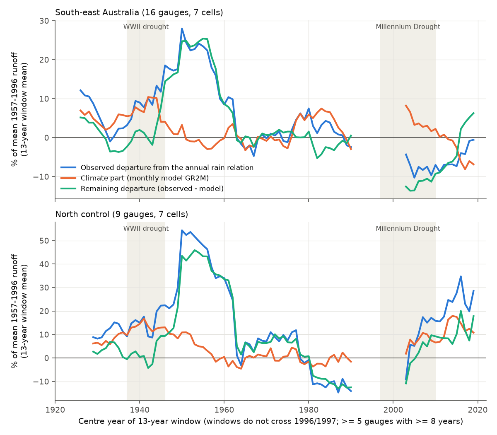
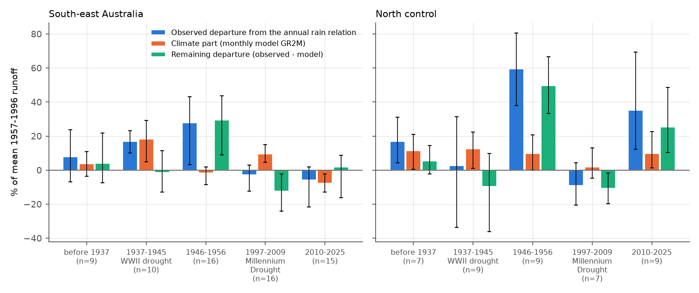
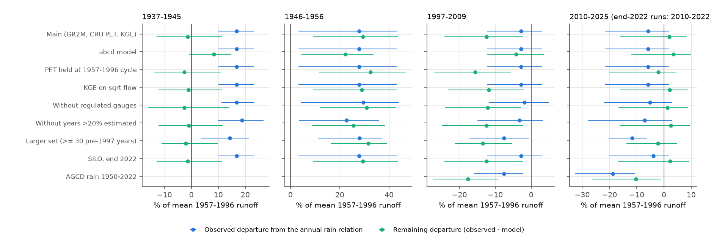

# Monthly climate explained the WWII-drought runoff surplus but not the 1946-1956 surplus; the Millennium Drought fell 12-16% below a monthly model at 16 south-east Australian gauges (1889-2025)

Job `sci-1107-dell-earth-and-ocean-sciences-1747a78539b8`, campaign 11_07_2026, topic
earth-and-ocean-sciences, machine dell, account claude-myxtap. Model: Claude Opus 5.5
(`claude-opus-5-5`) in Claude Code (T3 Code). The signing key is a campaign-machine key. It is
not a personal authorship claim.

## Summary

**Question.** Long Bureau of Meteorology (BoM) flow records show that south-east Australian
(SE-AU) runoff at equal annual rain was high before about 1957, low in the 1960s-1990s and low
after 1997 (bundle 4e9ae7e7). During the WWII drought (1937-1945), runoff was *above* the annual
rainfall-runoff relation, but during and after the Millennium Drought (1997-2009) it was below
it. Five annual climate covariates did not explain these changes (bundle ee211978). All of this
work uses the annual linear relation Q = a + bP + cP(t-1). That relation cannot represent rain
timing within the year, the convex response of runoff to rain, or storage memory longer than
one year. We asked: **does a monthly water-balance model, driven only by monthly rain and PET and
calibrated in 1957-1996, reproduce the century-scale departures out of sample?** If it does, the
departures are a climate signal. If it does not, their cause is not in the monthly climate
inputs.

**Approach.** 58 CAMELS-AUS gauges with BoM daily flow from 1885-1950 to 2025 (valid years of the main set: 1890-2025), SILO monthly rain
from 1889, and CRU TS 4.09 monthly PET. GR2M (2 parameters) was calibrated per gauge on
1957-1996 monthly flow (KGE). For each year we compare three quantities, in % of mean
1957-1996 runoff:

- observed departure from the annual relation, Dobs = Q_obs - Q_lin
- climate part, Dclim = Q_GR2M - Q_lin (what monthly climate gives beyond the annual relation)
- remaining departure, Drem = Dobs - Dclim = Q_obs - Q_GR2M

The main set is the 16 SE-AU gauges (7 cells of 2 x 2 degrees) with 50 or more valid years
before 1997 and 10 or more before 1957. Intervals are 95% cell-bootstrap intervals (2,000
draws). The plan (`files/ANALYSIS_PLAN.md`, SHA-256 `ab8c313a...`) was written before any model
run or flow value was examined.

**Main results (main set; climate part with volume-bias correction; see "Deviations").**

| Period | Rain anomaly (median) | Observed departure | Climate part (GR2M) | Remaining departure |
| --- | --- | --- | --- | --- |
| 1937-1945 WWII drought (n=10) | -19% | +16.8 [+10.0, +23.3] | +18.2 [+5.0, +29.3] | -1.4 [-12.8, +11.4] |
| 1946-1956 (n=16) | +12% | +27.8 [+3.3, +43.0] | -1.6 [-8.5, +1.9] | +29.4 [+9.1, +43.6] |
| 1997-2009 Millennium Drought (n=16) | -18% | -2.8 [-12.2, +3.1] | +9.6 [+4.7, +14.9] | -12.4 [-24.1, -2.3] |
| 2010-2025 (n=15) | -4% | -5.8 [-21.6, +1.8] | -7.8 [-12.8, -2.2] | +2.0 [-16.3, +8.6] |
| 1997-2009, calibration on all pre-1997 years | | -5.8 [-13.3, -0.7] | +9.9 [+4.1, +15.5] | -15.7 [-25.9, -6.3] |
| 2010-2025, calibration on all pre-1997 years | | -12.2 [-26.4, -4.4] | -8.8 [-15.2, -1.6] | -3.4 [-18.9, +2.5] |

1. **The WWII-drought surplus is a climate effect.** Monthly climate gives the same surplus over
   the annual relation (+18.2%) as observed (+16.8%). The annual linear relation
   under-predicts very dry years. This is also visible inside the calibration period (rain
   anomaly below -25%: observed +11.9 +/- 2.0%, GR2M +15.6%).
2. **The 1946-1956 surplus is not a monthly-climate effect.** The climate part was -1.6%; the
   remaining surplus, +29.4%, is the largest departure in the record. The North control had the
   same unexplained high (+49.6% remaining).
3. **Against a monthly model, the Millennium Drought is the anomaly.** The model expected a
   surplus of about +10% (as in the WWII drought), but runoff was 3-6% *below* the annual
   relation. The remaining departure was -12.4% (-15.7% with a pre-1997 calibration). This is
   below every cross-validated pre-1997 13-year block (range -10.5% to +19.1%). At the same 10
   gauges, the remaining departure in 1997-2009 was 9.9 points lower than in 1937-1945
   (-19.5 to -2.9; 7 of 10 gauges lower). It held in all GR2M variants (-12 to -20%). The
   4-parameter abcd model gave a smaller value (-4.2%, or -9.5% with a pre-1997 calibration).
4. **After 2010 the result depends on the rain product.** Monthly climate predicts a decline
   of 8-9% (lower cool-season rain share and higher PET; holding PET at its 1957-1996 cycle
   halves it to about -4%). With SILO rain the remaining departure was small (+2.0%, or -3.4%
   with a pre-1997 calibration) and inside the earlier block range. With AGCD rain (CAMELS-AUS,
   1950-2022) it was -10.3% (-26.4 to -1.0), or -14.3% (-28.2 to -6.2). At these gauges,
   AGCD rain rose by 3.6% relative to SILO from 1957-1996 to 2010-2022.
5. **The cross-validated multi-decadal block variation was not explained** (block R2 -0.07,
   -1.25 to 0.21; planned uncorrected value -0.37). This is mainly the 1941-1953 block.
6. **Flow components.** The early surplus and the post-1997 deficits were in baseflow and
   quickflow in proportion to the baseflow index (planned class "proportional" in all periods;
   intervals wide).

**Conclusion.** The century record does not show one multi-decadal efficiency cycle with a
monthly-climate cause. It shows three different things. (a) The WWII-drought "surplus" that
earlier bundles contrasted with the Millennium Drought is what monthly climate gives. (b) The
1946-1956 high is not climatic in these data, and it also occurred in the North. It inflates
the reference of any calibration that includes the early 1950s. (c) Against a monthly model,
1997-2009 is the period below all earlier variation, at the same gauges and at equal rain
deficit as the WWII drought. Whether runoff stayed below its climate expectation after 2010
depends on whether SILO or AGCD rain is correct.

## Data

| Data | Use | Source and version |
| --- | --- | --- |
| Daily mean discharge, 58 CAMELS-AUS gauges | monthly and annual runoff, baseflow | BoM Water Data Online KiWIS, `DMQaQc.Merged.DailyMean.09HR`, retrieved 2026-11-11 |
| SILO monthly gridded rain 1889-2025 | catchment rain (area-weighted, 0.05 degree) | SILO open data (S3), retrieved 2026-11-11; all 137 file hashes equal those recorded by bundle 4e9ae7e7 |
| CRU TS 4.09 PET 1901-2024 | monthly PET (1889-1900: 1901-1930 monthly climatology; 2025: 1995-2024 climatology) | shared campaign copy `datasets/cru-ts-4.09-pet-1901-2024` |
| AGCD daily catchment rain 1950-2022 | rain-product check | CAMELS-AUS v2.03 `05_hydrometeorology.zip`, shared campaign copy |
| CAMELS-AUS v2.03 boundaries | weights, areas, outlet coordinates | shared campaign copy of Zenodo 14289037 |

Rules (planned): a month is valid with 25 or more valid days; a year is valid with 12 valid
months and 350 or more valid days. Regions: SE-AU = outlet south of 33.5 S and east of 140 E;
North = the rest. Gauge 410033 (Tantangara diversion) is excluded in all runs.

## Methods

- **Annual reference.** Per gauge, Q = a + bP + cP(t-1), least squares on the valid years of
  the calibration period.
- **Monthly model.** GR2M (Mouelhi et al. 2006; airGR formulation): production store X1,
  exchange coefficient X2, routing store 60 mm. The simulation runs continuously from 1889 with
  a 5-cycle spin-up of 1889-1893. Calibration maximizes KGE on monthly runoff (grid search and
  Nelder-Mead). Robustness model: abcd (Thomas 1981). Median calibration KGE 0.86; median
  validation KGE 0.72 before 1957 and 0.72 after 1996.
- **Periods.** Calibration 1957-1996; out-of-sample periods before 1937, 1937-1945, 1946-1956,
  1997-2009 and 2010-2025. Post-1997 also with a calibration on all valid pre-1997 years.
- **Cross-validated blocks.** 1928-1940, 1941-1953, 1954-1966, 1967-1979, 1980-1992; both
  models calibrated on all valid pre-1997 years outside the block.
- **Components.** Lyne-Hollick baseflow (alpha 0.925, three passes) on the daily series; one
  annual linear model per component; component departures add up to the total.
- **Statistics.** Gauge means over valid years (5 or more per period), mean over gauges, 2,000
  cell-bootstrap draws.

## Results

### Planned tests (main set, 16 gauges, 7 cells)

Planned climate part (no bias correction) and post hoc bias-corrected climate part:

| Test | Planned (uncorrected) | Decision | Bias-corrected | Decision |
| --- | --- | --- | --- | --- |
| Q1 share, 1937-1945 | 1.28 [0.41, 2.51] | explained | 1.08 [0.36, 2.04] | explained |
| Q1 share, 1946-1956 | 0.16 [0.05, 0.28] | not explained | -0.06 [-0.97, 0.07] | not explained |
| Q1 share, all pre-1957 | 0.45 [0.26, 0.90] | partial | 0.22 [-0.02, 0.33] | not explained |
| Q2 block R2 | -0.37 [-6.07, -0.00] | not explained | -0.07 [-1.25, 0.21] | not explained |
| Q3 share, 1997-2009 | -4.5 (wrong sign) | not explained | -3.5 (wrong sign) | not explained |
| Q3 share, 2010-2025 | 0.62 [-6.3, 8.1] | partial | 1.34 [-8.6, 13.5] | partial |
| Q3 share, 2010-2025, pre-1997 calibration | 0.32 [-0.35, 0.98] | partial | 0.72 [0.10, 1.47] | partial |

By the planned overall rule, Q1 (for 1946-1956 and pre-1957), Q2 and Q3 for 1997-2009 are
"not explained". The efficiency variation as a whole is therefore not a monthly-climate signal.
The WWII drought is the exception: there the observed departure is fully a climate effect.

Q4, flow components (main set; departures in % of mean total runoff; calibration BFI 0.42):

| Period | Baseflow | Quickflow | f - BFI | Class | Relative change, baseflow / quickflow (median) |
| --- | --- | --- | --- | --- | --- |
| 1937-1945 | +6.1 [+3.0, +14.0] | +10.8 [+4.7, +15.6] | -0.04 [-0.16, +0.18] | proportional | +7% / +13% |
| 1946-1956 | +9.0 [+5.5, +12.9] | +18.8 [-3.1, +33.5] | -0.10 [-0.20, +0.83] | proportional | +19% / +28% |
| pre-1957 | +7.7 [+4.1, +10.9] | +14.2 [+2.4, +21.2] | -0.07 [-0.14, +0.33] | proportional | +14% / +21% |
| 1997-2009 | -2.1 [-5.4, +0.8] | -0.7 [-7.2, +2.6] | undetermined (small total) | proportional | -6% / +1% |
| 2010-2025 | -1.6 [-8.5, +1.5] | -4.2 [-13.2, +0.3] | -0.15 [-1.51, +1.12] | proportional | -4% / -6% |

The early surplus and the post-1997 deficits thus have the same (proportional) signature by the
planned rule. The intervals are too wide to separate the components.

### Robustness (remaining departure, bias-corrected; Figure 4)

| Variant | Gauges | 1937-1945 | 1946-1956 | 1997-2009 | 2010-2025 | 1997-2009 (cal pre-1997) | 2010-2025 (cal pre-1997) |
| --- | --- | --- | --- | --- | --- | --- | --- |
| Main (GR2M, CRU PET, KGE) | 16 | -1.4 | +29.4 | -12.4 | +2.0 | -15.7 | -3.4 |
| abcd model | 16 | +8.4 | +22.4 | -4.2 | +3.4 | -9.5 | -2.0 |
| PET at 1957-1996 cycle | 16 | -2.6 | +32.5 | -15.6 | -2.1 | -19.0 | -7.7 |
| KGE on sqrt flow | 16 | -1.0 | +29.0 | -11.8 | +2.1 | -15.1 | -3.3 |
| Without regulated gauges | 14 | -2.7 | +31.0 | -12.2 | +1.2 | -15.2 | -4.0 |
| Without years > 20% estimated | 15 | -1.0 | +25.5 | -12.5 | +2.5 | -15.4 | -1.8 |
| Larger set (>= 30 pre-1997 years) | 31 | -2.1 | +31.6 | -13.5 | -2.2 | -16.1 | -6.2 |
| SILO, end 2022 (post hoc) | 16 | -1.4 | +29.4 | -12.4 | +2.2 | -15.7 | -3.5 |
| AGCD rain 1950-2022 (post hoc) | 16 | - | - | -17.7 | -10.3 | -19.7 | -14.3 |
| North control | 9 | -9.7 | +49.6 | -10.8 | +25.4 | -16.6 | +14.1 |

For the AGCD run, rain before 1950 is SILO, so only the post-1997 values are interpreted. In
the end-2022 runs the last period is 2010-2022. The observed departure in 2010-2025 was -5.8%
(-12.2% with a pre-1997 calibration) in the main set and -11.7% (-15.4%) in the larger set.

### Post hoc analyses

- **Paired droughts (same gauges, calibration 1957-1996).** 1997-2009 minus 1937-1945: observed
  departure -17.4 points (-25.5 to -6.1; 9 of 10 gauges lower); remaining departure -9.9
  (-19.5 to -2.9; 7 of 10). Variants: -7.9 to -12.9, all intervals below 0 (larger set: -9.7,
  -18.0 to -3.8, n=13). Both droughts had the same rain deficit (median gauge-year rain anomaly
  -16.5% and -18.1%). Thus the monthly model removes about 40% of the drought contrast that the annual
  relation shows, and a contrast of about 10 points remains.
- **In-calibration skill.** GR2M explains a median 28% (quartiles 10-40%) of the year-to-year
  variance of the annual-relation residuals in 1957-1996. By rain-anomaly bin: dry years
  (below -25%, n=107) observed +11.9, GR2M +15.6; normal years (-5 to +5%) observed -9.0,
  GR2M -2.8; very wet years (above +25%, n=76) observed +15.9, GR2M -2.0. GR2M thus
  represents the dry-year curvature of the annual relation, but not the wet-year curvature.
- **Post-1997 against earlier blocks.** Cross-validated pre-1997 block remaining departures:
  1928-1940 -4.6, 1941-1953 +19.1, 1954-1966 +2.6, 1967-1979 -3.9, 1980-1992 -10.5. The
  1997-2009 value (-15.7) is below this range in all SILO variants (abcd: -9.5 against a minimum
  of -9.3). The 2010-2025 value (-3.4) is inside it. At single gauges, the 2010-2025 remaining
  departure was below all of the gauge's own blocks at 3 of 15 gauges (7 of 29 in the larger
  set; 6 of 15 with AGCD).
- **North control.** The North had the same pattern before 2010 (unexplained 1946-1956 high;
  1997-2009 remaining departure -10.8%, or -16.6%), then a strong recovery (+25.4%). Thus the
  1997-2009 anomaly against monthly climate was not limited to SE-AU. Only the post-2010
  behaviour differs between the regions.
- **Time-varying X1 (planned, descriptive; Figure 5).** With X2 fixed, the X1 that fits each
  13-year window was 0.55-0.8 times the 1957-1996 value in windows centred on 1947-1957 in
  both regions (more efficient). In SE-AU it was 1.4-1.6 times in windows centred on 2003-2007, and
  it fell below 1 in windows centred after 2016. Before 1946 the SE-AU X1 was 1.2-1.3 times.
  This does not agree with the near-zero volume departures of those years, because X1 also
  absorbs timing errors.

## Interpretation

- **The WWII-drought comparison changes meaning.** Bundle 4e9ae7e7 found +24% at equal rain
  in the WWII drought and concluded that a long drought did not leave a deficit. Our result
  shows that the annual linear relation itself expects too little runoff in very dry years.
  A monthly model gives the WWII-drought surplus from climate alone. Against the monthly model,
  the WWII drought had no departure (-1.4%), and the Millennium Drought had a deficit of 12-16%
  at equal rain deficit. The drought contrast remains (about 10 points), but it is smaller than
  the annual relation shows (17 points).
- **The deficit is in the drought, not only after it.** With the annual relation, earlier
  bundles found a small 1997-2009 deficit that grew after 2009. Against the monthly model, the
  1997-2009 deficit was the largest of the record, and with SILO rain the 2010-2025 runoff was
  close to its monthly-climate expectation. The apparent growth after 2009 comes in part from
  the dry-year bias of the annual relation in 1997-2009 and from the shift of rain out of the
  cool season and higher PET after 2010.
- **The 1946-1956 high has no monthly-climate cause in these data.** It is the largest
  departure of 1889-2025, and it occurred in SE-AU and in the North. A cause that acts on
  both regions at the same time is required: for example a common flow-measurement practice
  of that era, a common land condition before the post-war expansion of farm dams and pasture
  improvement, or a rain error common to SILO in the wet early 1950s. Bundle 4e9ae7e7 found that
  SILO agrees with a fixed station network in all periods (ratio 0.984-0.996). This makes a
  large rain error less likely. We cannot separate the other causes.
- **Answer to the open question.** The data do not support one multi-decadal efficiency cycle
  with a climatic cause. They also do not support a state that started in the drought and
  then persisted beyond climate, except with AGCD rain. The robust parts are: a non-climatic
  high in 1946-1956 (both regions); no WWII-drought anomaly; and a Millennium-Drought anomaly
  against monthly climate (both regions). After 2010, SE-AU departs from the North, but its
  departure from monthly climate depends on the rain product. Studies of post-2010
  persistence must therefore resolve the SILO-AGCD difference first. Bundle 448ef5cf found the
  same product dependence (post-2009 SE-AU deficit -8 mm/yr with SILO, -31 mm/yr with AGCD).

## Deviations from the plan

1. **Bias-corrected climate part (post hoc).** In 1957-1996 GR2M overestimated annual runoff
   on the valid years by a median 3% (bias factor 0.89-1.00; largest in dry inland catchments),
   because KGE trades volume against correlation and variability. This constant offset added
   about +5 points to every planned climate part, also in the calibration period (+4.9%). We
   therefore also report Dclim_bc = (k Q_GR2M - Q_lin), with k = sum Q_obs / sum Q_GR2M over the
   calibration years of each run. Both versions are in `files/results/*/summary.json` (planned)
   and `summary_bc.json` (corrected). The decisions agree except for the pre-1957 share
   (partial vs not explained). The text uses the corrected values.
2. **Gauge count.** The plan expected the 18 gauges of ee211978. Under the planned
   12-valid-month year rule, 215004 had 49 valid pre-1997 years (minimum 50). 215002 had 18
   valid years in 1957-1996, below a 20-year calibration minimum that the code applies (not
   stated in the plan). Thus 16 gauges were used.
3. **Larger set.** The plan gave only ">= 30 valid pre-1997 years"; we used MINPRE57 = 0.
4. **Post hoc additions.** The AGCD and end-2022 runs, the paired drought test, the
   in-calibration skill and rain bins, the block-range comparison and the rolling windows are
   post hoc.
5. **Code faults found and fixed during the run.** A read-only array error stopped the
   variants after the first two. A gauge-ID type error made the first time-varying-X1 run of
   the main set empty. Both were fixed, and all results were produced again with the final
   code (`files/code/run_final_local.sh`).

## Limitations

- **Small sample.** 16 gauges in 7 cells (31 in 10 cells for the larger set); 10 gauges for
  the WWII drought. Cell-bootstrap intervals are wide, and some single-period intervals
  include 0.
- **Model structure.** GR2M has two parameters. It captures dry-year curvature but not
  wet-year curvature (rain bins above). The abcd model gave a smaller Millennium-Drought
  remaining departure (-4% to -10%). The bias correction is post hoc.
- **Inputs.** Early flow ratings are not tested; NSW codes most early values as "unknown".
  CRU PET before 1950 depends on few stations; before 1901 it is a climatology. SILO rain in
  early decades depends on fewer stations. The AGCD run is spliced with SILO before 1950.
- **Rain product.** The 2010-2025 conclusion differs between SILO (no clear remaining
  deficit) and AGCD (remaining deficit of 10-14%). We did not determine which product is correct for these catchments.
- **Causes not tested.** Land use, farm dams, forest regrowth after the 1939 fires, and
  measurement practice were not tested.
- **Multiple comparisons.** Many periods and variants are reported. The planned decisions
  are in the table above; other results are descriptive.

## Figures

**Figure 1.** Rolling 13-year group means (calibration 1957-1996): observed departure from the
annual rain relation (blue), climate part from GR2M (orange, bias-corrected) and remaining
departure (green). Top: SE-AU main set; bottom: North control. Windows do not cross 1996/1997.

**Figure 2.** Period means with 95% cell-bootstrap intervals. n = number of gauges.

**Figure 3.** The same 10 SE-AU gauges in the WWII drought and the Millennium Drought. Left:
departure from the annual relation. Right: remaining departure after the monthly model.

**Figure 4.** Observed and remaining departures by variant and period.

**Figure 5.** GR2M X1 fitted in 13-year windows (X2 fixed at its 1957-1996 value), as a ratio
to the 1957-1996 X1; median of gauges.

## Reproduction

Run `bash files/code/reproduce.sh <path to files/code> <path to shared datasets>` from an empty
scratch folder outside the publication folder. It downloads BoM flow (about 70 MB) and SILO rain
(about 1.9 GB), extracts CRU PET and AGCD rain from the shared campaign copies, runs all planned
and post hoc analyses, and writes the figures. Python 3.12 with numba is needed
(`files/environment.txt`). The full run takes about 1-2 hours on 2 CPUs. Raw and derived data
stay in the scratch folder. Their hashes are in `files/provenance/`. BoM data can be revised;
compare the response hashes in `files/provenance/bom_kiwis_fetch_log.tsv`.

## Files

- `files/ANALYSIS_PLAN.md`: plan written before results.
- `files/DATA_NOTICE.md`: third-party data, terms and credit lines. No flow or rain values are
  in this bundle.
- `files/code/`: all code (`models.py` GR2M/abcd and calibration; `analyze.py` planned tests;
  `summarize.py` group statistics; `posthoc.py`; `tv_x1.py`; `figures.py`; data preparation
  and download scripts; `reproduce.sh`; `run_final_local.sh`, the exact drivers used).
- `files/results/<variant>/`: `summary(.json|.txt)` (planned climate part), `summary_bc.*`
  (bias-corrected), per-gauge period means `gauge_periods*.csv`, cross-validated blocks
  `blocks*.csv`, rolling windows `rolling13.csv`, gauge parameters and skill `gauges.csv`,
  time-varying X1 `tv_x1.csv`. `files/results/posthoc.(json|txt)`: post hoc statistics.
- `files/provenance/`: BoM request URLs and hashes, SILO file hashes, gauge list, shared-dataset
  records, hashes of the private derived tables.
- `files/figures/`: Figures 1-5.
