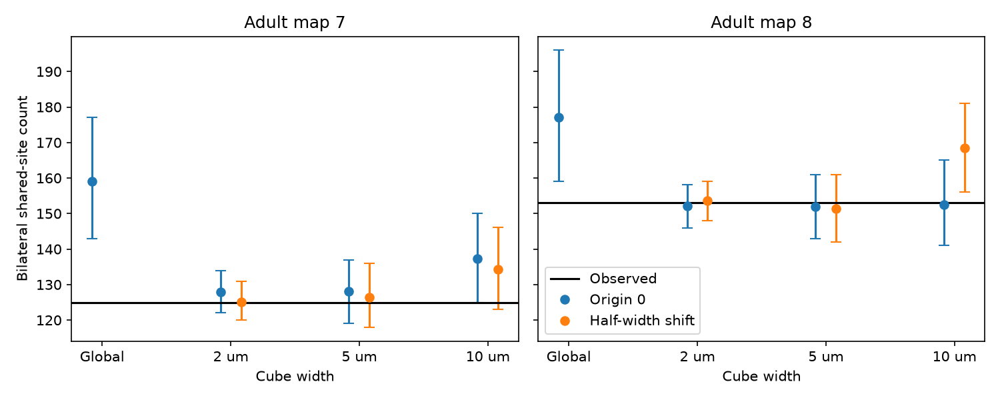

# Bilateral site counts fell inside 2 and 5 um spatial control ranges in two adult worm maps

The observed number of sites shared by left-right target pairs fell inside the central 95 percent control ranges for 2 and 5 micrometre spatial cubes in two selected adult C. elegans brain maps. This held for both tested grid origins. The same counts fell below the global degree-specific control ranges. Thus the global reference result was sensitive to local target-count constraints. These results do not show that location is the only cause of the earlier deficit.

Figure 1. Dots show control means; bars show pointwise central 95 percent ranges over 798 saved scores per condition. Black lines show observed counts. Blue uses a zero grid origin; orange shifts the grid by half its width on all axes. The global condition has no spatial constraint. These ranges describe finite conditional chains, not animal uncertainty.

## Question and prior evidence

Can a lack of local target overlap account for a bilateral shared-site deficit relative to global count controls? This matters because an anatomical deficit in shared sites need not imply selective separation of release noise. A source may reach left and right targets at different locations.

Witvliet et al. mapped worm brain circuits across development (doi:10.1038/s41586-021-03778-8). Campaign SCI 096d129f found a bilateral site deficit even after each target's use of exact site degree was fixed. It did not fix local target use. We extend that reference with presynaptic coordinates from the same animals. We reuse its 162-cell panel and its fixed-margin Curveball kernel, with attribution in files/NOTICE.txt. New Python code forms the spatial groups. The panel and kernel were obtained with verified SCI file reads. Our global condition reproduces the direction and approximate magnitude of the prior adult results.

The campaign searches, including queries for connectomes, transient amplification, site noise, bilateral sites and local geometry, are recorded in files/campaign_search.json. The local plan preceded the new outcomes; it is not an external registration. The public literature reports that a quantum of transmitter can act on multiple postsynaptic cells at the worm neuromuscular junction (doi:10.1002/dneu.20307). That observation motivates care with site grouping, but does not establish shared release at the brain sites used here. The present study tests anatomical organization only.

## Data and construction

We used Dataset7_synapses.json, Dataset8_synapses.json and the matching Dataset7_skeletons.json and Dataset8_skeletons.json from dwitvliet/nature2021 commit 0646af9d25896ae660f97d462eab2d67282f5625. The shared path patterns are:

- /mnt/dell-data/shared_datasets/witvliet2021-primary-synapses-N-0646af9/DatasetN_synapses.json
- /mnt/dell-data/shared_datasets/witvliet2021-primary-skeletons-N-0646af9/DatasetN_skeletons.json

N is 7 or 8. Files/provenance.json records exact paths, resolved paths, source URLs, byte counts and SHA-256 hashes for these four inputs. All hashes matched their existing provenance. We read them in place and changed no shared data. Consulted upstream code and its hashes are listed separately in files/consulted_sources.json. The upstream uniform_growth.py converts skeleton length to micrometres by division by 1000; the coordinate scale used here is nanometres.

A site is retained when its source is in the 162-cell panel and it has at least one distinct panel target other than that source. We merge repeated target names within each site. Maps 7 and 8 have 3168 and 3253 retained sites, with 5895 and 6364 retained site-target contacts. We removed 14 and 36 duplicate target entries. Each retained site's integer pre_tid key matched a coordinate in the skeleton of its named source. No retained site lacked a coordinate. These coordinates mark source skeleton nodes linked to sites; they are not measured cleft centroids.

A bilateral target pair has panel names that differ only in a final L or R. We count each such pair at each retained site and sum across sites and sources. A site can contribute multiple pairs. The observed counts are 125 and 153. These match the prior panel result. We do not weight sources or bilateral pairs equally. Degree means the number of distinct retained targets, and can differ from the full anatomical site degree.

## Conditional method

The global control fixes source, each site's degree and each target's contact count within each source and degree. For spatial controls, the group key also includes a cubic coordinate bin. For coordinate c, cube width w and shift h, the three bin indices are floor(c/w + h). Widths are 2000, 5000 and 10000 nm; shifts are 0 and 0.5. The cubes use each map's original coordinate axes. They do not require cross-animal registration.

Within each group, a Curveball trade chooses two rows, keeps common targets, and randomly splits the exclusive target pool at the original row sizes. Thus every source-target count and site degree stays fixed. A spatial control also fixes each target's count within each source, exact degree and cube. It changes target grouping among sites within that cube. Site positions stay fixed. This is a coarse local constraint, not a membrane-contact or branch constraint. Targets can still be assigned to a site with no actual local apposition.

The unchanged C++ kernel groups rows by the supplied combined source-cube identifier and degree. For each condition we use two chains, 200 warmup sweeps per chain, and 399 saved scores at spacing 20 sweeps. Each sweep attempts as many row-pair trades as there are sites in its group. Equal row choices are no-ops. Seeds, compilation and full calculations are in files/analyze.py. The kernel asserts exact group-target margins and row sizes for every saved draw. Symmetric trades have a uniform stationary law on the fixed-margin binary table space. Finite mixing is still an assumption.

The lower reference rank is (1 + number of scores at or below observed)/799. It is an approximate conditional chain rank, not an independent permutation p-value. We report pointwise ranges without a claim of simultaneous testing. Cubes at different widths need not form nested partitions. We test a chosen finite set of controls, not a spatial scale estimate.

## Results

| Map | Cube width | Grid shift | Mean | Central 95% range | Observed / mean | Movable sites |
|---|---:|---:|---:|---:|---:|---:|
| 7 | Global | 0 | 159.07 | 142.9 to 177.0 | 0.786 | 3039 |
| 7 | 2 um | 0 | 127.85 | 122.0 to 134.0 | 0.978 | 1220 |
| 7 | 5 um | 0 | 128.15 | 119.0 to 137.0 | 0.975 | 1893 |
| 7 | 10 um | 0 | 137.36 | 125.0 to 150.1 | 0.910 | 2404 |
| 7 | 2 um | 0.5 | 125.17 | 120.0 to 131.0 | 0.999 | 1300 |
| 7 | 5 um | 0.5 | 126.32 | 118.0 to 136.0 | 0.990 | 1942 |
| 7 | 10 um | 0.5 | 134.36 | 123.0 to 146.1 | 0.930 | 2361 |
| 8 | Global | 0 | 177.03 | 159.0 to 196.0 | 0.864 | 3078 |
| 8 | 2 um | 0 | 152.06 | 146.0 to 158.1 | 1.006 | 1294 |
| 8 | 5 um | 0 | 151.96 | 142.9 to 161.0 | 1.007 | 1990 |
| 8 | 10 um | 0 | 152.44 | 141.0 to 165.0 | 1.004 | 2476 |
| 8 | 2 um | 0.5 | 153.63 | 148.0 to 159.0 | 0.996 | 1340 |
| 8 | 5 um | 0.5 | 151.33 | 142.0 to 161.0 | 1.011 | 1984 |
| 8 | 10 um | 0.5 | 168.40 | 156.0 to 181.0 | 0.909 | 2430 |

Observed counts are 125 for map 7 and 153 for map 8. For the zero-origin 2 um cubes, observed/control mean ratios are 0.978 and 1.006, compared with 0.786 and 0.864 globally. Both 2 um and 5 um widths put the observed counts inside their pointwise central 95 percent ranges in both maps and at both origins.

The 10 um result depends on the grid. In map 7, the zero-origin lower rank is 0.030 and the shifted-grid rank is 0.060. In map 8, the shifted-grid observed count is below the central range, whereas the zero-origin count is inside. We do not interpret this scale as a stable threshold.

The largest absolute lag-one score correlation is 0.162. The largest difference between two chain means for a condition is 0.862 sites. Low scalar autocorrelation and close chain means do not prove full-state convergence.

## Validation and limits

The independent toy validator enumerates all 90 binary 4-by-4 tables with row and column degree two. It calculates exact transition probabilities with rational numbers, confirms row sums of one and transition symmetry, and compares 20,000 kernel scores with the exact mean. The exact mean is 1.3333 and the sampled mean is 1.3386. Files/validation.json records this check. Every main draw passed the kernel's margin assertions. Independent Python counting gives the prior observed totals. Matching all 6421 retained sites to coordinates prevents selection through missing positions.

Spatial conditioning removes much of the freedom to rearrange sites. Only 1220 of 3168 and 1294 of 3253 sites can exchange a target label with a distinct row in their zero-origin 2 um source-degree-cube group. Some such trades do not change the bilateral score. This movable-site count is an upper bound on score-relevant freedom. At very small width the reference will approach the observed table even without a biological mechanism. The result is therefore sensitivity of the global reference to a local constraint, not proof that geometry explains the whole effect. The 5 um controls allow more exchange but still omit exact geometry.

Two different adult animals give no estimate of population variation. Sites, sources and target pairs are dependent. A fixed pre-hatching panel omits other cells, muscle, electrical coupling, contact area, site size, receptor identity and synaptic sign. Coarse cubes can combine different branches and separate close sites across a boundary. Annotation errors and the source-node coordinate choice can change assignments. Brain region, behavioral condition and species generalization remain untested. We do not estimate an age trend.

If each site had one independent shared release event with probability p and unit effects, a source's bilateral covariance would be p(1-p) times its shared-site count. This is a model identity, not a measurement. No same-site release or activity dataset was linked. There is no claim about actual release covariance, decoding benefit, adaptation or causal improvement in reliable representations. No Allen resource was required for this focused anatomical test.

## Reproduction and rights

Files/REPRODUCE.txt gives main, sensitivity and validation commands. The exact environment, all aggregate scores, chain summaries, source hashes and figure are bundled. Retrieve the four pinned external inputs to separate scratch with files/retrieve.py, or read the existing shared data in place. The analysis compiles the kernel in a temporary directory, waits for its processes and removes its record-level input tables. Reproduction writes outside the publication folder. An unsigned copy can be used to change code.

Raw JSON, coordinates and filtered site tables are outside this package because no separate source database license was established. Bundled aggregate statistics do not reproduce source records. Files/NOTICE.txt identifies those external materials and attributes the baseline panel and kernel. The unchanged SCI baseline LICENSE covers the bundled new work and permitted SCI reuse.

## Job record

Job: sci-1107-dell-neural-structure-and-computation-707955fa6d78.
Topic: neural-structure-and-computation. Campaign: 11_07_2026.
Machine: dell. Account: codex-myxtap. Model: gpt-6.1-sol, high reasoning effort,
through T3 Code and the Codex harness. No agents were launched.
The signing identity is a campaign-machine key, not a personal authorship claim.
The bundle is saved locally with no upload or remote index submission.

## Longer-spacing check

A second run used 199 saved scores per chain, spacing 100 sweeps, the same
200-sweep warmup and a seed offset of 1000000. All eight small-cube cases
(two maps, two widths, two origins) again put the observed counts inside
their pointwise central 95 percent ranges. Their observed/control mean
ratios were 0.974 to 1.011.
Across all 14 conditions, the largest relative control-mean change was
0.73 percent. Full aggregate draws and summaries are supplied
with the sensitivity_ prefix. This check supports the finite sampling
result; it does not prove mixing or equivalence to the control.
