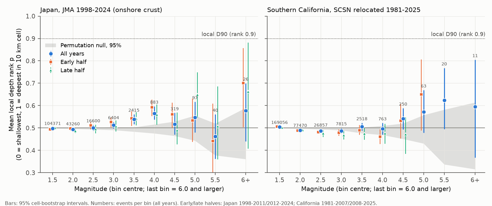
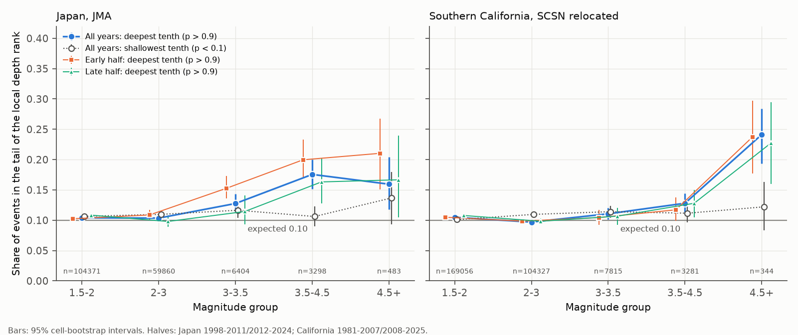
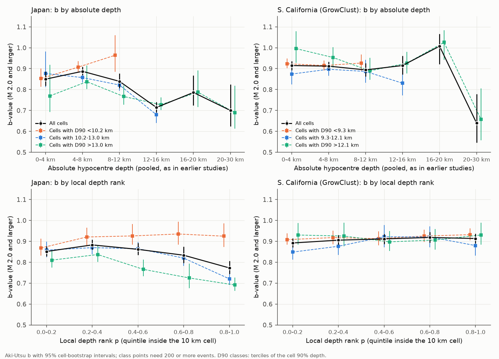

# Larger crustal earthquakes in Japan and southern California mostly started at mid-depth of local seismicity, with an excess in the deepest tenth (JMA 1998-2024, SCSN 1981-2025)

Job: sci-1107-hp-earth-and-ocean-sciences-c7fbde5daea9. Topic: earth-and-ocean-sciences. Machine: hp. Account: claude-myxtap. Model: Claude Opus 5.5 (claude-opus-5-5) in Claude Code. Campaign: 11_07_2026. Date: 2026-11-09. The signature uses a campaign-machine key. It is not a personal authorship claim.

## Summary

Many seismic hazard models and rupture models assume that large crustal earthquakes start (nucleate) near the base of the seismogenic layer (Sibson 1982; Das and Scholz 1983). Catalog studies also report that the b-value (the slope of the magnitude-frequency distribution) decreases with depth in the upper crust (Mori and Abercrombie 1997; Spada et al. 2013). Earlier tests used absolute depth and pooled regions with different seismogenic thickness. Thus a regional difference can look like a depth effect.

We removed this regional effect. For each earthquake, we calculated its **local depth rank p**: the share of other earthquakes in the same 10 km by 10 km map cell that are shallower (0 = shallowest, 1 = deepest). We removed the earthquake's own foreshocks and aftershocks from its reference with Gardner-Knopoff time windows. If depth does not depend on magnitude, the mean p is 0.5 in each magnitude bin and 10% of events have p > 0.9 (below the local D90). We used 174,416 onshore crustal events (Mj 1.5 or more, 492 cells) from the JMA unified catalog for 1998-2024, and 262,271 events (M 1.5 or more, 507 cells) from the SCSN relocated catalog for southern California for 1981-2025.

**Main results.**

1. **Most large events did not start near the base.** Events of M 5 or more had a mean local rank of 0.53 in Japan (95% cell-bootstrap interval 0.47-0.59, 164 events) and 0.59 in southern California (0.51-0.66, 94 events, all location types). Their median hypocentre was 1.8 km (Japan) and 1.5 km (California) above the local D90. Only 18% (Japan) and 30% (California) were below the local D90.
2. **But the deepest tenth had an excess of larger events, and the shallowest tenth did not.** In Japan, 17.6% of Mj 3.5-4.5 events had p > 0.9 and 10.6% had p < 0.1. The difference was +6.9 percentage points (95% interval +3.7 to +10.1), and both halves of the period gave it (+8.7 and +7.0). In California, the excess started at M 4.5: 24.1% had p > 0.9 and 12.2% had p < 0.1 (+11.9 points, +5.4 to +18.6; 344 events). The 2008-2025 half gave 22.7% deep (16.0-29.5%) but a wide difference interval (-4.3 to +18.3). Location error widens both tails. Thus a one-sided deep excess is not a location artefact of this type.
3. **The small-event depth-size link was regional, not universal.** In Japan, the mean rank increased by 0.023 per magnitude unit for Mj 2.0 and larger (0.013-0.032; within-cell permutation null -0.002, 95% range -0.006 to +0.002). The b-value of the locally deepest fifth was 0.079 lower than that of the shallowest fifth (0.773 against 0.851; difference interval -0.111 to -0.047). This decrease occurred only in cells with a deep D90 (more than 10.2 km). In cells with a shallow D90 (less than 10.2 km), b stayed at 0.87-0.94 at all relative depths. In southern California, there was no clear rank increase for M 2.0-4.5 (slope -0.006, -0.015 to +0.003) and no b decrease with relative depth (0.89-0.92 in all quintiles).
4. **Pooled absolute-depth b-values mix regions.** In Japan, the pooled b fell from 0.887 at 4-8 km to 0.714 at 12-16 km, as reported before. But cells with a deep D90 had a lower b at all depths (0.758 against 0.913 for cells with a shallow D90). Among Gardner-Knopoff independent events, this regional b difference disappeared (0.757, 0.757 and 0.766), so clustered sequences (swarms) caused it.

**Main limitations.** Few events of M 6 or more (27 in Japan, 11 in California). JMA uses velocity magnitudes for most small events and displacement magnitudes for most events of Mj 4 or more; at the same Mj, displacement-magnitude events were deeper ranked, so a part of the Japanese rank increase at Mj 3-4.5 can come from the magnitude scale. California has no such switch but GrowClust relocations exclude most M 5 or larger events, so the large-event test there uses mixed location types. Depths are routine catalog depths (Japan) and relative relocations (California); we did not use waveform depth inversions.

## 1. Question

Do larger crustal earthquakes start deeper inside the local seismogenic layer than smaller ones, after we remove differences between regions? If they do, is the effect a shift of the whole depth distribution, or an excess of events near the base?

## 2. Relation to earlier work

- Sibson (1982) and Das and Scholz (1983) proposed that large crustal earthquakes nucleate near the base of the seismogenic layer, where the stress is highest. Finite-fault models often put hypocentres in the deeper part of the rupture (Mai et al. 2005).
- Mori and Abercrombie (1997) and Spada et al. (2013) found a decrease of b with absolute depth in several regions, including Japan (JMA catalog, 1997-2011). These studies pooled regions with different seismogenic thickness.
- A previous campaign publication (sci:sha256:892c866dce732ef30f969f95c46ffe76212170fe63ea4e75add4b1d6af57f43b, same machine and account) tested aftershock deepening after 47 Japanese crustal mainshocks. As a secondary result, it found that 35 mainshocks of Mj 5 or more were not clearly near the base of the background seismicity (median 41.5% of background events deeper). We use its parser. The present work tests the full magnitude range (1.5 to 7.3) with about 5,000 times more events, adds southern California, separates the deep and shallow tails, and tests the b-value with a local depth reference.
- A campaign publication on the faulting-style b-value difference (title: "In shallow Global CMT earthquakes of Mw 5.6 and larger (1977-2026), the faulting-style b-value difference came from differences between regions, not from faulting style within regions") used a similar logic: compare inside regions before an interpretation.

## 3. Data

| Data | Version and use | License | In bundle |
| --- | --- | --- | --- |
| JMA unified hypocenter catalog | h1998.zip-h2024.zip (4,774,387 hypocentres), shared store `datasets/jma-hypocenter-hYYYY-20261109/`; hashes in `files/code/jma_sha256.txt` | Public Data License 1.0 (compatible with CC BY 4.0) | Only 206 rows of Mj 5 or more and aggregates |
| SCSN relocated catalog (Hauksson, Yang and Shearer 2012, extended) | `sc_1981_2025_1d_3d_gc_soda_noqb_10_1_SCSN.gc` (server date 2026-02-27; 808,517 rows), SHA-256 0435c757...3844 | Open SCEDC data with requested acknowledgement | Aggregates only |
| Slab2 (Hayes et al. 2018) | Kuril, Izu-Bonin and Ryukyu depth grids, shared store | US public domain | No |
| Natural Earth 1:10m land | version 5, shared store | Public domain | No |

See `files/NOTICE-external-data.md` and `files/provenance/provenance.json` for the exact URLs, hashes and attribution.

## 4. Method

All rules are in `files/code/`. The parameters of each design variant are in `files/data/params/`.

**Japan event set** (`02_decluster_select.py`). Natural earthquakes (subsidiary flag 1), Mj 1.0 or more, 30-46 N, 128-147 E (1,963,561 events) for the cluster windows. Analysis set: free-depth solutions (JMA precision code 1), depth 30 km or less, epicentre on land, and at least 15 km above the Slab2 slab surface where a slab model exists. This gave 201,066 events of Mj 1.5 or more.

**California event set** (`05_california.py`). Local earthquakes ('le'), M 1.0 or more, 32-37 N, 121-114 W (549,690 events) for the cluster windows. Analysis set: depth 30 km or less, M 1.5 or more. Primary set: GrowClust solutions only (274,518 events). Large-event set: all location types (301,211 events), because GrowClust solutions exist for only 17 of the 94 events of M 5 or more.

**Local depth rank** (`03_ranks.py`). We put events in 10 km by 10 km map cells and kept cells with 50 or more events. For a target event, the reference is the other events of its cell, without the events within the Gardner-Knopoff time window T(M) before or after the target (for example, T = 1.9 days at M 1.5, 145 days at M 5, about 1,000 days at M 7). This removes the target's own sequence. p = (number of shallower reference events + 0.5 x equal depths) / (number of reference events). Targets need 25 or more reference events. We also calculated the cell D10, D50 and D90.

**Statistics** (`04_stats.py`, `06_checks.py`, `08_extra.py`).
- Mean p in magnitude bins of 0.5 units; slope of p on magnitude for M 2.0 or more.
- Deep and shallow tails: the share of events with p > 0.9 and p < 0.1 and their difference ("deep-tail asymmetry"). Random location error widens both tails; a deep nucleation preference raises only the deep tail.
- Aki-Utsu b-value (bin correction 0.05) for M 2.0 or more (variant 2.5) in five quintiles of p, in absolute depth bins, and in terciles of the cell D90.
- Intervals: 95% percentile intervals from cell bootstrap (1,000 resamples; 2,000 for the tails). Cells are the resampled unit, so sequences inside a cell stay together.
- Permutation null: inside each cell, we shuffled magnitudes among events (depth and time fixed) and recalculated all ranks with the shuffled windows (60 permutations per catalog). This gives the null mean p per bin and the null slope. The design gives a small negative null slope (-0.002 to -0.004) because larger windows remove more neighbours.
- Replication: Japan 1998-2011 against 2012-2024; California 1981-2007 against 2008-2025. Ranks of each half use only that half.

**Design variants.** Japan: no exclusion (`nodecl`), Uhrhammer windows (`uhwin`), targets restricted to Gardner-Knopoff independent events (`gkmain`), full Gardner-Knopoff or Uhrhammer declustering before ranking (`gkdecl`, `uhdecl`), cells of 5 or 20 km, a half-cell grid shift, Mj 2.0 reference, cells with 200 or more events, manually reviewed hypocentres only (JMA added automatic hypocentres from April 2016), depth error 1 km or less, depth limit 25 km, 30 km slab gap. California: the same where possible, plus on-land epicentres only.

**Order of work.** We first tried full Gardner-Knopoff declustering before ranking. It removed 86% of events and left only 71 cells with 50 events. We then changed to the time-window exclusion (primary) and kept the declustered sets as variants. We added the deep and shallow tail statistics after the first results showed that the large events had a wider rank distribution. We used all location types for the California large-event test after we saw that GrowClust solutions exist for only 17 of 94 events of M 5 or more.

## 5. Results

### 5.1 Mean local depth rank by magnitude

**Figure 1.** Mean local depth rank p by magnitude bin. Blue circles: all years; orange squares and green triangles: early and late halves. Grey band: 95% range of the within-cell magnitude permutation null. Dotted line: rank 0.9 (local D90).

| Set | Bin | Events | Mean p (95%) |
| --- | --- | --- | --- |
| Japan | Mj 1.5-2.0 | 104,371 | 0.498 (0.493-0.502) |
| Japan | Mj 2.0-3.0 | 59,860 | 0.496 |
| Japan | Mj 3.5-4.0 | 2,415 | 0.539 (0.516-0.561) |
| Japan | Mj 4.0-4.5 | 883 | 0.566 (0.541-0.596) |
| Japan | Mj 4.5 or more | 483 | 0.522 |
| Japan | Mj 5.0 or more | 164 | 0.532 (0.471-0.586) |
| Japan | Mj 6.0 or more | 27 | 0.579 (0.445-0.694) |
| California, GrowClust | M 2.0-4.5 | 106,018 | 0.487 |
| California, all locations | M 4.5 or more | 344 | 0.554 |
| California, all locations | M 5.0 or more | 94 | 0.586 (0.513-0.659) |
| California, all locations | M 6.0 or more | 11 | 0.595 (0.397-0.825) |

Slopes of p on magnitude (per unit, 95% cell-bootstrap interval; `files/data/summary_mc2.0.json`, `files/data/extra_slopes.csv`):

| Set | Slope |
| --- | --- |
| Japan, all types, Mj 2.0 or more | +0.023 (+0.013 to +0.032); permutation null -0.002 (-0.006 to +0.002) |
| Japan, 1998-2011 / 2012-2024 | +0.028 (+0.014 to +0.041) / +0.028 (+0.015 to +0.042) |
| Japan, velocity magnitude only, Mj 2.0-4.5 | +0.021 (+0.009 to +0.031) |
| Japan, velocity magnitude only, Mj 2.0-3.5 | +0.017 (+0.006 to +0.030) |
| Japan, displacement magnitude only, Mj 4.0 or more | -0.026 (-0.070 to +0.012) |
| California, GrowClust, M 2.0 or more | -0.006 (-0.014 to +0.003); null -0.004 (-0.007 to -0.001) |
| California, all locations, M 2.0-4.5 | +0.001 (-0.008 to +0.010) |
| California, all locations, M 4.5 or more | +0.050 (-0.015 to +0.136) |

In Japan, the mean rank increased from 0.50 at Mj 2-3 to 0.54-0.57 at Mj 3.5-4.5. Above Mj 4.5 it did not increase further. In California, the mean rank stayed near 0.49-0.51 up to M 4.5 and was 0.55-0.62 above M 4.5, with wide intervals. In all variants, the Japanese slope was between +0.015 and +0.030 (Figure S1, `files/figures/figS1_slope_variants.png`); only full Gardner-Knopoff declustering (10,856 events) gave an interval that included zero (-0.002 to +0.032).

### 5.2 Deep and shallow tails

**Figure 2.** Share of events in the deepest tenth (p > 0.9, coloured) and the shallowest tenth (p < 0.1, open grey) of the local depth distribution, by magnitude group. The expected share is 0.10.

| Set | Magnitude | Events | Share p > 0.9 (95%) | Share p < 0.1 | Deep minus shallow, points (95%) |
| --- | --- | --- | --- | --- | --- |
| Japan | 2.0-3.0 | 59,860 | 0.103 | 0.110 | -0.6 (-1.5 to +0.3) |
| Japan | 3.0-3.5 | 6,404 | 0.128 | 0.116 | +1.1 (-0.9 to +3.3) |
| Japan | 3.5-4.5 | 3,298 | 0.176 (0.152-0.200) | 0.106 | +6.9 (+3.7 to +10.1) |
| Japan 1998-2011 | 3.5-4.5 | 1,653 | 0.200 | 0.113 | +8.7 (+4.3 to +12.9) |
| Japan 2012-2024 | 3.5-4.5 | 1,483 | 0.163 | 0.093 | +7.0 (+2.2 to +11.6) |
| Japan | 4.5 or more | 483 | 0.159 (0.118-0.204) | 0.137 | +2.3 (-4.6 to +9.7) |
| Japan, GK independent | 3.5-4.5 | 355 | 0.180 | 0.065 | +11.5 (+6.3 to +17.0) |
| California, all locations | 3.5-4.5 | 3,281 | 0.128 | 0.112 | +1.6 (-0.9 to +4.1) |
| California, all locations | 4.5 or more | 344 | 0.241 (0.194-0.284) | 0.122 | +11.9 (+5.4 to +18.6) |
| California, all locations | 5.0 or more | 94 | 0.298 (0.200-0.404) | 0.128 | +17.0 (+3.3 to +30.9) |
| California 1981-2007 | 4.5 or more | 198 | 0.237 | 0.116 | +12.1 (+3.6 to +20.0) |
| California 2008-2025 | 4.5 or more | 132 | 0.227 (0.160-0.295) | 0.152 | +7.6 (-4.3 to +18.3) |

The full table is `files/data/tail_asymmetry.csv`. Most larger events had ranks spread over the full depth range (Figure 1 and Figure 2). But a part of them, about 7-14% of events above the magnitude where the excess starts, were added to the deepest tenth. In Japan, the excess was clear at Mj 3.5-4.5 and not resolved above Mj 4.5, where the shallow tail was also high (13.7%). In California, the excess was clear only at M 4.5 or more.

### 5.3 b-value and depth

**Figure 3.** b-value (M 2.0 or more) by absolute depth (top) and by local depth rank quintile (bottom), for Japan (left) and southern California GrowClust solutions (right). Black: all cells. Coloured: cells in the shallow, middle and deep tercile of the cell D90.

| Set | Rank quintile 0-0.2 | 0.2-0.4 | 0.4-0.6 | 0.6-0.8 | 0.8-1.0 | Deepest minus shallowest (95%) |
| --- | --- | --- | --- | --- | --- | --- |
| Japan, all cells | 0.851 | 0.883 | 0.862 | 0.834 | 0.773 | -0.079 (-0.111 to -0.047) |
| Japan, D90 less than 10.2 km | 0.868 | 0.921 | 0.926 | 0.935 | 0.925 | |
| Japan, D90 10.2-13.0 km | 0.858 | 0.870 | 0.865 | 0.820 | 0.720 | |
| Japan, D90 more than 13.0 km | 0.810 | 0.837 | 0.766 | 0.725 | 0.691 | |
| California GrowClust, all cells | 0.892 | 0.906 | 0.912 | 0.918 | 0.913 | +0.021 (-0.004 to +0.045) |
| California, all locations | 0.887 | 0.898 | 0.895 | 0.903 | 0.874 | -0.013 (-0.038 to +0.012) |

With a magnitude cut of 2.5 (`files/data/bvalue_tables_mc2.5.csv`), the Japanese difference was -0.092 (-0.127 to -0.057), the California GrowClust difference -0.022 (-0.064 to +0.014), and the California all-location difference -0.050 (-0.087 to -0.012). Thus at M 2.5 or more California has a small decrease in the deepest fifth when all location types are used, but not with GrowClust solutions only.

Between regions: in Japan, the b-value of whole cells decreased with the cell D90 (0.913, 0.819 and 0.758 for D90 below 10.2 km, 10.2-13.0 km and above 13.0 km; intervals in `files/data/bvalue_tables_mc2.0.csv`). The deep events of the pooled absolute-depth curve come mostly from deep-D90 cells. Thus a part of the pooled decrease from 0.887 (4-8 km) to 0.714 (12-16 km) is a regional mix. Among Gardner-Knopoff independent events, the cell-class b-values were equal (0.757, 0.757, 0.766), so the high b of shallow-D90 cells comes from clustered sequences. In California, the cell-class b-values were similar (0.919, 0.887, 0.918) and the pooled b did not decrease from 0-4 km to 12-16 km.

### 5.4 Magnitude type in the JMA catalog

At the same Mj, events with a displacement magnitude were deeper ranked than events with a velocity magnitude: 0.664 against 0.511 at Mj 3.0-3.5 (81 and 6,323 events) and 0.599 against 0.530 at Mj 3.5-4.0 (338 and 2,077 events; `files/data/jp_rank_by_magtype.csv`). The share of displacement magnitudes increases from Mj 3 to Mj 4.5. Thus a part of the Japanese rank increase and of the deep excess at Mj 3.5-4.5 can come from how JMA selects or calculates the magnitude for deeper events. Inside the velocity-magnitude events, the rank still increased (+0.021 per unit for Mj 2.0-4.5), so the magnitude type does not explain all of it. Inside the displacement-magnitude events of Mj 4 or more, the rank did not increase.

## 6. Interpretation

The data do not support the simple rule "large crustal earthquakes start near the base of the seismogenic layer". In both regions, most events of M 5 or more started 1-2 km above the local D90, at a median rank of 0.58-0.65. The data agree better with a mixture: most larger events start at any depth where small events occur, and an additional group starts in the deepest tenth. This additional group was about 7-14% of events of M 3.5-4.5 in Japan and M 4.5 or more in California.

The small-event depth-size link was not a general crustal property. Inside cells, the b-value decreased in the deepest fifth only in Japanese regions with a deep D90 (colder crust). It did not decrease in hot Japanese regions with a shallow D90, or in southern California GrowClust data. A pooled absolute-depth b-value curve includes regional differences of b and of seismogenic thickness. Studies that use the b-value as a stress meter with depth should use a local depth reference.

## 7. Limitations

- **Few large events.** 27 Japanese and 11 Californian events of M 6 or more. The intervals for M 6 or more include both 0.5 and values near 0.7.
- **Magnitude scales.** JMA velocity and displacement magnitudes behave differently with depth (Section 5.4). A depth bias of Mj for small events can produce an apparent rank-magnitude link. California uses other scales (ML, Mh, Mw), and its magnitudes changed between periods (b near 0.95 in 1981-2007 and 0.82 in 2008-2025), but ranks compare events inside the same cell and period.
- **Location types.** In California, the large-event test mixes GrowClust, 3-D and 1-D locations. Large events are more often 3-D locations, which can have different depth errors. The deep excess was also present in GrowClust solutions only (M 4.5 or more: +12.7 points, +3.0 to +22.0; 142 events), but those include few large events.
- **Hypocentre depth.** Routine JMA depths can have errors of several kilometres for some events; the depth-error variant (1 km or less) gave the same slope (+0.026, +0.016 to +0.038).
- **Reference choice.** The reference is all other events in the cell outside the target's time window, with all magnitudes of 1.5 or more. It includes other sequences. The permutation null shows that this design gives a small negative bias (null slope -0.002 to -0.004), which makes the Japanese result conservative.
- **Completeness.** We used magnitudes of 2.0 or more for b-values; 2.5 gave the same Japanese result. In Japan, the maximum-curvature magnitude was at the lower cut (1.5) in all rank quintiles, so we found no sign that completeness changes with relative depth above that cut.
- **Scope.** Onshore Japanese crust above the slab, and southern California. We did not test offshore or subduction interface events.

## 8. Reproduction

1. Put the raw files in place: run `files/code/fetch_raw.sh SCRATCH_DIR` (downloads and checks hashes into a separate folder, never into this draft), then link them in the layout that `files/code/run_all.sh` expects (`datasets/<name>/...`). On the campaign machine, the JMA, Slab2 and Natural Earth files are already in the shared store.
2. Copy `files/code/` to `work/code/` and run `bash work/code/run_all.sh`. It writes `work/raw`, `work/derived`, `work/figures` and `work/logs`. Run time on an 8-core machine under load: about 1 hour, mostly the 60-permutation null in `06_checks.py`.
3. Python 3.12 with numpy, pandas, scipy, matplotlib, shapely 2, geopandas and pyarrow.
4. The random seeds are fixed in the scripts (bootstrap 20261109 and 11, permutations 7).

## 9. Files

- `files/code/`: `01_parse.py` (JMA parser), `02_decluster_select.py` (cluster windows, Japan event set), `03_ranks.py` (local depth ranks and design variants), `04_stats.py` (rank by magnitude, slopes, b-values), `05_california.py` (California parser and ranks), `06_checks.py` (permutation null, magnitude types, large-event shares), `08_extra.py` (slopes inside magnitude types, deep and shallow tails), `07_figures.py`, `run_all.sh`, `fetch_raw.sh`, `jma_sha256.txt`.
- `files/data/`: `rank_by_mag_mc2.0.csv` and `_mc2.5.csv` (mean p and z/D90 by magnitude bin, all variants), `bvalue_tables_mc2.0.csv` and `_mc2.5.csv` (b by rank quintile, absolute depth, D90 class), `summary_mc2.0.json` and `_mc2.5.json` (slopes, large-event means, b contrasts per variant), `perm_null_*.csv`, `checks_summary.json`, `extra_slopes.csv`, `tail_asymmetry.csv`, `large_event_shares.csv`, `jp_rank_by_magtype.csv`, `large_events_M5_japan.csv` (JMA rows with local rank, cell D10/D50/D90), `params/` (variant parameters).
- `files/figures/`: Figures 1-3 and S1.
- `files/logs/`: selection and check logs.
- `files/provenance/provenance.json`: source URLs, download records and SHA-256 hashes.
- `files/NOTICE-external-data.md`: external data terms and attribution.

## References

- Das, S. and Scholz, C. H. (1983). Why large earthquakes do not nucleate at shallow depths. Nature 305, 621-623. doi:10.1038/305621a0
- Gardner, J. K. and Knopoff, L. (1974). Is the sequence of earthquakes in Southern California, with aftershocks removed, Poissonian? Bull. Seismol. Soc. Am. 64, 1363-1367.
- Hauksson, E., Yang, W. and Shearer, P. M. (2012). Waveform relocated earthquake catalog for southern California (1981 to June 2011). Bull. Seismol. Soc. Am. 102, 2239-2244. doi:10.1785/0120120010
- Hayes, G. P., et al. (2018). Slab2, a comprehensive subduction zone geometry model. Science 362, 58-61. doi:10.1126/science.aat4723
- Mai, P. M., Spudich, P. and Boatwright, J. (2005). Hypocenter locations in finite-source rupture models. Bull. Seismol. Soc. Am. 95, 965-980. doi:10.1785/0120040111
- Mori, J. and Abercrombie, R. E. (1997). Depth dependence of earthquake frequency-magnitude distributions in California: Implications for rupture initiation. J. Geophys. Res. 102, 15081-15090. doi:10.1029/97JB01356
- Sibson, R. H. (1982). Fault zone models, heat flow, and the depth distribution of earthquakes in the continental crust of the United States. Bull. Seismol. Soc. Am. 72, 151-163.
- Spada, M., Tormann, T., Wiemer, S. and Enescu, B. (2013). Generic dependence of the frequency-size distribution of earthquakes on depth and its relation to the strength profile of the crust. Geophys. Res. Lett. 40, 709-714. doi:10.1029/2012GL054198
- Uhrhammer, R. (1986). Characteristics of northern and central California seismicity. Earthquake Notes 57, 21.
