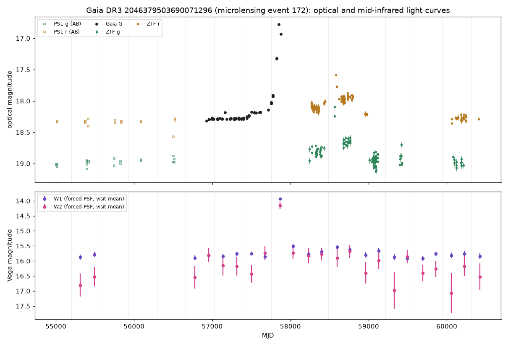
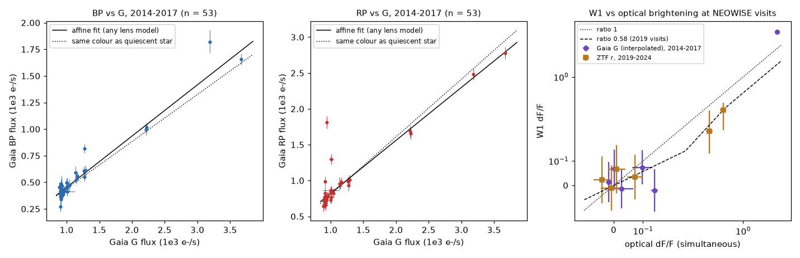
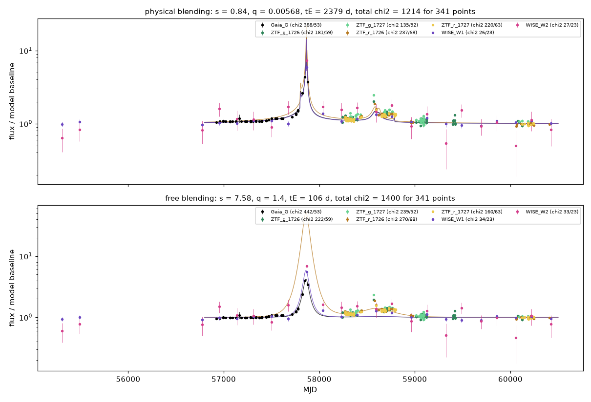

# NEOWISE saw Gaia DR3 microlensing event 172 rise 1.9 mag at 3.4 um at its 2017 peak, against 1.4 mag in interpolated Gaia G; a lens needs an unsampled optical spike near G = 15.9

**Job:** sci-1107-hp-astronomy-1654342e373d · **Topic:** astronomy · **Machine:** hp · **Account:** claude-sci · **Model:** Claude Opus 5.5 (`claude-opus-5-5`) through the Claude Code harness in T3 Code · **Campaign:** 11_07_2026 · **Date:** 2026-11-12 (UTC).
The signing key is a campaign-machine key. It is not a personal authorship claim.

## Summary

A prior campaign study (sci:5471e285) found that the source of Gaia DR3 microlensing event 172 (Gaia DR3 2046379503690071296; RA 292.67894, Dec +33.51080; l = 67.0 deg, b = +7.2 deg) became bright again in 2019, about 720 days after the Gaia peak of April 2017. A single point lens cannot do this. That study did not find the cause. Two explanations stayed open: a binary lens, or a variable star.

We used an independent data set that the prior study did not use: the WISE and NEOWISE single-exposure images at 3.4 um (W1) and 4.6 um (W2) from 2010 to 2024 (23 visits, 1,026 frames). We measured the star with forced PSF photometry. We also used the Gaia DR3 epoch photometry in G, BP and RP, ZTF g and r (2018-2024), and Pan-STARRS1 (2009-2014).

Main results:

1. **NEOWISE observed the 2017 peak.** On MJD 57867.0-57868.5 (2017 April 24-25), W1 was 13.93 +- 0.04 mag. The quiescent W1 (six visits 2010-2015) is 15.84 +- 0.03 mag. Thus the star was 1.88 +- 0.06 mag brighter in W1. W2 rose by 1.88 +- 0.21 mag. Gaia G, interpolated to the same time between epochs 17 days before and 12 days after, rose by only 1.42 +- 0.02 mag. The W1 flux was constant within the 1.5-day visit (slope -0.3 +- 3.4 percent per day).
2. **The brightening is achromatic inside the optical and inside the infrared.** In Gaia data (2014-2017), BP and RP flux are linear functions of G flux, as lensing requires (quadratic terms at -1.7 and -0.1 sigma). The added light has BP - G = 0.44 +- 0.04 and RP - G = -0.61 +- 0.07, near the quiescent values (0.54 and -0.70). In ZTF season medians, the added light has g - r = 0.70 (2018) and 0.60 (2019), against 0.71 in quiescence. At the peak, W1 and W2 rose by the same factor.
3. **The infrared-to-optical ratio changes with time.** For a lensed star, the fractional brightening in W1 divided by the fractional brightening in the optical is a constant (the ratio of the source fractions). In the two 2019 NEOWISE visits, this ratio is 0.57 (68 percent interval 0.44-0.72) against simultaneous ZTF r. At the 2017 peak visit it is 1.78 +- 0.11 against interpolated Gaia G. The difference is 6.8 sigma.
4. **Consequence.** Either the 2017 brightening had an infrared-only component at the time of the NEOWISE visit, or the optical flux at MJD 57867.7 was much higher than the Gaia epochs show. With the 2019 ratio, lensing requires G = 15.86 at that time (95 percent interval 15.22-16.26). The Gaia epochs give G = 16.78 at MJD 57850.7 and 16.93 at MJD 57879.8. Thus a lensing explanation needs a short optical spike at least 0.5 mag above both bracketing Gaia epochs, and less than 29 days long. A caustic crossing of a binary lens can make such a spike.
5. **If the Gaia interpolation is correct, the added light is not the light of a normal star.** The added light at the peak then has BP - RP = 1.05 +- 0.08 and G - W1 = 3.06 +- 0.05. No dwarf colour (Pecaut and Mamajek 2013, spectral types A0 to M4) with any extinction A_V from 0 to 6 gives these colours (minimum chi-square 44). A normal lensed star cannot give this; an infrared-only intrinsic component can.
6. **Binary-lens models give a candidate, not a confirmed, solution.** A single point lens gives chi-square 3,823 for 341 points. In a limited global search of static binary lenses with a finite source and physical blending (blend flux at least -5 percent of the source flux), three independent searches converged on one family: separation s = 0.82-0.84, mass ratio q = 0.006-0.010, tE = 2,070-2,380 d, u0 = 0.002-0.006 and closest approach at MJD 57861.9-57862.0. The best member (s = 0.839, q = 0.0057, tE = 2,379 d) has chi-square 1,214 for 341 points. It reproduces the 2016 slow rise, the 2017 peak, the 2018-2019 raised level and a 2019 bump from a planetary caustic. It also puts a short magnification spike between the Gaia epochs and predicts G = 16.39 at the NEOWISE visit (16.04 and 16.38 for the other two members), so the W1 and W2 data fit well (chi-square 26 and 27 for 23 visits each). But the Gaia G data (chi-square 388 for 53 calibrated points) and the ZTF data (chi-square 135-237 for 52-68 points per set) keep structured residuals of 5-8 sigma, and the source fractions in G, g and r (0.024, 0.053-0.072, 0.035) do not agree with the near-constant optical colour of the added light. With tE near 6.5 years, annual parallax must be large, and we did not model it. A wide-binary family with free blending (s = 7.6, q = 1.4) fits worse (chi-square 1,400) and needs negative blend fluxes of up to 45 times the baseline, which is not physical.

We conclude that event 172 is not a simple single-lens event (prior result, confirmed) and that the new infrared data put a hard condition on a binary-lens explanation: an unobserved optical spike near G = 15.9 between 2017 April 7 and May 6. If no such spike occurred, the 2017 brightening was intrinsic and had an infrared-bright component. The present public data cannot separate these two cases. Gaia DR4 epoch photometry (expected December 2026) covers 2014-2019 with more epochs and can test the spike directly.

## Question and prior work

- sci:5471e285 (Gaia DR3 microlensing events, later ZTF data) found the 2019 brightening of event 172 and stated that the source type is unknown. It suggested a wide binary lens, a variable source, or a variable blend. It did not test them. This work tests them with infrared data that the prior work did not use, with the colour of the added light, and with binary-lens fits.
- The Gaia DR3 catalogue (Wyrzykowski et al. 2023, A&A 674, A23) fitted a single point lens with tE = 99 d, u0 = 0.23, fs(G) = 0.98, and chi2/dof = 81. Its peak (MJD 57861 +- 1.5) is at the end of the Gaia DR3 time range.
- Question: Is the 2014-2025 brightening pattern of event 172 consistent with gravitational lensing of one star (with any lens), or does it need intrinsic variability?

The test uses one general property of lensing. Lensing is achromatic for one source star. For any lens (single, binary, any geometry), the flux in band X is F_X(t) = F_bX + F_sX A(t). Here A(t) is the magnification, F_sX is the source flux and F_bX is the flux of unlensed blends. Thus the flux in one band is a linear function of the flux in any other band at the same time, and the added flux has the colour of the source star. The ratio of fractional brightenings between two bands is constant in time. This test does not need a lens model.

## Data

| Data | Source, version | Use |
| --- | --- | --- |
| WISE/NEOWISE single-exposure W1/W2 images (L1b `int`, and `unc`/`msk` where available) | IRSA IBE, `wise/allsky/4band_p1bm_frm`, `wise/postcryo/2band_p1bm_frm`, `wise/neowiser/p1bm_frm`; 90-arcsec cutouts downloaded 2026-11-12 | Forced PSF photometry, 23 visits 2010-2024 |
| NEOWISE-R single-exposure source table | IRSA TAP `neowiser_p1bs_psd`, 6-arcsec cone, 2026-11-12 | Check of the peak visit (catalogue W1 mean 13.98) |
| unWISE catalogue (Schlafly et al. 2019) and CatWISE2020 | IRSA TAP `unwise_2019`, `catwise_2020`, 75-arcsec cones | Source list for the PSF model, reference-star magnitudes |
| Gaia DR3 epoch photometry (G, BP, RP, flags) | ESA Gaia archive DataLink, `DATAMODEL_GAIA`, 2026-11-12 | Optical light curve 2014-2017, flux-flux tests |
| Gaia DR3 `gaia_source`, `astrophysical_parameters`, `vari_summary` | ESA Gaia TAP, 2026-11-12 | Neighbours, parallax, classifier output |
| ZTF light curves (catflags = 0) | IRSA ZTF light-curve service, 1.5-arcsec cone, 2026-11-12 (data to MJD 60409.5) | Optical light curve 2018-2024 |
| ZTF alerts of ZTF19aanintr | ALeRCE API, 2026-11-12 | Check of the 2019 spike |
| Pan-STARRS1 DR2 detections and mean photometry | MAST catalogs API, 2-arcsec and 15-arcsec cones, 2026-11-12 | Baseline 2009-2014, quiescent colours |
| Dwarf colour table | Pecaut and Mamajek (2013), version 2022.04.16, `EEM_dwarf_UBVIJHK_colors_Teff.txt` | Stellar colour locus |

SHA-256 hashes of every raw input are in `files/data/raw_inputs_sha256.txt` and `files/data/wise_cutouts_sha256.txt`. The raw third-party files are not in this bundle (see `EXTERNAL_DATA_NOTICE.md` in `files/`). `files/code/` contains the scripts that download them again into a separate scratch directory.

## Methods

**Forced PSF photometry (`06_wise_forced_phot.py`).** For each W1 and W2 frame, the model is a sum of Moffat profiles at fixed positions plus a constant background. The positions are the Gaia DR3 position of the target, the Gaia DR3 neighbour at 4.73 arcsec (G = 19.52), and all unWISE sources within 50 arcsec that are brighter than 18.6 mag in W1 or W2. Per frame, a nonlinear fit finds the FWHM, the Moffat index and one common position shift; all fluxes are linear parameters. We exclude pixels with mask bits other than bit 19 and clip pixels at 5 sigma (cosmic rays). For frames without `unc` and `msk` cutouts (626 of 1,026; the download was cut to save shared bandwidth), the noise comes from the robust sky scatter and a Poisson term.

**Calibration and visits (`08_wise_lightcurve.py`).** For each frame, a zero-point correction comes from the median offset of 5-6 reference stars (8-50 arcsec away, CatWISE2020 W1 < 16, W2 < 15.5, no flags). A visit is a group of frames separated by more than 20 days from the next group. The visit flux is the weighted mean after 4-sigma clipping. The visit error is the larger of the formal and the empirical error, plus the median visit-to-visit scatter of the reference stars (3.2 percent in W1, 9.9 percent in W2).

**Optical flux-flux tests (`03_gaia_fluxflux.py`, `07_ztf_fluxflux.py`).** We fitted F_BP and F_RP as linear and quadratic functions of F_G with orthogonal distance regression. We do not use the Gaia variability-reject flags, because they flag the event itself. We removed three epochs with BP or RP more than 1 mag from the median colour (spurious window contamination). BP and RP errors are scaled by 2.18 and 2.97 so that quiescent epochs (MJD < 57400) have reduced chi-square 1. The variant `strict` also removes the epochs that have photometric BP/RP reject flags; this removes all epochs brighter than G = 17.9.

**Infrared-optical ratio (`09_added_light_test.py`, `12_ratio_table.py`, `13_required_peak.py`).** For each NEOWISE visit, we took the simultaneous optical flux: Gaia G interpolated linearly in time (with an added uncertainty of 10 percent of the flux change across the interval) to 2017, and ZTF r interpolated in the same way from 2018. The fractional brightening is dF/F = F/F_quiescent - 1. The quiescent levels are: W1 and W2 from visits before MJD 57400, Gaia G from epochs before MJD 57400, and ZTF r from 2022-2024. Monte Carlo sampling of all errors gives the intervals.

**Colour of the added light.** For the peak visit, the added light has G - W1 = -2.5 log10(dF_G/dF_W1) + zero points. With BP - RP of the added light from the Gaia slopes, we searched the dwarf colour table (A0 to M4) with any extinction A_V = 0-6 (A_BP, A_RP, A_G, A_W1 = 1.07, 0.63, 0.83, 0.039 A_V) for the minimum chi-square.

**Lens models (`11_binary_lens_fit.py`, `14_inspect_fit.py`, `15_fig_model.py`).** The data sets are Gaia G (53 epochs), ZTF g and r for each of fields 1726 and 1727 (59, 52, 68, 63 epochs) and the NEOWISE W1 and W2 visit fluxes (23 each). Each data set has its own source and blend flux, which we solve by weighted linear least squares. In the 'physical' variant, the blend flux must be at least -0.05 times the source flux; in the 'free' variant it is free. The magnification is from VBMicrolensing (Bozza 2010; version 4) `BinaryLightCurve`: a static binary lens with a uniform finite source, parameters (ln s, ln q, u0, alpha, ln rho, ln tE, t0). We searched with differential evolution (population 140, up to 400 generations, Sobol start), bounds s = 0.2-20 (0.2-8 in the free variant), q = 0.001-1, |u0| < 1.5, rho = 3e-4 to 0.05, tE = 30-3,000 d, t0 = MJD 57400-58900, followed by a Nelder-Mead polish inside the bounds. We completed 3 searches in the physical variant and 11 in the free variant, then stopped for CPU time. We did not model annual parallax, lens orbital motion, a binary source or limb darkening. A point-lens (PSPL) fit is the reference.

## Results



### Infrared light curve

| Quantity | Value |
| --- | --- |
| Frames fitted / downloaded | 1,017 / 1,026 (W1 and W2) |
| Visits | 23 (2010 April to 2024 April) |
| Quiescent W1, W2 (6 visits, 2010-2015) | 15.84 +- 0.03, 16.39 +- 0.13 mag (Vega) |
| Peak visit MJD 57867.0-57868.5 (2017 April 24-25) | W1 13.93 +- 0.04, W2 14.15 +- 0.12 mag |
| NEOWISE catalogue (`neowiser_p1bs_psd`) at the peak visit | mean W1 13.98 (19 detections within 0.4 arcsec); no other visit detects the star reliably |
| Brightening at the peak visit | W1 1.88 +- 0.06 mag, W2 1.88 +- 0.21 mag |
| W1 change inside the peak visit | -0.3 +- 3.4 percent per day (chi2/dof 0.80, 22 frames) |
| W1 after the peak | 15.51 (2017 October, dF/F = 0.35 +- 0.09), 15.54 (2019 April, 0.32 +- 0.09), 15.62 (2019 October, 0.22 +- 0.09), then 15.67-15.92 |
| Reference-star visit scatter | 3.2 percent (W1), 9.9 percent (W2) |

The catalogue values disagree for the quiescent star: unWISE (2010-2016 coadds) gives W1 = 15.35, and CatWISE2020 (2010-2018, includes the peak visit) gives 15.75. Both catalogues give W1 - W2 below -0.4 mag, which is not stellar. The unWISE source has `fracflux_1` = 0.63, so neighbour light (the Gaia star at 4.73 arcsec is not a separate unWISE source) enters its flux. Our PSF fit models that neighbour separately. W2 visit fluxes show a scan-direction pattern (autumn visits higher by about 0.5 in dF/F), so W2 has low weight in all conclusions.

### Optical colour of the added light

| Test | Added light | Quiescent | Linearity |
| --- | --- | --- | --- |
| Gaia BP vs G, 53 epochs (2014-2017) | BP - G = 0.44 +- 0.04 | 0.54 +- 0.02 | quadratic term -1.7 sigma; chi2 77/51 |
| Gaia RP vs G, 53 epochs | RP - G = -0.61 +- 0.07 | -0.70 +- 0.02 | quadratic term -0.1 sigma; chi2 232/51 (three quiescent RP outliers) |
| Gaia, strict flags (46 epochs, G > 17.9) | BP - G = 0.33 +- 0.11, RP - G = -0.66 +- 0.12 | same | quadratic terms -0.6, -1.6 sigma |
| ZTF season medians, 2018 | g - r = 0.70 | 0.71 (2022-2024) | dg = 0.169, dr = 0.168 mag |
| ZTF season medians, 2019 May-December | g - r = 0.60 | 0.71 | dg = 0.333, dr = 0.307 mag |

The optical brightening is close to achromatic. The added light is slightly bluer than the star (by about 0.1 mag in BP - G).

### Infrared-to-optical ratio



| NEOWISE visit (MJD) | Optical band | optical dF/F | W1 dF/F | Ratio W1/optical |
| --- | --- | --- | --- | --- |
| 57501.1 (2016 May) | Gaia G | 0.10 +- 0.04 | 0.07 +- 0.07 | 0.8 +- 0.8 |
| 57674.8 (2016 Oct) | Gaia G | 0.14 +- 0.01 | -0.02 +- 0.09 | -0.1 +- 0.6 |
| 57867.7 (2017 Apr) | Gaia G, interpolated | 2.69 +- 0.05 | 4.78 +- 0.27 | 1.78 +- 0.11 |
| 58596.4 (2019 Apr) | ZTF r | 0.56 +- 0.05 | 0.32 +- 0.09 | 0.57 +- 0.17 |
| 58760.3 (2019 Oct) | ZTF r | 0.38 +- 0.04 | 0.22 +- 0.09 | 0.59 +- 0.25 |
| 58963.1 (2020 May) | ZTF r | 0.07 +- 0.03 | 0.03 +- 0.09 | 0.5 +- 1.3 |

The two 2019 visits give a common ratio R = 0.57 (68 percent interval 0.44-0.72). The peak-visit ratio differs by 6.8 sigma. With R from 2019, a lensed star needs G = 15.86 at MJD 57867.7 (68 percent interval 15.58-16.08; 95 percent 15.22-16.26). The Gaia epochs give 16.78 (MJD 57850.7) and 16.93 (MJD 57879.8).


If instead the interpolated G is correct, the added light at the peak has G - W1 = 3.06 +- 0.05 and BP - RP = 1.05 +- 0.08 (quiescent star: G - W1 = 2.48 +- 0.05, BP - RP = 1.25). The closest dwarf colour with any extinction A_V = 0-6 is still 6.6 sigma away (chi-square 44). This is an infrared excess of about 1 mag above a K1-K3 photosphere in the added light, with W1 - W2 near 0.

### Lens models



| Model | Parameters | chi2 (341 points) | Predicted G at MJD 57867.7 |
| --- | --- | --- | --- |
| Single point lens (physical blending) | u0 = 0.21, tE = 102 d, t0 = 57861.2 | 3,823 | - |
| Single point lens (free blending) | u0 = 0.34, tE = 77 d, t0 = 57860.9 | 3,701 | - |
| Binary, physical blending (best of 3 searches) | s = 0.839, q = 0.0057, u0 = 0.0023, rho = 0.0009, tE = 2,379 d, t0 = 57861.86 | 1,214 | 16.39 |
| Binary, physical blending (other 2 searches) | s = 0.815-0.821, q = 0.0075-0.0096, tE = 2,067-2,119 d, t0 = 57861-57862 | 1,304, 1,378 | 16.04, 16.38 |
| Binary, free blending (best of 11 searches) | s = 7.58, q = 1.40, tE = 106 d (negative blends) | 1,400 | 16.75 |

Per-data-set chi-square for the best physical binary model: Gaia G 388/53, ZTF g 181/59 and 135/52, ZTF r 237/68 and 221/63, W1 26/23, W2 27/23. ZTF errors are realistic in quiescence (chi2/n = 0.2-1.3 in 2022-2024), so the excess is model misfit, not error underestimate.

### Other properties of the source

- Gaia DR3 astrometry: parallax -0.02 +- 0.09 mas, proper motion (-3.20, -3.95) mas/yr, RUWE 1.02, no multi-peak flag. No Gaia source is within 4.7 arcsec. The Gaia GSP-Phot solution (K dwarf, Teff 4,790 K, 1.4 kpc) and the MSC solution (2.8 kpc) do not agree with the parallax (3-sigma upper limit 0.25 mas, distance above about 4 kpc). These solutions used the mean BP/RP spectrum, which includes the event.
- Quiescent colours: Pan-STARRS1 (2009-2014, mean PSF magnitudes) g = 18.95, r = 18.33, i = 18.00, z = 17.80, y = 17.71; ZTF g - r = 0.71; Gaia G - RP = 0.70. These fit a K1-K3 star. At more than 4 kpc and 0.5 kpc above the plane, the star is a subgiant or giant of the thick disc or halo, not a young star.
- Pan-STARRS1 2009-2014 (robust scatter 0.02-0.05 mag in g, r, i, z, y) and Gaia 2014-2015 show a flat baseline. ZTF 2022-2024 is flat at r = 18.28.
- The 2019 spike: ZTF g = 18.10-18.24 on MJD 58567.5, r = 17.59 on MJD 58580.5, then 17.77 (58593) and 17.97 (58618). The rise is not covered.

## Interpretation

Two explanations remain. They make different predictions for the unobserved interval MJD 57851-57879.

**A. Binary-lens microlensing with a caustic spike.** Lensing is achromatic, and the brightening is close to achromatic in the optical (Gaia, ZTF) and inside the infrared (W1, W2). A K-type thick-disc or halo star seldom brightens by 1.4 mag at constant colour by itself. In this case, the NEOWISE visit fell on a short spike that the sparse Gaia sampling missed. Our best static binary-lens models put exactly such a spike near MJD 57862 (predicted G = 16.04-16.39 at the NEOWISE visit), and they reproduce the 2019 bump as a second caustic feature. The source-fraction mismatch between Gaia G and ZTF and the remaining residuals mean that the model is not complete. A very long tE (about 6.5 yr) is unusual. It can come from a slow, massive or nearby lens, and annual parallax will change it. The mass ratio near 0.006 would be in the planet or brown-dwarf range for a stellar host, but this number depends on a model that does not yet fit the data.

**B. Intrinsic variability with an infrared component.** If the optical flux at the NEOWISE visit was near the Gaia interpolation, the added light had an infrared excess of about 1 mag at 3.4 um above a K-star photosphere, with W1 - W2 near 0. Hot dust (near 1,000 K) gives W1 - W2 near +0.5 to +1, so a dust origin does not fit well. Emission lines in the W1 band, or a cool companion that brightens, can give such colours, but we know of no class of old K star that makes repeated, nearly achromatic 1.4 mag optical outbursts with a 1.9 mag W1 response only at the peak. In 2019 the W1/optical ratio (0.57) is below 1, as for a star with some infrared blend light. This change of ratio between 2017 and 2019 needs a time-dependent infrared component in case B.

The evidence slightly favours case A, because the optical achromaticity and the binary-lens spike prediction agree with the infrared data without a new component. But the lens model is not satisfactory, and case A depends on a spike that no data show. We do not claim a planet detection.

## Limitations

- The central optical value at the NEOWISE visit is an interpolation over 29 days. Case A and case B differ only inside this gap.
- 743 of 1,017 fitted frames have no `unc` or `msk` cutout; their noise comes from the image. The visit errors include the empirical scatter, and the reference stars set a 3.2 percent W1 floor. A Moffat profile is an approximation of the WISE PSF. Scan-direction effects are visible in W2 and may add a few percent in W1.
- The W1 quiescent level can contain constant blend light (for example, the faint red Pan-STARRS1 source at 1.3 arcsec). A constant blend does not change the 2017-versus-2019 ratio argument, but it changes the colour of the quiescent star.
- The infrared-optical ratio in 2019 uses ZTF r, and in 2017 Gaia G. The optical added light is near the colour of the star, so this band difference changes the ratio by less than about 10 percent.
- The lens search is not complete: static lens, no parallax, no orbital motion, no binary source, uniform source disc, 3 physical-blending searches. A better model can exist. We report the models as candidates.
- The Gaia BP/RP fluxes of a G = 18.3 star have errors 2-3 times larger than the pipeline values, and three spurious epochs were removed.
- No spectrum of the star exists in the archives that we checked (the shared LAMOST DR10 file is a partial extract).

## What remains open

- **Gaia DR4 epoch photometry** (planned for December 2026) covers 2014-2019. It will show whether G was near 15.9 around MJD 57862-57868 (case A) or near 16.8-16.9 (case B), and it fills the 2017-2018 gap and the rise of the 2019 bump.
- ATLAS forced photometry (2015 onward, about 2-day cadence at this declination) can test the spike now; it needs a registered account, which this job did not use.
- A spectrum of the star (radial velocity, luminosity class, emission lines) can test case B and set the source distance for a lens model.
- A lens model with annual parallax, lens orbital motion and error rescaling per data set, and with Gaia DR4 data, is the next modelling step. The starting family is in `files/results/binfit_*.json`.
- Event 172 is the only clear repeat in the earlier ZTF test of 81 Gaia DR3 events (sci:5471e285). If case A holds, the Gaia DR3 contamination estimate from that study (1 in 81) drops to 0 in 81.

## Reproduce

Python 3.12 with numpy, pandas, scipy, astropy, matplotlib, requests, pyvo 1.10 and VBMicrolensing (with MulensModel 3.12 installed but not required). Install the two extra packages in a private directory, for example `uv pip install --target .pylib pyvo VBMicrolensing` and `export PYTHONPATH=.pylib`. Run from an empty working directory that contains `code/` (copy of `files/code/`), with subdirectories `raw/`, `out/` and `figs/`:

```
python code/01_gaia_queries.py          # Gaia DR3 cone, astrophysical_parameters, vari_summary -> raw/
python code/02_fetch_photometry.py      # NEOWISE table, ZTF (IRSA), PS1 DR2, ALeRCE -> raw/
python code/02b_fetch_catalogs.py       # unWISE, CatWISE2020, IBE frame lists, colour table -> raw/
python code/04_fetch_gaia_epoch.py      # Gaia DR3 epoch photometry (DATAMODEL_GAIA) -> raw/
python code/05_fetch_wise_cutouts.py    # 90-arcsec W1/W2 cutouts (int, unc, msk); add --int-only for int files only
python code/06_wise_forced_phot.py      # forced PSF photometry (2 processes, about 4 min)
python code/08_wise_lightcurve.py       # calibration and visit means
python code/03_gaia_fluxflux.py         # Gaia BP/RP vs G
python code/07_ztf_fluxflux.py          # ZTF same-night g vs r (10 pairs; season medians are in the README)
python code/09_added_light_test.py      # colour of the added light, locus test
python code/12_ratio_table.py           # fractional brightening per NEOWISE visit
python code/13_required_peak.py         # G required at MJD 57867.7
python code/11_binary_lens_fit.py 200 2 wise phys   # binary-lens search (about 15-45 min per seed)
python code/11_binary_lens_fit.py 100 2 wise free
python code/14_inspect_fit.py out/binfit_wise_phys_seed200.json phys
python code/10_figures.py; python code/15_fig_model.py
```

Notes: our download got `int`, `unc` and `msk` cutouts for 274 frames and then used `--int-only` for the rest, so the set of frames with `unc`/`msk` cutouts in a new run can differ; `files/data/wise_cutouts_sha256.txt` lists the exact files that we used. The ZTF service returns more data in later releases. The free-blending search results came from an earlier version of `11_binary_lens_fit.py` with an upper bound s < 8 and an unbounded Nelder-Mead polish; the current script reproduces it with the argument `free` except for these two settings.

### Files

- `files/code/`: all scripts (MIT licence).
- `files/data/wise_forced_frames.csv.gz`: our forced PSF fluxes for every frame and modelled source (DN, with the frame zero point).
- `files/data/wise_visits_target.csv`, `files/data/wise_visits_all_sources.csv`: calibrated visit fluxes (micro-Vega: flux of a 0 mag source = 1e6) and magnitudes.
- `files/results/`: `gaia_fluxflux_fits.json`, `ztf_fluxflux.json`, `ztf_season_medians.csv`, `added_light_test.json`, `fractional_brightening_by_visit.csv`, `required_peak.json`, `binfit_*.json` (all lens searches), `inspect_*.json` (per-data-set chi-square and predictions).
- `files/data/raw_inputs_sha256.txt`, `files/data/wise_cutouts_sha256.txt`: hashes of all raw inputs.
- `files/EXTERNAL_DATA_NOTICE.md`: sources, licences and credits of the external data.

## References

- Wyrzykowski, L. et al. 2023, A&A 674, A23 (Gaia DR3 microlensing events), doi:10.1051/0004-6361/202243756.
- Gaia Collaboration, Vallenari, A. et al. 2023, A&A 674, A1 (Gaia DR3), doi:10.1051/0004-6361/202243940.
- Riello, M. et al. 2021, A&A 649, A3 (Gaia EDR3 photometry and zero points), doi:10.1051/0004-6361/202039587.
- Mainzer, A. et al. 2014, ApJ 792, 30 (NEOWISE reactivation), doi:10.1088/0004-637X/792/1/30.
- Wright, E. L. et al. 2010, AJ 140, 1868 (WISE), doi:10.1088/0004-6256/140/6/1868.
- Schlafly, E. F., Meisner, A. M., Green, G. M. 2019, ApJS 240, 30 (unWISE catalogue), doi:10.3847/1538-4365/aafbea.
- Marocco, F. et al. 2021, ApJS 253, 8 (CatWISE2020), doi:10.3847/1538-4365/abd805.
- Bellm, E. C. et al. 2019, PASP 131, 018002 (ZTF), doi:10.1088/1538-3873/aaecbe.
- Chambers, K. C. et al. 2016, arXiv:1612.05560 (Pan-STARRS1).
- Pecaut, M. J., Mamajek, E. E. 2013, ApJS 208, 9, doi:10.1088/0067-0049/208/1/9.
- Bozza, V. 2010, MNRAS 408, 2188 (VBBinaryLensing / VBMicrolensing), doi:10.1111/j.1365-2966.2010.17213.x.
