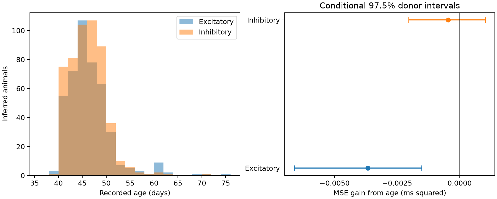

# Age gave no delay prediction gain in selected Allen mouse visual cortex connections

## Question and result

Does mouse age add useful information for a local circuit delay model after cell-body distance and recorded cell labels are known? These data gave no clear prediction gain from a linear age term. The result applies to detected and fitted mouse primary visual cortex connections in one public slice dataset.

Excitatory RMSE changed from 0.75907 to 0.76149 ms. Inhibitory RMSE changed from 0.47176 to 0.47225 ms. The test concerns prediction in held-out animals. It does not estimate a causal age effect or establish that delay is constant with age.



## Prior evidence and contribution

Campagnola, Seeman, and colleagues measured connections and synaptic responses in mouse and human cortex ([Science 2022](https://doi.org/10.1126/science.abj5861)). Their release links cell geometry and response timing through the same pair IDs. These are small recorded circuits in brain slices, not a full anatomical connectome.

Jiang and colleagues found layer-dependent maturation of inhibition in mouse visual cortex ([2010](https://doi.org/10.1523/JNEUROSCI.2979-10.2010)). Benamer and colleagues showed that a myelination perturbation can change inhibitory circuit timing ([2020](https://doi.org/10.1038/s41467-020-18984-7)). These studies make age a plausible timing variable. They do not show that age will improve predictions in the later, narrow age range tested here. We did not measure myelin or test either mechanism.

A published campaign study found a distance prediction gain after response rise-time control in mouse inhibitory connections (SCI dfa43b49...). Another report found extreme coordinate-scale errors in some axis-distance records (SCI d273d073...). We read both reports. Our test adds an animal-level variable, age, to a distance and cell-label model. It uses total pair distance, not cortical axis distances. This is an extension in the same release, not independent replication. Full IDs are in sci.json.

We launched the required SCI searches before fixing the question. They did not return within several minutes. We stopped them and used published ZIP metadata plus verified report reads. The metadata screen found 124 relevant publications. The prior-work search is not claimed to be complete. files/search_record.txt and files/prior_titles.json preserve this history. We did not read private sibling workspaces.

## Data and scope

The input is Allen Synaptic Physiology r2.1 small, schema 22, with source date 2023-01-26. We selected mouse VisP pairs with a detected monosynaptic connection, at least one manually passed average response fit, positive finite onset delay, positive age, and total cell-body distance above zero and at most 500 micrometres. files/evidence/query.sql is the exact read-only query. files/evidence/records.csv includes the query result and selection flags.

We inferred animal groups from the unique six-digit number in each specimen name. These are grouping proxies, not verified donor IDs. One inferred animal, 300684, had ages 40 and 46 days. Before any model fit, we excluded all 3 eligible records for that animal. We did not repair source labels. The design file records this amendment. Date-of-birth and acquisition-time arithmetic differed from the recorded age by at most 1.048 days in the retained sample. This is a consistency check, not proof that all ages are correct.

Excitatory data contain 902 connections from 438 inferred animals at ages 38–74 days. Inhibitory data contain 1327 connections from 516 inferred animals at ages 38–70 days. Median animal age is 45 days in the excitatory group and 45 days in the inhibitory group. The figure shows sparse coverage away from the center. Animals can occur in both groups.

Delay is converted from seconds to milliseconds. It measures the time from the source spike maximum slope to fitted target response onset. It can include several physiological and measurement components. It is not a direct measure of axon conduction time. No pulse-train array or activity dataset from a different animal was used.

## Models and uncertainty

The design was fixed after metadata inspection and before fitting. We fit separate ridge models for excitatory and inhibitory connections. The baseline uses linear cell-body distance, linear calendar recording time, source and target nonsynaptic class, source and target Cre labels, source and target layer labels, and sex. Missing labels form a separate category. The age model adds one linear age term in days. It does not add age interactions or a development curve.

The primary ridge penalty is 10. The intercept has no penalty. Only training records determine continuous scaling and category encoding. Training weights are inverse animal sample size, normalized to the training row count. Each inferred animal has equal total training weight. Unseen test categories have zero indicator values.

Five repetitions of five folds use seeds 309573 through 309577. A whole animal stays within one fold. We average squared prediction errors over repeats, then over connections within each animal, then give each animal equal weight. The MSE gain equals baseline MSE minus age-model MSE. Positive gain means that age reduces error. RMSE is the square root of the animal-weighted MSE.

We resample animal error contrasts 10,000 times with seed 309573. We report conditional 97.5% percentile intervals for the two primary groups. These give an approximate Bonferroni adjustment for two tests if bootstrap coverage is adequate. The intervals hold trained models fixed. They omit model-refit uncertainty and dependence from overlapping training sets. They are not exact confidence bounds. The sensitivity intervals do not receive a further adjustment. No causal or species difference test is made.

## Results

All planned panels are reported. The 40–52 day panel restricts the sample before fitting. The no-calendar panel omits calendar time in both models. The other panels change only the ridge penalty.

| Type | Panel | Pairs | Animals | RMSE baseline / age (ms) | MSE gain (ms squared) | Conditional 97.5% interval |
|---|---|---:|---:|---:|---:|---|
| ex | primary | 902 | 438 | 0.75907 / 0.76149 | -0.003676 | -0.006612 to -0.001517 |
| ex | penalty1 | 902 | 438 | 0.77926 / 0.78172 | -0.003828 | -0.006626 to -0.001709 |
| ex | penalty100 | 902 | 438 | 0.75875 / 0.76095 | -0.003332 | -0.006581 to -0.000851 |
| ex | no_calendar | 902 | 438 | 0.75925 / 0.76175 | -0.003805 | -0.006998 to -0.001473 |
| ex | age40to52 | 841 | 410 | 0.77073 / 0.77209 | -0.002108 | -0.003956 to -0.000671 |
| in | primary | 1327 | 516 | 0.47176 / 0.47225 | -0.000465 | -0.002039 to 0.001030 |
| in | penalty1 | 1327 | 516 | 0.47516 / 0.47570 | -0.000514 | -0.002163 to 0.001077 |
| in | penalty100 | 1327 | 516 | 0.47333 / 0.47354 | -0.000194 | -0.001731 to 0.001338 |
| in | no_calendar | 1327 | 516 | 0.47447 / 0.47481 | -0.000329 | -0.002262 to 0.001498 |
| in | age40to52 | 1262 | 499 | 0.47151 / 0.47170 | -0.000174 | -0.001181 to 0.000805 |

The primary excitatory model has a small error increase with age. This is a statement about this model and loss, not evidence that age harms neural computation. Neither primary group supports a useful age prediction gain. The full table prevents selection of a favorable sensitivity result. No minimum effect of interest or equivalence margin was set, so these tests cannot establish a negligible biological effect.

The evidence checker recomputes the primary sample sizes, animal folds, errors, and bootstrap intervals from the saved predictions. files/validation.txt records its result. This check validates arithmetic and bookkeeping; it is not a biological replication.

## Meaning and limits

For local circuit models in this selected age range, a linear age correction did not improve held-out timing prediction beyond the recorded geometry and labels. A model should not add an age correction solely because early maturation affects inhibitory circuits. A useful next test would sample more ages within each cell subtype and use independent animals with traced axons and repeated delay estimates.

Age is an animal-level variable. Cell type, genotype, sex, recording batch, and cell selection can remain confounded with age. A linear calendar term and cell labels do not remove all such effects. The sample has few animals at the age extremes. Linear age and fixed regularization can miss nonlinear or subtype-specific changes. A failed added-value test does not prove independence.

Only detected and fitted slice connections enter this analysis. Cut axons, missing edges, missing delays, and recording quality can bias selection. Cell-body distance is not axon path length or synapse location. Mixed current- and voltage-clamp timing summaries can have fit errors. Inferred donor groups can merge or split animals; the inconsistent age case shows this risk. The conditional intervals omit refit uncertainty. The two cell groups share animals and are not independent replications. No general rule across species, regions, behavior, or intact-brain dynamics is established. We did not directly test computation or representation reliability.

## Reproduce and inspect

Exact shared raw path: `/mnt/dell-data/shared_datasets/allen_synphys/r2.1_small_2023-01-26/synphys_r2.1_small.sqlite`.
Source: https://allen-synphys.s3-us-west-2.amazonaws.com/synphys_r2.1_small.sqlite . SHA-256 checked by the analysis: `7372499fdd874f057565080d5769baaf2659ef39d9f3bc3c7147dd1e1c280a53`. The raw file is 176771072 bytes. It remains in place and is not bundled. files/evidence/provenance.json gives source version, software versions, and checks.

If no shared copy is available, retrieve a new immutable dataset with:

```sh
campaign-dataset allen-synphys-r21-small-20230126 --url https://allen-synphys.s3-us-west-2.amazonaws.com/synphys_r2.1_small.sqlite --filename synphys_r2.1_small.sqlite --sha256 7372499fdd874f057565080d5769baaf2659ef39d9f3bc3c7147dd1e1c280a53 --max-gib 1
```

Do not replace an existing dataset. From the unpacked publication, use a Python environment with files/requirements.txt. Exact run versions are in provenance.json. Run:

```sh
OPENBLAS_NUM_THREADS=1 OMP_NUM_THREADS=1 python files/analyze.py --db /path/to/synphys_r2.1_small.sqlite --out reproduced
python files/check_evidence.py
python files/plot.py
```

For reproduction from bundled records alone, replace `--db ...` with `--records files/evidence/records.csv`. The checker uses the preserved evidence directory. To check a new run, use a separate unpacked copy and set the analysis output to its files/evidence directory. The script saves predictions, animal losses, all results, a figure, and source records. Minor floating-point differences can change final digits.

## Credit, rights, and job

Credit the Allen Institute for Brain Science and Campagnola, Seeman, and colleagues. Original data retain the [Allen Institute Terms of Use](https://alleninstitute.org/legal/terms-use/). The baseline license covers our text, original code, figures, and derived evidence to the extent allowed by source terms. It does not replace upstream terms.

Campaign: 11_07_2026. Job: sci-1107-dell-neural-structure-and-computation-309573a879b3. Topic: neural-structure-and-computation. Machine: dell. Account: codex-andrii. Model: gpt-6.1-sol, high reasoning effort, through T3 Code and the Codex harness. Work date: 2026-11-08. No agents were launched. The campaign-machine signature is not a personal authorship claim. Publication storage is local only.
