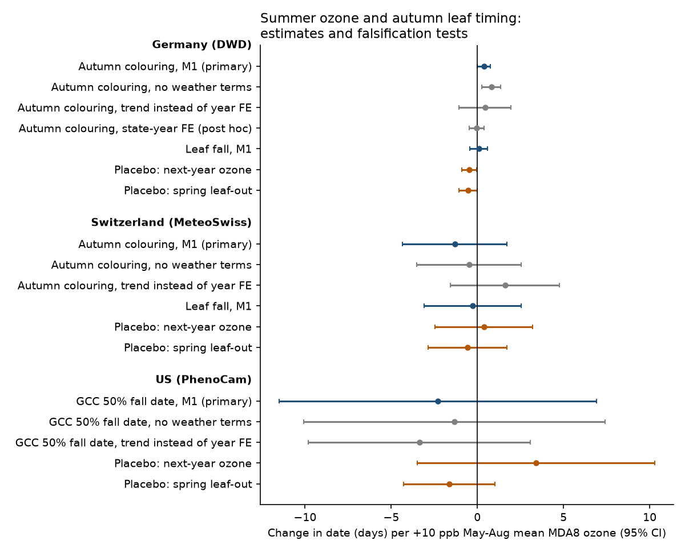
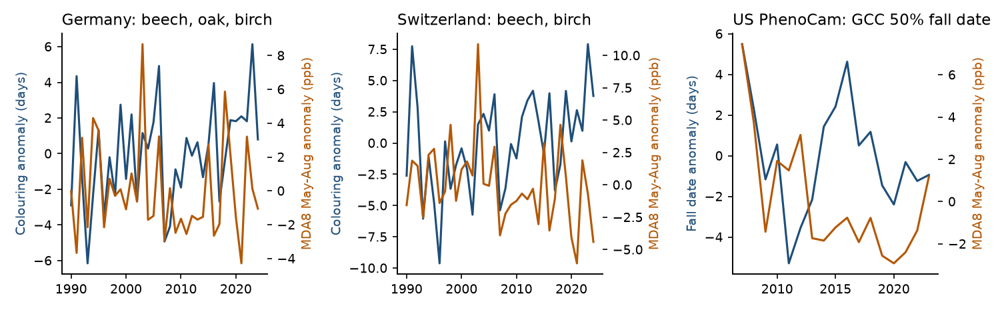
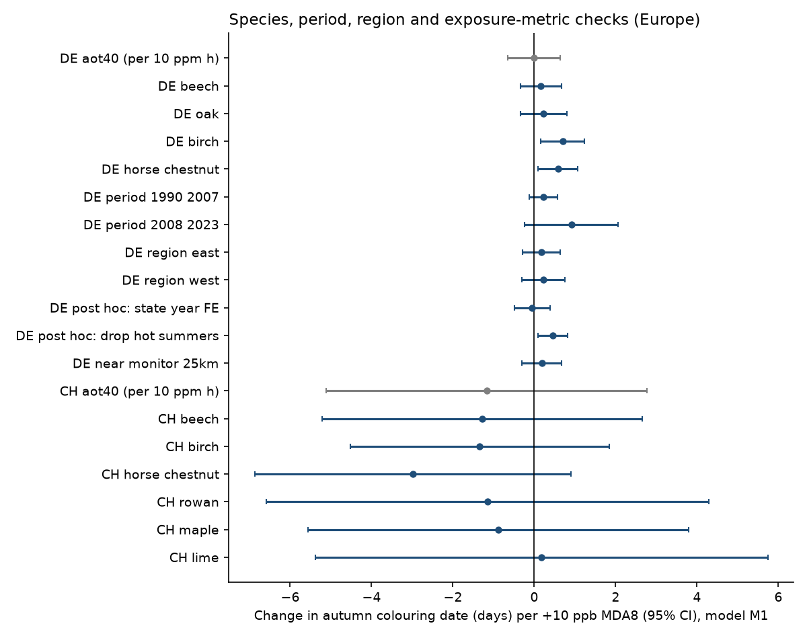

# Summer ozone did not make autumn leaf colouring or leaf fall clearly earlier in Germany (1990-2023), Switzerland (1990-2023) or at US PhenoCam sites (2007-2023) after weather control

**Job** sci-1107-hp-climate-pollution-biodiversity-ffbf529f1c5c · **Topic** climate-pollution-biodiversity ·
**Machine** hp (campaign 11_07_2026) · **Model** Claude Opus 5.5 (`claude-opus-5-5`) · **Date** 2026-11-09.
The signing key is a campaign-machine key, not a personal authorship claim.

## Question
Experiments show that raised ground-level ozone damages leaves of trees and can make leaf
senescence and leaf loss earlier (for example the meta-analysis of Wittig et al. 2009 and the
Aspen FACE synthesis of Karnosky et al. 2003). Does this effect appear in long-term field
observations of autumn leaf timing, after we control for heat, drought and radiation? These
weather terms also control ozone formation. We tested this question in three independent
observation systems:

* Germany: DWD volunteer observers, beech, pedunculate oak and silver birch, 1990-2023.
* Switzerland: MeteoSwiss observers, beech and birch, 1990-2023.
* Eastern and central US: PhenoCam canopy greenness cameras (no human observer), 2007-2023.

We wrote the analysis plan before we joined any phenology data to ozone
(`files/PLAN_preregistered.md`). The plan includes two falsification tests and a decision rule.

## Data and methods (short)
* **Ozone.** Hourly O3 at 432 German and 34 Swiss non-traffic, non-industrial EEA monitors
  (AirBase 1984-2012, e-Reporting 2013-2025). US: daily maximum 8-hour ozone (MDA8) at about
  1,200 EPA AQS monitors per year. The primary metric is the May-August mean MDA8 (ppb). The
  secondary European metric is AOT40, May-July (ppm h).
  An additive model (monitor offset + country-year effect) removes level differences between
  monitors, so that monitor openings and closures do not create false changes. The station
  exposure is the inverse-distance mean of the monitor anomalies within 50 km (US: 75 km).
  The median distance to the nearest monitor is 18 km (DE), 20 km (CH) and 12 km (US).
* **Phenology.** DWD phases 31 (autumn colouring), 32 (leaf fall) and 4 (leaf unfolding).
  MeteoSwiss leaf colouring 50%, leaf drop 50% and leaf unfolding 50%. PhenoCam V3 3-day
  `gcc_90` transition dates: the falling 50% date is the primary US response. We removed DWD
  quality flags 5, 7 and 8 and records more than 40 days from the station median (508 of
  700,144 records).
* **Weather.** E-OBS v31.0e (Europe): mean temperature May-July and August-October,
  climatic water balance April-August (precipitation minus Turc PET), mean radiation May-July.
  CPC (US): the same temperature windows and water balance with Hargreaves PET.
* **Primary model (M1).** Date = station-species fixed effect + species-year fixed effect +
  beta x ozone anomaly + weather terms. Standard errors are two-way clustered by station and year.
  Beta is in days per +10 ppb.
* **Falsification tests.** P1: spring leaf unfolding happens before most of the ozone season,
  so summer ozone must not "predict" it. P2: next-year summer ozone must not predict this autumn.

## Results



| Region, response | Beta, days per +10 ppb (95% CI) | Records (units) |
|---|---|---|
| **Germany, autumn colouring (primary)** | **+0.37 (-0.01, +0.76)** | 123,081 (7,129 station-species) |
| Germany, leaf fall | +0.08 (-0.43, +0.58) | 113,890 (6,756) |
| Germany, colouring, no weather terms | +0.81 (+0.27, +1.36) | 123,081 |
| Germany, colouring, AOT40 (per 10 ppm h) | -0.01 (-0.66, +0.64) | 122,857 |
| Germany, P1 placebo, leaf unfolding | -0.54 (-1.08, -0.00) | 130,686 (7,371) |
| Germany, P2 placebo, next-year ozone | -0.47 (-0.91, -0.03) | 122,865 |
| **Switzerland, autumn colouring (primary)** | **-1.31 (-4.34, +1.72)** | 5,462 (247) |
| Switzerland, leaf fall | -0.29 (-3.10, +2.52) | 5,301 (245) |
| Switzerland, P1 / P2 placebos | -0.57 (-2.85, +1.71) / +0.37 (-2.46, +3.21) | |
| **US PhenoCam, GCC 50% fall date (primary)** | **-2.30 (-11.51, +6.91)** | 280 site-years (32 sites) |
| US, P1 / P2 placebos | -1.64 (-4.28, +1.00) / +3.41 (-3.47, +10.29) | |

All 82 model estimates are in `files/results/estimates.csv`.

**Decision rule outcome.** The pre-specified rule required (a) a German colouring estimate below
zero with a 95% interval below zero, (b) the same sign in Switzerland and the US with at least
one interval below zero, and (c) placebo intervals that include zero or placebo values below half
of beta. Condition (a) failed: the German estimate is positive. Condition (b) failed: the Swiss
and US estimates are negative but their intervals include zero. Condition (c) failed in Germany:
both placebos have intervals below zero. **Thus the data do not support the hypothesis that
summer ozone makes autumn senescence earlier at these scales.**

**What the placebos tell us.** In Germany the two placebo exposures give estimates of about
-0.5 days per 10 ppb, and their intervals exclude zero. May-August ozone can hardly change leaf
unfolding, which occurs mostly in April and early May, and next-year ozone cannot change this autumn. So the design keeps residual
confounding or chance structure of about +/-0.5 days per 10 ppb. The German primary estimate
(+0.37) is inside this band. With a bias of this size, a true advance of more than about
0.6 days per 10 ppb in Germany is not compatible with the data. This statement assumes that
the bias is not larger than the placebo values.

**Size of the ozone variation that we can use.** After station and year fixed effects, the
ozone anomaly has a standard deviation of only 2.2 ppb in Germany, 1.4 ppb in Switzerland and
1.6 ppb in the US (`files/results/exposure_stats.csv`). The "per 10 ppb" scale is therefore an
extrapolation of about 5 standard deviations. Per 1 SD (2.2 ppb), the German primary estimate
is +0.08 days. The ozone anomaly correlates with May-July temperature (r = 0.54 after station
fixed effects, 0.27 after station and year fixed effects). Weather control changes the
German estimate from +0.81 to +0.37: hot summers have high ozone and also later colouring in
the raw data.



*Figure 2.* Yearly network means of the colouring date residual (after station-species means,
blue, no weather adjustment) and of the ozone anomaly (orange). High-ozone summers such as 2003
and 2018 do not have consistently early colouring.



**Checks (Germany, colouring, M1).** Beech +0.17 (-0.34, +0.67), oak +0.23 (-0.34, +0.80),
birch +0.70 (+0.15, +1.24), horse chestnut +0.58 (+0.09, +1.08). 1990-2007 +0.23 (-0.12, +0.57);
2008-2023 +0.91 (-0.24, +2.07). Former East German states +0.18 (-0.29, +0.64); West +0.22
(-0.31, +0.76). Nearest monitor within 25 km +0.18 (-0.31, +0.67). Linear species trends
instead of year effects +0.44 (-1.08, +1.96). No German species or subset has a negative
interval below zero. Post-hoc checks that were not in the plan: state-species-year fixed
effects -0.05 (-0.48, +0.38); without the six hottest summers (2003, 2006, 2015, 2018, 2019,
2022) +0.45 (+0.09, +0.82). In Switzerland five of six species have negative point estimates
(horse chestnut -2.99, interval -6.87 to +0.90; lime +0.18), and every interval includes zero.
("maple" in Switzerland is sycamore, *Acer pseudoplatanus*.) In the US,
the earlier 10% and 25% GCC decline thresholds give -4.12 (-11.13, +2.88) and -2.23
(-8.29, +3.84).

## Interpretation
Experiments compare charcoal-filtered air with ambient or raised ozone, a contrast of tens of
ppb. In the field, the usable year-to-year ozone contrast between nearby stations is about 2 ppb.
At this scale, observed autumn timing in Germany shows no ozone advance. The small positive
estimates are within the placebo band, so we do not interpret them as a delay caused by ozone.
The negative Swiss and US point estimates agree in sign with the experimental expectation, but
these samples are small and their intervals are wide. A clear test needs denser ozone exposure
(for example modelled hourly fields) or larger camera networks.

## Limitations
* Observational design. Ozone co-varies with heat and sunshine. Our weather terms are seasonal
  means from 0.25 deg (Europe) and 0.5 deg (US) grids, so residual confounding remains. The
  placebo tests show bias of about 0.5 days per 10 ppb in Germany.
* Exposure error. Monitors are 12-20 km from the median station, and monitor anomalies include
  local noise. Exposure error biases beta toward zero.
* Human observers (DWD, MeteoSwiss) change over time, and "autumn colouring" is a visual
  judgement. Station-species fixed effects absorb constant observer bias, not observer changes.
  The PhenoCam test has no human observer but only 32 sites with at least four years.
* Horse chestnut colouring in Europe is affected by the leaf miner *Cameraria ohridella*, which
  spread in the 1990s and 2000s. For this reason horse chestnut is not a primary species.
* The European models end in 2023 because E-OBS v31.0e radiation has no 2024 values.
* The AirBase files have no unit field; we use ug/m3 (see PROVENANCE.md for the check).

## Deviations from the plan
1. European years are 1990-2023, not 1991-2024 (radiation data end in 2023; we kept 1990).
2. Switzerland has no oak in the MeteoSwiss network; the Swiss primary set is beech and birch.
3. DWD has no autumn colouring for rowan, maple or lime and no autumn phases for maple and lime
   in the files that we used, so these secondary species are absent in Germany.
4. The US models use sites with at least four years. The US leaf-out placebo uses the rising
   50% GCC date and adds February-April temperature. The European leaf-out placebo also adds
   February-April temperature.
5. Post-hoc checks (state-year fixed effects; removal of hot summers) are marked as post hoc.

## Reproduce
From a folder that contains `datasets/` (the shared campaign store) and `work/`:

```
mkdir -p work/result && cp -r <this publication>/files work/result/
bash work/result/files/code/run_all.sh
```

`run_all.sh` downloads about 2 GB to `work/scratch` (EEA, DWD, AQS, CPC; `retrieve_data.sh`),
then runs the scripts in order. Python 3.12 with numpy, pandas, pyarrow, scipy, netCDF4 and
matplotlib. Run time on the loaded campaign host was about 1 hour, most of it for downloads.
`files/provenance/input_hashes.csv` lists SHA-256 values for all 1,112 raw inputs.
Shared datasets that we used in place: `eobs-v31.0e-{tg,rr,qq}-ens-mean-0.25deg`,
`meteoswiss-phenology-{previous,stations,parameters}-20261109`, 60 `phenocam-v3-*-db1000`
folders, and `noaa-psl-cpc-global-temp-tmin-{2007..2023}-20261109`.

## Files
* `files/PLAN_preregistered.md`: analysis plan written before outcome data were joined.
* `files/code/`: retrieval, processing, models (`common.py` has the fixed-effect estimator
  with two-way cluster-robust errors), figures and summaries.
* `files/results/estimates.csv`: all estimates; `sample_summary.csv`; `exposure_stats.csv`;
  `yearly_means_europe.csv`; `ozone_network_by_year_europe.csv`; `analysis_log.txt`.
* `files/provenance/`: input hashes and PhenoCam site acknowledgements.
* `files/PROVENANCE.md`, `files/NOTICE_EXTERNAL_DATA.md`: sources, licences and attribution.

## Related campaign work
This study extends campaign results on autumn leaf colouring and weather (19006f537b2c,
70b69f10765f), the SO2 and phenology study in East Germany (b6f27029ec22), and the
ozone-injury study of US bioindicator plants (268004a08eb3).
