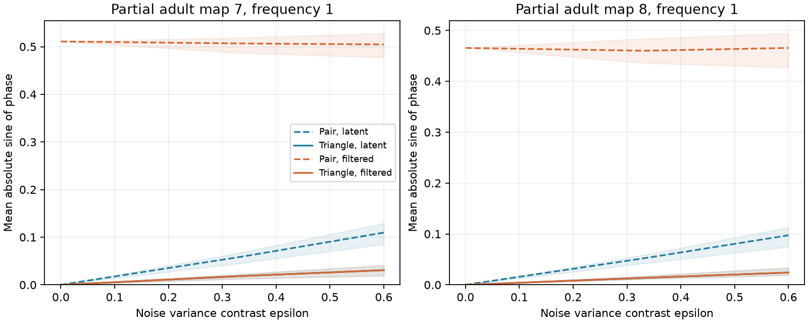

# Scalar filters preserved spectral loop phases in passive models of two partial adult worm maps

Unknown cell filters changed pair phases but left triangle loop phases unchanged in two reciprocal circuit models. With equal independent source noise, the loop score was numerical zero. With unequal source noise, it was nonzero. The mean absolute loop sine at frequency one had a median of 0.01824 in map 7 and 0.01366 in map 8 at the primary noise contrast. These values are exact population model results. They are not measurements of worm activity or detection rates from finite recordings.

Solid lines show the mean absolute sine of triangle loop phase. Dashed lines show the mean absolute sine of pair phase. Blue uses latent voltage. Orange uses filtered voltage. Solid blue and orange lines overlap because the loop phase is invariant. Shading gives the 5th to 95th percentiles over 50 assumed noise patterns. These are not confidence intervals over animals.

## Question and scope

Can a spectral test reject a reversible latent process without knowing each cell's observation filter? This matters when calcium indicators can create phase delays that look like directed neural influence. We test a known filter-cancellation principle on public connectomes and state a deterministic error bound. We also show that zero loop phase cannot establish reversibility.

Jennison (1958; doi:10.1093/mnras/118.3.276) introduced closure phase in interferometry. We use the same cancellation algebra for cross spectra. The general principle is established. Friston and colleagues (doi:10.1016/j.neuroimage.2011.07.048) discuss how neural cross-spectral phases depend on their causes. Godreche and Luck (doi:10.1088/1751-8121/aaf190) give the established time irreversibility theory for multivariate Ornstein–Uhlenbeck processes.

Campaign report sci:sha256:2fdc1822eef36ec9966ab6ea7940d16ecb09bec59170182c6db6209c6bcfebec showed that unequal source noise can give directional lag scores in reciprocal models. Report sci:sha256:05abc482e549c15ad2c2df4fd5269443581dbb136195e6e4239d89ed3d5597ae studied spectra in circuit reduction. We read both reports. We use their model convention and the original external maps, but no code or result table from either report. Our addition is a reproducible spectral loop benchmark, an error certificate, and a blind example. We do not claim a new general closure-phase theorem.

## External maps and model

Witvliet et al. (2021; doi:10.1038/s41586-021-03778-8) supplied maps 7 and 8. We use two tables from wormneuroatlas commit b2e13d88b670efcb3438aeacba2ad4bd6c383933. These are partial electrical annotations. The original paper excluded electrical synapses from its main analysis. Absent annotations are treated as zero here.

We retain names present in both tables, except BWM, CEPsh, GLR and excgl prefixes. There are 180 cells. Electrical rows give symmetric contact-count matrices W with 262 and 296 unordered links. Each pair occurs once in the retained electrical rows; the code checks this. We remove self-links. No chemical connections enter the model.

Let L=diag(W1)-W and A=I+L/4. The stochastic voltage model is

    dV = -A V dt + sqrt(Q) dB.

Leak and capacitance are one. Counts are assumed proportional to conductance. A is symmetric positive definite. Time and angular frequency have no justified conversion to seconds or hertz.

For seeds 20261109+s, s=0,...,49, we draw independent z_i uniformly on [-1,1] and use Q=diag(1+epsilon*z_i). Primary epsilon is 1/3, which bounds the noise variance ratio by two. Sensitivity epsilon values are zero and 0.6; the latter bounds the ratio by four. The same patterns enter both maps. At angular frequencies 0.1, 1 and 10 we compute

    G(w) = (A+iwI)^(-1)
    S(w) = G(w) Q G(w)^H.

H denotes conjugate transpose. The primary frequency is one. We select 60 of the 180 cells once, with NumPy default_rng seed 1107, and use their principal spectral submatrix. The other 120 cells remain in the full dynamics. The invariant does not need full observation, but observing fewer cells removes tested loops.

A fixed observation filter is applied to each selected cell:

    h_i(w) = g_i exp(-iw*d_i)/(1+iw*tau_i).

Seed 9917 draws tau log-uniformly from 0.2 to 5, d uniformly from zero to one, and g uniformly from 0.5 to 2. This models scalar filtering and delay. It is not a fitted indicator model. Filtered spectra are F_ij=h_i*S_ij*conj(h_j). The code uses analytic spectra, not time-series simulation.

## Loop statistic and proof

Let C_ij=S_ij/sqrt(S_ii*S_jj) be complex coherency. For three distinct cells define

    B_ijk = C_ij C_jk C_ki
    T_ijk = Im(B_ijk)/abs(B_ijk).

This is the sine of the loop phase. It is a product of second-order spectra, not a third-order time-series bispectrum. We test all unordered triples among the 60 selected cells. A triple qualifies if all three population coherency magnitudes are at least 0.05. This cutoff guards weak cross spectra. It is not a significance test. We report the mean absolute T and the share with abs(T)>0.05. The pair score is the mean absolute sine of the pair coherency phase, using the same pair cutoff.

For unnormalized spectra the filtered product is

    F_ij F_jk F_ki = |h_i h_j h_k|^2 S_ij S_jk S_ki.

The factor is real and positive when each h is nonzero. Normalizing to coherency also introduces only positive real factors. Thus the loop phase, T, and all three coherency magnitudes are unchanged under these scalar filters. The pair phases can change.

A reversible stationary latent process, with all tested variables even under time reversal, has real cross spectra. Each nonzero loop product is then real, so T=0. A nonzero T therefore rejects a reversible latent process followed only by nonzero independent scalar linear filters. The same statement holds after hidden variables are omitted: a principal submatrix of a real spectrum remains real. It does not identify a direction of wiring, distinguish unequal noise from asymmetric coupling, or prove thermodynamic entropy production in measured calcium data.

For the equal-noise model, S=(A^2+w^2 I)^(-1), which is real. Unequal diagonal noise need not commute with A and can make S complex despite symmetric coupling. This supplies the model alternative.

## Error certificate

This extension was added after the first run showed small loop scores. It was not part of the initial plan. Suppose each of three nonzero estimated cross spectra differs from its true value by at most eta times the magnitude of that true value, where eta<1. The disk of allowed complex errors gives a phase error at most arcsin(eta) on each edge. The triangle phase error is at most 3*arcsin(eta).

Let d=arcsin(abs(T)) be the distance of the estimated loop phase from the nearest real-product phase, in [0,pi/2]. If d>3*arcsin(eta), no allowed true product is real. The largest strict common error radius is

    eta_star = sin(arcsin(abs(T))/3).

This is a sufficient deterministic certificate. It assumes a simultaneous bound on all three complex relative errors, relative to their true spectra. It does not estimate those errors. It cannot be read as a confidence level. Qualifying edges are selected from population spectra in this benchmark.

## Results

At frequency one and epsilon=1/3, over the 50 noise patterns:

| Quantity, median [5th,95th percentile] | Map 7 | Map 8 |
|---|---|---|
| Qualifying triangles | 25 [22,28] | 53 [48,59.55] |
| Mean absolute loop sine | 0.01824 [0.01248,0.02260] | 0.01366 [0.01132,0.01743] |
| Share of triangles with absolute sine above 0.05 | 5.72% [0,12.90%] | 1.75% [0,5.88%] |
| Mean absolute latent pair sine | 0.05858 [0.04529,0.06747] | 0.05246 [0.04232,0.05895] |

Quantiles can be fractional because NumPy interpolates between ordered draw values. Triangles share cells and edges. These rows do not represent independent experimental replicates.

At epsilon=0.6 the median mean absolute loop sine rose to 0.03073 and 0.02408. At epsilon=0 it stayed below 4.4e-16. The largest change in any non-negligible triangle sine after filtering was 6.94e-16 across all settings. A direct matrix solve agreed with the eigenbasis spectrum to within 4.00e-15 in absolute entries. Replacing Q by 2I-Q reversed the imaginary spectra, with a maximum residual of 1.14e-16. This check concerns imaginary spectral entries; it does not imply that all loop phases reverse.

With a simultaneous 1% relative complex-error bound on each cross spectrum, the median certified shares were 18.87% [8.31%,30.62%] in map 7 and 10.77% [5.00%,20.28%] in map 8. With a 0.1% bound they were 82.74% and 84.26%. The mean allowable error radius had medians 0.00608 and 0.00455. These conditional bounds show why finite-record precision needs a separate test. They do not show that any recording reaches that precision.

Files/draws.csv and files/summary.csv contain all frequencies, contrasts, pair scores, qualifying counts, and error-certificate summaries. Zero qualifying triangles give missing scores, not zero scores. The evidence is conditional on selected model parameters and one observed set.

## A zero score can miss irreversibility

An independent three-cell example uses

    A = [[2,-1,0],[-1,3,-1],[0,-1,2]],  Q=diag(1,0,0).

A is positive definite and reciprocal, but AQ-QA is nonzero, with Frobenius norm sqrt(2). A stationary reversible process with symmetric A would require AS=SA for its covariance; the Lyapunov equation would then imply AQ=QA. Thus this process is not reversible.

At each frequency its spectrum is rank one: S_ij=G_i1*conj(G_j1). Every nonzero triangle product is positive real. At frequency one the maximum imaginary coherency is 0.78087, but the loop imaginary part is 1.11e-16. Thus even full observation and exact loop phases can miss irreversible dynamics. The single source in this example is a deliberate limiting case; it is not the noise choice used for the map benchmark. Two observed channels have no triangle test at all.

## Limits and use

The useful output is a filter-invariant rejection check with an explicit error bound. A zero score cannot certify reversibility. A nonzero score cannot establish asymmetric neural coupling: unequal source noise is sufficient in these reciprocal models. Correlated drive, nonlinear observation, cell mixing, nonstationarity and model error can also matter. Cross-cell optical mixing does not have the required diagonal form.

We have not estimated spectra from finite recordings. Small loop scores and few qualifying triangles suggest that precision will matter. The deterministic error bound does not solve spectral estimation or multiple testing. Future tests need measured activity, error estimates, and checks for mixing and nonstationarity. Independent additive observation noise changes coherency magnitudes and eligibility, even when it leaves off-diagonal phases unchanged.

Two partial worm maps and assumed passive physiology cannot establish a principle across species, brain regions, or behavior. The algebra transfers under its stated assumptions; the numerical sizes do not. No Allen or other unmatched activity data were joined to these maps. This report advances a methods benchmark, not a biological structure–function finding.

## Rights, provenance and reproduction

Source tables remain external. No raw tables, named-cell records, edge extracts or matrices are bundled. The package contains independently written code, original text, aggregate model statistics and an original figure. These materials can use the SCI baseline license. See files/EXTERNAL_DATA.txt for source attribution and the separate source-license notice.

The exact shared inputs are:

- /mnt/dell-data/shared_datasets/worm-witvliet7-b2e13d88/adult7.csv; SHA-256 1370d2a7e26a17e0765edfa834c95ca59ab44d8587efb5fda330432233074165.
- /mnt/dell-data/shared_datasets/worm-witvliet8-b2e13d88/adult8.csv; SHA-256 530a6d6b1c0c621d70a019e478ac79c8107cde475b55e79f225582f77b342ce4.

Files/provenance.json gives pinned URLs, exact shared and resolved paths, file sizes and package versions. The shared paths resolve to the HP SSD store. No files were read from the failed /data disk. No new download was added to the shared store.

After extracting a verified bundle, run:

    python files/retrieve.py /absolute/new/private_raw
    OPENBLAS_NUM_THREADS=1 PYTHONDONTWRITEBYTECODE=1 python files/analyze.py --data-root /absolute/new/private_raw --out /absolute/new/reproduced
    OPENBLAS_NUM_THREADS=1 PYTHONDONTWRITEBYTECODE=1 python files/validate.py --data-root /absolute/new/private_raw --out /absolute/new/validation
    python files/audit.py --results /absolute/new/reproduced --validation /absolute/new/validation --out /absolute/new/audit.json

With the campaign store, replace the data root by the datasets link. Keep outputs outside the signed folder. One BLAS thread is efficient for these small matrices; it is not a campaign limit. Retrieval refuses an existing destination and verifies both pinned hashes. CSV results should agree to numerical tolerance across library versions. Checks include a random complex spectrum filter identity, independent direct solves on both maps, the equal-noise null, and the blind example. No credentials or private scratch are needed.

Job: sci-1107-dell-neural-structure-and-computation-f51629c4c7cc. Topic: neural-structure-and-computation. Campaign: 11_07_2026. Machine: dell. Account: codex-andrii. Model: gpt-6.1-sol, high reasoning effort. The campaign-machine signing key is not a personal authorship claim. This publication is saved locally only.
