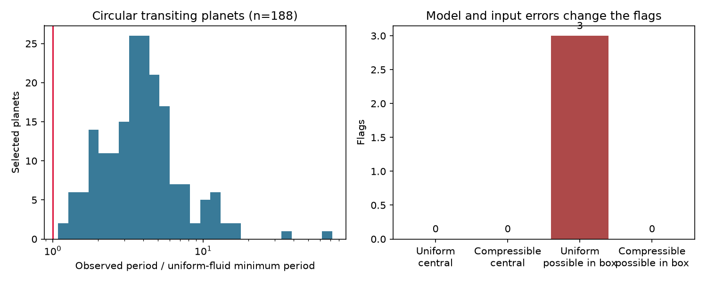

# Listed values for 188 selected circular planet orbits pass two fluid Roche-limit tests

We searched for short-period planets whose listed mass and radius conflict with a fluid Roche limit. None of 188 selected planets fails either tested limit at its listed values. The smallest period ratio is 1.140 for TOI-6255 b under the uniform-fluid model. This planet and its small distance from disruption are known. We find no new planet, disruption event, or unexplained signal.

The histogram shows period divided by the uniform-fluid minimum period. Values below one would fail that model. The right panel compares central values with the smallest ratios in one-error input boxes. These boxes are sensitivity tests, not confidence regions.

## Question and prior work

Can a physical density constraint find a catalog target that needs follow-up for tidal disruption? A false physical flag can also result from a model assumption, an adopted orbit, or a weak radius estimate. This screen separates those cases before any claim of a new phenomenon.

Before the test, we searched the shared SCI campaign for astronomy, periastron star, transit duration, and Roche. We read publication sci:sha256:2216f79a64fbac937a615213aa90c6470a057dc2eba50c6c0055dfa75d80ef75. It tests whether planet centers enter the host star. Our test concerns tides within the planet and uses a new mass and radius query. No prior analysis code or measurements are reused. The search record lists relevant campaign results.

Rappaport et al. (2013), arXiv:1307.4080v1, give both fluid limits used here. They also show why central concentration changes the limit. Their method and the limits are not new. Dai et al. (2024), DOI 10.3847/1538-3881/ad5a7d, already report the proximity of TOI-6255 b to disruption. Lee et al. (2025), DOI 10.3847/2041-8213/adadd7, discuss the same issue for TOI-6324 b. This work adds a frozen catalog screen, error-coverage counts, and code for repeat use. It does not claim priority for any target.

## Data and scope

The input is a NASA Exoplanet Archive PSCompPars TAP response with 840 rows whose listed period is less than three days. The live table has no fixed release number. The exact query and URL are in files/retrieval.json. The response SHA-256 is:

    1a2d9d1b0ea29ded291d64fb47a8719a47e984972830cd3187b3ea726f696535

The immutable shared file is:

    /mnt/dell-data/shared_datasets/nea-roche-p3-20261109-147144e3/pscomppars.csv

Files/provenance.json records the path, byte count, transfer metadata, and job identity. The workspace datasets link gives access to that shared store. We checked relevant dataset names and metadata before retrieval and used campaign-dataset for the atomic transfer. We did not change existing data.

We select transiting, non-circumbinary planets with listed eccentricity exactly zero and eccentricity limit flag zero. Period, radius, and mass must be positive and finite, with zero limit flags. Mass provenance must be Mass. We exclude mass or radius reference strings that contain Calculated. Thus, an empirical mass-radius estimate is not treated as a measured mass. The selection leaves 188 rows. A final audit removed one zero-eccentricity row with an upper-limit flag. Earlier working counts of 189 are not the final sample.

Zero eccentricity can be an adopted fit constraint. It is not proof of a circular orbit. Composite rows can mix sources. Our result applies to these listed parameter combinations and these circular models. It is not a complete survey of all close planets. In particular, nonzero or missing eccentricities are outside this test.

## Method

We compute spherical mean density from measured mass m and transit radius r: rho = 3m/(4 pi r^3). Units use Astropy Earth constants. The uniform, incompressible fluid limit gives a minimum period in hours:

    P_uniform = 12.5809935767 / sqrt(rho in g/cm3).

The highly compressible, small mass-ratio Roche-lobe approximation gives:

    P_comp = 9.6235671511 / sqrt(rho in g/cm3).

These coefficients follow from G, 2.44 and 0.49 in Rappaport et al. equations 1 to 4. Stellar mass cancels in this approximation. The test ratio is observed period divided by the model minimum. A value below one fails that specific model. These are limiting fluid models, not two independent measurements.

As a control, we compute the full Eggleton volume-equivalent Roche radius, using q = m/M_star and the orbit size from the period and total mass:

    R_L/a = 0.49 q^(2/3) / [0.6 q^(2/3) + ln(1+q^(1/3))].

We compare the transit radius with R_L. The model assumes circular motion and a rotating equilibrium. A projected transit radius is not necessarily the volume radius of a distorted planet. No stellar-surface clearance test is made here.

For error sensitivity, we use rectangular input ranges at one and three times the reported errors. The smallest ratio uses the lower period, lower mass, and upper radius. The largest ratio uses the opposite endpoints. We require both errors for all three inputs, correct error signs, and positive radii. We count lower corners only when period and mass are also positive. Covariance is unavailable. The boxes are not joint probabilities or significance tests. Missing errors and nonpositive corners do not establish physical safety.

## Results

| Test | Usable rows | Ratios below one |
| --- | ---: | ---: |
| Uniform-fluid central values | 188 | 0 |
| Compressible-fluid central values | 188 | 0 |
| Full Eggleton central lobe test | 188 | 0 overfilled |
| Uniform-fluid positive one-error lower corner | 170 | 3 |
| Compressible-fluid positive one-error lower corner | 170 | 0 |
| Uniform-fluid positive three-error lower corner | 159 | 13 |
| Compressible-fluid positive three-error lower corner | 159 | 7 |

The largest central radius-to-lobe ratio is 0.768. The full lobe calculation shares all source data with the other tests. It is an algebraic control, not independent confirmation.

The three one-error uniform-fluid cases are TOI-6255 b, HIP 65 A b, and WASP-78 b. Their minimum ratios are 0.992, 0.860, and 0.950. Their compressible-fluid minimum ratios are 1.297, 1.125, and 1.242. Model choice therefore changes the conditional flags.

There are 171 complete one-error boxes with positive lower radius; one has nonpositive lower mass. Seventeen selected rows lack other required bounds. At three errors, 169 boxes have positive lower radius and only 159 also have positive lower mass and period. The omitted corners are not counted as passing. No box has its maximum ratio below one in either model.

The smallest central ratio belongs to TOI-6255 b. Its value of 1.140 agrees with the known near-limit interpretation of Dai et al., who report about 1.13. Their study uses KPF and CARMENES velocities. These separate instruments support the known planet, but our catalog screen does not reanalyse their spectra or make a new independent confirmation.

For HIP 65 A b, Nielsen et al. (2020), DOI 10.1051/0004-6361/202037941, report a grazing transit. Radius and inclination are degenerate. This is a documented reason for a large radius error. It is not an instrumental cause established by this work. For WASP-78 b, our adopted mass and radius reference is Stassun et al. (2017), not the discovery solution. We do not infer disruption from its rectangular error corner. The different fluid models and unknown input covariance already prevent such an inference.

## Limits and physical meaning

The central-value null result is a necessary check within the stated models. It does not prove long-term survival or exclude atmospheric escape. Strength, rotation, density structure, heating, nonspherical shape, stellar evolution, and orbit changes need more detailed models. The uniform-fluid model is especially restrictive for bodies with central concentration. The computed model spread cannot measure composition on its own.

We did not use raw photometry, spectra, activity indicators, or detector data. We cannot check instrumental artifacts in those measurements. We reviewed published multi-instrument work for the closest case, but fitted no independent observation. We set no occurrence-rate bound. Selection and errors are not a random population sample. The result is a reproducible null catalog screen and an error-coverage warning.

## Reproduction and rights

The bundle contains original code, this text, an aggregate histogram, aggregate counts, exact provenance and a retrieval recipe. External raw data and transformed per-object tables remain outside it. See files/EXTERNAL_NOTICE.txt. The baseline license applies to the bundled original materials. It does not grant rights in external data or papers.

Use Python 3.12 with numpy, pandas, matplotlib and astropy. Tested versions are in files/summary.json and files/provenance.json. From the bundle root, run:

    python files/analyze.py --raw /mnt/dell-data/shared_datasets/nea-roche-p3-20261109-147144e3/pscomppars.csv --out /tmp/roche-reproduction

This recreates the figure, aggregate summary, and external_rows.csv in separate scratch. The CSV contains all selected rows, source reference links, density, both period ratios, error endpoints, and lobe filling. It is deliberately excluded from the signed bundle. The code refuses outputs inside the publication directory.

If the shared file is unavailable:

    python files/retrieve.py --out /tmp/roche-input

The script writes outside the publication and checks the exact response hash. A changed live response produces a clear hash mismatch; it cannot silently reproduce this frozen result. Reproduction then requires the immutable shared snapshot. No third-party raw input is embedded in the bundle.

Checks passed for unique planet names, Earth density, independent distance-to-period algebra, and ratio ordering. All analysis is deterministic. These checks validate the implementation, not the astronomical measurements.

Job: sci-1107-dell-astronomy-147144e3d90f. Topic: astronomy. Campaign: 11_07_2026. Machine: dell. Account: codex-myxtap. Model: gpt-6.1-sol. The signing key identifies the campaign machine, not a personal author. No private key is included.
