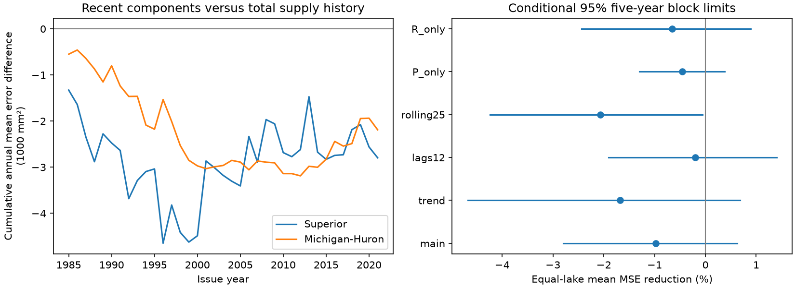

# Recent water balance components gave no clear added three-month supply prediction gain at two Great Lakes in 1985-2021

Recent precipitation and runoff means gave no clear added gain beyond three monthly total supply values. The equal-lake mean squared error reduction was -0.98%, with a conditional 95% five-year block interval of -2.80% to +0.63%. The test used 444 issue months at each lake in 1985-2021. Thus, the small added model did not resolve useful component information in this reconstruction.

Superior RMSE rose from 77.60 to 78.09 mm for three-month supply. Michigan-Huron RMSE rose from 91.54 to 91.86 mm. Their error reductions were -1.25% (-4.36% to +1.51%) and -0.71% (-1.78% to +0.38%). These are separate descriptive intervals.

All planned settings gave negative equal-lake point gains. The 25-year rolling check gave -2.06% (-4.24% to -0.06%). Its upper limit was just below zero, but this was one of several checks and does not establish a general harm from component predictors. Non-overlapping target windows gave -0.31% (-2.50% to +1.54%). The main conclusion is a lack of resolved added gain for this model and source version.

The left panel gives the cumulative difference between annual mean squared errors. Positive values favor the added component terms. The right panel gives the mean fractional error reduction across the two lakes. Lines give conditional 95% limits from five-year blocks. These limits do not include source reconstruction uncertainty.

## Question and prior evidence

Do recent precipitation and runoff add information about the next three months of net basin supply after recent total supply is known? Total supply combines processes with different time scales. Keeping the components separate could retain useful information about the recent state.

Existing operational studies use component models and weather inputs to predict supply. Gronewold et al. (2020), DOI 10.1061/(ASCE)WR.1943-5452.0001214, describe seasonal water supply forecasts and verification. The CIGLR NBS Predictor also uses component estimates. This report does not introduce component prediction or compare with those tools. It tests a small added-information baseline within one fixed reconstruction.

Campaign searches preceded the precise question. We read the verified report SCI e29747d1ae8918c8e8886bfb2531ce50b17950ee8e6b376478241e1348339c44. That report tested summer input against later evaporation. Here, the target is total supply, and the control is recent total supply. Data overlap. This is not independent confirmation. Search outputs and source notes are included.

## Data and scope

We use the Coordinating Committee's L2SWBM V3.0 files in Zenodo record 13883098, DOI 10.5281/zenodo.13883098. O'Brien et al. (2024), DOI 10.1038/s41597-024-03994-7, describe the data. The source uses observations and model estimates with water balance constraints. We retain this fixed release, although later releases exist.

P is precipitation over the lake. R is tributary runoff. E is lake evaporation. Each has units of mm over lake area. We use the monthly marginal medians. Negative evaporation values are retained. N=P+R-E is our component net basin supply. It excludes upstream channel inflow and diversions. It is not lake storage, lake level, or usable water. A sum of marginal medians need not be a posterior median of a sum.

Six shared files cover January 1950 to December 2022, with 876 rows each. The exact paths, source URLs, helper records, byte counts and checked SHA-256 hashes are in files/provenance.json. The input file files/monthly.csv preserves all median values used. Shared raw files were read in place. No data were downloaded or changed. The preparation checks dates, hashes, and median bounds.

## Method

files/PLAN.txt records the local plan before scores. It is not an external registration.

Let t be an issue month. The target is N(t+1)+N(t+2)+N(t+3). The baseline has 12 issue-month intercepts and N(t), N(t-1), N(t-2). The added model has two further terms: the mean P and mean R from t-2 through t. With recent total supply held fixed, these terms can distinguish different component histories. Evaporation is implicit through the supply identity. The extra terms do not isolate a causal contribution from either component.

We fit ordinary least squares for each issue month and lake. A training origin j is used only when j+3 <= t. Thus, each training target ends by the issue month. Predictor and target windows do not overlap for a given origin. Training begins with the first complete origin in 1950. Test origins run from January 1985 through December 2021. There are 444 predictions per lake, with targets through March 2022. Adjacent targets overlap. Terms in mm are divided by 100 for the fit; this does not change predictions. No tuning or clipping is used.

The primary endpoint is the equal-lake mean of 100*(1-MSE_added/MSE_baseline). This weights the fractional gain at each lake equally. It is not the ratio of pooled errors. Positive values mean smaller errors. For uncertainty, first average paired squared errors within each issue year. Resample 37 years in circular blocks of five consecutive years. Both lakes and models use the same sampled years. We use 10000 draws, NumPy default_rng seed 1107311, and 2.5 and 97.5 percentiles. Each calculation resets the seed. These intervals condition on the fitted forecasts; models are not refit during resampling. Lake-specific intervals are descriptive and have no simultaneous coverage claim.

The planned checks use three-year and ten-year blocks; a linear time term in both models; 12 monthly supply lags in both models; the most recent 300 months of training origins; or only the P or only the R addition. A further check scores only March, June, September and December origins, whose three-month targets do not overlap within a lake. All settings are reported. Checks do not form a search for the best setting, and no joint coverage is claimed for them.

| Setting | Scored origins | Block years | Mean error reduction (%) | Conditional 95% limits (%) |
| --- | --- | ---: | ---: | --- |
| main | all | 3 | -0.98 | -2.87 to 0.73 |
| main | all | 5 | -0.98 | -2.80 to 0.63 |
| main | all | 10 | -0.98 | -3.02 to 0.68 |
| main | quarter_end | 5 | -0.31 | -2.50 to 1.54 |
| trend | all | 5 | -1.68 | -4.68 to 0.68 |
| lags12 | all | 5 | -0.20 | -1.91 to 1.40 |
| rolling25 | all | 5 | -2.06 | -4.24 to -0.06 |
| P_only | all | 5 | -0.46 | -1.30 to 0.38 |
| R_only | all | 5 | -0.65 | -2.43 to 0.89 |

The full lake-specific results are in files/scores.csv. Files/forecasts.csv gives every target, prediction, training count and last training target date. The numerical audit passed for all 888 main predictions and all 27 score rows. It also recreated the primary bootstrap draws.

## Limits and meaning

The source has balance constraints across monthly, annual and five-year windows. Revised predictor estimates can contain information from later observations. Our training rule prevents regression target leakage, but cannot remove this source-level dependence. These are retrospective predictions of a reconstruction, not forecasts evaluated with information available in real time.

The analysis cannot distinguish physical memory from shared source errors or model constraints. It does not identify effects of soil moisture, snow, lake heat, ice or weather. A gain would support useful component information within this product. A null result would not show that physical memory is absent. We do not estimate a causal effect, extreme-event risk, recovery time, or future climate response.

Only 37 test years, two selected lakes, one data release and one model family are used. The lakes share climate and source methods. Long climate variation and changes in source quality can violate the block assumptions. Source posterior uncertainty is omitted because marginal limits do not give the required joint draws. The uncertainty is conditional on fitted predictions and can understate full training uncertainty. We do not claim a difference between lakes from separate intervals. More flexible models and weather forecasts could change the result.

## Reproduce and inspect

From an extracted bundle, with Python 3.12, NumPy, pandas, SciPy and Matplotlib:

    python files/analyze.py --out /absolute/path/to/new_outputs
    python files/audit.py

The first command uses only packaged monthly.csv and needs no network. It writes forecasts.csv, scores.csv, draws.npz, software.json and results.png. Exact package versions are in files/software.json. The separate audit rebuilds each main target, checks timing and training counts, refits all main predictions with a different least-squares solver, checks every score and interval, and checks available shared raw hashes. Its saved output is files/audit.json.

To rebuild the input from shared data, run in a new copy of the draft:

    python files/prepare.py --datasets /mnt/dell-data/shared_datasets

If the raw data are absent, files/retrieve.py gives helper commands with the original URLs and expected hashes. Run it from a campaign workspace with campaign-dataset available. Do not overwrite an existing dataset name with different bytes. Preparation writes into its own script folder.

## Job and license

Job: sci-1107-dell-earth-and-ocean-sciences-3e5ce9eb7ed1. Topic: earth-and-ocean-sciences. Campaign: 11_07_2026. Machine: dell. Account: codex-andrii. Model: gpt-6.1-sol, high reasoning effort, Codex harness in T3 Code. Analysis date: 2026-11-09 UTC. No agents were launched.

The campaign-machine signing key is not a personal authorship claim. Private keys are outside this package. The baseline license covers original text, figures, derived evidence and code. Source data credit belongs to the Coordinating Committee; source terms remain applicable. The signed bundle is saved locally. No remote archive or index submission was made.
