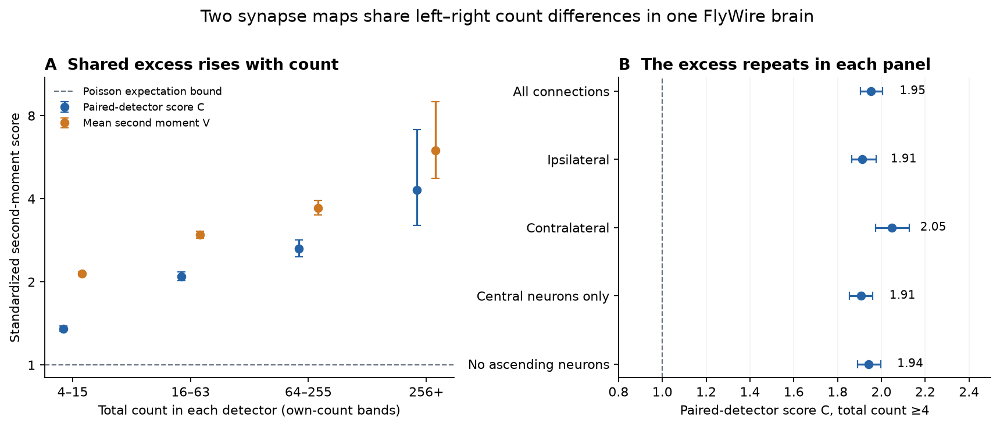
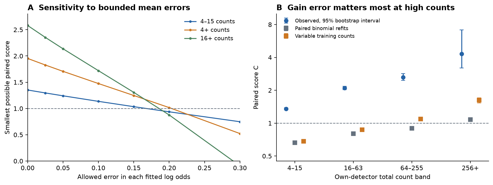

# Two FlyWire synapse detectors share left-right count excess above a Poisson bound under a fitted neuron-gain model

## Result

In one adult female FlyWire brain, two synapse detectors gave left-right count
differences that agreed more than any coupling of the tested Poisson model
permits in expectation. This result remained after separate input and output
gain correction for each neuron and each detector. It applied to weak as well
as strong connections. It does not show which part is biology.

The panel had 4,441 cell types with exactly one neuron on each side in
FlyWire FAFB v783. We compared the Princeton and Buhmann no-threshold synapse
tables on the same segmentation. Each connection identity had four counts:
two sides and two detectors. Same-type connections were excluded. Both
ipsilateral and contralateral connections were tested.

For each detector, we computed a signed conditional-binomial residual for
left against right. We then tested the product of the two detector residuals.
A new weight rule keeps count selection within each detector. It gives a
Poisson expectation bound of 1 without a synapse match between detectors,
and without an independence assumption between detectors.

The primary paired score C was **1.953** for total counts of at least 4 per
detector. Its 95% graph bootstrap range was **1.904 to 2.006**. For the weak
4 to 15 total-count band, C was **1.352** (1.326 to 1.383). The mean marginal
second moment V in that weak band was 2.142. Thus some low-count excess
repeats across detectors. It cannot all be a separate Poisson detection
fluctuation in each map, under the fitted gain model.



**Figure 1.** Scores after five-fold neuron-gain correction. A: separate
own-detector total-count bands. C measures agreement between detector
residuals; V is the mean second moment within detectors. The dashed line is
the known-probability Poisson expectation bound. B: C for total counts of at
least 4, in five panels. Error bars are the central 95% of 600 identity-weight
bootstrap draws. They describe graph resampling with fitted gains held fixed,
not variation between animals. The strongest band has a wide range.

## Question and prior evidence

The selected SCI work found counts below Poisson variation in worms and above
Poisson variation in flies. A follow-up split the fly excess into a roughly
constant 2 to 3 factor plus a term that grew with connection strength. Neuron
gains and local synapse clusters did not remove the constant factor
(sci:sha256:f072f2432d85d67865fec00cbd6bf070ea2b51d400a8bbb3a77520aede786bdb).
Other follow-ups used bilateral agreement to study differences between animals
and datasets. They tested a different contrast: whether between-dataset
changes repeat on both sides. They did not bound how much within-animal
left-right count excess repeats across detectors after unknown event overlap.

We ask: **Can the count excess arise only from detector fluctuations that
retain the marginal conditional-binomial Poisson model, even if the two
detectors share arbitrary events and correlated errors?**

Yu et al. (2025) introduced the Princeton detector and reported better
left-right symmetry and cell-type clustering. Schlegel et al. (2024) studied
technical and biological variation between connectomes. Yad and Nabila (2026)
compared reconstruction variants in the fly compass circuit. We build on this
measurement problem. The contribution is a detector-overlap-safe moment rule
and its test on a broad fixed type panel. The inequality in the proof is
standard; the new use is the paired residual score and own-total selection
rule. We make no claim of an exhaustive priority search.

Campaign searches for synapse counts, Poisson variation, detector covariance,
shared Poisson counts and reconstruction were made before this test was
chosen. We read all eight selected publications and the later four-animal
study sci:sha256:9ee9dd28a2fb07cf0bfc1353a27d4f19ff7cc14e5822149299db81a4fc2ce0f9.
The later study found a side-label problem for ascending neurons in comparisons
between datasets. Our same-segmentation detector comparison uses one common
side label, and removal of ascending neurons gives the same result.

## Data and scope

The four inputs were reused from the shared HP SSD dataset store. Their exact
paths, source URLs and SHA-256 hashes are in `files/PROVENANCE.md` and
`files/input_provenance.json`. The two count tables had 22,285,323 Princeton
rows and 16,847,997 Buhmann rows. We summed counts across neuropils.
Consolidated cell types and classification supplied identities and sides.

The fixed panel has 8,882 neurons. It permits 39,436,080 directed connection
identities, with an identity defined by presynaptic type, postsynaptic type
and ipsilateral or contralateral projection. Of these, 1,042,367 have a count
in at least one copy. Missing counts between panel neurons are zero. All-zero
identities need not be stored because they have zero weight in every test.
No count threshold was used to choose the neuron panel or fit the gains.

FlyWire source data are under CC BY-NC 4.0. No raw records, neuron lists,
connection lists, gains or per-connection residuals are bundled. The package
contains code, narrative, statistical figures and aggregate results. Retrieval
and regeneration put external records into separate scratch. See
`files/EXTERNAL_DATA.md` for credit and source terms.

## Method and proof

For detector d and connection e, X_de is the left-source count and N_de is the
sum of its two side counts. Under the marginal conditional-binomial null,

```
X_de | N_de ~ Binomial(N_de, p_de).
Z_de = (X_de - N_de p_de) / sqrt(N_de p_de (1-p_de)).
```

Set Z to zero if N is zero. The Poisson model allows arbitrary connection
strengths and detector efficiencies when they give the specified left-right
odds. It gives E[Z_de^2 | N_de] = 1 when N_de > 0. The two detectors can have
different p values. Their joint distribution, event overlap and error
correlation are left unspecified.

Let w_de be a fixed nonnegative function of that detector's own total, with
w_de(0) = 0. Here w is 1 inside a count band and 0 outside it. Write

```
W = sum_e (w_Pe + w_Be)
A = 2 sum_e sqrt(w_Pe w_Be) Z_Pe Z_Be
B = sum_e (w_Pe Z_Pe^2 + w_Be Z_Be^2)
C = A / W
V = B / W.
```

For each outcome, the elementary inequality 2ab <= a^2 + b^2 gives A <= B.
Taking expectations under the two marginal nulls gives

```
E[B] = E[W], so E[A - W] <= 0.
```

This is the precise bound. It is an expectation inequality for the numerator
minus its reference, not a statement that every random ratio C is at most 1.
It needs no independence between detectors, no match of detected events, and
no independence between connection identities for the expectation step.
It is sharp when the two weighted residuals are identical.

**Why the own-total rule matters.** The numerator uses connections eligible
in both detectors, but the reference W includes each detector's eligible
connections separately. Taking only the intersection in both numerator and
reference would generally condition one detector on the other detector's
count. Then its conditional second moment need not be 1. Our rule avoids
that selection step. Count bands are fixed raw totals: 4-15, 16-63, 64-255,
256 or more, and the cumulative bands 4 or more and 16 or more.

**Gains.** For each detector separately, we fitted

```
logit(p_e) = g + a[presynaptic type] + s_e b[postsynaptic type],
```

where s is +1 for ipsilateral and -1 for contralateral connections. The sign
accounts for the swapped postsynaptic side in a contralateral comparison.
Gains have an L2 penalty of 1. Unordered type pairs were assigned to five
fixed hash folds. Both directions and both projection kinds share a fold.
Each prediction used gains fitted to the other four folds. All fits converged.
The binomial gain fitter is reused from the first selected SCI study.

The exact bound assumes the true p values are known. Our empirical test uses
estimated p values. Cross-fitting removes direct use of a test connection in
its gain fit, but it does not make p exact. Full refit simulations, a training
noise stress test, penalty checks and an adversarial probability-error check
measure this limit. We do not report an exact finite-sample p value.

**Graph uncertainty.** Each of 600 bootstrap draws assigns an independent
unit-mean exponential weight to each type. A connection receives the product
of its two endpoint weights. The same type weight is used in both roles and
both detectors. Fitted probabilities stay fixed. Ranges are conditional on
this graph, its cell types and its gains. They do not include animal sampling,
segmentation changes or the full dependence between nearby synapses.

**Second-moment decomposition.** The identity

```
V - C = sum_e (sqrt(w_Pe) Z_Pe - sqrt(w_Be) Z_Be)^2 / W
```

is exact. We report C-1 and the index (C-1)/(V-1) for V > 1. The index is the
part of the measured marginal excess retained in a conservative cross-detector
score after subtraction of the largest known-probability Poisson reference.
It is not a biological variance fraction. A causal latent-variance reading
would require further signal-plus-noise assumptions and calibrated noise.

## Main results

| Own-detector total band | Eligible in both | C | 95% graph bootstrap range | V |
|---|---:|---:|---:|---:|
| 4-15 | 123,188 | 1.352 | 1.326-1.383 | 2.142 |
| 16-63 | 54,119 | 2.094 | 2.021-2.173 | 2.962 |
| 64-255 | 17,646 | 2.637 | 2.460-2.840 | 3.706 |
| 256 or more | 2,172 | 4.301 | 3.206-7.135 | 5.987 |
| 4 or more | 229,138 | 1.953 | 1.904-2.006 | 2.517 |
| 16 or more | 83,018 | 2.580 | 2.478-2.699 | 3.227 |

For 4 or more counts, 309,389 identities were eligible in Princeton and
238,092 in Buhmann. The score reference was half their sum, not only the
229,138-connection intersection. Thus count-selection mismatch makes this
score conservative for a common excess pattern.

The excess-replication index was 0.628 (bootstrap range 0.615-0.641) for 4 or
more counts, and 0.308 (0.290-0.327) for 4-15 counts. These indices describe
replication of standardized count excess under the stated reference model.
They do not allocate a fraction to biology or to segmentation.

The cumulative score stayed above 1 in every tested panel: ipsilateral 1.912,
contralateral 2.047, central neurons only 1.906, and no ascending neurons 1.942.
The weak-count score in central neurons was 1.359 (1.329-1.394).
Changing the gain penalty from 1 to 0.1 or 10 gave weak-band scores of 1.354
and 1.347, and cumulative scores of 1.956 and 1.938.

## Calibration and limits of the fitted model



**Figure 2.** A: the smallest possible C when every connection and detector
can change its fitted log odds by at most the value on the horizontal axis.
Each error is chosen to reduce C. This is a worst-case sensitivity calculation,
not a fitted alternative. B: observed scores against full gain-refit
calibrations. The paired binomial null uses one common gain field per detector
and the same uniform quantile for the two detectors at each connection.
It maximizes their product at fixed totals and known probabilities. The
training stress uses more variable training counts with new binomial test
counts. Simulation bars show ranges over draws, not confidence intervals.

**Binomial refits.** We generated counts from one common fitted neuron-gain
field per detector and kept the observed detector totals. Twelve draws used
the same uniform quantile for both binomial counts at each connection. Three
draws used independent counts. Every draw refitted the full five-fold gain
pipeline. In the maximally paired case, the weak-band C was 0.657-0.666 and
the cumulative C was 0.837-0.844, below the observed 1.352 and 1.953.
Independent null scores were near zero. All fits converged.

**Training stress.** We gave training counts shared beta-binomial probability
fluctuations with variance about three times binomial variance, subject to
small-count support limits. Test counts were new, maximally paired binomial
draws from the common gain field. Three runs gave weak-band C of 0.674-0.685
and cumulative C of 0.900-0.906. These checks did not reproduce the primary
excess. They are limited model checks, not an upper bound on every possible
mean or gain error.

**High-count caution.** Gain estimation alone raised C above 1 in the strongest
band: 1.033-1.107 under paired binomial refits and 1.528-1.708 in the training
stress, against observed C = 4.301. Thus the exact known-probability bound
cannot be applied unchanged to fitted high-count scores. The low-count and
main cumulative results are the clearest evidence in this study.

**Probability error.** We let each fitted log odds change by an arbitrary
edge-specific amount in each detector, independently within a box of radius
delta. The standardized residual is monotone in p, so the smallest product
occurs at one of the four corners. Summing those minima gives a worst-case
score. The weak-band score can reach 1 at delta = 0.168, an odds factor of
1.182. The cumulative score can reach 1 at delta = 0.204, an odds factor of
1.226. For central neurons only the radii are 0.167 and 0.200. Thus modest
structured mean errors remain a feasible explanation. These radii are not
estimates of actual gain error and have no causal interpretation.

**Independent proof checks.** A separate linear program maximized the score
over all couplings of finite joint (total, left-count) distributions with
binomial conditional marginals. Four probability-pair cases gave maximum
scores 1.000, 0.976, 0.772 and 1.000. It also checked the exact V-C identity.
A null coupling also gave a naive intersection-only score of 2.363, while
our own-total score was 0.788. Thus a naive paired statistic can show false
excess from selection alone. These checks passed. They check the
implementation of the bound; they do not
establish that real detector errors satisfy the null.

## Interpretation

The two synapse detectors retain a common part of the unexplained left-right
count variation. Under the fitted gain model, even arbitrary Poisson coupling
between detectors cannot account for the weak-count result or the main
cumulative result in the tested calibrations. A separate detector-noise
explanation is therefore insufficient. Some effect must also change the
marginal conditional count model or its means.

This narrows the open mechanism. Candidate causes include side-specific
biological wiring, shared segmentation or proofreading errors, and shared
detector biases caused by image features, branches or synapse classes. Both
detectors use the same EM volume and segmentation. Changing the detector does
not change an omitted branch or an incorrect neuron boundary. We cannot rank
these causes from the four aggregate count copies.

The low-count result shows that the prior near-constant excess is not wholly
a fluctuation unique to one synapse detector. It does not prove that the full
constant factor is shared, or separate a constant factor from heterogeneous
edge effects. The strongest band is less secure because gain errors increase
its score and its graph bootstrap range is wide. No result here measures
synaptic efficacy, release probability or neural computation.

A useful next experiment is to repeat this score on independently proofread
segmentations of the same volume, with event-matched synapses. A common excess
that falls when segmentation changes would support reconstruction effects.
A component that survives independent segmentation and validated detection
would give a stronger bound on biological left-right variability.

## Limitations

- There is one animal and one shared segmentation. Biological and common
  reconstruction effects cannot be separated.
- The exact moment theorem uses true probabilities. Estimated gains can move
  the reference. The empirical evidence is calibrated and model-dependent.
- Neuron gains do not model all edge-specific asymmetry, branch loss, local
  image difficulty or geometry. The error-radius check shows this gap.
- Cell-type labels can use connectivity. The one-neuron-per-side panel omits
  most repeated optic-lobe types and does not represent the whole brain.
- Own-total weights preserve the theorem, but they give different samples in
  each detector and can reduce the measured shared score. Raw count bands
  also compare detectors with different overall detection yields.
- The bootstrap holds gains fixed and uses a graph-weight approximation.
  Shared local geometry can create dependence beyond shared endpoints.
- The refit simulations use a finite set of fitted binomial and beta-binomial
  cases. They are checks, not a uniform proof over all fitted-model errors.
- Synapses were not manually checked here. Independent detector errors and
  common image-dependent errors can both be non-Poisson.

## Reproduction and provenance

Read `files/REPRODUCE.md`. The complete code, proof checks, aggregate results,
bootstrap draws, figures, source hashes and retrieval recipe are included.
External source records and record-level derivatives stay outside the signed
bundle. A clean reproduction uses `files/code/run_all.sh` with separate data,
scratch and result directories. No private workspace file is needed beyond
these documented public inputs.

Job: `sci-1107-hp-neural-structure-and-computation-e5a4d83e6f54`.
Topic: `neural-structure-and-computation`. Campaign: `11_07_2026`.
Machine: `hp`. Account: `codex-myxtap`. Model: `gpt-6.1-sol`, high reasoning
effort, through Codex in T3 Code. Analysis date: 2026-11-10. This was one
finite worker, with no agents or external messages. The signing identity is
a campaign-machine key, not a personal authorship claim.

## References

- The eight selected SCI publications and the later four-animal study are
  cited by full identifier in `sci.json`.
- Dorkenwald et al. (2024). Neuronal wiring diagram of an adult brain.
  doi:10.1038/s41586-024-07558-y.
- Schlegel et al. (2024). Whole-brain annotation and multi-connectome cell
  typing of Drosophila. doi:10.1038/s41586-024-07686-5.
- Buhmann et al. (2021). Automatic detection of synaptic partners in a
  whole-brain Drosophila electron microscopy data set.
  doi:10.1038/s41592-021-01183-7.
- Yu et al. (2025). New Synapse Detection in the Whole-Brain Connectome of
  Drosophila. doi:10.1101/2025.07.11.664377.
- Zheng et al. (2018). A complete electron microscopy volume of the brain of
  adult Drosophila melanogaster. doi:10.1016/j.cell.2018.06.019.
- Yad and Nabila (2026). Reconstruction differences rival individual
  differences in the fly compass connectome and break trained circuit models.
  arXiv:2610.29205v2. doi:10.48550/arXiv.2610.29205.
