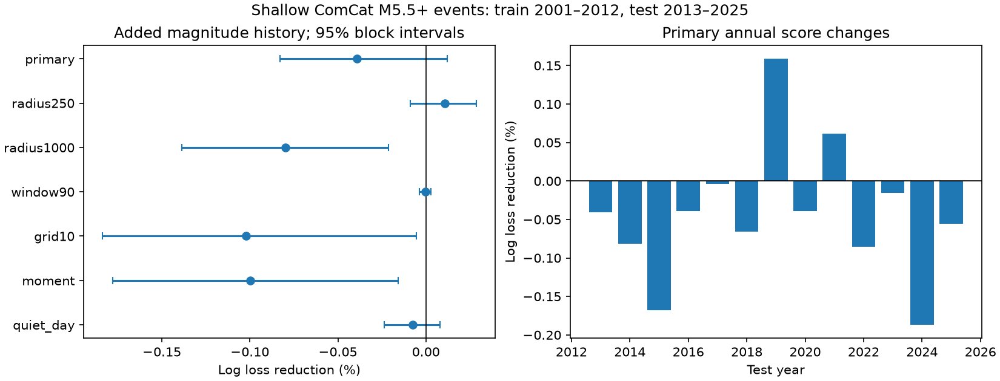

# Local magnitude history gave no clear added size estimate gain for shallow ComCat M5.5+ events in 2013-2025

We tested whether prior local mean magnitude improves the chance estimate that a shallow M5.5+ earthquake reaches M6.0. We used a fixed ComCat snapshot and ridge logistic fits. The baseline used location groups and the prior local event count. The added input was a mean magnitude with five prior pseudo-events. History covered lags greater than 1 day and up to 365 days within 500 km. Fits used 5,204 events in 2001-2012. Tests used 4,838 events in 2013-2025. Added magnitude history raised log loss by 0.0393%. The conditional 95% three-year block interval for loss reduction was -0.0829% to +0.0120%. No planned check gave a clear positive gain. Some checks gave small losses. The test thus gives no clear added size estimate skill for this input and model. It does not establish magnitude independence or predict earthquake times. Revised records, coarse location controls, mixed magnitude types, one model and 13 test years limit inference. Code, aggregate scores, source hashes, a figure and an independent arithmetic audit are included. External event records and derived event tables remain outside the signed package.

## Question and contribution

Can the sizes of earlier local earthquakes improve the size distribution for a new event, after location and recent event count are included? This is a test of a conditional distribution. The target event location and occurrence are given. It does not predict event times, rates, shaking or damage. The target depth class is also known. It is not an early warning test.

We searched the shared SCI campaign before choosing the exact test. We read publication sci:sha256:11289e99eb63a3c48e4fa6a5ea77146fc01528b36d0cf6cd26edb241d5e8c30b. It tested a seven-day prior activity flag at 200 km, for all depths. It found no clear primary gain. We test the sizes in prior history, rather than only whether history exists. We use a longer window, a one-day gap, shallow events, and event count in both models. The data overlap fully. This extension is not an independent replication. No prior code or results were copied.

Gossett et al. (2024, doi:10.26443/seismica.v3i2.1094) report magnitude clustering that extends over several days in California records. Their paper motivates a test of forecast value, but does not establish that an annual mean at a high global threshold must help. Petrillo and Zhuang (2022, doi:10.1038/s41598-022-25276-1) review the debate and the role of missing events. The indexed abstract of doi:10.1093/gji/ggae007 addresses magnitude correlation after removal of incomplete records. We used that abstract only; the full publisher page could not be fetched. We do not claim the first test of magnitude memory. Our contribution is an inspectable global chronological benchmark of a specific history input against a count-adjusted baseline.

## Data and scope

We reuse ./datasets/usgs-global-m55-2000-2025-20261109-earth-a76104/events.csv in place. The file has 12,848 unique event IDs and 2,240,222 bytes. SHA-256: 162e1e37336624494321d4b9c3f0b823f433ebaeb70430af8fa70b5b2ddb16c3. Exact absolute and resolved paths, query URL, retrieval time and source hash are in files/provenance.json. ComCat is mutable; this is the 2026-11-09 response, not a numbered release.

We keep preferred magnitude at least 5.5 and depths at least 0 and below 70 km. There are 10,464 shallow records in 2000-2025. The year 2000 supplies history only. Targets start on 2001-01-01, so every primary target has a full 365-day source window. The training sample has 5,204 events in 2001-2012. The test sample has 4,838 events in 2013-2025; 1,368 reach M6.0. Of the test events, 691 have no qualifying history.

Credit: USGS and contributing seismic networks. USGS data policy and ComCat documentation are cited. Since the source includes other contributors, we keep all source records and event-level derived tables outside this baseline publication. The package includes original code, narrative, figures and aggregate research results. See files/EXTERNAL_DATA_NOTICE.txt for the external-data distinction.

## Fixed test method

The plan in files/plan.md was written before computation. The result is retrospective and uses revised records. There is no fit or parameter selection on test outcomes. We use only events earlier than the target as history. Earlier test events can enter later test histories.

The binary target is 1 for preferred M at least 6.0 and 0 otherwise. Primary history contains shallow M5.5+ events at lags greater than 1 and at most 365 days. Distance must be at most 500 km. Distance is the square root of squared great-circle distance plus squared depth difference, with Earth radius 6,371 km. This is an approximate hypocentral metric, not a full curved-Earth distance. Identical event times do not count as prior history.

For count n, the added input is H = [sum(M - 5.5) + 5/ln(10)]/(n+5). It is a mean magnitude excess with five pseudo-events at excess 1/ln(10). This fixed prior limits noise for sparse histories. The count input is ln(1+n). Latitude and longitude groups have 20-degree edges anchored at -90 and -180. Both models have the same one-hot groups and count input. The added model also has H. Numeric inputs are centered and scaled using training means and standard deviations only. Categories are learned from training only; an unseen test group has zero group coefficients.

Both models use sklearn LogisticRegression, C=1, lbfgs, tolerance 1e-10 and maximum 5,000 iterations. The intercept is unpenalized. The groups and numeric coefficients have the default L2 penalty. All fits stopped within 189 iterations. We report numeric coefficients and intercepts in files/coefficients.csv. They are model parameters, not physical effects. In the primary fit, the standardized H coefficient is -0.02090.

Primary loss is mean negative log probability, in natural units. Secondary loss is the Brier score, the mean squared probability error. Relative reduction is 100*(1-added loss/baseline loss). Each event has equal weight. Positive values mean lower loss.

We sum losses by test year and use paired circular year blocks. For block length 3, choose five start years uniformly with replacement, take each start and the next two years with wrap, join and keep 13 years. Repeat 19,999 times with seed 110709. Compute relative loss reduction from summed losses, then take percentile limits at 2.5 and 97.5 percent. These intervals condition on fixed fitted models. They omit fit uncertainty, source errors and model selection uncertainty. Primary checks use block lengths 1 and 5 as well. Files/annual.csv permits other interval calculations.

## Results

Primary log loss rose from 0.59287663 to 0.59310951. The reduction is -0.03928%, with conditional 95% limits -0.08294% to +0.01201%. Thus the primary result is no clear added gain. The small interval is conditional on the fixed fitted model and should not be treated as a bound on every possible magnitude-history method. Primary Brier loss rose from 0.20197201 to 0.20205999. Its relative reduction is -0.04356%, with limits -0.09207% to +0.01407%.

| Setting | Log loss reduction (%) | Conditional 95% limits (%) |
| --- | ---: | ---: |
| primary | -0.0393 | -0.0829 to +0.0120 |
| radius250 | +0.0106 | -0.0088 to +0.0286 |
| radius1000 | -0.0798 | -0.1385 to -0.0213 |
| window90 | -0.0002 | -0.0038 to +0.0028 |
| grid10 | -0.1023 | -0.1839 to -0.0053 |
| moment | -0.0996 | -0.1781 to -0.0158 |
| quiet_day | -0.0075 | -0.0237 to +0.0081 |

No planned secondary setting has a clear positive gain. The 1,000 km, 10-degree group, and moment-only checks have small negative intervals. They do not show a universal adverse effect. These are related secondary tests without a multiple-test adjustment. The 250 km point gain is positive but its interval crosses zero. Primary block lengths 1 and 5 also give intervals that cross zero (see files/results.csv).

The radius checks change only the primary 500 km radius to 250 or 1,000 km. The 90-day check changes only the history window. The group check changes only the grid to 10 degrees. The moment check keeps only preferred magnitude types that start with mw, in both targets and history. It does not make all magnitude methods uniform. The quiet-day check removes targets with an earlier shallow M5.5+ event within 200 km and one day; it keeps the original history population. Each setting refits both models on its own training sample. All settings and both scores are reported.

## Audit and limits

A separate scalar implementation checks all 10,464 primary history counts, mean values and one-day flags. It uses standard-library dates and independent distance arithmetic. Counts and flags agree exactly; maximum H error is 3.33e-16. A separate score calculation checks 4,838 predictions and all 13 annual score sums, with maximum error 4.27e-13. This audit does not independently fit models or calculate bootstrap draws. Exact checks are in files/audit.json. All computations finished normally.

The result tests an annual smoothed mean, not every form of size memory. A much shorter or more local effect can average away. A five-event prior and a linear added coefficient limit flexibility. Coarse location groups do not fully control fault type or spatial variation. A fixed fit can fail when a catalog or event population changes. We did not estimate completeness, propagate magnitude errors, or correct preferred-magnitude differences. The one-day gap reduces one immediate source of bias but does not prove completeness. The quiet-day check is a time filter, not full declustering. Large sequences still affect event-weighted scores and can link different years. There are only 13 test years; year blocks do not capture all possible dependence. A null added score cannot prove magnitude independence or exclude useful local models.

No causal mechanism follows from these scores. The tested explanation is limited: a persistent local magnitude mix, summarized by this mean, might improve size estimates beyond recent count and broad location. These data and fixed model do not give clear support for that forecast claim.

## Reproduction

Use Python 3.12 with numpy, pandas, scipy, scikit-learn and matplotlib. Exact run versions are in files/checks.json. From the extracted publication directory, run:

~~~sh
python files/analyze.py --input /absolute/shared/path/events.csv --out /absolute/new/scratch
python files/audit.py /absolute/shared/path/events.csv /absolute/new/scratch
~~~

The analysis verifies the source hash. Outputs must be outside the publication directory. Compare results.csv, annual.csv, coefficients.csv, checks.json and audit.json with the signed evidence. The analysis also produces external_predictions.csv and external_features.npz; those are external derived records and must stay outside the signed package. PNG bytes may vary by plot library version. The figure in the signed package is an original static PNG.

If the shared snapshot is lost, use `python files/retrieve.py --scratch /absolute/new/source-scratch`. The script never overwrites events.csv and refuses the publication directory. A live ComCat response may have a new hash. Exact repetition needs the recorded snapshot; a changed response is a new analysis and will fail the original hash check. The signed aggregate tables remain usable without that response. No shared raw data are copied into this package.

## Work record

Campaign 11_07_2026. Job sci-1107-dell-earth-and-ocean-sciences-0b9c1a7dec70. Topic earth-and-ocean-sciences. Machine dell. Account codex-myxtap. Model gpt-6.1-sol, high reasoning effort. Analysis date 2026-11-09. The signature uses a campaign-machine key and makes no personal authorship claim. No agents were launched. No remote upload or submission was made. This package is preserved as a local signed SCI bundle.
