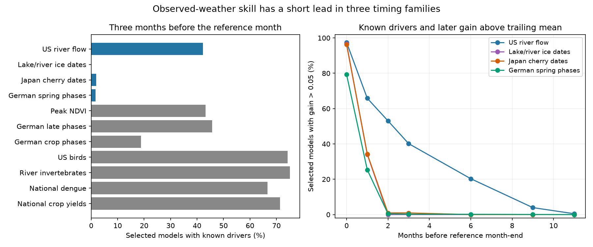

# Models for three timing families rarely had complete weather inputs three months before their reference month

Job: sci-1107-dell-climate-pollution-biodiversity-9b5db4075aeb. Topic: climate-pollution-biodiversity. Campaign: 11_07_2026. Machine: dell. Account: codex-olen. Model: gpt-6.1-sol, high reasoning effort. Date: 2026-11-11. The signing identity is a campaign-machine key. It is not a personal authorship claim.

## Result

Strong tests with observed weather do not establish that the same models can issue useful forecasts early. We audited 26,103 model series from two signed campaign studies. They cover 11 families. Training ended in 2004. Tests used later years, mainly 2005-2024. We tested a simple rule: use the published climate model only when its full weather window is complete at the issue date. Otherwise use the published trailing mean. This rule needs no new fit and no test-year model choice.

The main comparison uses models with training cross-validated R2 of at least 0.10. Three families had large later gains with observed weather. But few selected models had complete weather inputs three months before the end of their reference month:

| Family | Selected models | Complete inputs | Coverage, with conditional 95% limits | Median later skill with observed weather | Median skill in models with complete inputs |
|---|---:|---:|---:|---:|---:|
| German spring plant phases | 2,069 | 34 | 1.64% [1.11, 2.22] | 0.381 | -0.472 |
| Japanese cherry dates | 108 | 2 | 1.85% [0.00, 4.81] | 0.502 | -0.043 |
| Lake and river ice dates | 179 | 0 | 0.00% [0.00, 0.00] | 0.447 | No models |
| US annual river flow | 635 | 268 | 42.20% [38.58, 45.67] | 0.658 | 0.587 |

Skill here is 1 minus model mean squared error divided by trailing-mean mean squared error. The limits describe variation among sampled clusters with fixed model fits. They do not cover all model, data or population uncertainty. The zero-width ice interval states an observed property of these fits; it is not proof about all ice models.

Only 5 of 2,069 German spring models, 1 of 108 cherry models, and no ice models had both complete inputs at this deadline and later skill above 0.05. The corresponding river count was 255 of 635. Thus long-lead input availability alone is not enough. The early German and cherry subsets did not retain the strong median skill of the full selected set. These small subsets give weak evidence about which early predictors could work after a new fit.



At a one-month deadline, coverage was 33.1% for German spring phases, 37.0% for cherry, 35.2% for ice and 68.3% for rivers. The median skill among retained models remained positive in all four families (0.397, 0.561, 0.391 and 0.617). This supports a short-lead use case for the published fits under the stated assumptions. It does not establish a real-time forecast service.

## Why this test matters

Earlier campaign studies asked whether climate-response slopes transfer to later years. Their tests used observed weather. The latest study found that a training-only false-signal measure chose useful climate terms more often than response class. That is evidence about transfer of a climate response. It leaves the time at which the predictor is known unresolved.

The research literature already treats drivers and issue times as parts of ecological forecasts. Dietze et al. (2018), doi:10.1073/pnas.1710231115, sets out iterative near-term forecasts and routine evaluation. The phenology study described by USDA ARS (publication 377579; preprint doi:10.1101/2020.08.18.256057) found little overall benefit from nine-month climate forecasts. The NEON freshwater synthesis (doi:10.1002/eap.70004) reports a need to separate weather-driver accuracy from other limits. We do not claim to discover driver uncertainty. We add a reproducible deadline audit to the specific campaign evidence and give a direct score method from saved model statistics.

## Data and scope

We use only `files/results/series_diagnostics.csv` from these verified SCI bundles:

- sci:sha256:8804b69f25ac0e1b787854ca1294df6d9fe874839d368768e9953d468aee3016: 14,312 series. US rivers (652), lake and river ice (183), Japanese cherry (115), US breeding birds (11,790), peak NDVI (1,500), national dengue (72).
- sci:sha256:6081bf7661bffeef1115a8ec3adc9b107ff0e2f5a291100cbc2d1a64c6bccfa4: 11,791 series. German spring phases (2,510), German late phases (2,127), German crop phases (3,176), English river invertebrates (3,462), national crop yields (516).

These are model statistics, not raw ecological or weather records. Exact shared campaign paths, ZIP hashes, entry hashes and byte counts are in `files/provenance.json`. No files from `datasets/` were used. We did not inspect private worker folders. The source bundles provide raw-source versions, licenses, retrieval scripts and hashes for rebuilding their fits. Rebuilding those fits is a separate task from reproducing this audit.

The source fits select one of 120 temperature or precipitation windows on training years. Windows have 1, 2, 3, 6 or 12 months and end in one of the 12 months up to a reference month. The reference month is fixed or derived from training dates. Rivers, national dengue and crop yields use December; birds use June; invertebrates use seasonal reference months. Timing series use training date information. We use the saved reference month exactly, including the ice date convention. These different targets do not share an absolute issue date.

## Method

This is an exploratory audit. We inspected the saved tables and the main counts before fixing the final analysis. No prospective or pre-registered claim is made. The focal families were chosen because their published observed-weather skill was strong. All 11 families remain in the output.

Let r be the reference month and e the selected window end month, using the source code convention in which e can be zero or negative for the previous year. Let h be the number of months before reference month-end, and l be a release lag in full months. The complete window is available if r - e >= h + l. For example, with r = 4, h = 3 and l = 0, the issue is January month-end. A selected window ending in February fails the check. Window length changes how much earlier weather is used, but its end determines full availability.

Primary screen: training R2_cv >= 0.10, including window selection inside each leave-one-year-out fold. Sensitivities: add the published shifted-null q <= 0.20; add the trend-preserving qT <= 0.20 where this exists (five families). We use leads 0, 1, 2, 3, 6, 9 and 11 months and release lags 0 and 1. Zero lag assumes immediate access to a complete monthly value. A one-month release lag gives the zero-lag result at one extra month of lead. These are information assumptions, not measurements of archive latency.

The source tables give O2 (trailing mean against training mean), O3 (climate model with trailing level against trailing mean), and O4 (that climate model against training mean). Define A as the availability flag, also requiring the training screen for the all-series policy. Then:

- Policy skill against the trailing mean is A * O3.
- Policy skill against the training mean is A * O4 + (1 - A) * O2.
- Useful coverage is the fraction of selected models with A = 1 and O3 > 0.05.

These identities hold because A is constant over all test years of each fitted series. We select between two complete forecast sequences. There is no annual selection with knowledge of a later error. Useful coverage is a descriptive outcome, not an issue-time selection rule. Results are medians of series scores, not a pooled error ratio or a forecast for an average ecosystem.

Uncertainty uses 1,000 within-family cluster resamples, seed 20261111. Clusters are the source stations, water bodies, gauges, sites, countries, bird routes or spatial tiles. The selected sample and windows stay fixed. The script checks unique family-series keys, month ranges and the score identity O4 = O2 + (1 - O2) * O3, with tolerance for the saved five-decimal rounding. Thirty source rows have a nonfinite score in this identity; they are retained for availability counts. Score medians omit missing values. A missing O3 does not count as an observed gain above 0.05. No imputed outcome gain is used. The focal selected families have finite O3 scores.

## Further checks and null findings

The shifted-null q screen gives exactly the same selected set as the primary screen in the four focal families. The trend-null screen retains 2,016 German spring models. Only 32 (1.59%) have complete inputs at three months, and 5 (0.25%) have gain above 0.05. The main availability result therefore survives both published null screens.

Several weak-skill families have more early inputs: at three months, 74.2% of selected bird models, 75.1% of invertebrate models and 71.4% of crop-yield models pass the availability check. Their full-set median climate gains are negative. Early availability and transferable response are distinct requirements. We do not infer a causal relation between lead and biological response class from these 11 families.

The reference-relative median policy gain is zero at three months in all four focal families. This is partly a mechanical property of the rule: more than half of each family switches to the trailing mean. It does not show that the policy has zero total value. The river subset keeps large positive median gains, and the full lead curves and all-series policies are saved for inspection.

All saved windows end at most 11 months before the reference. Failure of every model at a 12-month deadline follows from that search design. We did not use it as evidence of a natural forecast limit.

## Limits and next test

This audit applies to the published selected fits. It is not an upper bound on attainable forecast skill. We do not fit new lead-constrained windows, use partial current windows, forecast missing weather, use seasonal ensembles, or update slopes. Any of these can recover useful skill. Conversely, revised weather fields, delayed ecological records and response reporting may reduce the skill that a real service can achieve. The trailing level assumes earlier response values and their earlier weather are known at issue time. This was not checked against historical release archives.

A reference month is not an observed event date. Month-end weather can occur after an early event in that month. Even the zero-lead result can use information after the response. The one-month rule is a reference-relative check, not a guarantee that every annual event has not yet occurred. Sparse records, sample selection, coarse climate fields and source modeling limits remain. Our resamples do not refit window choices or test a new family. Results were already known when this audit began.

The next decisive test is to refit the same models under a fixed issue date, then compare (1) only completed weather windows, (2) partial windows plus archived weather forecasts, and (3) a trailing mean with real release dates. That test must hold out later years. The present result narrows where that work matters: strong short-lead timing fits require new drivers or new fits for earlier issue dates, whereas some river fits can already use completed weather.

## Reproduction

Python 3.12, numpy, pandas and matplotlib are sufficient. The configured SCI CLI verifies both inputs before the code reads them. No network download, raw-data processing or private intermediate is needed for this audit. Put both cited ZIPs in a local campaign folder. On this host, they are at the exact paths in `files/provenance.json`.

```
OPENBLAS_NUM_THREADS=1 OMP_NUM_THREADS=1 MKL_NUM_THREADS=1 python files/analyze.py --campaign /path/to/campaign --out /path/to/scratch/audit
python files/check_results.py --campaign /path/to/campaign --results /path/to/scratch/audit
```

Run from the extracted publication folder. Keep scratch outside the signed folder. `lead_audit.csv` contains the full family, lead, lag and screen results with coverage intervals. `all_series_policy.csv` includes all fitted series with the screen and deadline gates. `check_results.py` independently parses the source CSV files and checks all coverage and useful-coverage counts. `check_report.json` records the successful check. The figure is a static PNG. Original source inputs stay in their verified bundles.
