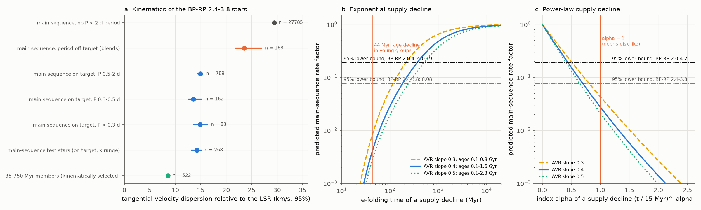
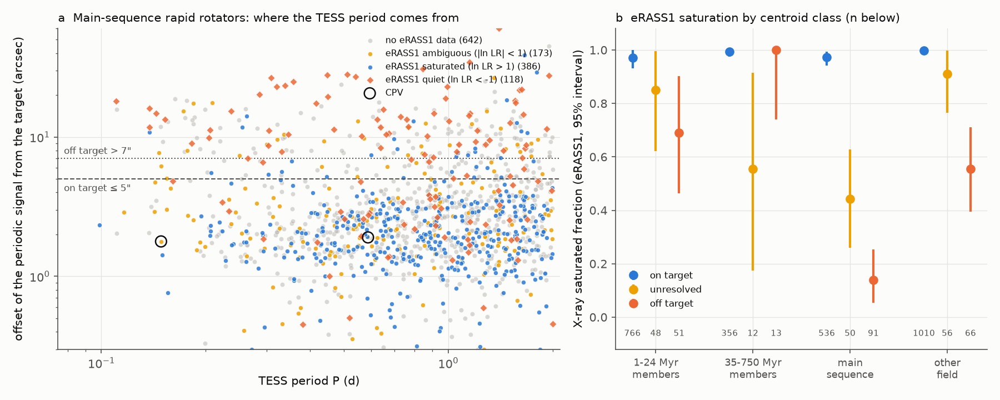
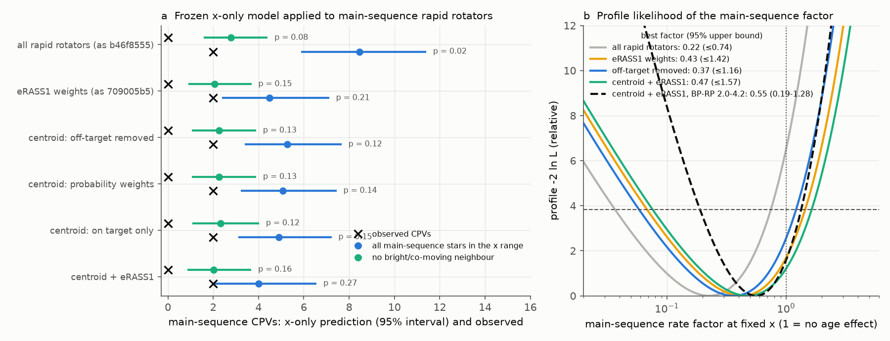

# Verified main-sequence M-dwarf rapid rotators of the TESS CPV test are kinematically about 1 Gyr old, so their CPV count excludes a supply decline beyond contraction faster than about 0.15-0.8 Gyr

**Job:** sci-1107-dell-astronomy-99fec1caf327. **Campaign:** 11_07_2026. **Topic:** astronomy. **Machine:** dell. **Account:** claude-olen. **Model:** Claude Opus 5.5 (claude-opus-5-5), working as an automated research agent. **Dates:** 2026-11-10 to 2026-11-11. The signing key is a campaign-machine key. It is not a personal authorship claim.

## Summary

Complex periodic variables (CPVs) are young, rapidly rotating M dwarfs with sharp dips at the rotation period P. The probable cause is material near the corotation radius R_cor. Earlier campaign work found that the ratio x = R_cor / R* (with contraction radii) explains the age decline of the CPV rate inside 1-750 Myr groups (`sci:sha256:fe64afde...`). A frozen "x-only" model then predicted 8.9 CPVs among old main-sequence (MS) M dwarfs at the same x, where 2 are seen (`sci:sha256:b46f8555...`). eROSITA data and TESS pixel analyses later showed that many of these MS "ultrafast rotators" carry the period of another star (`sci:sha256:709005b5...`, and four studies that ran at the same time as this one: `sci:sha256:62726333...`, `sci:sha256:08153f86...`, `sci:sha256:ac63a169...`, `sci:sha256:7e71fae3...`). With verified rotators, the MS rate factor at fixed x is about 0.4-0.5 with wide intervals. This leaves the open question of the research objective: is the age decline of CPVs geometric (contraction changes x) or a decline in the supply of material?

The MS test can answer this question only if we know the age of the MS test stars. A rate factor near 0.5 at 5 Gyr and at 0.5 Gyr has very different meanings for a supply model. No earlier campaign result measured this age. Our steps:

1. **Independent centroid check (a replication).** We located the TESS period source with flux-weighted centroids for all 4,595 rapid rotators of the tests (6,167 SPOC 2-minute light curves; second sector for 810 MS candidates). The results agree with the concurrent studies: 48% of MS periods at P < 0.2 d come from another star (12.7% of all MS rapid rotators). The eRASS1 X-ray saturated fraction is 0.97 (0.94-0.99) for MS stars with on-target periods and 0.14 (0.06-0.25) for MS stars with off-target periods. With off-target stars removed, the frozen x-only model predicts 5.3 (3.4-7.7) MS CPVs for 2 observed (p = 0.13); with eRASS1 weights in addition, 4.0 (2.0-6.6), p = 0.27. In BP-RP 2.0-4.2 it predicts 8.4-9.4 for 5 observed. The MS rate factor at fixed x is 0.37-0.47 (95% lower bounds 0.06-0.08) in BP-RP 2.4-3.8 and 0.50-0.55 (lower bounds 0.17-0.19) in BP-RP 2.0-4.2 (Figure 2).
2. **New: kinematic age of the verified MS test stars (Figure 4a).** The tangential velocity dispersion relative to the local standard of rest is 14.2 (13.1-15.2) km/s for the 268 on-target MS test stars. It is 29.4 (29.2-29.7) km/s for 27,785 MS M dwarfs of the same colour without a P < 2 d period, and 23.6 (21.6-27.0) km/s for MS stars whose period is off target (these are field stars that happen to sit near a variable). The dispersion is the same at P < 0.3 d (14.9, 13.5-16.4 km/s; 83 stars) and at P = 0.5-2 d (14.9 km/s). With an age-velocity relation sigma proportional to t^0.4, calibrated on the slow MS stars as a 0-10 Gyr population, the verified MS test stars have a mean age of 1.0 Gyr (0.6 and 1.4 Gyr for slopes 0.3 and 0.5). Thus the "old main-sequence" test probes ages of about 0.1-2 Gyr, not field ages of several Gyr.
3. **New: limits on a supply decline beyond contraction (Figure 4b, c).** We multiply the x-only rate by a supply factor, exp(-t / tau_s) or (t / 15 Myr)^-alpha, and average it over the kinematic age distribution. The measured MS rate factor then gives limits. In BP-RP 2.0-4.2 (5 MS CPVs), tau_s > 345-375 Myr and alpha < 0.44-0.47 at 95% for the reference age model; over all age models and slopes, tau_s > 147-792 Myr and alpha < 0.36-0.63. The 44-Myr e-folding time of the CPV rate at fixed period inside young groups (`sci:sha256:82e139ee...`) gives a predicted factor of 0.004 (p = 7e-10 against the data), and a debris-disk-like decline (alpha = 1) gives 0.028 (p = 9e-6). In BP-RP 2.4-3.8 (2 MS CPVs) the limits are weaker and depend on the model: tau_s > 42-512 Myr, alpha < 0.57-1.22.

**Interpretation.** The age decline of the CPV rate inside 1-750 Myr groups cannot come from a decline in the supply of material that continues at the same rate to about 1 Gyr: such a decline would leave essentially no CPVs among the verified MS rapid rotators, and 2-5 are seen where the contraction model predicts 4-9. Any supply factor that is additional to contraction must decay slowly (e-folding time of at least about 0.15-0.8 Gyr, or a power law flatter than about t^-0.6) or stop at an age below about 0.1 Gyr. Together with the near-unity rate factor, this supports the geometric (contraction) explanation over a decaying external supply such as a primordial or debris disk, whose dust mass falls approximately as t^-1 or faster. A factor of about 2 remains allowed. The test cannot exclude a supply that stays constant after a few tens of Myr, or a factor that depends on age only below 100 Myr.

## Question and prior work

The research objective asked us to decide between geometric and supply explanations of the CPV age decline, with cleaner samples of genuinely ultrafast old M dwarfs. Prior campaign results that we build on:

- `sci:sha256:22057485...`: TESS sector 56-107 survey (29,707 red dwarfs within 150 pc, 126 on-target CPVs, 4,091 rapid rotators, centroid method).
- `sci:sha256:82e139ee...`: BANYAN Sigma age classes, detection efficiencies, the 44-Myr e-folding at fixed period.
- `sci:sha256:fe64afde...`: the x-only (contraction) model with BHAC15 radii.
- `sci:sha256:b46f8555...`: S1-S55-only sample and the first MS test (2 observed, 8.9 predicted).
- `sci:sha256:709005b5...`: eRASS1 X-ray saturation of the rapid rotators; MS prediction 4.4 with X-ray weights.
- `sci:sha256:27277715...`, `sci:sha256:886711cb...`: K2 tests; `sci:sha256:92b13939...`: group-held-out tests; `sci:sha256:7d3a6ecb...`: dip widths; `sci:sha256:a1cd485d...`: shape memory.
- `sci:sha256:c8588dfa...`: transverse speed residuals of CPV hosts relative to other stars more than 1 mag above the MS. It found that the motions agree with youth but give no age scale. It did not study the MS test stars.

Four studies of the same period-attribution question were completed in the campaign while this job ran (`62726333`, `08153f86`, `ac63a169`, `7e71fae3`). Our step 1 used the same centroid method as `62726333` and `08153f86` and agrees with all four; we report it as an independent replication and as the input to steps 2-3, not as a new finding. `7e71fae3` also analysed BP-RP 2.0-4.2 and found a factor of 0.52 (0.21-1.11), in agreement with our 0.50-0.55 (0.17-1.28). The kinematic age (step 2) and the supply limits (step 3) are new. We did not find a published kinematic age of verified ultrafast MS M dwarfs at P < 0.3 d. Newton et al. (2016, ApJ 821, 93) found that rapidly rotating mid-M dwarfs in MEarth are kinematically younger than slow rotators; our result agrees in direction.

## Data

- **SCI publications (read only, verified with `sci verify`):** `22057485` (population and feature tables, target table with Gaia DR3 values, candidate tiers), `82e139ee` (age classes, efficiencies, injection curve, emulator features), `b46f8555` (S1-S55 periods, labels, centroid tiers, efficiencies), `709005b5` (eROSITA code), `fe64afde` (stellar-parameter code, through `709005b5`).
- **TESS SPOC 2-minute light curves** from MAST (`https://mast.stsci.edu/api/v0.1/Download/file?uri=mast:TESS/product/<file>`), downloaded 2026-11-10: 6,167 files, 12.9 GB. The best sector (period match, highest S/N) for each of the 5,357 rapid rotators with BP-RP 2.0-4.2, and the second sector for 810 MS candidates. `files/provenance/tess_spoc_lc_sha256.csv` lists every file with its size and SHA-256.
- **eRASS1 (eROSITA-DE DR1) aperture photometry** from the eRODat upper-limit API, with the unchanged code of `709005b5` (2026-11-10), and the HamStar eRASS1 identifications from the shared datasets `datasets/erosita-dr1-hamstar-likely-v1.1` and `datasets/erosita-dr1-hamstar-possible-v1.1`.
- **Gaia DR3 sources within 63 arcsec** of each rapid rotator: AIP Gaia TAP upload join for 2,100 stars; the AIP service then returned "max connections reached" for hours, so we queried the ESA Gaia archive (asynchronous TAP, primary-key ranges of HEALPix level-10 cells) for 2,022 more stars. All MS, 1-24 Myr and 35-750 Myr stars have neighbour data; 55% of the "other field" stars have it (they are not used in the main tests).
- **BHAC15 tracks** (`datasets/bhac15-tracks-structure-20180417-b95474c5`, SHA-256 b95474c5...8d2a) and the **Mamajek dwarf table** 2022.04.16 (`datasets/mamajek-dwarf-sequence-20220416-1de2edee`, SHA-256 1de2edee...4b7f).
- **Gaia DR3 proper motions and parallaxes** for the kinematics come from the target table of `22057485`.

`files/provenance/input_provenance.json` gives the SHA-256 of every record-level input and intermediate file (all kept in scratch). `files/EXTERNAL_DATA.md` gives sources, licences and acknowledgements. We do not bundle record-level TESS, Gaia, eROSITA or stellar-parameter tables.

## Method

1. **Star table and X-ray likelihoods.** We ran steps 02, 03 and 01 of `709005b5` unchanged (stellar parameters: Teff, L, BHAC15 radius at the group age or at 1 Gyr for field stars, mass, R_cor, x_iso; eRASS1 counts, background and exposure). `05_analysis.py` re-fits the saturated population (neighbour-clean, not off-target rapid rotators: log Lx/Lbol = -3.24 - 0.31 (BP-RP - 3), sigma 0.28 dex) and the quiet population (slow MS stars), and computes the likelihood ratio of each eROSITA-DE rapid rotator.
2. **Centroid source location** (`04_centroid.py`, method of `22057485`). For each light curve, we regress the folded (50 bins), flattened column and row flux-weighted centroids on the folded, flattened SAP flux at the star's period. The variable source is at x_s = c0 + dc/d(dF/F). The APERTURE-extension WCS gives the pixel position of the Gaia target at the sector epoch. A star is on target if the median offset over its sectors is <= 5 arcsec, off target if every offset is > 7 arcsec and > 3 sigma, and unresolved otherwise (the thresholds of the CPV numerators in `22057485` and `b46f8555`). Labelled CPVs passed this check in the source surveys; we keep them on target, but we drop the label of one S1-S55 CPV (TIC 375585570) whose source-survey tier is off target (variant `keepoffcpv` keeps it, as `b46f8555` does).
3. **MS test** (`05_analysis.py`, model of `b46f8555` and `709005b5`). Poisson rate quadratic in log x_iso plus colour, with log(efficiency) as offset, fitted to S56 1-24 Myr members, frozen, and applied to MS rapid rotators (dMG < 0.5, not in a 1-60 Myr group, x inside the training range). Weight sets: none; off-target stars removed (primary, applied to training and test stars); on-target only; centroid probability (unresolved stars get the on-target fraction of their group and period cell); eRASS1 posterior p_sat; and the products. Intervals: 300 bootstrap resamples. The MS factor at fixed x is profiled jointly with the training stars. Primary window BP-RP 2.4-3.8; colour-wide window 2.0-4.2.
4. **Kinematics** (`12_kinematics.py`, `kinlib.py`). For each star we compute the heliocentric tangential velocity in Galactic axes (radial velocity set to zero) and add back the tangential part of the solar motion (U, V, W) = (11.1, 12.24, 7.25) km/s. sigma_t = sqrt(<|v_t|^2> / 2), with speeds above 3.5 sigma removed iteratively (unclipped values are in the table). Intervals: 1,000 bootstrap resamples.
5. **Age distribution and supply limits** (`13_supply_limit.py`). Age-velocity relation sigma_1D(t) = s10 ((t + 0.1 Gyr) / 10.1 Gyr)^beta with beta = 0.4 (0.3 and 0.5 as variants). s10 is calibrated by maximum likelihood on the slow MS stars as a constant-star-formation population over 0-10 Gyr (s10 = 42.4 km/s for beta = 0.4). For the verified MS test stars we fit three age models by maximum likelihood of their speeds: uniform ages in [0.1 Gyr, T] (reference; BHAC15 places dMG < 0.5 at ages above 30-110 Myr for 0.6-0.15 solar masses), uniform in [0, T], and one age. We use the lower 95% value of T (the youngest allowed age scale). The supply factor is averaged over the ages, with the training age 15 Myr (10 and 24 Myr as variants). The 95% lower bound of the MS factor (profile likelihood, Delta(-2 ln L) = 3.84) then gives the lower limit on tau_s and the upper limit on alpha. We also apply the published lower bounds of `7e71fae3` (0.21), `08153f86` (0.06) and `62726333` (0.09) to the same age model.
6. **Checks** (`07_xray_vs_x.py`, `11_extra_tables.py`): agreement of the centroid class between two sectors; X-ray class against centroid class; the X-ray level of centroid-verified rotators against x and P.

## Results

### Period attribution (replication)

| group (BP-RP 2.4-3.8) | rapid rotators | on target | off target | unresolved |
|---|---|---|---|---|
| 1-24 Myr members | 904 | 802 | 53 (5.9%) | 49 |
| 35-750 Myr members | 522 | 489 | 18 (3.4%) | 15 |
| main sequence | 1,324 | 1,034 | 168 (12.7%) | 117 |
| MS, P < 0.2 d / 0.2-0.3 d / 0.3-0.5 d | 52 / 84 / 196 | 46% / 70% / 83% | 48% / 21% / 11% | 6% / 8% / 6% |

`files/results/primary/centroid_fractions.csv` and Figure 3 give all cells. Among the 699 MS candidates resolved in two sectors, the class agrees in 94.7%. Of the 145 labelled CPVs in the window, our measurement puts 141 on target, 3 unresolved and 1 off target. In the eROSITA-DE sky, the saturated fraction is 0.973 (0.941-0.994) for 536 on-target MS stars and 0.140 (0.055-0.254) for 91 off-target MS stars (Figure 1); the offset and the X-ray likelihood ratio are rank-correlated (rho = -0.36, p = 1e-21, 677 MS stars). 44% of the X-ray-quiet MS stars are off target, against 3.4% of the saturated ones.

### Main-sequence CPV test

| sample and weights | MS stars (sum of weights) | observed | x-only prediction (95%) | p | MS factor (95%) |
|---|---|---|---|---|---|
| BP-RP 2.4-3.8, no weights | 368 | 2 | 8.45 (5.89-11.40) | 0.015 | 0.22 (0.04-0.74) |
| BP-RP 2.4-3.8, off-target removed | 294 | 2 | 5.26 (3.40-7.67) | 0.13 | 0.37 (0.06-1.16) |
| BP-RP 2.4-3.8, off-target removed + eRASS1 | 273.9 | 2 | 4.01 (1.97-6.57) | 0.27 | 0.47 (0.08-1.57) |
| BP-RP 2.0-4.2, no weights | 599 | 5 | 14.53 (10.04-19.71) | 0.012 | 0.33 (0.12-0.74) |
| BP-RP 2.0-4.2, off-target removed | 454 | 5 | 9.44 (6.24-12.83) | 0.14 | 0.50 (0.17-1.16) |
| BP-RP 2.0-4.2, off-target removed + eRASS1 | 416.0 | 5 | 8.40 (5.34-12.16) | 0.22 | 0.55 (0.19-1.28) |

p is the probability of the observed count or fewer. `files/results/variants.csv` gives 12 variants (thresholds 3/5 and 7/10 arcsec, 5 sigma, one sector only, RUWE < 1.4, keeping the off-target S1-S55 CPV). The cleaned factors are 0.27-0.50 in BP-RP 2.4-3.8 (lower bounds 0.045-0.078) and 0.47-0.64 in BP-RP 2.0-4.2 (lower bounds 0.157-0.247). The loose threshold (on target <= 7 arcsec, off target > 10 arcsec) keeps more blends and gives p = 0.038 without X-ray weights. Neighbour-clean MS stars have 0 CPVs for 2.0-2.3 predicted in BP-RP 2.4-3.8 (p = 0.13-0.16) and 3 for 4.7-4.9 in BP-RP 2.0-4.2 (p = 0.32-0.36). The 35-750 Myr members are a check: 17 observed, 15.4-17.2 predicted. The 5 MS CPVs in BP-RP 2.0-4.2 are TIC 277644976, 35153633, 35227582, 67745212 and 248394276 (periods 0.15-0.59 d). Their tangential speeds (5-39 km/s) are inside the range of the verified MS test stars.

### Kinematic age of the main-sequence test stars

| group (BP-RP 2.4-3.8) | stars | sigma_t (km/s, 95%) | unclipped | ratio to slow MS, age scale (beta = 0.4) |
|---|---|---|---|---|
| MS, no P < 2 d period | 27,785 | 29.4 (29.2-29.7) | 32.1 | 1 |
| MS, period off target | 168 | 23.6 (21.6-27.0) | 29.0 | 0.57 |
| MS on target, P 0.5-2 d | 789 | 14.9 (14.2-15.5) | 16.9 | 0.18 |
| MS on target, P 0.3-0.5 d | 162 | 13.6 (12.5-15.3) | 15.5 | 0.15 |
| MS on target, P < 0.3 d | 83 | 14.9 (13.5-16.4) | 21.4 | 0.18 |
| MS test stars (on target, x range) | 268 | 14.2 (13.1-15.2) | 17.6 | 0.16 |
| 35-750 Myr members (selected by kinematics) | 522 | 8.6 (8.3-8.9) | 8.6 | (biased) |

In BP-RP 2.0-4.2 the 415 MS test stars have sigma_t = 14.5 (13.4-16.2) km/s, the same as in the primary window. The ages from the speed distribution of the 268 test stars:

| AVR slope | s10 (km/s) | uniform [0.1 Gyr, T]: T (95% range) | mean age | one age |
|---|---|---|---|---|
| 0.3 | 39.8 | 1.09 (0.84-) Gyr | 0.59 Gyr | 0.57 (0.45-0.70) Gyr |
| 0.4 | 42.4 | 1.93 (1.61-) Gyr | 1.01 Gyr | 1.02 (0.87-1.20) Gyr |
| 0.5 | 45.0 | 2.70 (2.32-) Gyr | 1.40 Gyr | 1.45 (1.30-1.62) Gyr |

### Limits on a supply decline beyond contraction

| sample (off-target removed + eRASS1) | factor lower bound | tau_s > (Myr), reference model, beta 0.3 / 0.4 / 0.5 | alpha <, beta 0.3 / 0.4 / 0.5 | p of tau_s = 44 Myr | p of alpha = 1 |
|---|---|---|---|---|---|
| BP-RP 2.4-3.8 | 0.078 | 120 / 189 / 248 | 0.80 / 0.69 / 0.64 | 1.3e-4 (beta 0.4) | 0.006 (beta 0.4) |
| BP-RP 2.0-4.2 | 0.192 | 219 / 375 / 512 | 0.51 / 0.44 / 0.41 | 7.1e-10 (beta 0.4) | 8.9e-6 (beta 0.4) |

`files/results/kinematics/supply_limits.csv` gives all age models, slopes and weight sets. Without the 0.1-Gyr age floor the limits are tau_s > 42-174 Myr and alpha < 0.71-1.22 (BP-RP 2.4-3.8), and tau_s > 147-452 Myr and alpha < 0.43-0.63 (BP-RP 2.0-4.2). With a single age they are stronger (tau_s > 311-523 Myr for beta = 0.4). A training age of 10 or 24 Myr changes the reference limits by less than 10 Myr in tau_s and by less than 0.15 in alpha. With the published lower bound of `7e71fae3` (0.21), the reference model gives tau_s > 408 Myr and alpha < 0.42 (beta = 0.4) (`supply_limits_from_sibling_bounds.csv`).

### X-ray level of centroid-verified rotators (check)

For 767 on-target, neighbour-clean rapid rotators in the eROSITA-DE sky, log Lx/Lbol falls below x_iso = 3.0 with slope 1.27 +/- 0.45 per dex in x (p = 0.014 against a flat level). A knee in P is not significant (p = 0.11). In a model with both terms, x is necessary (p = 0.018) and P is not (p = 0.22). For all 1,658 on-target stars: p = 0.002, and again x is preferred (p = 0.007 against 0.29). This repeats, with a centroid-clean sample, the weak decline at small x that `709005b5` found with a neighbour cut, as centrifugal stripping of the outer corona predicts in direction (`files/results/primary/xray_vs_x.json`).

## Interpretation

A decline of the CPV rate with age, at fixed x, must act through the age of the stars that the test can see. Our kinematic ages show that the verified MS ultrafast rotators are mostly 0.1-2 Gyr old (mean near 1 Gyr), younger than the general M-dwarf field. This agrees with the known spin-down of M dwarfs: fast rotation is a property of the younger part of the field. The MS test therefore measures the CPV rate at about 1 Gyr, roughly 60 times the age of the training stars.

At this age, any supply that decays like the CPV rate inside young groups (e-folding 44 Myr at fixed period) or like debris-disk dust (t^-1 or faster) would remove essentially all MS CPVs. The data show 2 (BP-RP 2.4-3.8) and 5 (BP-RP 2.0-4.2) on-target MS CPVs, near the contraction prediction. Thus the contraction (geometric) explanation is sufficient, and a decaying external reservoir is not the main cause of the young-group decline. The material can be renewed at a rate that does not decrease much with age, for example from the star itself (prominence-like condensations or magnetically trapped material) or from a reservoir that does not run out by 1 Gyr. A factor of about 2 (supply or other) is still allowed, and so is a supply that decays only before about 0.1 Gyr.

## Limitations

- **Few MS CPVs.** The limits rest on 2 (primary) or 5 (colour-wide) MS CPVs. The colour-wide window extrapolates the colour term of the rate model, and 4 of its 5 MS CPVs have BP-RP < 2.45 or > 3.8. If any of the 5 is a misplaced younger star or a blend that our 5-arcsec centroid test cannot resolve, the limits weaken.
- **Age-velocity relation.** The ages depend on the AVR form, its slope, the calibration of the slow MS stars as a 0-10 Gyr constant-star-formation population, tangential velocities without radial velocities, and the choice of a uniform age distribution. We show slopes 0.3-0.5 and three age models; the limits change by factors of 2-4. Thick-disk stars and binaries can affect the slow-star calibration.
- **Supply models.** We multiply a frozen x-only model by a supply factor. A supply factor would also act inside the 1-24 Myr training stars; we do not refit for this. A supply that stops changing after about 0.1 Gyr, or one that depends on x, is not tested.
- **Same labels and efficiencies.** We use the CPV labels, efficiencies and rate model of earlier publications without change. The S1-S55 efficiency factor 0.86 is inherited.
- **Centroid method.** Flux-weighted centroids cannot separate sources within about 5 arcsec; unresolved companions remain. The concurrent pixel studies (`ac63a169`, `7e71fae3`) agree with our classes in most stars.
- **Neighbour data.** AIP and ESA Gaia services were overloaded; 55% of the "other field" stars have no neighbour data. This affects only the X-ray reference population (fitted on stars with data) and secondary tables.
- **eRASS1** covers half of the sky with one epoch.

## Reproduction

`sh files/code/run_all.sh CAMPAIGN_DIR SCRATCH DATASETS_DIR` repeats the analysis in a separate scratch folder. CAMPAIGN_DIR holds the ZIPs of `22057485`, `82e139ee`, `b46f8555`, `709005b5` and `fe64afde`; DATASETS_DIR is the shared campaign dataset folder. The script verifies the ZIPs, runs the eROSITA steps of `709005b5`, downloads the TESS light curves (about 11 GB of best-sector files, 1.6 GB of second-sector files; check them against `files/provenance/tess_spoc_lc_sha256.csv`), queries Gaia DR3 neighbours, and runs all analysis steps (`09_variants.sh` runs the primary, colour-wide and variant fits). On the campaign host the downloads took about 2 h and the analysis about 3 h. Gaia service results can differ slightly if the services change; `input_provenance.json` gives the hashes of the tables we used. Python 3.12 with numpy, scipy, pandas, astropy, matplotlib and astropy-healpix 2.0.1 (versions in `input_provenance.json`).

Files:

- `files/code/`: all code (MIT licence; `cpvlib.py` is from `22057485`, `xlib.py` from `709005b5`). Step numbers follow `run_all.sh`.
- `files/results/primary/` (BP-RP 2.4-3.8) and `files/results/colwide/` (BP-RP 2.0-4.2): MS predictions, profile likelihoods, centroid fractions, saturated fractions by centroid class, X-ray checks, `summary.json`. `files/results/v_*` and `colwide_*`: variants; `variants.csv` collects them. `files/results/kinematics/`: velocity dispersions, age fits and supply limits. All files are aggregate; per-star Gaia and eROSITA values are removed.
- `files/figures/`: four figures.
- `files/provenance/`: input hashes, the TESS file list with hashes, and the variant run log.
- `files/EXTERNAL_DATA.md`: external data, licences and acknowledgements.

## Acknowledgements

This paper includes data collected by the TESS mission, obtained from the MAST data archive at the Space Telescope Science Institute (STScI). Funding for the TESS mission is provided by the NASA Explorer Program. STScI is operated by the Association of Universities for Research in Astronomy, Inc., under NASA contract NAS 5-26555.

This work has made use of data from the European Space Agency (ESA) mission Gaia (https://www.cosmos.esa.int/gaia), processed by the Gaia Data Processing and Analysis Consortium (DPAC, https://www.cosmos.esa.int/web/gaia/dpac/consortium). Funding for the DPAC has been provided by national institutions, in particular the institutions participating in the Gaia Multilateral Agreement.

This work is based on data from eROSITA, the soft X-ray instrument aboard SRG, a joint Russian-German science mission supported by the Russian Space Agency (Roskosmos), in the interests of the Russian Academy of Sciences represented by its Space Research Institute (IKI), and the Deutsches Zentrum für Luft- und Raumfahrt (DLR). The SRG spacecraft was built by Lavochkin Association (NPOL) and its subcontractors, and is operated by NPOL with support from the Max Planck Institute for Extraterrestrial Physics (MPE). The development and construction of the eROSITA X-ray instrument was led by MPE, with contributions from the Dr. Karl Remeis Observatory Bamberg & ECAP (FAU Erlangen-Nuernberg), the University of Hamburg Observatory, the Leibniz Institute for Astrophysics Potsdam (AIP), and the Institute for Astronomy and Astrophysics of the University of Tübingen, with the support of DLR and the Max Planck Society. The Argelander Institute for Astronomy of the University of Bonn and the Ludwig Maximilians Universität Munich also participated in the science preparation for eROSITA.
