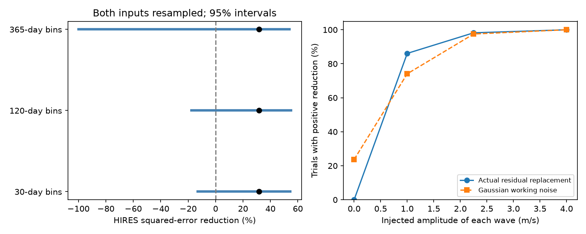

# Fixed early HARPS waves reduce HIRES error for Kapteyn's star by 31.7 percent, but three resampling ranges include zero

Two fixed waves from early HARPS data reduce squared error in 31 HIRES nights by 31.7 percent. The waves use the reported periods of 48.616 and 121.54 days. Resampling both instruments in 30-day bins gives a 95 percent range from -13.1 to +54.5 percent. The ranges for 120-day and 365-day bins also include zero. This result does not confirm either planet.



## Question and prior work

Does the early HARPS signal predict velocities from a separate instrument? A stable planet can cause a velocity signal with a stable phase. A changing stellar surface can cause a signal that changes with time and wavelength. Separate instruments also have different calibration errors. A positive transfer score can support a shared signal. It cannot by itself identify its physical cause.

Anglada-Escude et al. (2014, DOI 10.1093/mnrasl/slu076) reported the two periods. Robertson et al. (2015, DOI 10.1088/2041-8205/805/2/L22) proposed an activity cause. Anglada-Escude et al. (2016, DOI 10.3847/0004-637X/830/2/74) disputed that claim. Bortle et al. (2021, DOI 10.3847/1538-3881/abec89) used a Gaussian process model and found no need for planets. Our small fixed-wave test does not replace those analyses.

We searched the campaign for astronomy, periastron mass, GJ 674 and GJ 191 before we fixed the question. We read SCI sha256:180dc40614cb1e7f489c14e9ca756bca8ec02c573294755b46257765e7afeee5. That study found that early HARPS waves raise later HARPS error. It could not obtain HIRES data under the requested name. We use its early time cut and fixed periods, but write new code. We found the HIRES archive entry under HD33793. SIMBAD identifies HD33793 as Kapteyn's star. The archive position, 05:11:40.59, -45:01:06.36, also agrees. We add a separate-instrument test with 34 exposures. We do not claim a new signal or a new planet.

The periods were derived from earlier observations that include HIRES. Thus, the instruments have separate spectra, but the test is not independent of period selection. This is an exploratory check, not a registered discovery test. We did not choose periods to increase the HIRES score.

## Data

We use HARPS RVBank version 02 and the HIRES RVBank corrected data of Tal-Or et al. (2019, DOI 10.1093/mnrasl/sly227). Butler et al. (2017, DOI 10.3847/1538-3881/aa66ca) describe the HIRES observations. Trifonov et al. (2020, DOI 10.1051/0004-6361/201936686) and Perdelwitz et al. (2024, DOI 10.1051/0004-6361/202348263) describe HARPS RVBank.

The exact shared inputs are:

- /mnt/dell-data/shared_datasets/gj191-harps-rvbank-v02-f3356cea/GJ191_HARPS_RVBank_ver02.csv
- /mnt/dell-data/shared_datasets/kapteyn-hires-hd33793-talor2019-da898ec9/HD33793.csv

The HARPS SHA-256 is e84367a0baae1d130ddccaf7808c152d0ead3ab258579ca9f70b2365f510cb3b.
The HIRES SHA-256 is 732fa5aa6565d2ee280dfbe8eb9fe651b1642994ce74aa6958465d338099084d.
Exact source URLs, versions, byte counts and helper records are in files/provenance.json. We reused HARPS in place. The campaign helper staged the new HIRES file. We did not change an existing dataset.

We select the 96 HARPS exposures with flag f_RV equal to zero and BJD below 2457163. They give 48 nights, from BJD 2452985.7411 to 2456667.6591. We use RV_mlc_nzp and e_RV_mlc_nzp. These are the SERVAL values with the supplied nightly correction. We keep all 34 HIRES rows. They give 31 nights, from BJD 2451170.9251 to 2456640.9512. We use RV_nzp and e_RV_nzp, in m/s. Neither instrument has a velocity cut. The target times overlap the training times and extend earlier. This is a transfer between instruments, not a forecast of later time.

A night is floor(BJD). We use inverse formal variance weights to average time and velocity within each night. The night error is the square root of the reciprocal sum of weights. We then add a fixed 1.5 m/s noise term in quadrature for each night. This is a working weight, not a measured stellar noise model. The wave is evaluated at the weighted mean night time. Very short time structure is outside the tested model.

Raw observations and record-level extracts remain outside this publication. The separate external-data notice records the source credit and license check. The package contains our code, aggregate calculations and figure.

## Method

The HARPS design has a constant, a linear time term, and sine and cosine terms at each period. The time origin is BJD 2453000. We solve weighted least squares. The two wave amplitudes are 1.53569 and 1.90513 m/s. We freeze their four coefficients. We do not transfer the HARPS constant or trend.

For HIRES, the reference fit has a free constant and linear time term. The signal fit first subtracts the frozen HARPS waves, then fits the same nuisance terms. This allows different velocity origins and linear drift. It also avoids a direct dependence on a difference in secular acceleration correction. It does not remove nonlinear drift.

Let R remove the weighted HIRES nuisance fit. The score is:

gain = 1 - sum(w * R(y-s)^2) / sum(w * R(y)^2).

Here y is the HIRES velocity and s is the frozen prediction. A positive score means lower squared error. It is not a false-alarm probability. Both fits estimate nuisance terms from HIRES; no periodic coefficient is fitted to HIRES.

We draw 4,000 bootstrap samples at each bin width. We sample occupied bins with replacement within each instrument separately. Each draw fits HARPS again and fits the HIRES nuisance terms again. Bin edges are anchored at BJD 2453000. We report percentile ranges. A second calculation holds the early fit fixed. These ranges assume that sampled blocks represent the relevant variation. They omit period error, between-instrument covariance and correlations between bins.

## Results and controls

The reference weighted root mean square error is 3.42171 m/s. It falls to 2.82865 m/s with the fixed waves.

| Bin width | Occupied HARPS bins | Occupied HIRES bins | Joint 95 percent gain range |
|---|---:|---:|---:|
| 30 days | 17 | 24 | -13.1 to +54.5 percent |
| 120 days | 12 | 18 | -17.6 to +54.9 percent |
| 365 days | 9 | 13 | -100.0 to +53.9 percent |

The very wide yearly range shows that a few early seasons strongly affect the wave estimate. There are few blocks. These intervals should not be read as precise coverage guarantees. Even the intervals with the early coefficients held fixed include zero.

We test HIRES nuisance fits with only a constant, with a constant and trend, and with a constant, trend and step at BJD 2453236. The step is an approximate August 2004 instrument-change control, not a measured event time. We cross these with extra noise values of 0, 1.5 and 3 m/s. All nine two-wave point scores are positive, from 29.0 to 35.2 percent. With the main weights, the inner wave alone gives 18.8 percent and the outer wave alone gives 13.0 percent. Their scores need not add exactly because the sampled waves are not orthogonal.

The HIRES source RV column, before its supplied correction, gives a 35.3 percent score with its own formal errors. This is a reduction control on the same spectra, not another independent observation. Instrument changes and stellar noise can still be shared across the period range.

A grid has 21 periods from 48.508 to 48.724 days and 21 periods from 120.79 to 122.29 days. At every pair we fit HARPS again. All 441 node scores are positive, from 18.2 to 35.5 percent. These bounds follow the earlier campaign sensitivity range. They are not a joint orbit confidence region. We do not optimize the period on HIRES or treat the best node as a measurement.

## Signal trials and limits

The code tests two signal models at amplitudes of 0, 1, 2.25 and 4 m/s per wave. Each amplitude has 1,000 random phase pairs. One model subtracts the fitted early waves from each real series, adds a coherent pair, then repeats the fit and score. This retains actual residual structure but depends on the chosen subtraction. The other model uses independent Gaussian errors with the working variances. Exact fractions are in files/summary.json and the figure. Positive gain is a weak success criterion, not a calibrated detection rule or a survey completeness limit. The zero-amplitude Gaussian trials give positive gain in 23.7 percent of cases. At 2.25 m/s, the fractions are 98.2 percent for actual residual replacement and 97.5 percent for Gaussian noise. These values show why positive gain alone is not a detection claim.

The positive HIRES score does not resolve the conflict with the later HARPS failure. HIRES mainly covers the early era. A shared early stellar signal can transfer between instruments and still change at later times. A stable orbital signal mixed with activity can do this too. A calibration error unique to one reduction is less able to explain agreement between separate spectra, but the broad resampling ranges prevent a firm exclusion. We do not fit a joint activity model, spectral line responses or full eccentric orbits. We do not claim that activity is proved, that the planets are ruled out, or that HIRES confirms them.

## Reproduction and checks

Use Python 3.12 with NumPy, pandas, SciPy and Matplotlib. Exact versions and seeds are recorded in the code and summary. From an extracted package, retrieve raw inputs into separate scratch:

```bash
python files/retrieve.py --output ../external-inputs
python files/analyze.py --harps ../external-inputs/GJ191_HARPS_RVBank_ver02.csv --hires ../external-inputs/HD33793.csv --out ../recomputed
```

The retrieval script requires exact hashes and stops if the source changes. It rejects output inside the publication. If a source URL fails, use the exact shared files above or a mirror with matching hashes. Do not change a shared dataset. The analysis writes only aggregate outputs to the specified output folder. It does not write a derivative observation database.

Checks cover expected row counts, positive HIRES errors, exact synthetic coefficient recovery, an independent normal-equation solve, and the score identity based on residual cross-products. The coefficient solvers agree within 2.45e-15, and the score identity agrees within 2.23e-16. The package figure meets the SCI PNG limits. The separate validate.py script checks both raw hashes, rebuilds the primary score and bounds the nightly basis approximation error at 6.82e-5. Run it with the same --harps and --hires arguments. Its output is in files/validation.json. Numerical checks do not validate the stellar noise model.

## Job record

Job sci-1107-dell-astronomy-da898ec9bc6a; campaign 11_07_2026; topic astronomy; machine dell; account codex-andrii. Model gpt-6.1-sol with high reasoning effort through T3 Code. One worker performed this investigation. No child agents were used. The campaign-machine signing key is not a personal authorship claim. No private key is included. The signed bundle is stored locally; this worker does not upload or submit it.
