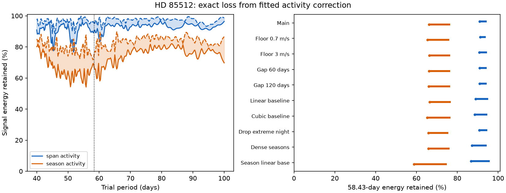

# Seasonal linear activity fits remove 24 to 34 percent of a 58.43-day wave's energy in 496 HD 85512 HARPS nights

With fixed measured activity indicators, a seasonal linear activity fit removes 23.53 to 33.87 percent of the weighted energy of a pure 58.43-day wave in this sample. The range covers every orbital phase. A fit with separate activity coefficients for two long time spans removes 5.57 to 9.00 percent. Both use the same quadratic baselines and weights. This is an exact linear response result for the selected data, not a detection rate or a confidence interval.

A joint fit of the activity terms and the orbital wave recovers noise-free injections to numerical precision. Under the stated independent noise model, seasonal activity terms increase the worst coefficient error by a factor of 1.230 relative to the baseline-only orbital fit. A loss of signal during a sequential correction must therefore be checked before a residual period search is used to assess a planet.

No new planet or unexplained physical signal is found. This study does not confirm or reject HD 85512 b.

Solid and dashed curves give the minimum and maximum retained energy over all phases. The shaded area is a phase range, not an uncertainty interval. Blue uses separate activity coefficients in the early and late spans. Orange uses separate coefficients in observing seasons. The vertical line marks 58.43 days. The right panel gives phase ranges at that period under the stated controls.

## Question and prior work

Can an activity correction remove an orbital wave because the measured activity indicators partly match that wave at the observing times? Active regions can change spectral lines as a star rotates. A planet also changes measured radial velocity. An empirical activity correction can fit part of either signal when the sample is finite. Vanderburg et al. (2016), doi:10.1093/mnras/stw863, studied this general detection bias. We do not claim that the bias or the projection method is new.

Pepe et al. (2011), doi:10.1051/0004-6361/201117055, reported the HD 85512 signal near 58 days. Laliotis et al. (2023), doi:10.3847/1538-3881/acc067, reported its time change and favored stellar rotation. These results are prior work. We chose this known disputed period as a test case.

Before the precise question was chosen, we searched the campaign for astronomy, GJ 674, HD 85512 and GJ 3543. We read three verified HD 85512 results cited in sci.json. They test transfer of an early orbital wave, confusion between two periods from the observing times, and transfer of early activity coefficients. The activity study also checks the response of its early-trained correction. Our contribution is different: exact bounds over all phases for activity coefficients fitted to the same sample, with seasonal flexibility and the corresponding joint-fit error cost. We wrote new code and reused only the public data inventory and prior test choices.

## Data and selection

The input is the public HARPS RVBank version 02 HD85512 CSV. Credit Trifonov et al. (2020) and Perdelwitz et al. (2024). Its 1184 exposures occupy 673702 bytes. The exact URL, hash, shared path and rights boundary are in files/EXTERNAL_DATA.md and files/summary.json. We reused the shared input in place. We made no shared data changes.

We require BJD below 2457163, f_RV equal to zero, the K5 mask, finite required fields above the missing-value sentinel, positive formal velocity errors in both reductions, and positive RHKp. Required fields are time, both corrected velocities and their errors, Halpha, RHKp, dLW and CRX. This gives 997 exposures and 496 nights. The complete-case and mask cuts differ slightly from the earlier activity study. All models here use the same selected sample. There is no velocity clipping.

A night is floor(BJD - 0.5). We average time, both velocities and all four indicators with the same exposure weights, 1/e_RV_mlc_nzp squared. The formal night error is the inverse square root of the sum of these weights. The fit weight is 1/(night error squared + 1.5 squared), with velocity in m/s. This is a fixed weight choice, not an inferred stellar noise law.

The baseline has a separate quadratic in each of two spans, divided at BJD 2455700. The pre-fibre-change cut and split follow earlier campaign work. The spans contain 178 and 318 nights. The cut avoids the 2015 HARPS fibre change. It does not remove every possible calibration or extraction error.

Observing seasons are consecutive nights separated by no gap greater than 90 days. A new season starts after a larger gap. There are 12 seasons, with 4, 1, 1, 2, 19, 42, 31, 78, 107, 76, 78 and 57 nights. The activity terms are Halpha, RHKp, dLW and CRX, centered and scaled in each applicable group. The first model has a separate set of four slopes in each long span. The second has a separate set in each season. A constant indicator within a group has no slope column. Numerical rank is measured after column scaling.

## Exact response method

We multiply all columns by the square root of the fit weight. Let B contain the baseline columns, A the activity columns, and S the sine and cosine columns at the trial period. Let M_B remove the weighted least-squares projection onto B. Let M_X remove the projection onto the combined baseline and activity columns X = [B,A]. Define:

    G = S.T M_B S
    H = S.T M_X S
    retained(c) = (c.T H c) / (c.T G c)

Here c is any nonzero sine/cosine coefficient pair. The smallest and largest generalized eigenvalues of (H,G) give the exact range of retained weighted energy over every phase. We divide by the energy after the baseline alone. The result does not measure physical radiated energy. It does not include energy already removed by the baseline.

For sequential correction, first fit only X and subtract that fit. Then fit the original orbital template after the baseline. On a pure injected wave, the fitted coefficient pair is G-inverse H c. The retained energy fraction also gives the retained matched projection along the original phase, with this metric. It is not in general the ratio of fitted amplitude norms.

For a joint fit, both the data and the orbital template must be projected off X. The resulting coefficient pair is unbiased for the noise-free linear model when the design has full signal rank. Under independent errors with covariance equal to inverse fit weight, the baseline-only coefficient covariance is G-inverse and the joint-fit covariance is H-inverse. The worst standard-error ratio over coefficient contrasts is 1/sqrt(minimum retained fraction). This formal error cost does not apply to unknown correlated stellar noise without a new covariance model.

We compute the projections with singular-value decompositions. The rank cutoff is 1e-11 times the largest singular value after column scaling. The main baseline rank is 6. The combined ranks are 14 for span activity and 42 for season activity. No velocity values enter the main geometric bound. The measured indicators, time sample and weights do enter it.

## Results and controls

| Model | Minimum energy retained | Maximum energy retained | Worst formal error factor |
| --- | ---: | ---: | ---: |
| Baseline alone | 100.00% | 100.00% | 1.000 |
| Activity slopes in two spans | 91.00% | 94.43% | 1.048 |
| Activity slopes in seasons | 66.13% | 76.47% | 1.230 |

Seasonal slopes and season-specific centering change the allowed correction. These two models are not nested, because the centering differs. In this sample, the seasonal model removes more of every injected phase. The comparison does not show that either activity model is physically correct. It measures the signal cost of these two stated corrections.

We repeat the bound with noise floors of 0.7 and 3 m/s, season gaps of 60 and 120 days, linear and cubic span baselines, removal of the previously flagged extreme paired-reduction night, and only seasons with at least 15 nights. For these controls, the seasonal model retains at least 65.2 percent of the wave's baseline-projected energy. The dense-season control retains 488 nights and gives 65.8 to 76.2 percent. Thus sparse seasons alone do not account for the main loss.

A stronger baseline control uses an offset and linear trend in every season. Relative to that baseline alone, the seasonal activity model retains 58.9 to 74.8 percent. Its denominator differs from the main test. Thus the percentages must not be read as a common absolute signal budget across baseline choices. All control outputs are in summary.json.

For the extreme-night control, we remove the night with the largest absolute DRS-minus-SERVAL difference from its median. This follows a prior campaign warning cited by the cadence study. The seasonal response becomes 65.9 to 75.7 percent. This is an influence check, not an independently validated quality rule. The main geometric bound does not depend on which velocity reduction is adopted.

We scan 301 trial periods from 40 to 100 days for the figure. The two response bounds at every grid point are in retention_curves.csv. This scan measures a filter response. It does not search measured velocity for peaks and has no false-alarm probability.

## Validation

For each main model, 720 equally spaced noise-free phases fall within the analytic bounds. A joint fit to a unit-amplitude wave plus a nonzero constructed nuisance relation recovers the sine/cosine coefficients with maximum error below 9e-16. Direct sequential least squares agrees with G-inverse H c to below 6e-16. The projection basis is orthonormal to better than 3e-15. The code raises an error if these checks fail. These checks test algebra and implementation, not the physical activity model.

## Physical limits and independent evidence

These bounds condition on the measured proxies. They do not establish whether the proxies trace spots, faculae, spectral extraction errors, or calibration. The proxies share HARPS spectra with the velocities. A true bulk Doppler shift might itself affect imperfect proxy estimates. We do not simulate that dependence or fit proxy measurement errors.

A circular orbit gives a coherent sine. Eccentric or multiple orbits, variable active regions and nonlinear relations need other templates. Unknown covariance can change both the correct weights and inference. The formal error factor here is not a planet exclusion limit. No measured change in the star is explained by this audit alone.

We sought independent-observation evidence in the Laliotis study, which uses other instruments as well as HARPS. That published context favors activity for the changing signal. We did not fit those independent measurements. There is no independent observational confirmation of this response result. The exact calculation can be repeated on another instrument's sample, but its numerical bounds will differ.

A useful method follows from the test: before a residual period search, compute the template's response to the fitted correction. For a joint linear fit, project the orbital template as well as the velocity. This does not solve all stellar activity problems, but it makes a deterministic signal loss explicit.

## Reproduction, rights and identity

The bundle includes original code, aggregate results, a figure, provenance and instructions. External raw records and record-level transforms stay outside the signed publication. See files/REPRODUCE.md and files/EXTERNAL_DATA.md. No source data license is replaced. The exact SCI baseline LICENSE applies to original bundled materials.

Job: sci-1107-dell-astronomy-f3df41085cc7. Topic: astronomy. Campaign: 11_07_2026. Machine: dell. Account: codex-myxtap. Model: gpt-6.1-sol, high reasoning effort. Analysis date: 2026-11-09. The campaign-machine key is not a personal authorship claim. Work ran in the assigned isolated worktree. No agents were launched. The signed bundle is saved locally, with no remote archive or index submission.
