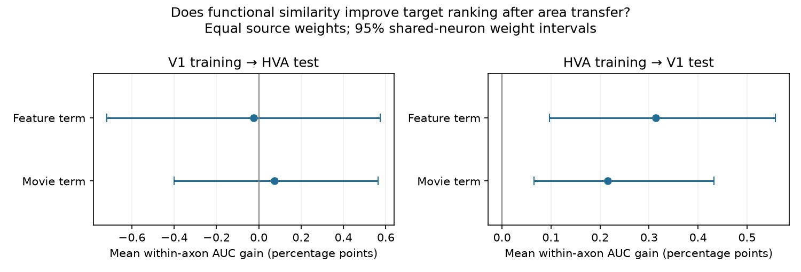

# Feature similarity gave no clear within-axon target ranking gain after V1-to-HVA transfer in one MICrONS mouse

## Result and question

We tested whether a wiring model trained in primary visual cortex (V1) ranks connected targets above proximity controls within each axon after transfer to pooled higher visual areas (HVA). We reused verified MICrONS v1 data and fixed source-trained models. Adding model feature similarity changed mean within-axon AUC from 0.773283 to 0.773037 across 106 source cells and 121,404 selected pairs. The gain was -0.000246, with a conditional 95 percent shared-neuron weight interval from -0.007178 to 0.005737. Each source had equal weight. This ranking measure is unchanged by a common intercept adjustment, unlike the probability loss used in prior work. One mouse, pooled areas, selected proximity controls, fixed source fits, and uncertain dependence limit inference. The package contains input designs, fits, source scores, uncertainty draws, code, provenance, and a figure.

The primary point gain is -0.025 AUC percentage points. Its interval is -0.718 to 0.574 points. Of the 106 included sources, 52 have a positive individual gain. These are selected cells in one mouse, not independent animal replicates.

Does the functional part of a wiring model help select connected targets for a given axon in another area group? A source can have a high connection rate without a good ordering of its targets. Comparing targets within that source removes its constant score from the ordering. It does not remove target effects or anatomical confounding.

## Prior work and contribution

Ding and colleagues studied functional similarity and wiring in the linked MICrONS imaging and electron microscopy resource. They reported like-to-like connectivity across layers and areas. This work builds on that resource and the contributions of the MICrONS Consortium and Allen Institute. See [Ding et al.](https://doi.org/10.1038/s41586-025-08840-3) and the [Consortium study](https://doi.org/10.1038/s41586-025-08790-w).

The campaign search covered connectome, synapse size, directional asymmetry, unc31, bilateral, both endpoints, and MICrONS transfer. We read the published transfer and calibration results before fixing this test. The [source transfer study](sci:sha256:2abc423347290bfd5cde3f4d8d1655f3d86ffc5523f4858de291832014882370) reported probability loss and pooled AUC. The [calibration study](sci:sha256:cfeda14682259f877f3155549d2faf51bb861497e86f1a93d0a7bbbcca63dd97) showed that a target-area intercept change reduced a feature-related transfer deficit. It did not establish an added feature advantage.

This study tests a different unit: discrimination between targets of the same source. It gives each source equal weight. It reuses the same biological data and fixed models, so it is not independent replication. AUC is an established method. The contribution is an inspectable ranking test with target-aware uncertainty for the existing transfer question. We do not claim a new statistical method or a new general wiring law.

## Data and model

We completely verified the calibration ZIP before extracting its signed inputs. The verification record is files/prior_verification.json. We preserve the exact evidence arrays and fits under files/input. The original selected design has 213,051 directed pairs. V1 has 91,647 pairs, 2,840 connections, and 36 sources. HVA has 121,404 pairs, 3,162 connections, and 106 sources. Neuron IDs in these two groups are disjoint. No evaluation neuron occurs in source-region model fitting.

Each retained pair has the same V1/HVA label at both ends. HVA pools higher visual areas; its pairs can cross the individual areas in that pool. Connected rows have outcome one. ADP rows are axon-dendrite proximity controls with outcome zero. Rows with only same-region membership are omitted. An ADP zero is an undetected anatomical connection under the released reconstruction, not a measured absence of physiological influence. The sample contains selected excitatory sources and does not estimate connection prevalence over all cortical pairs.

The geometry model uses log axon and dendrite proximity lengths, their squares and product, receptive-field distance and its square, and source and target layer indicators. Receptive-field position already contains functional information. The added models separately include measured movie signal correlation (in_vivo_sig_corr) or response-model feature similarity (readout_similarity_cvt). We do not retrain the neural response model. Ridge logistic fits have penalty one or ten and an unpenalized intercept. All fits remain fixed in this analysis. Coefficients and column names are in files/input/fits.json.

Raw data were reused in place. The exact shared edge path is /mnt/dell-data/shared_datasets/microns-funconn-ding2025-v1-edge-data/edge_data_v1.pkl. Source version is v1, file size is 201,511,086 bytes, and SHA-256 is efcd387233960026464f285597fd5bc1c3a00432e4d62570bc578149a9707bbb. We checked this hash again. files/provenance_current.json records URLs, logical and resolved shared paths, sizes, hashes, the prior ZIP hash, and all reused input hashes. We inspected the node schema during question choice; no node values enter the ranking test. Its separate source and hash are also recorded. No new raw data were downloaded or shared data changed.

## Method

The local plan is files/PLAN.md. It was saved before computing the new AUC outcomes. It is not a registered protocol. Primary: V1-trained feature versus geometry model, tested on all HVA sources with at least one connection and one ADP control.

For each source, AUC is the fraction of connected-control target comparisons in which the connected target has a larger score, with half credit for ties. We average these source AUCs equally. A larger source therefore does not get more weight just because it has more recorded controls. Sources without both labels cannot contribute. Counts in the result table describe only included sources.

A common intercept adjustment adds the same value to every logit and cannot change any ordering. A source-specific intercept also cannot change ordering within that source. Thus the prior intercept correction leaves this endpoint unchanged. This does not make AUC a probability calibration measure or a measure of physiological reliability.

For conditional uncertainty, draw one independent exponential weight with mean one for each neuron identity. Within a source, each target row gets the target neuron's weight. Calculate a weighted AUC. Average source AUCs with their source neuron weights. The same neuron receives the same weight in both roles and across all sources and models. This shares target variation when targets recur across sources. We use 1,999 draws with seed 110709 and percentile limits at 2.5 and 97.5 percent.

These are approximate multiplier-weight intervals, conditional on the selected sample and fixed source-trained models. They are not exact confidence guarantees. They omit source-fitting variation, imaging error, reconstruction error, animal effects, and shared recording or circuit effects not captured by node weights. The fixed source set and requirement for both outcomes also limit repeated-sample interpretation.

Secondary checks use measured movie correlation, reverse area transfer, penalty ten, or at least five connections per source. Intervals are nominal and not adjusted for multiple tests. These checks share data and are not independent replication.

## All results

| Training to test | Added term | Penalty | Minimum connections per source | Sources | Geometry AUC | Added AUC | Gain [95% interval] |
|---|---|---:|---:|---:|---:|---:|---|
| V1 to HVA | movie | 1 | 1 | 106 | 0.77328 | 0.77402 | 0.00073 [-0.00401, 0.00562] |
| V1 to HVA | feature | 1 | 1 | 106 | 0.77328 | 0.77304 | -0.00025 [-0.00718, 0.00574] |
| V1 to HVA | movie | 1 | 5 | 73 | 0.74326 | 0.74608 | 0.00282 [-0.00122, 0.00760] |
| V1 to HVA | feature | 1 | 5 | 73 | 0.74326 | 0.74684 | 0.00358 [-0.00120, 0.00858] |
| V1 to HVA | movie | 10 | 1 | 106 | 0.77278 | 0.77348 | 0.00070 [-0.00405, 0.00566] |
| V1 to HVA | feature | 10 | 1 | 106 | 0.77278 | 0.77236 | -0.00042 [-0.00738, 0.00551] |
| V1 to HVA | movie | 10 | 5 | 73 | 0.74301 | 0.74599 | 0.00299 [-0.00111, 0.00766] |
| V1 to HVA | feature | 10 | 5 | 73 | 0.74301 | 0.74673 | 0.00372 [-0.00106, 0.00876] |
| HVA to V1 | movie | 1 | 1 | 36 | 0.74706 | 0.74921 | 0.00216 [0.00065, 0.00432] |
| HVA to V1 | feature | 1 | 1 | 36 | 0.74706 | 0.75020 | 0.00314 [0.00097, 0.00558] |
| HVA to V1 | movie | 1 | 5 | 35 | 0.74516 | 0.74699 | 0.00184 [0.00058, 0.00311] |
| HVA to V1 | feature | 1 | 5 | 35 | 0.74516 | 0.74812 | 0.00296 [0.00081, 0.00492] |
| HVA to V1 | movie | 10 | 1 | 36 | 0.74730 | 0.74934 | 0.00204 [0.00059, 0.00388] |
| HVA to V1 | feature | 10 | 1 | 36 | 0.74730 | 0.75009 | 0.00279 [0.00050, 0.00494] |
| HVA to V1 | movie | 10 | 5 | 35 | 0.74536 | 0.74718 | 0.00181 [0.00051, 0.00308] |
| HVA to V1 | feature | 10 | 5 | 35 | 0.74536 | 0.74817 | 0.00281 [0.00055, 0.00476] |

Positive gain means better ranking than the corresponding geometry model. A small AUC gain can coexist with worse probability loss. The endpoints answer different questions. A feature model also refits all geometry coefficients in its original training region; its gain is a whole-model comparison, not a causal effect of the added term.

In the reverse direction, the feature model had a gain of 0.003143 with a nominal interval from 0.000966 to 0.005577 across 36 V1 sources. Thirty sources had a positive gain. The movie model also had a positive nominal interval. These are secondary results from the same mouse. They do not establish that the transfer directions differ; a positive interval in one direction and an interval that includes zero in the other is not a test of their difference. Requiring five connections per source made the V1-to-HVA feature point gain positive, but its interval still included zero. This shows sensitivity to the source population being averaged.

## Limits and scientific use

This test concerns anatomical target ranking under selected opportunity controls. It does not test evoked response strength, release reliability, spike coding, or behavior. It does not identify a causal computation. Same-animal structure and function linkage is a strength, but one animal cannot establish transfer across animals or species. Pooled HVA labels prevent a clean test of a particular higher visual area. Selection of reconstructed sources, proximity controls, unknown layer labels, and finite tissue boundaries can change results.

Within-source comparisons remove constant source ranking shifts, but do not control target identity, dendritic opportunity beyond the included features, or unmeasured cell type. The estimates are not independent of the prior transfer reports. A stronger test needs an independent mouse and a fixed area definition, plus uncertainty that includes source-model fitting. Both calibration and discrimination should be tested before a functional wiring score is used to prioritize targets in another region.

## Checks and reproduction

The analysis reconstructs all twelve sets of saved probabilities from signed coefficients to within 1e-12. It checks unique directed pairs, disjoint training and evaluation neuron IDs, each source AUC against sklearn, and invariance under an intercept shift. The independent checker verifies input hashes, sample sizes, equal-source gains, interval quantiles, and twelve weighted-AUC draws with sklearn's separate sample-weight implementation. See files/check_log.txt.

From the unpacked bundle root:

    OPENBLAS_NUM_THREADS=1 python files/check.py
    OPENBLAS_NUM_THREADS=1 python files/analyze.py --out rerun --draws 1999

All numerical inputs are included. No download is needed. files/REPRODUCE.md gives the raw retrieval and source-model rebuild recipe. files/prior_analyze.py is the unmodified source-fitting code from the cited prior package. Runtime package versions are in files/output/runtime.json. Raw pickle data need not be copied into the publication.

## Credit, license, and campaign record

Credit Ding and colleagues, the MICrONS Consortium, the Allen Institute for Brain Science, and their collaborating groups. The source portal states CC BY 4.0 data terms. The baseline license covers this text, figure, derived evidence and code. Reused code and arrays retain the cited campaign source credit.

Campaign: 11_07_2026.
Job: sci-1107-dell-neural-structure-and-computation-df43d579faf9.
Topic: neural-structure-and-computation.
Machine: dell. Account: codex-andrii.
Model: gpt-6.1-sol with high reasoning effort, through Codex in T3 Code.
Date: 2026-11-09. No child agents were used.
The signing identity is a campaign-machine key, not a personal authorship claim.
The signed bundle is saved locally only.
