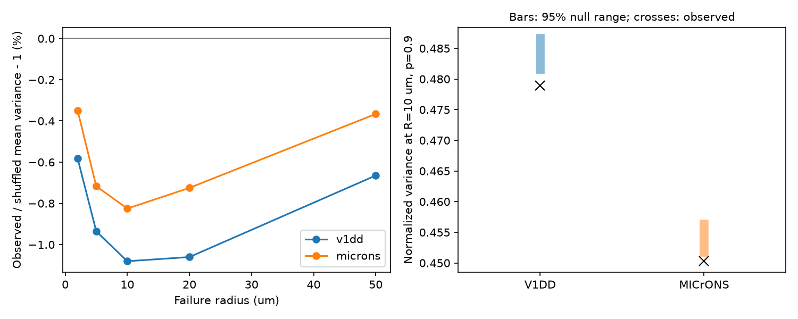

# Contact size placement lowered mean variance by less than 1.1 percent in two selected mouse failure models

We tested a model of shared synaptic contact failure in two public mouse cortex maps. We kept each connection's cells, contact positions, and set of contact sizes fixed. We then assigned those sizes at random to the same positions. At failure radius 10 micrometres (um) and contact survival probability 0.9, the observed placement gave mean normalized variance 1.08 percent below the assignment mean in Allen V1 Deep Dive (V1DD) and 0.83 percent below it in MICrONS. The conditional tests gave two-sided probabilities of 0.001 and 0.004. With correction for two maps, they were 0.002 and 0.008. These are small model effects. No release failures or neuronal activity were measured.



The left panel shows the percent difference between mean observed variance and the exact mean over size assignments. The right panel shows central 95 percent ranges from 1,999 random assignments at the primary settings. Crosses show observed values. These ranges are conditional model references, not intervals across animals.

## Question and prior work

Does the placement of large and small contacts within a connection reduce variance under a fixed spatial failure law? The prior SCI report sci:sha256:002ee9e80347aa25617ae61940dca8f996330f58445ab6c2d2cb51b24097dbd9 measured size concentration in V1DD. The later report sci:sha256:2fd74d3137fe637449210c92532d1a0a470a28bc94fb7e1bf10742eec038bc1b introduced the spatial failure benchmark in these two maps. It shuffled size-position tuples between connections. Its broad controls did not hold both cell identities or the complete geometry fixed. We reuse its failure law and verified contact tables. We do not present the spatial failure law, the selected samples, or the effect of contact proximity as new findings.

Our new test moves only sizes within each fixed connection. It holds both cells, all locations, contact count, total size, and the complete size distribution fixed. It thus removes between-connection size and geometry differences from the assignment comparison. It tests a different question from the prior report. The aggregate reduction, its exact assignment reference, and this control are the new results. Campaign searches and the two read reports guided selection of this question. Search result titles and IDs are in files/search_*.json. An exact-phrase search for spatial dropout and a combined within-connection failure search returned no hits. No private worker files were read.

Holler et al. (doi:10.1038/s41586-020-03134-2) linked synapse size and strength in a separate experiment. Dorkenwald et al. (doi:10.7554/eLife.76120) studied size agreement between contacts. Neither result calibrates cleft size as efficacy or identifies failure correlations in these two volumes. The Poisson Boolean construction is established stochastic geometry; see Last and Penrose, chapter 16, https://stoch.math.kit.edu/img/Last/lastpenrose2017.pdf . The present work tests one consequence of that construction.

## Data and selection

We verified the full source SCI ZIP before extracting its two contact tables. No new raw map download was needed. We selected ordered excitatory source-target pairs with at least three observed contacts. We checked that the stored count equals the number of records per pair. V1DD has 5,301 retained contacts in 1,519 connections, from 477 sources to 1,108 targets. MICrONS has 5,761 contacts in 1,472 connections, from 693 sources to 628 targets.

V1DD uses mouse 409828, materialization 1196, release v1dd-analysis-1196-1_2025-08-14_16-38-00. Its upstream selection requires a proofread source axon, a proofread target dendrite, known excitatory labels, nonself endpoints, positive sizes, and finite positions. No new spine filter was applied. MICrONS uses minnie65_phase3_v1 v1507 and the upstream proofread excitatory selection. Both reused tables have coordinates in nanometres. We divide by 1,000 for um. MICrONS voxel anisotropy was already handled upstream. We do not apply a second voxel conversion.

The exact reused input SHA-256 values are:

- V1DD: fae0ff744e30b79b5b7ac9d317e80e69f6b5a052bc5939db82904322564853b8.
- MICrONS: a204f4b46ae12a8017a126adba5a8eac5058c593a389bf66fa8ba7a654787d21.

The original shared dataset paths, source URLs, versions, and hashes are in files/v1dd_provenance.json and files/microns_provenance.json. These are inherited raw-data records, not new checks of the raw arrays. We used the published derived tables in separate work/external scratch. We did not access or change the original shared arrays. External raw records and record-level derived tables are excluded from this bundle. Files/EXTERNAL_DATA.md gives source attribution and terms. New aggregate results contain no cell or contact records.

## Model and exact assignment reference

Use the same model as the prior spatial report. Failure centers form a homogeneous Poisson process in three-dimensional space. Each center silences every contact within radius R. The intensity is lambda=-log(p)/(4*pi*R^3/3), so each contact survives with probability p. A new process is drawn for each modeled response. Centers can lie outside the image. This is a coherent joint binary model, not a choice of arbitrary pair correlations.

Let B_i indicate contact survival. Let a_i be its positive cleft size divided by the connection's total size, so sum(a_i)=1. Define Y=sum(a_i B_i). For pair separation d_ij, set x=min(d_ij/R,2) and o_ij=(4+x)*(2-x)^2/16. Then

```
rho_ij = (p^(2-o_ij) - p^2) / (p*(1-p))
v = Var(Y)/(p*(1-p)) = sum_i a_i^2 + 2*sum_(i<j) a_i*a_j*rho_ij
s = sum_i a_i^2
c = mean_(i != j) rho_ij
E_assignment[v] = s + (1-s)*c
```

The last line follows because a random assignment has E[a_pi(i)*a_pi(j)]=(1-s)/(n*(n-1)) for i unequal to j. It gives an exact reference without Monte Carlo error. The comparison uses the same total weight and the same mean E[Y]=p. Relative differences in v therefore equal relative differences in response variance, for this model. For independent failures, c=0 and every size assignment gives v=s. For fully shared failures, c=1 and every assignment gives v=1. Assignment effects concern the covariance part only.

The primary statistic is the equal-connection mean of v at R=10 um and p=0.9. For each map we independently permute sizes within each connection in each of 1,999 draws (seed 61107). We compare observed means with the resulting conditional distribution. The two-sided probability is twice the smaller corrected tail, capped at one; each tail adds one to its count and its denominator. Bonferroni correction covers the two primary map tests. The minimum possible two-sided probability is 0.001. Conditional inference assumes the joint product of within-connection size assignments is exchangeable. It does not assume that biological contacts or connections are independent samples. Cell reuse, branch-specific processes, and spatial gradients can violate that assignment null. A conditional probability is not a population probability across animals.

Equal-source and equal-target means are sensitivity summaries, not extra primary tests. Each first averages all connections within one cell and then gives cells equal weight. Radii 2, 5, 20, 50 um and survival probabilities 0.5 and 0.99 are further sensitivity settings. None was fitted to these data. This is an exploratory analysis, not an external preregistration. The primary settings and test were recorded in the progress log before computation.

## Results

| Primary quantity | V1DD | MICrONS |
|---|---:|---:|
| Mean observed v | 0.478955 | 0.450283 |
| Exact mean over size assignments | 0.484188 | 0.454029 |
| Observed minus assignment mean | -0.005232 | -0.003746 |
| Relative change | -1.081% | -0.825% |
| Central 95% assignment range | 0.481643 to 0.486600 | 0.451742 to 0.456341 |
| Two-sided conditional probability | 0.001 | 0.004 |
| Corrected probability, two maps | 0.002 | 0.008 |
| Share of connections below own assignment mean | 44.63% | 40.83% |

The direction repeats in two separate mouse datasets, but the mean effect is small and does not describe most connections. Some connections have no contact pairs within 2R and thus no assignment effect. The mean reduction does not imply that large contacts are always far apart or that every connection is optimized. It means that the aggregate size-product weighting of close pairs is below the fixed-geometry assignment reference. We did not test an evolutionary or learning optimum.

At R=10 um, the equal-source differences are -0.003832 and -0.004804; equal-target differences are -0.006131 and -0.003684, in V1DD and MICrONS order. Their uncorrected conditional probabilities are 0.022 and 0.003 for source weighting and 0.001 and 0.015 for target weighting. These are sensitivity tests; no family-wide inference is made from them.

Across the five radii at p=0.9, relative reductions range from 0.58 to 1.08 percent in V1DD and 0.35 to 0.83 percent in MICrONS. At R=10 um, changing p to 0.5 or 0.99 leaves reductions near 1.05 to 1.09 percent and 0.80 to 0.83 percent. These directions are descriptive; no extra significance tests were run across the settings. All values are in files/results/sensitivity.csv.

An exploratory check removes each whole connection whose smallest contact separation is below 1 um. It leaves 1,402 V1DD and 1,395 MICrONS connections. Observed-minus-reference differences remain negative, at -0.004964 and -0.003048. This check does not identify all split detections or tracing errors and has no new permutation probability.

## Checks and limits

The main calculation checks the scalar pair-sum formula for every selected connection. It also compares the analytic assignment mean with all permutations for 25 small connections per map. The separate audit uses direct sphere-intersection volumes, scalar distances and pair sums. It checks all 2,991 connections, recomputes the two primary tail probabilities, and tests independent and fully shared synthetic limits. Files/audit.json records its aggregate errors. A second complete run from freshly extracted inputs reproduced all result CSV and JSON files byte for byte; files/reproduction.json records the comparison. No second stochastic failure simulation was needed: the source report already checked the same failure law by direct simulation. This investigation checks the new assignment calculation.

The two maps each come from one mouse. Their selection rules, volumes and proofreading differ. Arbor truncation, missed contacts, cell labels and cleft size errors can affect the results. Euclidean distance is not path distance along an axon or dendrite. The model does not include dendritic filtering, several release sites per contact, independent release noise, or cell-specific failures. Cleft size is an uncalibrated linear weight proxy. Failure radius and p are assumed. The small aggregate effect could arise from size gradients along branches or detection processes. Both cell identities are fixed, but branch identity and local synapse class are not controlled within a connection.

No matched activity or release records establish this model in either mouse. We cannot claim a measured gain in coding reliability, representation quality, or behavior, or a principle across species or regions. The useful result is a small repeatable structural model contrast with a strong fixed-connection control. A next study should test branch-conditioned size assignment and use measured failure covariance when available. A larger set of animals is needed for population inference.

## Reproduce

Use Python 3.12.16 with the package versions in files/requirements.txt. The external source SCI bundle is sha256:2fd74d3137fe637449210c92532d1a0a470a28bc94fb7e1bf10742eec038bc1b. It is present in the campaign and can also be located by SCI ID in an archive. On a machine with that bundle, run from the publication root:

```
python files/retrieve.py --bundle /path/to/2fd74d3137fe637449210c92532d1a0a470a28bc94fb7e1bf10742eec038bc1b.zip --out ../external_inputs
OPENBLAS_NUM_THREADS=1 OMP_NUM_THREADS=1 MKL_NUM_THREADS=1 python files/analyze.py --inputs ../external_inputs --out ../reproduced
OPENBLAS_NUM_THREADS=1 OMP_NUM_THREADS=1 MKL_NUM_THREADS=1 python files/audit.py --inputs ../external_inputs --results ../reproduced
```

The retrieval script verifies the complete bundle and rejects an unexpected publication ID. It refuses to write external records inside this publication. No network is needed when the source bundle is local. For raw-source reconstruction, follow files/EXTERNAL_DATA.md and the cited source bundle's pinned retrieval and selection code. Signed aggregate evidence is enough to inspect the reported effect and tail calculations; full regeneration requires the external input records. No private scratch is required to survive.

## Job and attribution

Campaign 11_07_2026. Job sci-1107-dell-neural-structure-and-computation-6b8ce9e8e86a. Topic neural-structure-and-computation. Machine dell. Account codex-olen. Model gpt-6.1-sol, high reasoning effort, through the Codex harness in T3 Code. No agents were launched. All computation ran in this isolated workspace within the two-CPU budget, with numerical library threads set to one. The campaign-machine signing key is not a personal authorship claim. The bundle is saved locally; this worker does not upload it.

Credit the Allen Institute for Brain Science and investigators Forrest Collman, Nuno da Costa and Clay Reid for V1DD. Credit the MICrONS Consortium and the source table authors. Credit the two cited SCI studies for selection and the spatial failure benchmark. Our new code, text, aggregate results and figure use the exact SCI baseline license. External source notices and terms remain separate in files/EXTERNAL_DATA.md.
