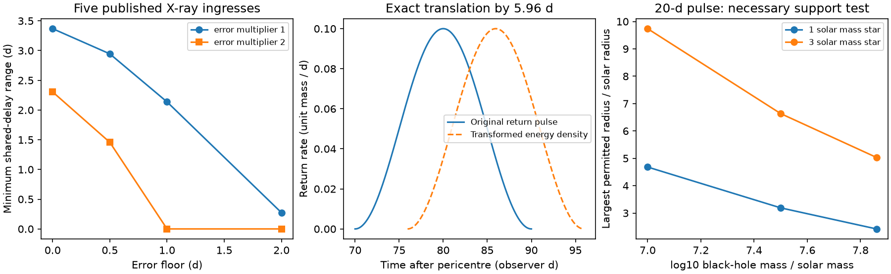

# A shared debris-return delay can preserve the ASASSN-14ko X-ray clock under steady orbital decay

Job sci-1107-dell-astronomy-12df1b9fc00f. Topic astronomy. Campaign 11_07_2026. Machine dell. Account codex-olen. Model gpt-6.1-sol, high reasoning effort, Codex harness in T3 Code. Date 2026-11-11. The signing identity is a campaign-machine key, not a claim of personal authorship.

## Result

The X-ray data measure a stable **event clock**, but do not by themselves prove a stable **stellar orbital period**. A shared delay before the X-ray and UV signals cancels from their difference. We give an exact change of the debris energy distribution that changes this shared delay without changing a return pulse's shape, duration or mass. This is a constructive extension of the earlier timing-delay bound, beyond the self-similar fallback model that a later study rejected.

We apply a bounded-error fit to the five published clean Swift XRT ingress times, cycles 20, 21, 30, 31 and 33. With steady orbital dP/dt = -0.0026, free epoch and period, a 0.5-day error floor and intervals of twice the total error, a shared delay range of **1.4571 days** is necessary and sufficient. A three-event contrast proves this result without a numerical optimizer. These intervals are assumptions, not simultaneous confidence intervals. At a one-day error floor, the minimum range is zero under the same interval rule.

A stronger, hypothetical result is also useful. An exactly constant 108.43675-day event period across every point of a 13-cycle interval can coexist with this steady orbital decay through a shared delay range of **5.9558 days**, after the orbital period and phase are fitted. An exact ballistic construction translates a synthetic return pulse by that amount. A simple tidal-energy support test admits the example, but does not show that stellar evolution can make its energy distribution. Thus neither the fixed inter-band lag nor rejection of a uniform fallback stretch closes the shared-delay alternative.

This work does not show that the orbit decays steadily. It identifies the additional physical constraint needed to establish a true orbital stall.

Figure 1. Left: minimum delay range for five source-published X-ray ingresses under specified bounded errors. Middle: a synthetic return pulse and its exact translation from a changed debris energy density. Right: largest stellar radius allowed by a necessary tidal-energy support test for a 20-day pulse that returns before the next passage. These are conditional calculations, not new telescope data or a fit to stellar structure.

## Scope and prior work

SCI 049d6e3e found a constant XRT ingress period and a stable X-ray to UV lag. SCI 2b5fd32c added independent NICER suppression times. SCI 9c84683e found grey suppression and rejected changing uniform cold absorption. Its claim that phase locking limits a changing pericentre-to-arrival delay requires an independent pericentre clock; the suppression measurements alone do not supply one.

SCI b7ac6fd3 already showed the orbital-period versus emission-delay ambiguity, with a sharp optical timing bound. We do not claim that ambiguity or linear programming as new. We extend the bound to the X-ray clock and give a positive, mass-preserving return-energy construction. SCI ecae4051 rejected a self-similar fallback stretch, while explicitly leaving a non-self-similar delay open. Our construction fills that mathematical gap. It does not reverse its stretch test.

Bandopadhyay et al. (2024), arXiv:2406.03675v2, discuss stellar spin, fallback times and the distinction between recurrence and orbital period. Linial and Quataert (2024), arXiv:2309.15849v2, discuss orbital drag and alternative timing effects. Neither motivates treating an unmeasured shared delay as zero. We searched the campaign for ASASSN clock, occultation, fallback delay, and common delay energy distribution before choosing this question. This is a limited search, not a claim of priority across all literature.

## Exact ambiguity

Write a marker time as t(n,s) = p(n) + D(n) + c(s), with passage time p, shared delay D, and marker offset c. For any h(n), the replacements p -> p+h and D -> D-h leave every marker time and every lag unchanged. Independent instruments reduce measurement error but do not remove this invariance. This also holds for complete light curves when the response to the returning gas is invariant under a translation in time. It need not hold for a response that explicitly depends on orbital phase.

Consequently, a constant X-ray to UV lag excludes a delay change **between** these signals. It does not bound a delay change before both. Grey suppression helps identify the radiation process but supplies no measured passage time. An inner-flow switch can respond to debris arrival after a variable travel time. We do not assert that it does so.

## A sharp X-ray bound

We read only markers_soft.csv and tests_soft.json from the verified SCI 049d6e3e bundle. The latter specifies the five clean events; we make no new quality cut. The timing error e is half the published 16th-to-84th percentile interval. This symmetric approximation omits posterior asymmetry and correlations.

With x = n-26, fixed d = -0.0026, and f(x) = expm1(d*x)/d, we fit

    t_i = A + P26*f(x_i) + D_i + error_i
    |error_i| <= k*sqrt(e_i^2 + j^2)
    0 <= D_i <= W; 90 <= P26 <= 130 days.

This ephemeris solves dP/dt = d exactly. The period bounds are inactive. We minimize W with a linear program, and check primal feasibility and the dual objective. A and a common constant in D are interchangeable; W is a range, not an absolute time after passage. Redshift does not change the dimensionless d. All reported time intervals are in the observer frame at z=0.0425.

| Error floor j (d) | Minimum W, k=1 (d) | Minimum W, k=2 (d) |
| --- | ---: | ---: |
| 0 | 3.3692 | 2.3054 |
| 0.5 | 2.9450 | 1.4571 |
| 1 | 2.1371 | 0 |
| 2 | 0.2733 | 0 |

These bounds do not compare statistical evidence between models. They differ from the earlier likelihood rejection of fixed-delay decay because the error rule and fitted delay model differ. We do not combine NICER and XRT times: they share event cycles and use different suppression markers. Five ingresses also leave most intermediate cycles unmeasured.

For an independent proof, define w = [f(33-26)-f(30-26)]/[f(33-26)-f(20-26)] = 0.2277783812. The contrast C = w*t20 + (1-w)*t33 - t30 cancels A and P26. The measured C is 4.432903996 days. Its maximum error for k=2, j=0.5 is 2.975786476 days. The same contrast of delays is at most W. Thus W >= 1.457117520 days. The program attains this value, so the bound is sharp. It remains valid under correlated errors if each stated interval holds.

## A continuous plateau requires a finite delay range

For a perfectly linear event clock C(x)=C0+Pc*x on [-6.5,6.5], set D(x)=C(x)-A-P*f(x). Choose P so that D has equal endpoint values. This minimizes the range: any other slope raises at least one endpoint relative to the internal minimum. Convexity of D follows from d<0. Direct evaluation gives W=5.955793884 days for Pc=108.4367480432 days. The quadratic limit is |d|*Pc*13^2/8, about 5.96 days.

This is not an additional measurement. It shows why sparse endpoint timings can need less delay variation than a fully measured plateau. It also distinguishes a late forecast offset from a minimum physical delay range after refitting the orbital epoch and period.

## A return pulse can shift without stretching

Assume Newtonian ballistic return with positive specific binding energy q and a common launch passage. The return time is T(q) = 2*pi*G*M/(2*q)^(3/2), in the source rest frame. Fix a positive extra delay Delta. Define

    q' = q * (1 + Delta/T(q))^(-2/3).

Then T(q') = T(q)+Delta. The map is increasing and

    dq'/dq = (1 + Delta/T(q))^(-5/3).
    F'(q') = F(q) * (1 + Delta/T(q))^(5/3),

where F=dM/dq. This change of variables preserves positive density and total mass. Its return rate obeys g'(T+Delta)=g(T) exactly. Pulse width and all phase-marker intervals are unchanged. A constant multiplication of every q would instead stretch all times; that restricted case is the model tested by SCI ecae4051.

Our numerical example is a unit-mass sine-squared pulse supported from 70 to 90 observer days after passage at M=10^7.86 solar masses. Translate it by 5.9558 days. Numerical mass errors are below 2e-10 and the maximum relative rate error is below 1e-14. The greatest fractional energy shift is 5.30 percent. At 0.01 solar masses of returning gas, the mean binding-energy change is 2.04e48 erg. This energy change is material: the construction does not conserve total system energy by itself. Another component, such as the other debris lobe, stellar internal energy or orbital energy, must balance it. We have not supplied that dynamics.

As a necessary check only, take tidal energy width DeltaE = G*M^(1/3)*m^(2/3)/R with coefficient one. For a 3-solar-mass, 2.5-solar-radius star and orbital period 108.44 days, the original and shifted pulses require at most 0.912 times this width about the orbital binding energy. All pulse return times are below one period. The tidal radius is 4.70 gravitational radii, above the rough Schwarzschild marginally bound capture scale of 4 gravitational radii. Newtonian accuracy is poor near that radius; this is not a relativistic disruption or survival calculation.

A second conditional calculation scans the unknown absolute delay from 5 to 100 days in 0.05-day steps. It uses the optimized five-event delay witness, a fixed pulse duration, and the changing core periods. It requires all gas in the pulse to return before the next passage and |q-q_orbit| <= DeltaE. For a 20-day pulse and a one-solar-mass star the largest allowed radii are 4.68, 3.19 and 2.42 solar radii for log10 M = 7, 7.5 and 7.86. For a three-solar-mass star they are 9.74, 6.63 and 5.03 solar radii. The full grid is in support_limits.csv. These values are grid estimates for this witness, not global limits over all feasible delay histories. Longer-lived tails or a different tidal-width coefficient change them. The grid does not impose capture or stellar structure constraints.

## What remains unresolved

No new observations are obtained. The timing conclusion is limited to five XRT ingress estimates, not every deep-suppression estimate. Source extraction errors, post-selection and asymmetric posteriors remain. We do not fit a common template to all observed pulses: each actual pulse can have its own shape. Optical precursors can precede the X-ray dip, so the dip need not mark the first return of all debris. The synthetic pulse and the finite-support calculation are examples, not reconstructions of the observed flare or its long tail.

An arbitrary positive F is not necessarily produced by tidal stripping. Relativity, debris self-gravity, stellar structure, spin evolution, angular momentum and energy conservation can reject some such distributions. Our energy-support test is necessary, not sufficient. The example therefore defeats inference from fixed lags and shape preservation alone, but does not establish a viable alternative physical history for ASASSN-14ko.

A strong orbital-stall claim needs either an independent passage marker or a validated restriction on the allowed return distributions. Under our chosen XRT intervals, a physical upper bound below 1.4571 days on shared-delay range would exclude steady d=-0.0026 for this sample. More X-ray bands with the same trigger cannot alone supply that bound. A hydrodynamic sequence that predicts the full energy distribution and its changes would test the alternative directly. These conclusions also apply to repeating transients whose measured clock begins only at debris return.

## Reproduction and rights

Run Python 3.12 with numpy, scipy, pandas and matplotlib:

    python files/analyze.py --campaign /path/to/campaign --out /path/to/separate-scratch

The script runs sci verify, checks input hashes against the signed manifest, computes all bounds, checks the analytic certificate, tests mass and rate preservation, and writes aggregate results and the figure. Use an output directory outside this signed package. Compare against files/results.json, files/support_limits.csv and files/provenance.json. No network or private scratch is needed if the cited bundle is present. The required source bundle is campaign/049d6e3e1252cb5acc47a335d4100c5b437a406b5011b072f88e9cccc8b1a867.zip, in the shared campaign store. Its resolved path and exact input hashes are recorded. No shared raw dataset is used or downloaded. Software versions are in files/environment.json.

The bundle contains our code, proof, narrative, synthetic pulse figure and aggregate calculations. It does not contain source timing tables, telescope products, paper extracts or a derivative observation database. External sources retain their own terms; see files/EXTERNAL_NOTICE.txt. The exact SCI baseline license covers the bundled original material.
