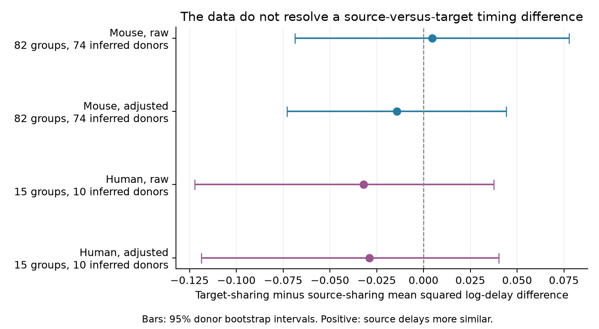

# Matched Allen cortical recordings do not resolve a source-versus-target difference in synaptic delay similarity

## Result

Connections with one source cell did not show a clear difference in delay similarity from connections with one target cell in this test. The mouse sample had 82 matched groups from 80 recordings and 74 inferred animals. The human sample had 15 groups from 14 recordings and 10 inferred donors. All four main confidence intervals include zero. This result does not show equal variation or the absence of cell effects.

The main contribution is a reproducible comparison of two local circuit structures within the same recording and cell-class group. It measures how much delay variation occurs across connections. It does not measure timing variation across trials.

## Question and prior work

Can a shared source cell give its output connections a common delay? Such an effect could help preserve the relative times of signals that travel through different branches of a circuit. A shared target could also give its input connections similar measured delays through common cell and recording properties. A comparison of these two patterns can test which end of the connection better organizes delay similarity.

Campagnola, Seeman and colleagues (2022, doi:10.1126/science.abj5861) measured local connectivity and synaptic properties in mouse and human cortex. Their work established strong links between cell type and synaptic properties. Allen methods describe delay estimates from fits to average responses. Boudkkazi and colleagues showed that presynaptic release probability and action potential shape can change cortical synaptic delay (2007, doi:10.1016/j.neuron.2007.10.037; 2011, https://pubmed.ncbi.nlm.nih.gov/21224227/). These results motivate a shared-source hypothesis, but do not require it to hold across different target cells.

The campaign search for `connectome neural` and `latency` returned no matching publications before this question was fixed. The shared store also contains earlier published Allen distance-and-delay studies. Their metadata report distance effects and donor-held-out prediction results. This investigation uses a different contrast: shared source versus shared target within a recording. It does not claim to discover distance effects or to provide a complete review of prior work. The prior metadata paths and hashes are in `files/input_metadata.json`.

## Data and selection

The source is the Allen Synaptic Physiology r2.1 small SQLite database, schema 22, S3 date 2023-01-26. Its exact shared path is:

`/mnt/dell-data/shared_datasets/allen_synphys/r2.1_small_2023-01-26/synphys_r2.1_small.sqlite`

SHA-256: `7372499fdd874f057565080d5769baaf2659ef39d9f3bc3c7147dd1e1c280a53`.

The code opens the database in read-only mode and checks this hash. It joins `pair`, `synapse`, `cell`, `experiment`, and `slice`. It requires a confirmed chemical connection and finite positive distance and delay. It does not use the pulse-train arrays, which the shared metadata identify as affected by an order problem. It does not use `poly_synapse` or electrical coupling measurements. A cell pair can have other coupling in addition to a chemical synapse; such pairs are not excluded.

There are 3,297 confirmed synapse rows. Of these, 2,636 have positive finite distance and delay across all regions. The analysis uses 2,235 mouse connections labeled `VisP` and 383 human cortical connections. There is no further independent fit-quality filter. Positive measured delays include very short values; a range sensitivity test is reported below.

The structure here is a measured, directed local connection graph from slice recordings. It is not an electron microscopy connectome. Structure and function are linked by the same recorded cell identities. The source database is not included in this package. Original Allen data remain under the Allen Institute terms of use.

## Method

The saved plan, `files/PLAN.md`, was written before the outcome was calculated. For each species, define a group by recording, synapse sign, source nonsynaptic cell class, and target nonsynaptic cell class. Missing class is a separate value. Both connections in each comparison must be in the same group. This controls recording conditions and broad ordered cell class by design.

For each group, form all unordered pairs of distinct connections that have the same source. Separately, form all unordered pairs that have the same target. These are branching and converging two-edge structures. A reciprocal pair has neither shared end under these definitions and is not included. Retain only groups that have at least one comparison of each type.

For each comparison, square the difference in natural log delay. Average these values within each structure type and group. Subtract the source-sharing mean from the target-sharing mean. Finally, average these contrasts with equal weight per group. Positive values favor more similar delays from one source. Units are squared natural log delay; a change of time units does not change this contrast. The ratio of the two group-mean squared differences is a descriptive statistic, not an estimate of a cell variance component.

For adjustment, use five folds split by inferred donor. Fit a linear ridge model on four folds and predict log delay in the remaining fold. The penalty is fixed at 10; the intercept has a near-zero penalty. Features include distance in units of 100 micrometres, its square, age, temperature, and indicator variables for source and target cell class, target layer, Cre type, synapse sign, internal solution, and external solution. Feature scales use training data only. Category names are collected without delay labels. The code uses full indicator sets and does not fit interactions. Missing age and temperature are set to zero; missing categories are explicit values. Apply the same graph comparison to the held-out residuals. These are adjusted associations, not causal effects.

Mouse donor labels remove slice suffixes from specimen names. Human labels use the first three specimen-name parts. If a mouse name cannot be parsed, the recording storage prefix is used as a fallback cluster. There are 173 fallback connections in the mouse modeling set and 23 in retained groups. Thus, some inferred clusters may divide a true animal. Human names all passed parsing. No direct donor identifier was available in the joined fields. The code saves only donor digests.

For each analysis, draw 2,000 bootstrap samples of donor clusters with replacement. All retained groups from a sampled cluster receive its sampled count. The 2.5th and 97.5th percentiles give the reported interval. This bootstrap holds the residual predictions fixed; it does not include model refit uncertainty. For a second check, shuffle values across the fixed edges within each retained group 2,000 times. Report a two-sided randomization P value with a plus-one correction. This test assumes values are exchangeable across edges within a group. It tests this stronger null, not solely equality of the two biological variance components. Raw and adjusted results use separate randomization draws.

## Evidence

| Species and analysis | Source mean square | Target mean square | Target minus source | 95% cluster interval | Randomization P |
| --- | ---: | ---: | ---: | --- | ---: |
| Mouse, raw | 0.19864 | 0.20319 | 0.00455 | -0.06872 to 0.07775 | 0.941 |
| Mouse, adjusted | 0.18505 | 0.17075 | -0.01430 | -0.07297 to 0.04426 | 0.795 |
| Human, raw | 0.13261 | 0.10064 | -0.03197 | -0.12229 to 0.03747 | 0.483 |
| Human, adjusted | 0.12658 | 0.09776 | -0.02882 | -0.11860 to 0.04011 | 0.503 |

The mouse retained groups contain 363 connections, with 166 source-sharing comparisons and 164 target-sharing comparisons. Human groups contain 66 connections, with 25 and 28 comparisons. Group connection counts include all edges in retained groups, including edges that need not enter either comparison. Comparisons can share edges and cells. They are not independent samples; uncertainty is clustered above the group level.

Giving recordings equal weight instead of groups gives adjusted contrasts of -0.01154 in mouse and -0.03220 in human. Removing one inferred donor at a time gives ranges of -0.02464 to -0.00260 and -0.05134 to -0.00586. These are influence checks, not confidence intervals.

The mouse adjusted contrast is -0.10291 in 23 excitatory groups and 0.02025 in 59 inhibitory groups. These descriptive differences suggest possible cell-type dependence, but were not separately powered or tested. The small human sample has 12 excitatory groups and 3 inhibitory groups. It cannot establish a principle that transfers between species.

An added sensitivity analysis, chosen after the main result, retains only delays strictly between 0.2 and 5 ms and refits the adjustment model. The mouse sample then has 78 groups from 71 inferred animals. Its raw contrast is -0.00356 (interval -0.06072 to 0.05660), and its adjusted contrast is -0.01993 (interval -0.07564 to 0.03304). The human matched groups stay the same; the adjusted contrast is -0.02894 (interval -0.11879 to 0.03995). This check does not change the unresolved conclusion.

## Interpretation and limits

The data do not support a clear general advantage for shared sources in this selected sample. They also do not rule out useful cell-specific timing structure. The mouse adjusted interval permits differences of roughly -43% to +26% of the observed target-sharing mean square. This is not a narrow equivalence result.

Only a small part of the connection sample supplies both circuit structures within a matched group. Group selection favors cells and recordings with more detected connections. Broad class matching and additive adjustment do not match exact target subtype, dendritic path, contact location, or axon path. Detection thresholds, connection strength, fit error, shared electrodes, and manual onset estimates could affect the contrast. Soma distance is not axon path length. The human adjustment has high held-out log error (0.932; mouse 0.304), which further limits its interpretation. Missing donor labels and small human cluster counts limit interval coverage.

These results concern mean response delay in acute slices. They do not measure trial timing precision, behavior, intact brain dynamics, conduction speed, or causal effects of cell identity. A follow-up should acquire both branching and converging motifs within the same subtype, trace their paths, estimate delay error from trials, and use verified donor labels. The reusable method and cohort files identify the present data constraint without claiming a general brain rule.

## Reproduction and checks

See `files/REPRODUCE.md`. Code, exact seed, cohort IDs, group contrasts, all bootstrap and randomization draws, source hash, and figure code are included. An independent SQL-based audit reproduced both raw contrasts to within 1e-12 and checked unique directed edges, no self edges, and disjoint donor folds. A fresh full analysis run was also compared with the packaged results. Code uses one library thread and runs through `campaign-compute` for substantial computations.

## Campaign record and license

Job: `sci-1107-dell-neural-structure-and-computation-e7f3fb8166af`. Topic: `neural-structure-and-computation`. Campaign: `11_07_2026`. Machine: `dell`. Account: `codex-andrii`. Model: `gpt-6.1-sol`, high reasoning effort, in T3 Code. The campaign-machine signature verifies the bundle; it is not a personal authorship claim.

The baseline license applies to original text, figures, derived summaries, and code in this package. It does not change the terms for the separate Allen database or cited work. No private key or original database is included. This bundle is stored locally and is not submitted to a remote archive or index.
