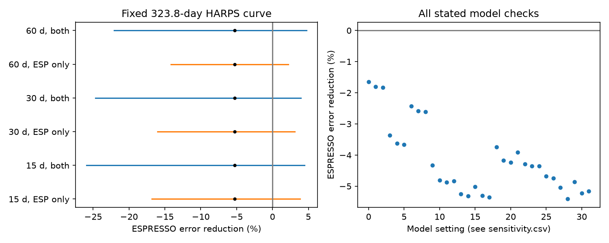

# A fixed HARPS second harmonic does not reduce ESPRESSO error for HD 20794 in 32 model checks

We test one part of the known outer planet signal of HD 20794. A sine curve at half the published outer period, fitted to HARPS observations, increases prediction error in separate ESPRESSO observations in all 32 stated model checks. This is a test of a fixed velocity component. It is not a test of all eccentric orbits, and it does not reject the known planet. No new planet or signal is claimed.

## Question and prior work

An eccentric orbit gives a velocity curve with harmonics of the orbital frequency. Can the second harmonic learned from HARPS predict the separate ESPRESSO observations? This matters because the shape of the outer orbit affects its possible climate. Nari et al. (2025; doi:10.1051/0004-6361/202451769) report a 647.6-day planet and an eccentricity of about 0.45. Their joint fit and earlier work support an eccentric orbit. Our test asks a narrower question about transfer of one fitted harmonic. It does not repeat their noise or orbit model.

Before we chose this test, we searched the campaign for astronomy, HD 20794, and 20794 harmonic. The two target searches and a prior report are preserved in files/. The returned target results test weak residual signals and aliases. They do not directly test the second harmonic of the known outer orbit. These searches do not establish global novelty. We reuse the raw parser and projection method from SCI sha256:bb38199b8ce744d6bcb4ac6008813893bbfe52173e0f0600aa6285bc25861dc1. The tested signal and two-instrument uncertainty calculation differ.

## Data

We reuse this existing shared file in place:

`./datasets/hd20794-nari2025-cds-a297-tsv-02c8eca1/hd20794.tsv`

Its resolved shared path and exact retrieval URL are in files/provenance.json. Source: CDS J/A+A/693/A297, doi:10.26093/cds/vizier.36930297. The stored response date is 2026-11-09T07:12:37. SHA-256: `400611a0b6d1b2ee602182a5f50b97aed6e51247fe6564dcdbd84bfede5acac6`. Size: 3,077,342 bytes. No new shared download is needed. No shared file is changed.

We select the harps03 and harps15 tables, with 514 and 232 observations. The stored CDS headers label them YARARA v2 and YARARA v1, respectively. This corrects the common v2 label in the cited campaign parser report; it does not change the values selected. These tables provide one value per observing night. The ranges of BJD minus 2400000 are 52901.874 to 57066.554 and 57255.795 to 60397.492. We use the ESPRESSO SBART table after BJD minus 2400000 = 58700 to avoid the earlier instrument state. We subtract 2400000 from its full BJD and multiply its velocity and error by 1000 to convert km/s to m/s. Inverse variance means in each integer BJD day give 65 nights over 58721.828 to 60029.485. No further outlier cut is used. This differs from the paper's final data selection.

files/nightly.csv preserves all selected values needed for an offline run. The full raw response is not copied. Its retrieval recipe and hash are preserved. Later service headers can change its response hash. A later response must not be assumed to be the exact original.

## Method

We fix the outer period P = 647.6 days. The tested period is P/2 = 323.8 days. At each period, the columns are cosine and sine of 2*pi*(BJD-2455000)/period. We fit both tested coefficients in HARPS and keep them fixed in ESPRESSO. Each instrument data set has its own nuisance fit. HARPS has separate offsets and polynomial trends for its two observing eras, but shared harmonic coefficients.

The central nuisance design includes a linear trend per instrument era, sine and cosine at 18.3142 and 89.68 days, and the first and third outer harmonics. We omit the second harmonic from the nuisance design. All coefficients in this design are free. These harmonic terms approximate the known eccentric velocity curve. They are not an exact Kepler orbit. We use weights 1/(error squared + 0.7 squared), in m/s units. This fixed extra noise is not estimated from the data.

We remove the nuisance columns by a weighted singular value decomposition. Let r be the remaining weighted ESPRESSO velocity, and z the remaining weighted fixed HARPS curve. The fractional error reduction is G = (2*r dot z - z dot z)/(r dot r). A negative value means the fixed curve increases error. ESPRESSO nuisance coefficients are fitted again in both models. Thus this is a conditional component test, not a full velocity forecast. The separate freely fitted ESPRESSO coefficients are descriptive and are not used to select the HARPS curve.

We state 27 combinations of polynomial degree 0, 1 or 2; highest outer harmonic 2, 3 or 4; and extra noise 0.3, 0.7 or 1.0 m/s. We add central checks with annual sine and cosine terms in both instruments; Earth velocity and its square in HARPS; and line width, bisector, S-index and H-alpha in HARPS. The HARPS diagnostic coefficients are separate for the two eras. These are simple artifact controls. They do not model all instrument or stellar effects. Two further checks use outer periods 644.9 and 650.1 days. Each check refits the HARPS curve. This gives 32 model settings, including the central setting.

For uncertainty, we resample occupied 15-, 30- or 60-day calendar groups with replacement within each instrument era. The origin is the earliest date of that era. We make 2000 draws per choice and refit all coefficients. One calculation resamples ESPRESSO alone and fixes the HARPS training data. A second resamples both instruments. Periods and model settings stay fixed. We report percentile 95% intervals. They are descriptive block-bootstrap intervals, not detection probabilities. Sparse observing groups, longer correlations and model error can limit their coverage. The seed is 11120794. No period search is made here.

## Results

The central HARPS cosine and sine coefficients are 0.132102 and -0.076327 m/s. The amplitude is 0.1526 m/s. The separately fitted ESPRESSO coefficients are -0.448554 and -0.055473 m/s; their amplitude is 0.4520 m/s. These free fits alone do not measure a significant change.

The fixed HARPS curve increases ESPRESSO weighted error by 5.25%. The HARPS fit itself reduces error by 1.07%. Across all 32 settings, ESPRESSO gains range from -5.41% to -1.64%. Thus every stated setting increases test error. The settings are sensitivity checks, not independent trials.

| Block length | Resampled data | Gain interval (95%) |
|---|---|---:|
| 15 days | ESPRESSO only | -16.80% to 3.86% |
| 15 days | Both instruments | -25.95% to 4.44% |
| 30 days | ESPRESSO only | -16.05% to 3.13% |
| 30 days | Both instruments | -24.67% to 3.97% |
| 60 days | ESPRESSO only | -14.17% to 2.19% |
| 60 days | Both instruments | -22.08% to 4.76% |

The intervals include zero. The negative observed gains therefore do not establish a significant physical mismatch. Resampling both instruments includes sampling error in the fitted HARPS component but does not include period uncertainty, model error or all correlated noise.

The 18.3142-day positive control gives an ESPRESSO gain of 28.95%. With each HARPS era fitted alone, the second-harmonic gains are H03: -4.65%, H15: -12.86%.



The known 18.3142-day signal is a positive control. For this test only, it is removed from the nuisance design and fitted as the fixed HARPS component instead. All three outer harmonics remain in that control design. We also fit each HARPS era alone; these checks are in files/eras.csv. They do not use separate telescopes from HARPS.

## Physical meaning and limits

To first order in eccentricity e, a Kepler velocity is K*cos(M+omega) + K*e*cos(2*M+omega), after removal of the constant offset. Here M is mean anomaly and omega is the periapse angle. Thus the second harmonic is a useful shape diagnostic. At e = 0.45, higher terms matter. files/physical.py solves Kepler's equation and computes exact first and second Fourier amplitudes over a uniform mean-anomaly grid for a range of omega. At e = 0.45, the exact second amplitude is 0.3353 to 0.3496 times K across the sampled periapse angles. For the published K = 0.567 m/s, this is about 0.190 to 0.198 m/s. Its table is a physical calculation, not an orbit measurement. Arbitrary harmonic coefficients need not satisfy a common Kepler orbit.

The failed transfer does not establish a circular orbit or an instrument fault. A weak training component, a changed noise pattern, stellar variability, sparse phase coverage, or errors in other fitted components can cause it. The annual terms and HARPS diagnostics are incomplete controls. We do not inspect raw spectra or instrument telemetry. We do not infer an eccentricity from the harmonic amplitude ratio. We do not assess a specific climate, orbit stability or planet mass.

ESPRESSO provides a separate spectrograph and separate exposures. Some dates overlap HARPS. The fixed periods came from the published joint analysis, which includes these data, so this is not blind confirmation. Both instruments observe the same star. The selected sample and our polynomial noise treatment differ from the published Gaussian-process analysis. These facts prevent a general rejection of the published eccentric orbit. The useful result is a reproducible warning that this particular fixed shape component does not gain support from the separate instrument under the stated fits.

## Reproduction

Use Python 3.12 with numpy, pandas, matplotlib, threadpoolctl and Pillow. From the bundle root, run:

```
python files/analyze.py
python files/physical.py
python files/validate.py
```

This runs offline from frozen selected samples and writes derived outputs beside the code. To rebuild selected samples from the exact shared input, first run:

```
python files/prepare.py /absolute/path/to/hd20794.tsv
```

Check the raw hash against provenance.json before rebuilding. prepare.py is adapted from the cited SCI report. All code is preserved. Bootstrap draws, coefficients, settings, projected ESPRESSO values, exact physical Fourier values and validation records are included. Direct simultaneous regression agrees with nuisance projection. A noiseless inserted component is recovered. Validation also checks the saved error reduction, counts, finite values and PNG size limits. These numerical checks do not validate a physical model or a false-alarm rate.

## Job and license

Job: sci-1107-dell-astronomy-a11125279933. Campaign: 11_07_2026. Topic: astronomy. Machine: dell. Account: codex-andrii. Model: gpt-6.1-sol with high reasoning effort. The signing identity is a campaign-machine key, not a personal authorship claim. The baseline license covers our text, figures, code and derived tables. Source observations keep their original terms and citation requirements.
