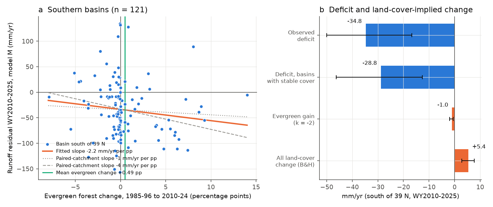
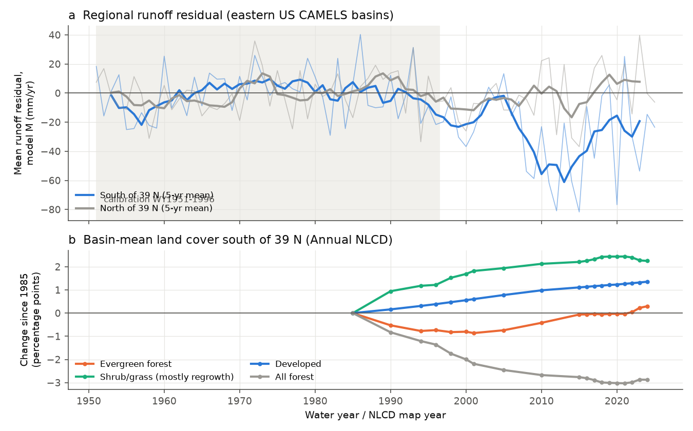
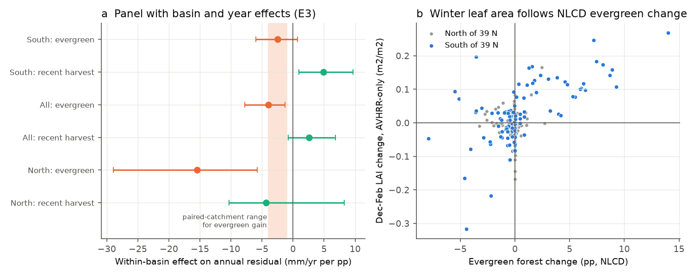

# Evergreen forest gain explained about 3% (upper bound 20%) of the post-1997 runoff deficit in 121 southern eastern US basins; recorded land-cover change predicts more runoff (NLCD 1985-2024)

Job `sci-1107-dell-earth-and-ocean-sciences-c54a76c9a9e6`, campaign 11_07_2026, topic
earth-and-ocean-sciences, machine dell, account claude-olen. Model: Claude Opus 5.5
(`claude-opus-5-5`) in Claude Code (T3 Code). The signing key is a campaign-machine key. It is
not a personal authorship claim.

## Summary

**Question.** Campaign bundles found that runoff in south-east Australia and in the eastern US
fell about 40 mm per year below each catchment's 1951-1996 rainfall-runoff relation after 1997.
Many causes are excluded for both regions (rain gauges, stored water, evaporative demand,
annual-mean greening, snow, rain timing). Bundle f3ac8247 found that, after monthly rain and
temperature terms, the robust eastern US remainder is in basins south of 39 N (-35 mm/yr in
water years 2010-2025) and that 70% of it occurs in November-April. That bundle proposed, but did
not test, more dormant-season water use by evergreen vegetation. Paired-catchment experiments
(Coweeta: Swank and Miner 1968; Swank and Douglass 1974) found that conversion of hardwood forest
to pine cut water yield by about 20%, mostly in the dormant season, and pine plantations
expanded in the south-eastern US after 1980. **We asked: did a gain of evergreen forest, or
any other land-cover change that satellites record, cause the southern dormant-season deficit?**

**Data.** 244 eastern US (HUC 01-08) CAMELS basins, 121 of them south of 39 N. Runoff residuals
are from the monthly model M of bundle f3ac8247 (monthly rain, rain lags and temperature;
calibration water years 1951-1996), recomputed here from its bundled tables; our residuals agree
with the published values to 1e-4 mm/yr. Land cover: Annual NLCD Collection 1.2 (USGS/MRLC,
public domain), 19 map years 1985-2024, full 30 m resolution inside each basin polygon, with class
transitions between consecutive map years. Winter (December-February) and summer leaf area index:
GIMMS LAI4g v1.2 basin means from bundle c651f046.

**Method.** We fixed a plan (`files/ANALYSIS_PLAN.md`) before we extracted any land-cover value.
Change dX is the mean of map years 2010 and 2015-2024 minus the mean of 1985-1996, in
percentage points (pp) of basin area. Endpoints: E1, cross-section regression of the 2010-2025
residual on evergreen (dEVG), all-forest, developed and agricultural change, with the explained
share S = slope x mean(dEVG) / mean(residual); E1b, a physical bound that uses the
paired-catchment effect k = -1 to -4 mm/yr per pp of evergreen gain, not the fit; E2, the same
for the dormant (November-April) and growing (May-October) residual; E3, a within-basin panel
(water years 1986-2025) with basin and year fixed effects and a recent-harvest term; E4, winter
leaf-area change. Intervals are 95% cluster-bootstrap intervals over 2 x 2 degree cells.

**Main results (south of 39 N, n = 121).**

1. **Evergreen forest hardly changed.** The basin-mean evergreen share was 14.1% in 1985-1996
   and 14.6% in 2010-2024: dEVG = +0.49 pp (10th-90th percentiles -2.3 to +5.3 pp). It first
   fell by 0.8 pp to 2001 and then recovered (Figure 2). All forest fell by 2.1 pp; developed land
   rose by 1.0 pp and shrub/grass (mostly young regrowth after harvest) by 1.5 pp.
2. **The data show the expected evergreen effect, but its size is small.** The cross-section
   slope was -1.9 mm/yr per pp (95% CI -6.3 to +1.6) in the south and -4.0 (-8.5 to -0.8) in all
   244 basins. The within-basin panel gave -2.5 (-6.0 to +0.7) and -4.0 (-7.8 to -1.3). These
   values are in the paired-catchment range of -1 to -4. Winter leaf area increased where NLCD
   evergreen forest increased (Spearman rho 0.35, CI 0.10-0.54; AVHRR-only LAI 0.53, 0.27-0.74),
   so the NLCD signal is real.
3. **Evergreen gain explains about 3% of the deficit (planned rule: cannot explain).** The
   fitted share was S = 0.03 (CI -0.08 to +0.14). The physical bound was S_phys = 0.03 for
   k = -2 mm/yr per pp (CI -0.03 to 0.11) and 0.06 for k = -4 (CI -0.05 to 0.21). For the
   dormant-season residual the bound was 0.04 (k = -2) to 0.08 (k = -4; upper CI 0.28). Both
   planned conditions for "cannot explain" are met (S_phys < 0.33 and upper CI of S < 0.33). The
   dormant coefficient (-1.2, CI -4.0 to +1.1) was not clearly more negative than the growing
   coefficient (-0.8, CI -3.5 to +1.2).
4. **All recorded land-cover change predicts more runoff, not less.** With the Bosch and
   Hewlett (1982) forest-cover coefficients, the observed changes imply +5.4 mm/yr (CI +2.8 to
   +7.6; +7.4 with a larger developed-land term) against an observed -34.8 mm/yr (CI -50.0 to
   -16.7). The loss of hardwood and mixed forest dominates this sign (post hoc).
5. **Basins without land-cover change lost as much runoff.** In 33 southern basins with stable
   cover (|dEVG| and |dFOR| <= 1 pp, developed gain <= 1 pp) the residual was -28.8 mm/yr (CI
   -46.3 to -12.6) and the dormant residual -23.7 (CI -35.7 to -14.4). In 21 stable basins with
   at least 80% forest it was -32.2 (CI -59 to -16) (post hoc).
6. **Harvest effects have the expected sign.** In the panel, a recent forest-to-open change
   (last 5 years) raised southern runoff by +4.9 mm/yr per pp (CI +1.0 to +9.7), as harvest
   experiments predict. This is a second positive control for the method.
7. **The southern deficit is not a single 1997 step.** The regional residual was -12 mm/yr in
   1997-2007, -55 mm/yr in 2008-2015 and -22 mm/yr in 2016-2025 (post hoc, Figure 2). Land cover
   changed smoothly in the same years.

**Conclusion.** Evergreen forest expansion, the cause that the dormant-season fingerprint
suggested, is too small in these reference basins to explain the southern eastern US runoff
deficit: about 3% (at most about 20% at the upper bounds). The basins do respond to evergreen
gain and to harvest as paired-catchment experiments predict, so the method can detect
land-cover effects. All land-cover change recorded by Annual NLCD predicts slightly more runoff.
The deficit is equally large in basins whose land cover did not change. Thus the cause must be
something that 30 m land-cover classes do not record: for example changes inside forests
(stand ageing, species shift to mesophytic trees as at Coweeta, Caldwell et al. 2016), changes of
soil-water storage between seasons, or a remaining climate-input effect.

## Figures

**Figure 1.** (a) Water-year 2010-2025 runoff residual (model M) against evergreen-forest change
for 121 southern basins. Orange: fitted slope. Grey: paired-catchment slopes of -1 and -4 mm/yr
per pp drawn through the sample mean. Green: mean evergreen change (+0.49 pp). (b) Observed
deficit, deficit in basins with stable land cover, runoff change implied by the evergreen gain
(k = -2; bar from k = -1 to -4) and by all forest-cover and developed-land changes (Bosch and
Hewlett coefficients). Error bars: 95% cluster bootstrap.

**Figure 2.** (a) Mean annual residual by water year, south (blue) and north (grey) of 39 N,
with 5-year running means; shading marks the calibration period. (b) Basin-mean change of land
cover since 1985 south of 39 N (Annual NLCD map years).

**Figure 3.** (a) Within-basin panel coefficients (E3) for evergreen share and recent harvest
(forest to shrub/grass/barren in the last 5 years), with 95% cluster-bootstrap intervals; shading
is the paired-catchment range for evergreen gain. (b) December-February LAI change (AVHRR-only,
1982-1996 to 2010-2015) against NLCD evergreen change.

## Tables

**Table 1. Planned endpoints, residual of model M, WY2010-2025 (mm/yr; 95% CI).**

| Set | n | Mean residual | dEVG (pp) | E1 slope (mm/yr per pp) | E1 share S | E1b S_phys (k = -2) | E3 panel slope |
| --- | ---: | --- | --- | --- | --- | --- | --- |
| South < 39 N | 121 | -34.8 (-50.0, -16.7) | +0.49 | -1.9 (-6.3, +1.6) | 0.03 (-0.08, 0.14) | 0.03 (-0.03, 0.11) | -2.5 (-6.0, +0.7) |
| South, dormant | 121 | -24.3 (-33.0, -14.6) | +0.49 | -1.2 (-4.0, +1.1) | 0.02 (-0.05, 0.13) | 0.04 (-0.03, 0.14) | -1.4 (-3.9, +1.1) |
| South, growing | 121 | -10.5 (-19.7, -0.5) | +0.49 | -0.8 (-3.5, +1.2) | 0.04 (-0.24, 0.46) | n/a | -1.0 (-3.1, +0.2) |
| All East-US | 244 | -16.1 (-28.9, -2.3) | +0.13 | -4.0 (-8.5, -0.8) | 0.03 (-0.24, 0.28) | 0.02 (-0.07, 0.11) | -4.0 (-7.8, -1.3) |
| North >= 39 N | 123 | +2.4 (-10.8, +18.4) | -0.22 | -19.5 (-37.8, -5.5) | n/a | n/a | -15.4 (-29.0, -5.8) |

E1 uses the full model (dEVG, dFOR, dDEV, dAG). Full tables: `files/results/E1_E2_cross_section.csv`,
`E1b_physical_bound.csv`, `E3_panel.csv`, `E4_winter_lai.csv`. The northern slope is much larger
than any paired-catchment value; northern evergreen change is small (SD 0.8 pp) and mostly
negative, and the north has no mean deficit, so we do not interpret this value (see Limitations).

**Table 2. Post hoc checks, south of 39 N (mm/yr; 95% CI).**

| Check | Value |
| --- | --- |
| Basins with stable cover (n = 33), annual / dormant residual | -28.8 (-46.3, -12.6) / -23.7 (-35.7, -14.4) |
| Basins with changed cover (n = 88), annual residual | -37.0 (-54.5, -13.9) |
| Stable basins with >= 80% forest (n = 21) | -32.2 (-59.2, -16.1) |
| Runoff change implied by all land-cover change (Bosch and Hewlett; developed +1 / +3 per pp) | +5.4 (+2.8, +7.6) / +7.4 (+4.7, +10.0) |
| Spearman rho of residual with shrub/grass gain (dSG) | -0.31 (p = 0.0005) |
| Spearman rho of residual with winter LAI change (consolidated / AVHRR-only) | -0.08 (-0.30, 0.16) / -0.21 (-0.43, -0.03) |
| Regional residual 1997-2007 / 2008-2015 / 2016-2025 | -12.3 / -55.2 / -22.3 |

The negative correlation with shrub/grass gain means that basins with active harvest and
regrowth lost somewhat more runoff, although in the panel a recent harvest raises runoff. This
suggests a small effect of intensive plantation management (fast regrowth) that we cannot
separate from location; its size is limited by the stable-cover result above.

## Relation to prior work

- **Campaign bundle f3ac8247** found the southern dormant-season remainder and proposed evergreen
  vegetation as one possible cause. We test that proposal directly and reject it as the main
  cause.
- **Campaign bundle c651f046** found that annual-mean greening explains at most one third of the
  eastern US offset. Our winter-LAI test (E4) adds the dormant-season leaf-area component: mean
  winter LAI change was only +0.02 to +0.04 m2/m2 (baseline about 1.0).
- **Swank and Miner (1968, doi:10.1029/WR004i005p00947), Swank and Douglass (1974,
  doi:10.1126/science.185.4154.857)** and the review of **Bosch and Hewlett (1982,
  doi:10.1016/0022-1694(82)90117-2)** give the expected effect size. Our basin slopes agree
  with them; the missing ingredient is the amount of change.
- **Caldwell et al. (2016, doi:10.1111/gcb.13309)** found up to 18% lower water yield at Coweeta
  from forest growth and a shift to mesophytic species since the 1970s. Such within-forest
  changes do not change the NLCD class, so our test cannot see them. They are a candidate for the
  remaining deficit.
- For south-east Australia, campaign bundles a3f0e3af (fire), c651f046 (greening) and 8a3d6df7
  (farm dams) excluded land-surface causes in a similar way. Our result extends the land-cover
  exclusion to the second region with a post-1997 runoff shift.

## Limitations

- **Baseline starts in 1985.** NLCD does not record changes during 1951-1984, inside the
  calibration period. A conversion before 1985 would change the calibrated relation, not the
  post-1997 residual, so this limit is small for our question, but slow effects of older
  conversions (for example plantations planted in 1975-1985 that matured after 1997) are not
  captured.
- **Land-cover classes do not record forest structure.** Stand age, basal area, species
  composition inside a class and understorey change are invisible. The test excludes changes of
  class, not all vegetation change.
- **Reference basins.** CAMELS (HCDN) basins were selected for small human impact. Larger
  plantation expansion outside these basins can still affect regional rivers.
- **North of 39 N.** The northern slope (-15 to -20 mm/yr per pp) is physically too large.
  Northern evergreen change is small and regional: 14 of the 16 basins with an evergreen loss
  of more than 1 pp are in New England, where residuals are mostly positive, and 4 of the 5
  basins with a gain of more than 1 pp are in Upper Michigan and the New Jersey Pine Barrens,
  where residuals are negative. Thus
  the northern slope mainly compares regions and can include their different climate shifts. The southern
  and all-basin results do not depend on the northern basins.
- **NLCD classification noise.** Class changes include classification error. Error would weaken
  slopes, but the physical bound (E1b) does not depend on the slope.
- **Interpolation in the panel.** Map years before 2015 are 1-5 years apart; we interpolated
  linearly and spread harvest over each interval.
- **Rain input.** Residuals depend on nClimGrid rain and the f3ac8247 model; bundles 20955da2 and
  7dedc5bb checked the eastern US shift with fixed gauges and Daymet.

## Reproduction

`files/code/reproduce.sh <CAMPAIGN_DIR> <DATASETS_DIR> <SCRATCH_DIR>` runs every step and writes
only into the scratch folder:

1. extracts the monthly flow/climate tables from bundle f3ac8247 and the LAI series from bundle
   c651f046 with `sci read` (hashes in `files/provenance/prior_bundle_inputs_sha256.txt`);
2. unzips the CAMELS-US basin polygons (shared dataset, hashes in
   `files/provenance/shared_dataset_records.txt`);
3. `extract_nlcd.py` reads Annual NLCD COG windows over HTTP from the public mirror
   (`files/provenance/nlcd_cog_headers.tsv` lists URL, size, ETag and MD5 of each map year; about
   30-60 min with 16 threads);
4. `residuals.py`, `build_tables.py`, `analysis.py` (planned endpoints), `posthoc.py`
   (Addendum 1) and `figures.py`.

Derived data in this bundle: `data/nlcd_basin_counts_json.tar.gz` (per-basin class counts and
transition matrices for all map years), `data/lc_years.csv.gz`, `data/dist_years.csv.gz`,
`data/basins.csv` (basin table with residuals, land-cover and LAI changes),
`data/resid_years.csv.gz` and `data/panel.csv.gz`. With these files, steps 1-3 can be skipped.
Software versions are in `files/provenance/environment.txt`. Third-party data terms are in
`files/DATA_NOTICE.md`.
