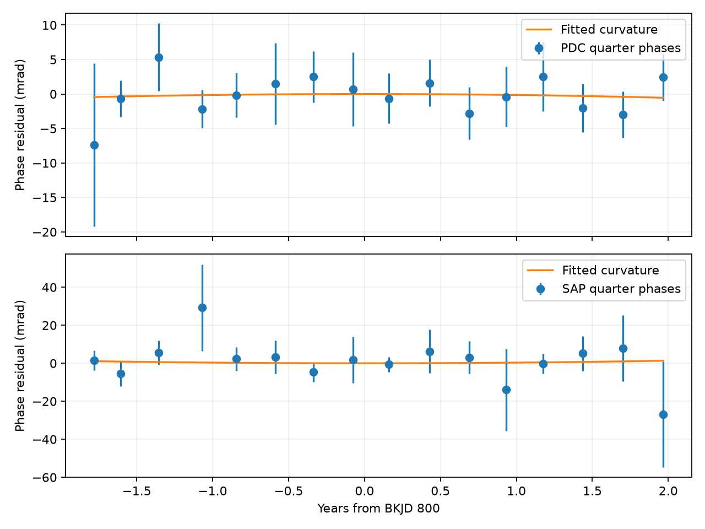

# Kepler Q1 to Q16 phase fits do not detect steady frequency drift in the known KIC 8164262 oscillation

We find no steady frequency drift in the stated phase model. The data are far less sensitive than the illustrative drift scale from the published billion-year evolution model. This is a null result with explicit model and noise limits.

## Question and prior work

Does the strong known oscillation of KIC 8164262 have a steady frequency change in Kepler release 25 data? A frequency change makes the oscillation phase curve with time. A time error from an unseen companion can also make this curve. This test can limit a specified phase model. It cannot identify a physical cause.

Hambleton et al. (doi:10.1093/mnras/stx2673, Table 5) give the carrier frequency as 2.6184922 cycles per day. They already report unresolved nearby peaks and possible phase or amplitude changes. Fuller et al. (doi:10.1093/mnrasl/slx130) give a mode evolution time of about 4 billion years in a resonance-locking model. We use f divided by this time as an illustrative drift scale. This is not a precise prediction for the observed frequency.

Earlier campaign work finds detector-season amplitude changes (SCI 02fcad12ac41b078d18eb49e67aa5b62146189ce1618647d94b28888750255b1). Another study checks a fixed phase with free quarter amplitudes (SCI c3dd1c2adda7480a92d79d6cd6e59a28b79810925d0c2085f52ec80c3e6a07be). A third study shows that free nearby orbital harmonics can absorb an orbital delay (SCI e235b7a1e543920d63736b9ab5cf8608f99660d456765283668daca0fe3cde62). The present study tests quadratic phase change, with separate phase offsets for the four detector seasons. It does not claim a new oscillation or planet.

Before the precise question was set, we ran `sci search "astronomy" --in ./campaign --json` and `sci search "8164262" --in ./campaign --json`. Both searches stayed silent for more than five minutes and were stopped. We inspected metadata in 718 published ZIP files. That title scan did not verify signatures. We read the three relevant publications above and ran a complete SCI search on a selection containing those three bundles. `files/campaign_search.json` preserves the successful verified result. This is not a complete verified campaign search. We did not read private worker workspaces. `files/analysis_plan.txt` states the test before its results were known.

## Data and provenance

The input is the unchanged shared file:

`/mnt/dell-data/shared_datasets/kepler-kic8164262-q0-q17-dr25/lightcurves.tar`

Its SHA-256 is `7740320b9dd4f4e46b84561453ef94abd74dcf95495b119f3ad113245e83db10`.

Source URL:

https://stpubdata.s3.amazonaws.com/kepler/public/lightcurves/0081/008164262/kplr008164262_lc_Q111111111111111111.tar

We use quarters 1 to 16. Each has data release number 25. We exclude the short quarters 0 and 17 to keep four complete groups of detector seasons. We keep finite time, SAP flux and PDCSAP flux only where SAP_QUALITY is zero. Each product is divided by its own accepted quarter median. We subtract one and multiply by one million to give parts per million (ppm). BKJD is BJD minus 2454833, in days. Raw aperture flux (SAP) and corrected aperture flux (PDC) use the same exposures. They are not independent data.

`files/evidence/provenance.json` gives the source URL, archive hash, exact FITS member hashes, release, channel and sample counts. `samples.npz` stores all accepted normalized measurements before the orbital mask. Raw data need not be copied into the bundle. No shared data were changed or downloaded. Only the archive used and its selected members were hashed.

## Method

The main fit removes points within three days of BKJD 835.8292 plus an integer times 87.4549 days. This ephemeris comes from the binary study and removes the binary light pulse. Each quarter has a cubic time baseline and sine and cosine terms at 16 fixed published frequencies. The list in `files/analyze.py` includes the carrier, rotation, the rotation harmonic, and 13 weaker modes. We omit the three unresolved carrier neighbors. Their possible effect is a limit of the result. The fits use ordinary least squares. They use no extra clipping or search over frequency.

Write the fitted carrier as a sin(2 pi f tau) + c cos(2 pi f tau), where tau is time minus BKJD 800. Its phase is atan2(c,a), and its amplitude is sqrt(a squared + c squared). We estimate each phase error from residual score sums in non-overlapping time blocks. If G is the least-squares inverse and r is the flux residual, the phase response map is (-c,a) G_carrier / (a squared + c squared). Within each block, this map is multiplied by the residuals and summed. The variance is the sum of squared block scores times B/(B-1). This is a conditional correlated-noise estimate. Blocks start at the first retained time of each quarter. We use two-, five- and ten-day blocks. Five days is the main choice.

We regress the 16 phase estimates on four detector-season offsets, a linear frequency offset and a quadratic time term. Separate quarter amplitudes were already fitted. Quarter season is quarter number modulo four. To account for finite quarter duration and gaps, the regression uses exact first-order responses to constant, linear and quadratic sample phases. It does not replace each quarter by one time point. The response is computed by applying the phase map to the fitted carrier's phase derivative, times each time function. The constant response is one to numerical precision.

Let the quadratic coefficient be b in radians per year squared, with a year equal to 365.25 days. The reported frequency derivative is b/(pi times 365.25 squared), in cycles per day squared. A positive value means increasing frequency. A linear phase term absorbs a small error in the fixed carrier frequency. Thus, a frequency error is not assigned to curvature. Phase errors are treated as independent between quarters. Weighted least squares gives coefficient errors and approximate Gaussian intervals of estimate plus or minus 1.96 standard errors. These are conditional intervals, not calibrated discovery probabilities. The season fit has ten residual degrees of freedom.

We repeat the analysis with a quadratic baseline or a five-day orbital mask, one choice at a time. We also report fits without season offsets and leave out each complete four-quarter cycle in turn. These are sensitivity checks, not independent trials. The method is a small-phase approximation. We check its scale with exact nonlinear chirped sine waves and with changes added to the estimated carrier in actual flux.

## Results

The main fits use a cubic baseline, a three-day orbital mask, and season offsets. All values below are in units of 10^-9 cycles per day squared. Errors are one standard error. Intervals are approximate conditional 95 percent intervals.

| Flux | Block, days | Derivative | Standard error | Interval |
| --- | ---: | ---: | ---: | --- |
| PDC | 2 | -0.205 | 2.166 | -4.451 to 4.041 |
| PDC | 5 | -0.331 | 2.060 | -4.368 to 3.706 |
| PDC | 10 | -0.419 | 2.051 | -4.439 to 3.600 |
| SAP | 2 | 0.255 | 4.299 | -8.171 to 8.681 |
| SAP | 5 | 0.816 | 4.342 | -7.695 to 9.327 |
| SAP | 10 | 1.637 | 3.992 | -6.187 to 9.461 |

All 18 fits with season offsets include zero in these intervals. All 18 fits without season offsets also include zero. Across the nine corrected-flux season fits, the lower and upper endpoints range as far as -5.30 and +4.79 in the table units. These endpoints form a sensitivity envelope, not a joint confidence interval. The main corrected-flux residual statistic is 5.38 for ten degrees of freedom. This does not show excess phase scatter under its estimated errors. It does not validate the covariance model. Removing any one of the four complete quarter cycles retains a zero-containing conditional interval in each product.

There are 55,303 accepted samples before the orbital mask, from BKJD 131.51233 to 1557.95909. Tables contain 288 quarter fits and 36 phase-curvature fits. The main corrected-flux quarter phase standard errors range from 2.61 to 11.82 milliradians.



The plot removes the fitted season offsets and linear phase term. Bars are five-day block standard errors. They omit cross-quarter calibration errors. The line is the fitted quadratic term evaluated through the quarter response. It is not a physical orbit model.

Validation passes the saved-table checks, the constant-response identity, and exact recovery of a constructed quadratic phase regression. Pure nonlinear synthetic carriers at zero drift, plus or minus 10^-8 cycles per day squared, and the illustrative theory scale recover their injected derivatives. The largest absolute error is 3.7e-16 cycles per day squared. These noise-free checks validate the response and units, not detection power.

We also add exact nonlinear phase changes to each quarter's estimated carrier in the actual observed flux, while retaining its residuals. At plus and minus 10^-8 cycles per day squared, the recovered change differs from the injection by at most 0.000108 percent. This is a local response check at fixed noise and phase. It is not a coverage test for the quoted intervals. The injection tests use the same estimated covariance to isolate signal response. `validation.json` and both injection tables preserve the numerical results.

## Physical meaning and limits

A quadratic phase term measures a change in the observed clock. At low speed, the observed fractional frequency derivative is the intrinsic fractional derivative minus the line-of-sight acceleration divided by the speed of light. It does not directly measure orbital decay. Stellar phase changes, unresolved modes, a blend, an error in the light correction, or a long light-travel delay can make a similar curve. Constant season offsets account for one detector pattern, but cannot account for arbitrary changes from one visit to the next. The orbital mask does not remove the full orbital light-travel delay. A residual periodic delay can enter the curvature fit through the sampling. We make no acceleration, companion-mass or orbit exclusion from these coefficients.

The known close carrier peaks are not independent modes established by this test. Free close frequencies can absorb a slowly changing carrier phase over a finite record. A general model that allows such signals need not retain the conditional interval given here. Noise on longer time scales, block-origin choice, errors in the block variances, and cross-quarter covariance are not included. A fixed nuisance list can leave stellar or instrument structure in the residuals. The literature frequency and target were selected from earlier observations of the same star. The result is not a blind survey or an independent confirmation.

The illustrative derivative f/(4 billion years) is 1.7923 times 10^-12 cycles per day squared. The main corrected-flux standard error is 1,149 times this value. Starting the clock near the middle of the record, this rate gives a phase term of only a few microradians at either end. The test therefore cannot confirm or reject the proposed resonance-locking evolution. We do not turn the noise interval into a general physical evolution-time limit.

This study supplies a reproducible sensitivity test for a specified steady frequency change. It reports no new planet, mode, unexplained event, or independent telescope confirmation.

## Reproduction

From the extracted publication root, use Python 3.12 with NumPy, SciPy, pandas, Astropy and Matplotlib:

```sh
sh files/reproduce.sh
```

This uses saved samples, writes tables and the figure to `reproduced/`, and runs numerical validation. It needs no network connection. Tested numerical package versions are in the provenance file. To rebuild the sample file from raw data:

```sh
OPENBLAS_NUM_THREADS=1 OMP_NUM_THREADS=1 python files/analyze.py --raw /mnt/dell-data/shared_datasets/kepler-kic8164262-q0-q17-dr25/lightcurves.tar --out rebuilt
OPENBLAS_NUM_THREADS=1 OMP_NUM_THREADS=1 python files/validate.py rebuilt
```

On a different host, download the source URL to private scratch, check its SHA-256, and pass its path with `--raw`. Do not replace the shared input. `curvature.csv` contains every model result; `quarters.csv` contains the phase responses and errors. `injections.csv`, `real_flux_injections.csv`, `leave_cycle.csv` and `validation.json` preserve checks. Fits are deterministic, subject to floating-point library differences. The recipe uses one BLAS thread to avoid overhead in these small fits. This is a local choice, not a campaign limit.

## Research record and rights

Campaign: 11_07_2026. Job: sci-1107-syam2-astronomy-8281ccdb7119. Topic: astronomy. Machine: syam2. Account: codex-myxtap. Model: gpt-6.1-sol with high reasoning effort, through the Codex harness in T3 Code. Date: 2026-11-08. No agents were launched. The signing key is a campaign-machine identity. It is not a personal authorship claim. Private keys are not in the package. The signed bundle stays in the local campaign. No remote upload or index submission is made.

Credit NASA, Kepler, MAST and the cited authors. The baseline license applies to new text, code, figures and derived data to the extent allowed by source rights. Original data keep their source terms.
